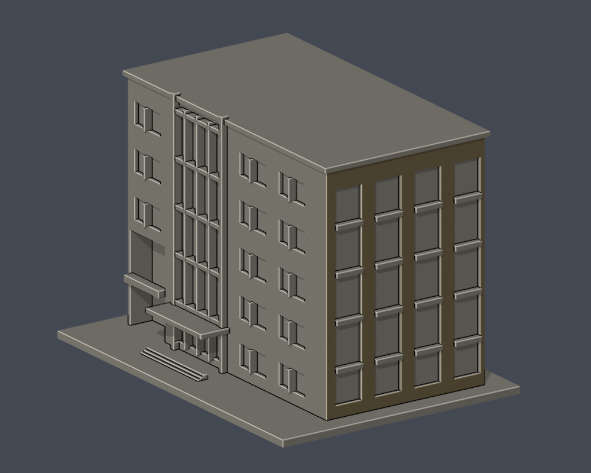
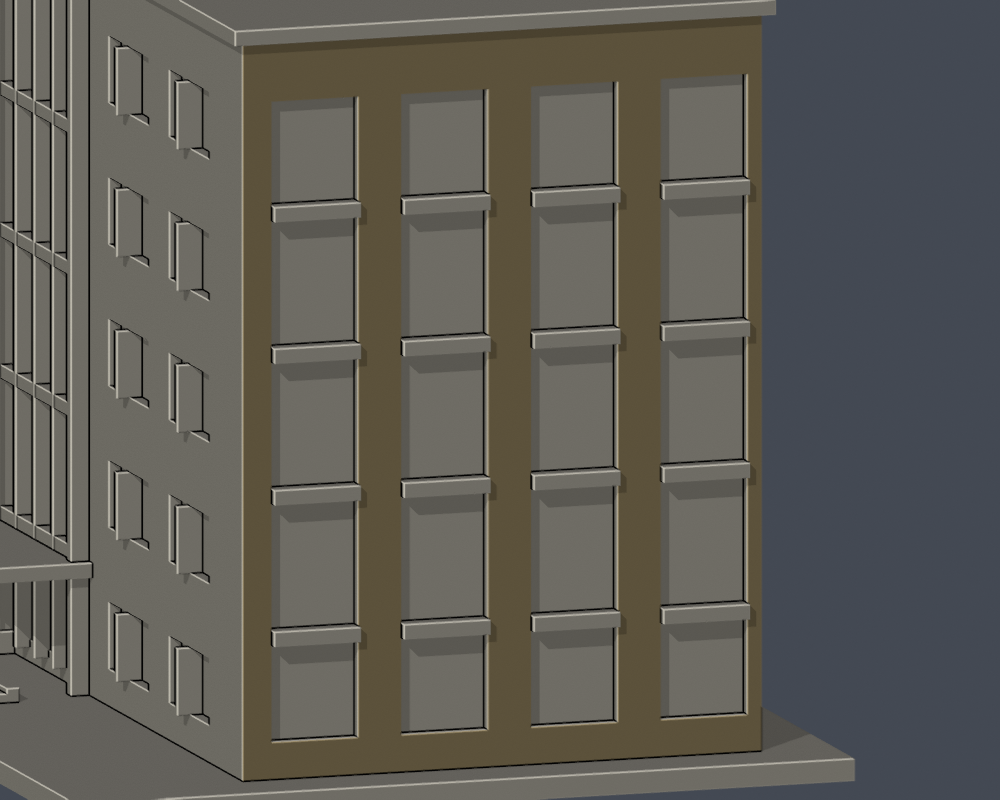

# 萬能科技大學管理大樓（G）

**本次只補右側主牆，非全棟彩色。** 所有 1,714 個原三角與原 STL 不變。模型右側主牆 90 面使用未校準的砂米色代理 `#B5A075`，其餘 1,624 面維持原暖中性展示色。

[原 STL（無色）](model.stl) · [新版逐面材色 3MF](side-color-20261120/model-colored.3mf) · [新版 Blender 場景](side-color-20261120/scene.blend)

## 模型預覽

| 模型預覽 | 模型預覽 | 模型預覽 |
| :---: | :---: | :---: |
|  補色後右側總覽 |  補色後右側細節 |  |

## 補色前後對照

| 補色前 | 補色後 |
| :---: | :---: |
| [補色前右側總覽](side-color-20261120/before-right-overview.png) | [補色後右側總覽](side-color-20261120/after-right-overview.png) |
| 同角度原中性版，含完整底座。 | 同角度右側補色版，正面、屋頂、底座未改。 |
| [補色前右側細節](side-color-20261120/before-right-wall-detail.png) | [補色後右側細節](side-color-20261120/after-right-wall-detail.png) |
| 局部裁切，顯示原四列凹槽。 | 僅原牆面砂米色；四列凹槽內面及凸出橫檻保持中性。 |

### 原代表圖（保留中性版本）

| 正面 | 背面 | 立面 |
| :---: | :---: | :---: |
| [原正面](previews/front.png) | [原背面](previews/rear.png) | [原立面](previews/elevation.png) |
| 原正面角度 | 未見處保留原簡化 | 原立面角度 |

## 本次上色範圍與限制

- [校方原照](https://www.vnu.edu.tw/images/campus/map23.png) 僅 190×143 像素。右側雖在陰影中，仍可辨窗間砂米牆的色族，並以轉角的受光長面作參照；無精密色票，無法確認確切材料或拍攝日期，非 2026 年現況紀錄。
- 只改模型外向 +X 的整個原共面牆域（x=66 mm，y=-28～44 mm，實際 z=3～102 mm），扣除四個原凹槽開口後為 3,000 mm²。模型四列為連續沉槽，並非實拍各扇窗的一一對應。不補凹槽背面、揭面、玻璃代理、凸出橫檻，未見背側不延伸。
- 保留原 STL、原 Blender 場景及三張代表圖；新 Blender/3MF 與對照圖另放子目錄，不覆寫原圖。來源照片不隨包、不作紋理。
- 根目錄 [hash-manifest.json](hash-manifest.json) 核對既有包檔案與本 README，新版子目錄的 [SHA256SUMS](side-color-20261120/SHA256SUMS) 核對新版交付。另見 [色域](side-color-20261120/domain.json)、[場景與交換驗證](side-color-20261120/verification.json)、[完整幾何驗證](side-color-20261120/whole-geometry-QA.json) 與 [重建／視覺核對](side-color-20261120/reproduction-QA.json)。
- 根目錄可執行 `python side-color-20261120/rebuild_exchange.py` 重建 3MF；`blender -b scene.blend -t 2 -P side-color-20261120/apply_side_color.py -- --qa-renders` 重建新版場景及對照圖。原場景的未指派材質 `Material` 在新版僅啟用保留旗標，沒有指派至新面；相機、燈光、世界與原材保留。原薄特徵限制仍適用，未實體列印或正式切片。

## 證據及近似
- 五層水平窗排、偏左中央玻璃直向區
- 左下跨兩層深凹入口與可見水平梁
- 右側凹窗豎向分格
- 平屋頂、長方量體與低入口雨庇

v2保留左下兩層深凹口與橫梁；凹深依照片近似。右側立面在實拍可見，依其凹窗節奏建模；入口雨庇尺寸近似，後側無清楚影像，未虛構背窗。 官方實拍只有190×143像素，沒有放大新增細節；細窗、柱、深度及間距均為視覺近似，不能作精確復原。現行總務處校圖仍標此館，未取得照片拍攝年代。側後遮擋明示簡化。省略招牌文字、空調、植栽、細欄杆。

## 比例與重建
- 含底板尺寸：150.00 × 108.00 × 105.00 mm，單件最長150mm，各件獨立比例。
- 安裝 requirements.txt；執行 python build_model.py 重建STL，再用 blender -b -t 2 -P render_preview.py 產生可編輯完整網格scene.blend與實際STL圖。
- 執行 validate_model.py、check_layers.py、check_thin_features.py 複核。

## 原幾何檢查及列印限制
- 原STL法向/邊與頂點流形、正體積、單一連通外表面、無分離內腔殼、重建SHA與Blend/STL三角幾何一致：全部通過。
- 0.2mm間距非共面微偏移截面525層，每個閉環及組合Polygon有效性assert全通過，未自動修補無效形狀。
- 0.8mm XY開運算（1mm抽樣）1層超過1%面積損失，最大2.30%。最高層105mm前兩根附牆豎框高於屋簷約1mm，2×3mm實心端部之角隅開運算損失；非0.8mm以下孤立柱，保留粗框。
- 窗頂、拱口、柱廊、雨庇可能需支撐；此篩查不是完整壁厚測量、正式切片或實體試印，支撐不能補救噴嘴解析度。請在切片器複查材料、橋接及支撐可移除性。

## 公開來源
- https://www.vnu.edu.tw/campus
- https://www.vnu.edu.tw/images/campus/map23.png
- https://www.vnu.edu.tw/school_tour.html
- https://administration.vnu.edu.tw/oga/3130
- https://resource.vnu.edu.tw/images/webmap/webmap.jpg

第三方照片及校圖不隨公開模型包重製。
