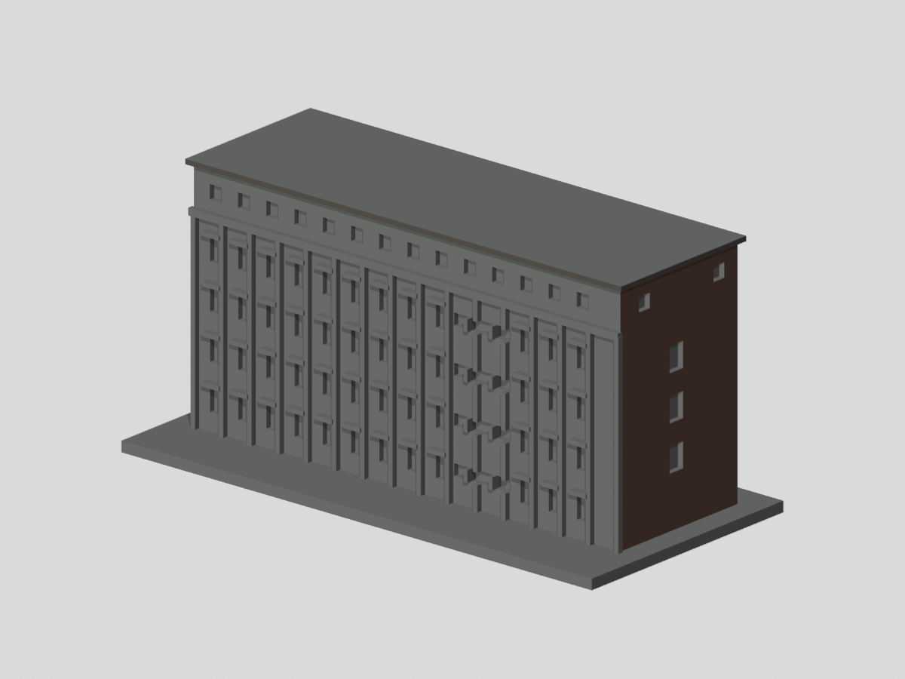
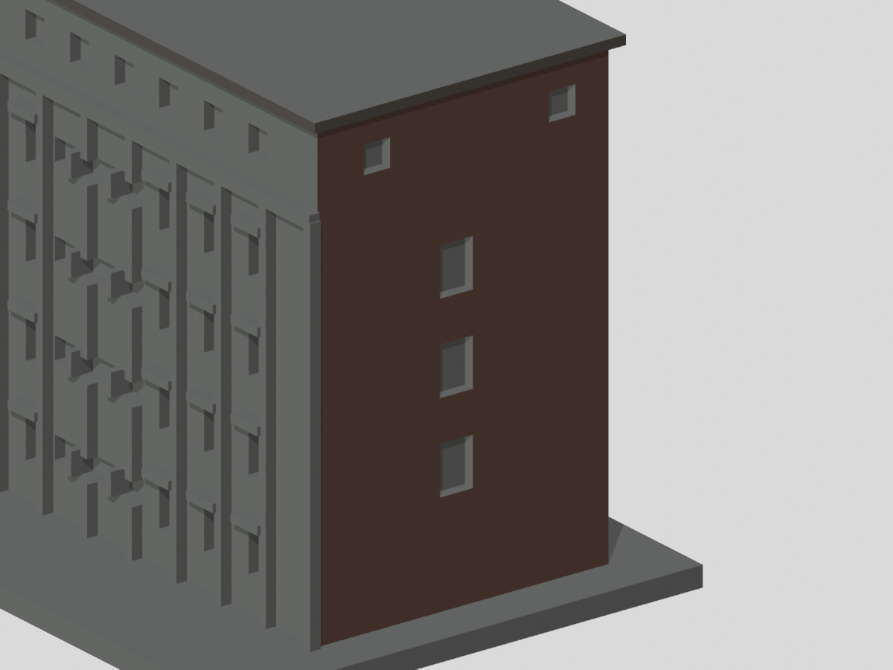

# 萬能科技大學仁愛樓 RHB｜右端牆與屋帽局部補色

**仍為局部分色，非全棟彩色。** 同一建築、套件數不變。保留原屋帽前沿與右端 4 面灰棕；新增右端主牆 34 面近似陶紅，其餘 2,902 面仍用原中性展示色。原 2,940 三角、STL、底座與比例不變。

[原 STL（無色）](model.stl) · [新版逐面材色 3MF](side-color-20261120/appearance.3mf) · [新版 Blender 場景](side-color-20261120/scene.blend)

## 模型預覽

| 模型預覽 | 模型預覽 | 模型預覽 |
| :---: | :---: | :---: |
|  右端牆補色總覽 |  右端牆近照（局部裁切） | |

圖片為同一最新版局部補色模型。總覽包含屋帽與底座；近照中的五個窗凹仍為中性，右端屋帽保留原灰棕。可點擊圖片查看原尺寸 PNG。舊屋帽版圖片不再混在本頁展示；[歷史屋帽版代表圖與各角度](https://github.com/hplin50643/taiwan-buildings-3d/blob/fad825f2235f4d9df20eba6a025bfc1ef2fceab3/%E8%90%AC%E8%83%BD%E7%A7%91%E6%8A%80%E5%A4%A7%E5%AD%B8/%E6%A0%A1%E6%9C%AC%E9%83%A8/buildings/vnu-renai-rhb/README.md)仍可查閱。

### 實際改色範圍與限制

- 只換模型 `x=+68 mm`、朝外 +X 的一個完整原牆面，共 34 三角、2,855 mm²，`y=-17…27 mm`、實際 `z=3…71 mm`。條件下界 2.8 mm，但 2.8–3 mm 被原底座遮住。五處窗洞及窗凹內面不改。新增色是未校準名義陶紅 `#A77C6C`。
- 校方外觀照的右端露牆可辨陶紅族；看板及樹木後方是同一連續牆面的推估，不是逐點實見。照片拍攝日未知，不代表 2026 現況；不散布原照、不貼圖、不補看板、文字或遮擋細節。
- 原簡化網格沒有可獨立分色的真實細橫帶，34 面仍是單一牆色代理。前柱、窗框、窗背、薄凸飾條、底座、屋頂上下皮、左端與後面不延伸上色。
- 3MF／Blender 材色可修改。示意比例為原 150 mm 底座設定，沒有實測建物色票，也未實際切片或試印。上方兩張展示圖均由現行補色版產生；歷史代表圖原檔不變。
- Blender 保留原本隱藏於渲染的歷史註記與背板；它們不是列印物件，不出現在新補色圖或 3MF。

### 可重建與校驗

1. 用既有屋帽版檔案作底稿：`python side-color-20261120/rebuild_exchange.py . side-color-20261120`。
2. 從既有屋帽版 Blender 場景套用新版面材：`blender -b scene.blend --python side-color-20261120/apply_side_color.py -- side-color-20261120/scene.blend`。
3. 根目錄用 `sha256sum -c SHA256SUMS` 驗本版；子目錄有自身 [校驗和](side-color-20261120/SHA256SUMS)、[色域](side-color-20261120/domain.json)、[3MF QA](side-color-20261120/exchange-QA.json) 與 [獨立驗證](side-color-20261120/independent-QA.json)。全場景快照檢查排除 Blender 的 UV Sculpt 及執行期欄位，並非逐位元相同。
4. 根目錄 [屋帽版 3MF](appearance.3mf)、[屋帽版 Blender](scene.blend) 和原重建腳本保存。`FREEZE-MANIFEST.json` 記錄既有屋帽版歷史；`hash-manifest.json` 為更早的單色歷史清單。兩份皆不是本版校驗入口。

**English scope:** Partial color only. Four original roof-cap faces keep gray-brown; 34 original right-wall triangles get nominal uncalibrated terracotta, with 2,902 faces retaining the original neutral preview material. The source photograph does not establish current appearance or hidden finishes. Geometry is unchanged. The gallery shows the current partial-color model; historical preview files are retained. No printing test.
