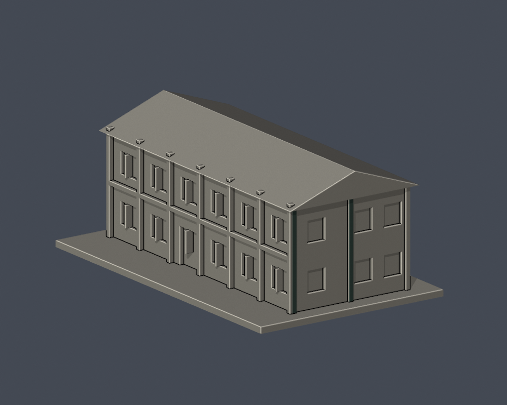
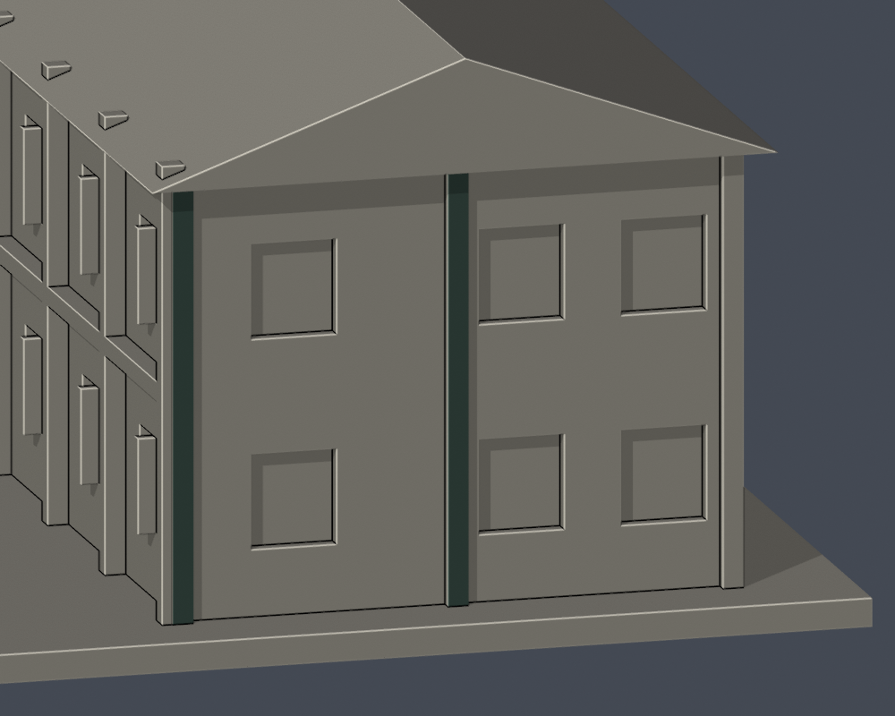

# 萬能科技大學萬強館（舊圖碼 PH008）

**本次僅補右端前角與中央兩柱的朝外窄面。** 4 個原三角使用未校準暗灰綠代理 `#536C62`；遠端受樹木遮擋的第三柱及其餘面不改，共 1,000 面維持原暖中性展示色。不是全棟彩色；原 STL 與全部 1,004 三角不變。

[原 STL（無色）](model.stl) · [新版逐面材色 3MF](side-color-20261120/model-colored.3mf) · [新版 Blender 場景](side-color-20261120/scene.blend)

## 模型預覽

| 模型預覽 | 模型預覽 | 模型預覽 |
| :---: | :---: | :---: |
|  右側總覽，含完整底座 |  右端柱細節，遠端柱維持原色 | |

兩張 WebP 均由上方連結的最新版 Blender 場景顯示，與原補色後驗證圖的像素完全相同。[展示圖 SHA256](display/SHA256SUMS) 可核對 WebP。原中性代表圖與補色前後 PNG 僅作歷史／視覺驗證，不在此處重複展示。

## 本次上色範圍與限制

- [萬能科大官方校景第 45 張](https://www.vnu.edu.tw/images/campus/map45.png) 僅 190×143 像素。右端與長面轉角的柱，及右端中央柱，在可見處呈暗灰綠。色值只是近似色族，不是材料種類、實測色票或 2026 年現況。拍攝日期未知。
- 只改模型 x=+67.2 mm、法向 +X、y 中心在 −24 與 5 mm 的兩個完整原矩形，實際 z=3～49 mm（柱體原延伸至 50 mm，屋簷自 49 mm 遮合），總面積約 202.4 mm²。兩柱返面與背面、窗凹、牆、橫構件、屋頂及正面均不延伸上色。
- 第三柱 y 中心為 34 mm，照片遠端與樹幹、枝葉交疊，不足以確認暗色直線屬於同柱或完整柱面，因此保留其兩個候選面中性。來源照片不隨包，不作紋理。
- 原 STL、原 Blender 場景及三張代表圖保留。新版場景、3MF 與四張驗證 PNG 另放子目錄，不覆寫舊預覽。根目錄 [hash-manifest.json](hash-manifest.json) 核對既有檔案與本 README；新版 [SHA256SUMS](side-color-20261120/SHA256SUMS) 核對新版交付。另見 [限定色域與未上色候選](side-color-20261120/domain.json)、[場景與交換驗證](side-color-20261120/verification.json)、[完整幾何驗證](side-color-20261120/whole-geometry-QA.json) 與 [重建／視覺核對](side-color-20261120/reproduction-QA.json)。
- 可從根目錄執行 `python side-color-20261120/rebuild_exchange.py` 重建 3MF，以及 `blender -b scene.blend -t 2 -P side-color-20261120/apply_side_color.py -- --qa-renders` 重建新版場景及對照圖。原未指派材質 `Material` 在新版僅啟用保留旗標，沒有指派至新面；相機、燈光、世界與原材保留。原薄特徵限制仍適用，未正式切片或試印。

## 證據及近似
- 兩層低館、沿長軸的雙坡屋頂
- 長邊深色構架、分格成對窗
- 端牆窗與橫梁

官網校景仍有萬強館名稱；PH008見2024官方交通PDF，現行校圖未獨立標此號，故不視為當年完整現況保證。實拍受樹遮擋，窗數和深度僅大輪廓近似。 官方實拍只有190×143像素，沒有放大新增細節；細窗、柱、深度及間距均為視覺近似，不能作精確復原。現行總務處校圖仍標此館，未取得照片拍攝年代。側後遮擋明示簡化。省略招牌文字、空調、植栽、細欄杆。

## 比例與重建
- 含底板尺寸：150.00 × 93.00 × 61.00 mm，單件最長150mm，各件獨立比例。
- 安裝 requirements.txt；執行 python build_model.py 重建STL，再用 blender -b -t 2 -P render_preview.py 產生可編輯完整網格scene.blend與實際STL圖。
- 執行 validate_model.py、check_layers.py、check_thin_features.py 複核。

## 原幾何檢查及列印限制
- 原STL法向/邊與頂點流形、正體積、單一連通外表面、無分離內腔殼、重建SHA與Blend/STL三角幾何一致：全部通過。
- 0.2mm間距非共面微偏移截面305層，每個閉環及組合Polygon有效性assert全通過，未自動修補無效形狀。
- 0.8mm XY開運算（1mm抽樣）0層超過1%面積損失，最大0.02%。窗框與框架為附牆裝飾，至少1.1mm；坡屋頂末端薄截面屬連續屋脊尖端，不是孤立承重柱。沒有用支撐宣稱修復薄特徵。
- 窗頂、拱口、柱廊、雨庇可能需支撐；此篩查不是完整壁厚測量、正式切片或實體試印，支撐不能補救噴嘴解析度。請在切片器複查材料、橋接及支撐可移除性。

## 公開來源
- https://www.vnu.edu.tw/campus
- https://www.vnu.edu.tw/images/campus/map45.png
- https://www.vnu.edu.tw/school_tour.html
- https://administration.vnu.edu.tw/oga/3130
- https://resource.vnu.edu.tw/images/webmap/webmap.jpg
- https://www.vnu.edu.tw/file_32651_萬能科大交通資訊.pdf

第三方照片及校圖不隨公開模型包重製。
