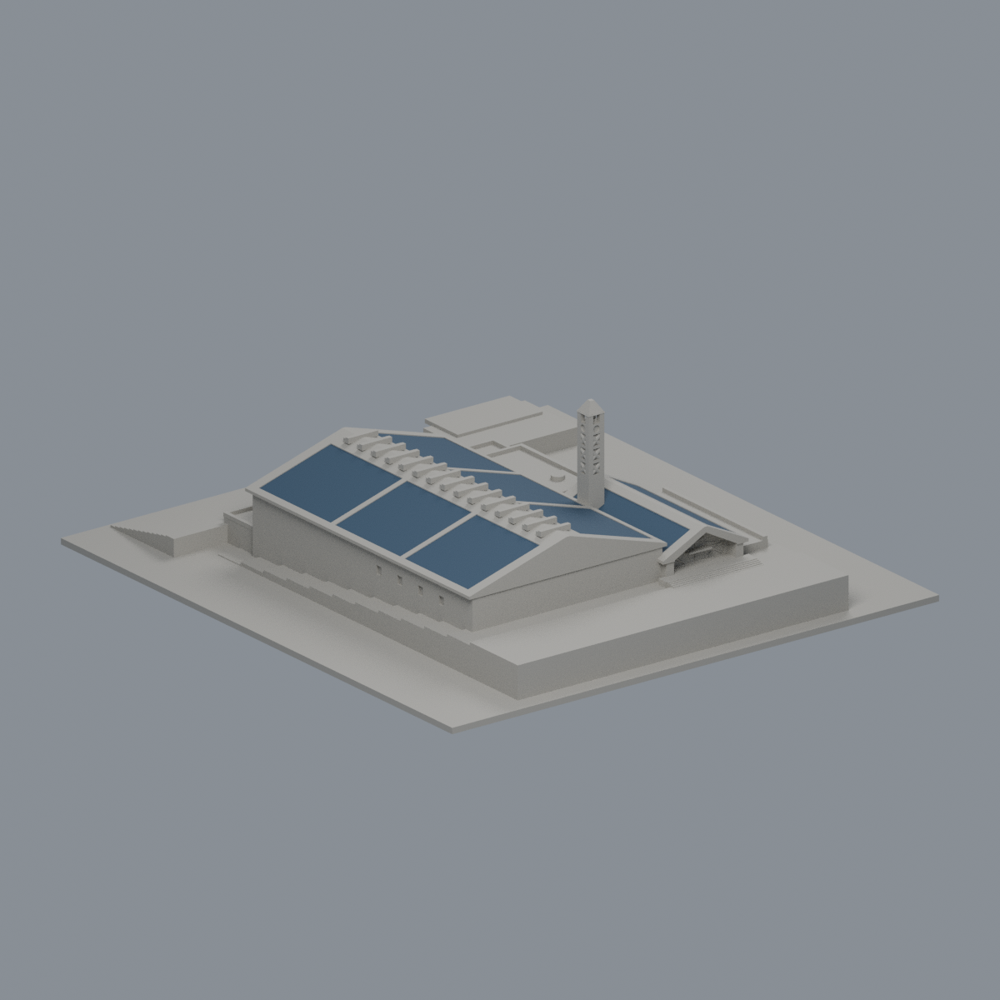
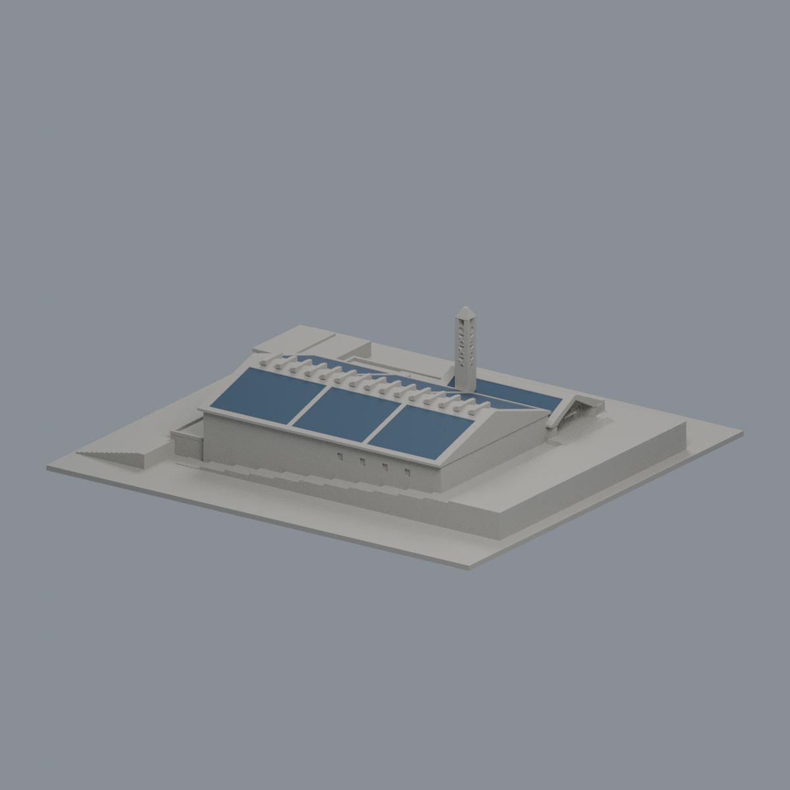
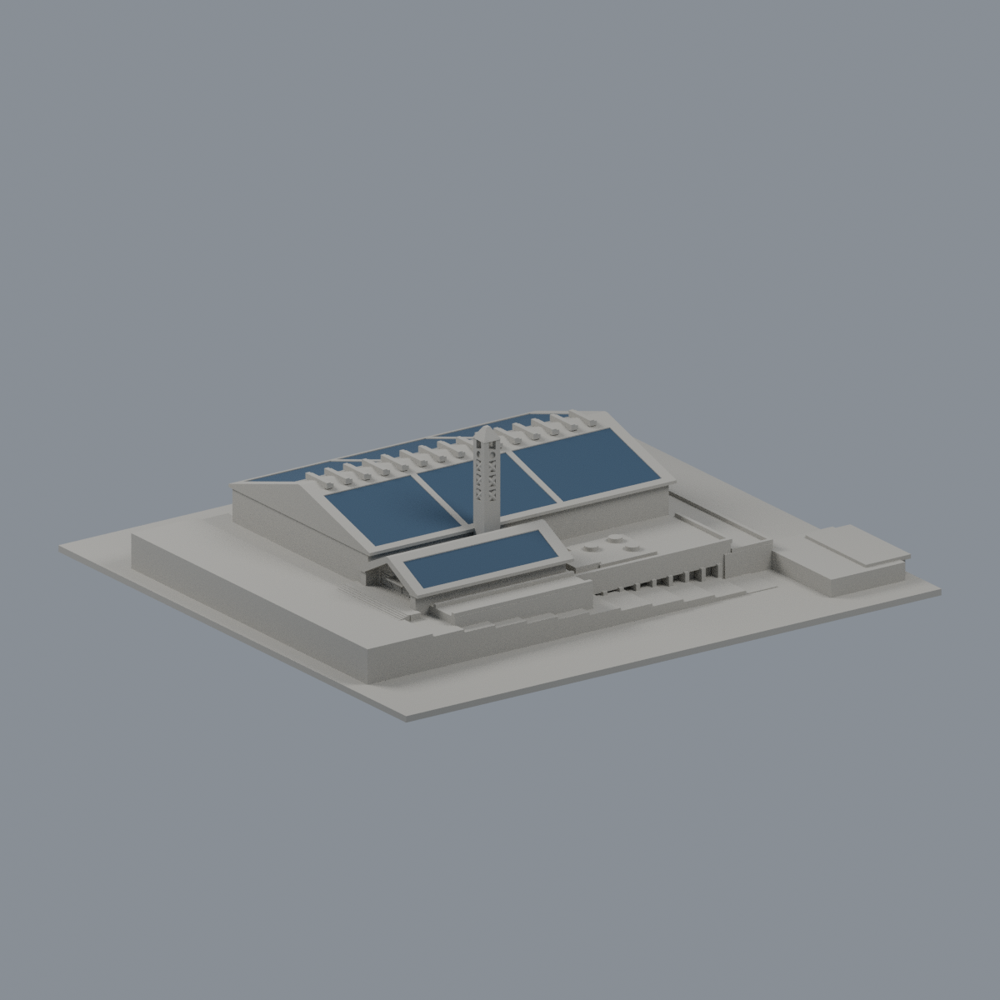
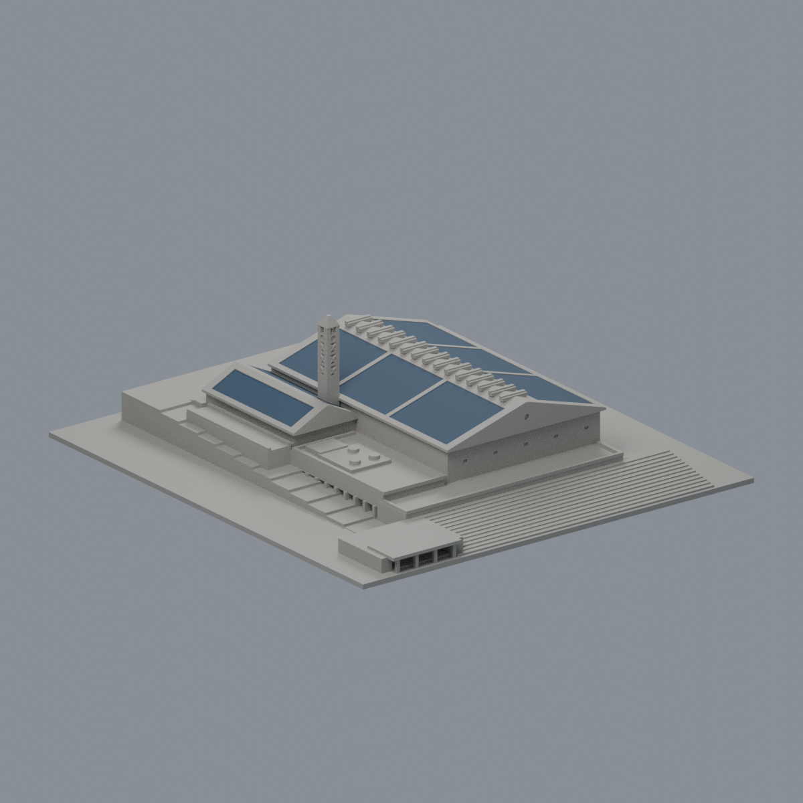
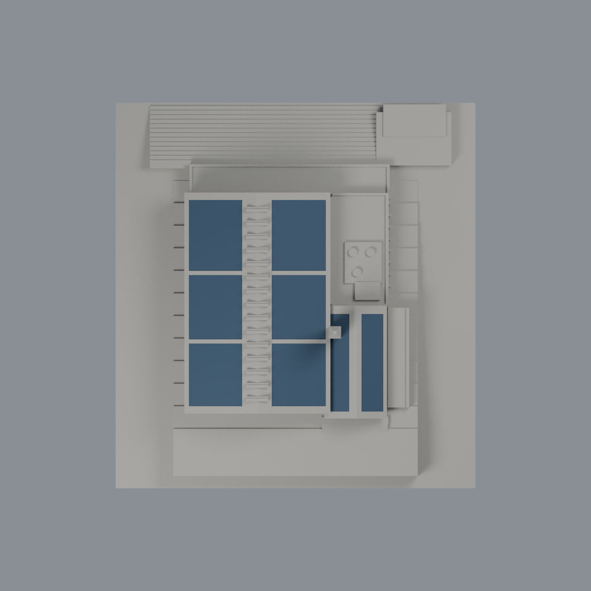

# 長庚大學學生活動中心

## 模型預覽

| 正面斜視 | 左側斜視 | 右側斜視 |
| :---: | :---: | :---: |
|  |  |  |
| 背面斜視 | 頂視 | |
|  |  | |

[彩色 3MF](appearance.3mf) · [可編輯 Blender](scene.blend) · [STL（不含色）](model.stl) · [渲染驗證](render-proof.json) · [當前校驗表](SHA256SUMS)

## 模型與來源

位於長庚大學校本部（桃園龜山），不是長庚科技大學活動中心。只包含主體及相接的有限看台與司令台，不含鄰近白膜場或獨立體育館；主體建成年尚未確證。整體最大 150 mm。

最新外觀模型以深藍灰代理 8 個既有屋頂光電區的 23 個原三角面（4,055.465801 mm²）；其餘 6,245 面維持中性。15 個屋脊蓋、綠頂、牆、塔、地面均未改色。沒有新增或分割幾何，也不推估實際光電片數。參考照片拍攝日期不明，2022 年 7 月是光電工程完工，不是建物或照片日期。色值未經校準。

[建模腳本](build_model.py) · [建物來源及限制](sources.md) · [外觀材色來源](APPEARANCE-SOURCES.md) · [逐面材質索引](face-materials.json) · [3MF 驗證](COLOR-EXCHANGE-VALIDATION.json) · [來源權利](LICENSE-NOTICE.md)

毫米單位，底面朝下，最大邊 150 mm。NLSC 原生約 0.13526818 m/px 的主頂投影為約 48.15 × 72.91 m；模型按每 1 m 約 1.18 mm 表達，約 1:847，不能視為實測復原。高建物視差及屋簷／牆基差異仍在。

2018 三禾圖外加座標格與底圖尺度、位置尚未閉合，僅用灰界辨主館、低翼、看台及司令台接合。不能稱已校測量尺寸模型；藍線是地籍，不沿藍線建牆。圖中原碼 1B 不是 B1，4R 亦不能直接改寫地上 4F。

B1–3F 由官方拆層圖及會議資料獨立支持。坡上為 3F 入口，坡下可見 1F 外廊；B1 無自然光，不做全圈明露層。底層退縮、背側細窗及所有高度均為照片有界近似。試稿主檐 14.4 m、脊 21.4 m、鐘塔 35.6 m、入口平台 8 m，均非官方標高或實測。

參考跨年：以 2022 光電工程後屋面為方向，配合較早的正背照片及 2018 拓撲。2024 為 NLSC 圖面水印，不是已確認拍攝日；本作不宣稱某一日完全一致的現況。

## 明示的列印簡化

- 鐘塔約 4.47 mm 寬。X 斜撐內側加退背實芯，把來源真穿孔封背成凹紋；不宣稱重現原構造鏤空。
- 帽頂原三角開孔完全封實，不保留凹槽。尖帽截頂保留有限頂面，避免針尖。
- 入口細 X 約 0.26 mm，為背接淺浮雕，並非自由細杆；細紋是否保留仍依噴嘴、層高及切片設定。
- 15 個屋脊採光／通風蓋以封頂浮雕表達，上唇平面進深加至約 1.117 mm；主屋脊採有限脊平台。這些是列印簡化，不是原件尺寸。
- 光電板為有限淺浮雕／淺凹，省略細格，不把光電當屋頂開洞。
- 地形、低翼、看台與遮擋處保守簡化；不憑陰影補造精密窗列或地下層外露高度。

## 核驗邊界

現有數位檢查檔只是特定幾何與切層抽樣的證據，不能取代原面厚根核對、切片及實體試印。入口／鐘塔列印簡化外觀已核；數位檢查不等於已試印或無支撐保證。原幾何數位檢核與歷史薄壁紀錄不能視為新增印製驗證。

預覽是自行生成的模型渲染。官方照片、NLSC 原圖與 PDF 僅供研究核對，不放入候選或另行散布；來源連結見 sources.md。

## 原幾何檢核與封存

原 3,104 頂點、6,268 面、三角面順序、方向及 STL 已逐項比對。原 v1 薄唇仍不採用；現行 v2 移除帽頂盲凹、保留六類列印簡化及原數位審核界線。六類不等於放寬通用薄壁門檻。請見[原完整幾何檢核](https://github.com/hplin50643/taiwan-buildings-3d/blob/9d27470c219df60ff5211342c28ba0aab5b06658/%E9%95%B7%E5%BA%9A%E5%A4%A7%E5%AD%B8/%E6%A0%A1%E6%9C%AC%E9%83%A8%EF%BC%88%E6%A1%83%E5%9C%92%E9%BE%9C%E5%B1%B1%EF%BC%89/buildings/cgu-student-activity-center/QA.md)。

[原重建來源套件](https://github.com/hplin50643/taiwan-buildings-3d/blob/9d27470c219df60ff5211342c28ba0aab5b06658/%E9%95%B7%E5%BA%9A%E5%A4%A7%E5%AD%B8/%E6%A0%A1%E6%9C%AC%E9%83%A8%EF%BC%88%E6%A1%83%E5%9C%92%E9%BE%9C%E5%B1%B1%EF%BC%89/buildings/cgu-student-activity-center/appearance/rebuild-source.zip)及[當時色版整套說明](https://github.com/hplin50643/taiwan-buildings-3d/blob/9d27470c219df60ff5211342c28ba0aab5b06658/%E9%95%B7%E5%BA%9A%E5%A4%A7%E5%AD%B8/%E6%A0%A1%E6%9C%AC%E9%83%A8%EF%BC%88%E6%A1%83%E5%9C%92%E9%BE%9C%E5%B1%B1%EF%BC%89/buildings/cgu-student-activity-center/appearance/README.md)固定於原版本。此頁只展示現行模型，參考照片及 PDF 不隨包分發。何時及怎麼比對見[校驗範圍](CHECKSUM-SCOPE.md)。
