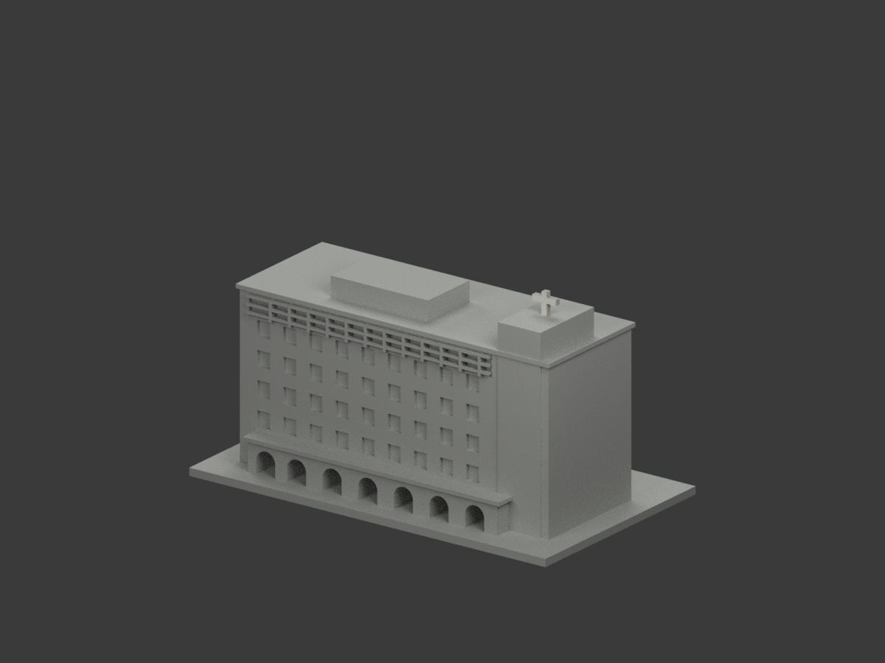
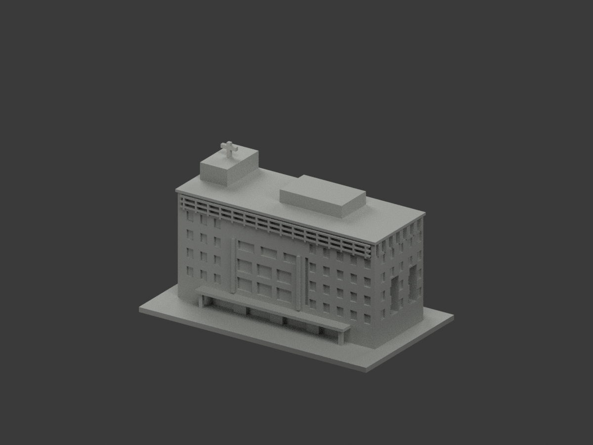
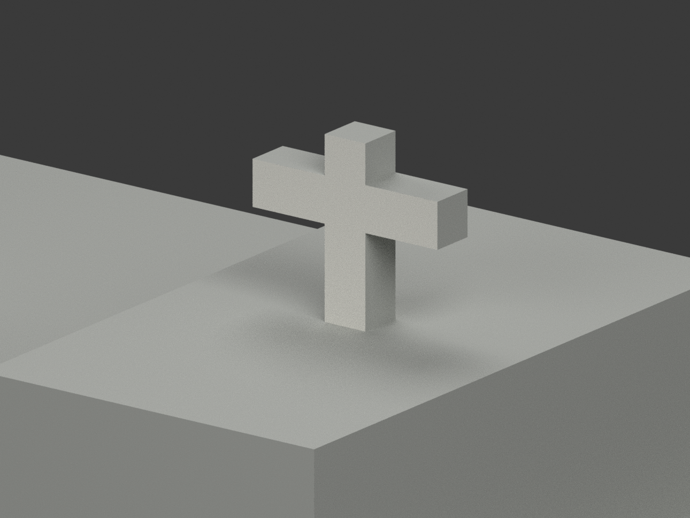

# 長榮大學行政大樓｜屋頂十字兩面局部補色

## 模型預覽

| 原代表角度總覽 | 另一側斜視（此次補色面） | 屋頂十字局部 |
| :---: | :---: | :---: |
|  |  |  |

三張皆為同一份已發布的屋頂十字反面補色模型（原三角面 5,500），不是舊版模型或照片；點圖可開啟同版原始 PNG。總覽保留首頁既有代表角度；另一側斜視呈現此次補色面，局部圖顯示同版保留的十字範圍。

## 現行下載

[逐面材色 3MF](appearance.3mf) · [可編輯 Blender](scene.blend) · [原幾何 STL（不含顏色）](model.stl) · [現行 SHA-256](SHA256SUMS) · [展示圖來源](display/PROVENANCE.json)

## 補色範圍與限制

延續原本已配色的十字朝向面 10 個三角面，新增其相反寬面的 10 個原三角面，淡白族 #DDDCD5。共 20 個配色三角面，其餘 5,480 面保持未知中性。窄側、頂底返面、石塔基腳及其他立面未補色；未切分三角面，原 STL 幾何未改。不是全棟分色、現況測繪或實體試印。3MF 顏色是逐面材色，不代表已驗證多料切片。

[校園導覽官方照片](https://www.cjcu.edu.tw/images/campus/campus_adm.jpg)與[來源檢核記錄](CROSS-BACK-SOURCE-QA.json)交叉支持有限的屋頂十字粗淡白色族；照片未測色，拍攝日期未核，未隨包散布。模型不改相鄰圖書館或校門十字。

## 驗證與歷史

[本次獨立審查](CROSS-BACK-INDEPENDENT-QA.json) · [交付檢查](CROSS-BACK-DELIVERY-QA.json) · [場景檢查](CROSS-BACK-SCENE-QA.json) · [校驗範圍](CHECKSUM-SCOPE.md) · [固定發布版本與原始重建證據](https://github.com/hplin50643/taiwan-buildings-3d/tree/bb24c96fd6bb0210d238bbfa95cd9ef9c504ed8a/%E9%95%B7%E6%A6%AE%E5%A4%A7%E5%AD%B8/%E6%AD%B8%E4%BB%81%E6%A0%A1%E6%9C%AC%E9%83%A8/buildings/cjcu-administration/)。

原資料內「未發布」是當時凍結的候選文字；此版已由對應提交收錄主線。中性版首圖僅保留給既有外部 QA 的固定路徑，不在現行畫面顯示。其餘中性渲染、舊清單及舊檢查腳本請至上述固定發布版本取回；現行展示更新不擴大原模型驗證。
