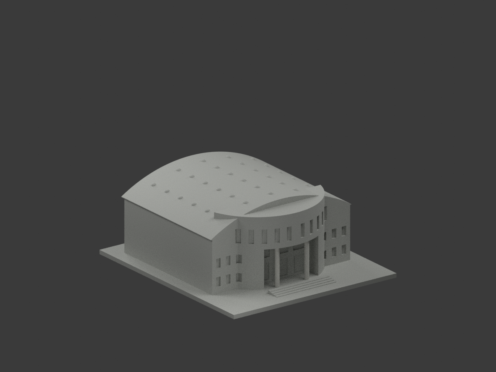
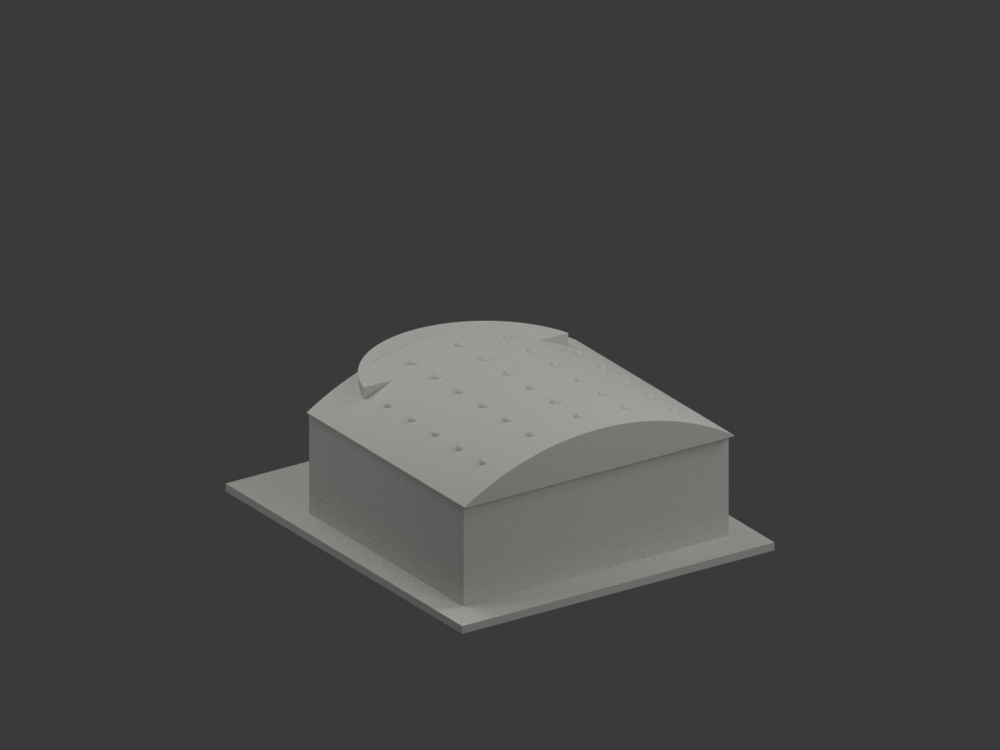
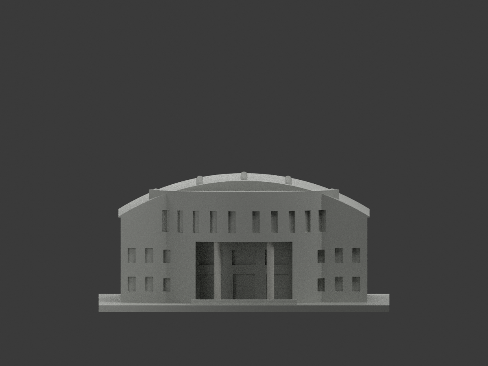
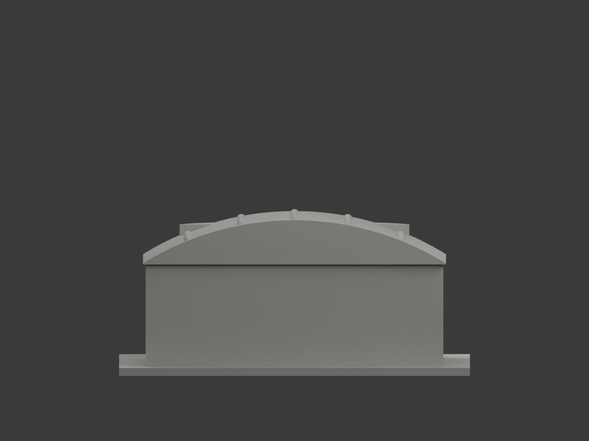
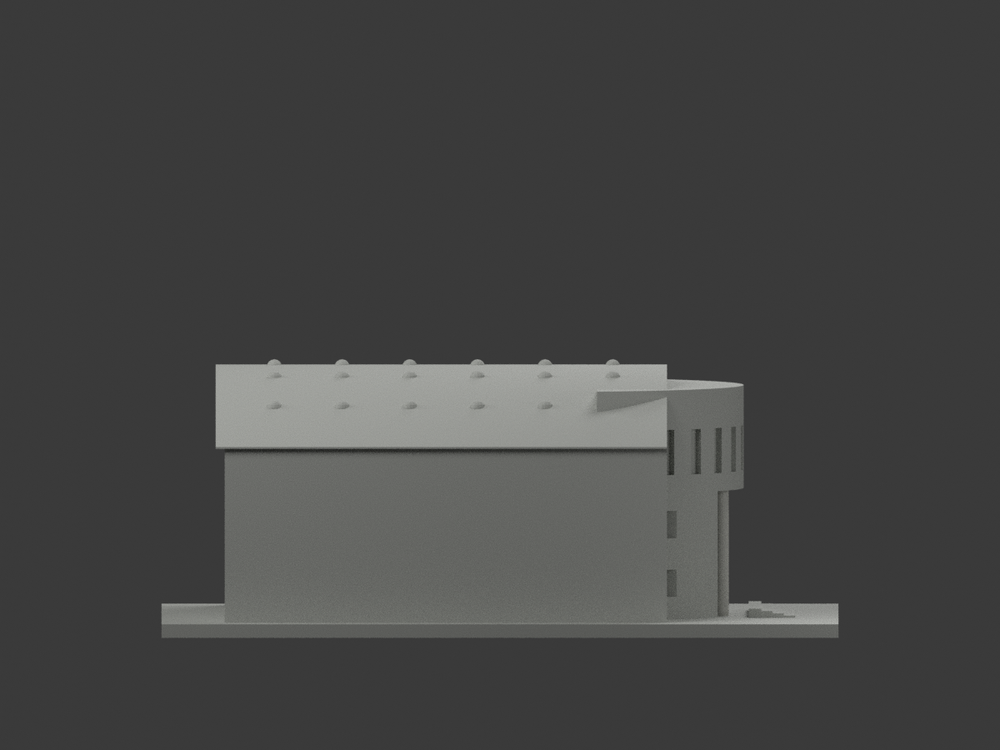
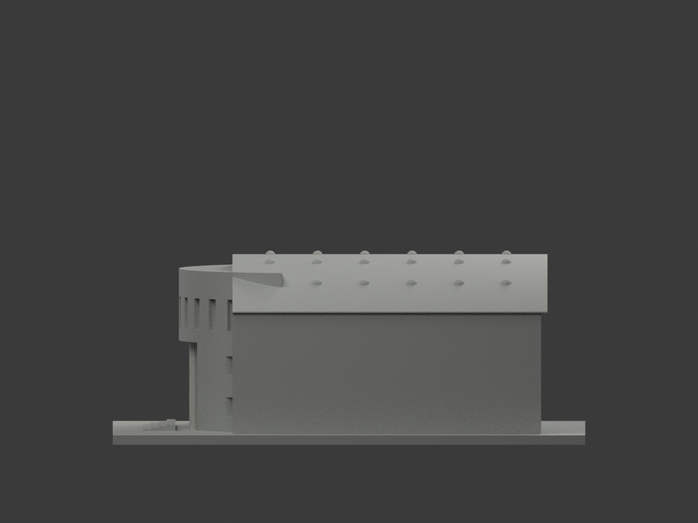
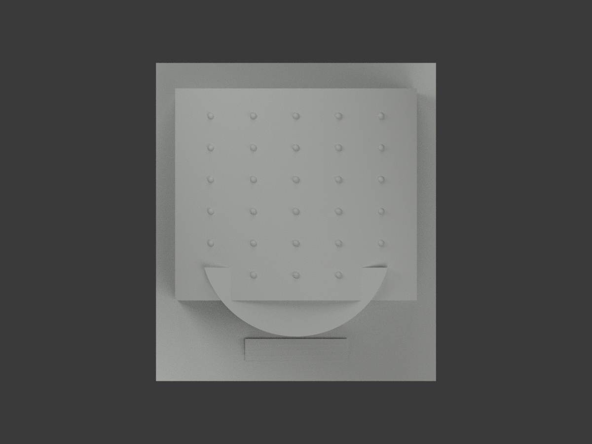
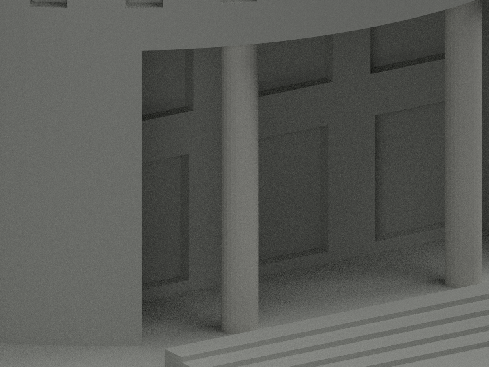
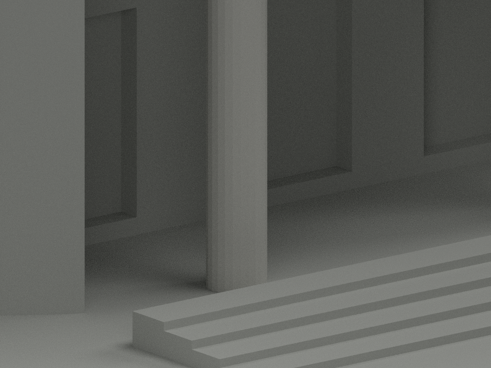
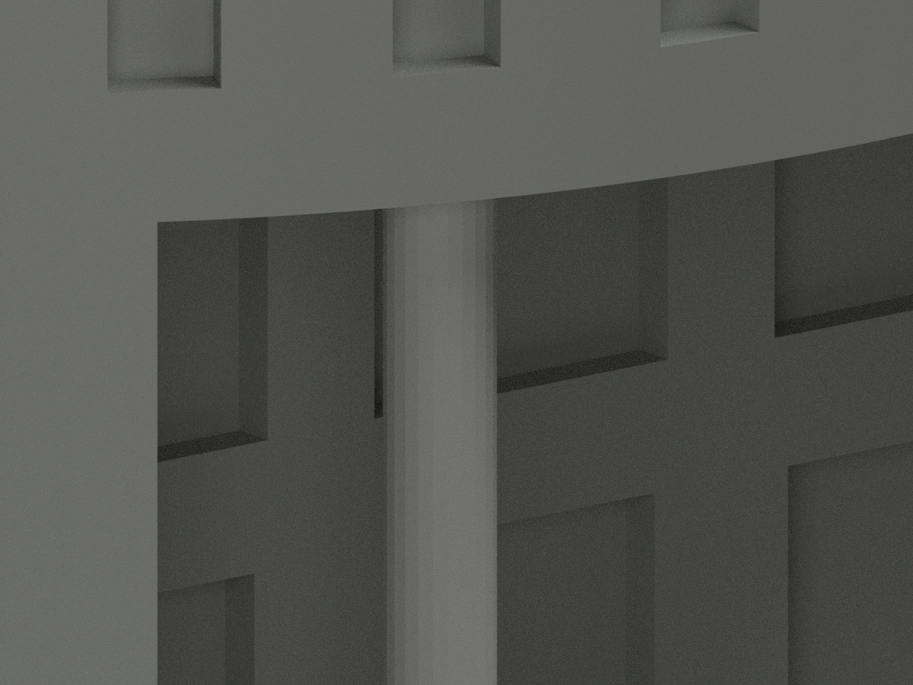

# 長榮大學體育館｜兩入口圓柱同材質延續

## 模型預覽

| 總覽 | 背側 | 正面 |
|---|---|---|
||||
||||
||||
||||

## 本次兩入口圓柱完整柱身材質延續

沿用現行 root 的兩槽配色版，不以歷史 appearance/ 任選屋面示意作基準。原左右柱各 4 個已色 facet、共 16 三角保留；兩柱剩餘 40 個完整矩形 facet／80 原中性三角延用既有淺灰槽 0。現在淺灰 96 面、中性 4,598 面；原 4,694 三角／2,345 點、STL bytes、頂點表、面序和座標皆精確不變。材質名稱仍含 visible left column 是歷史標籤，名稱及名義色 #CBCBC5 不改。

每柱中心 (±12,−49)、原半徑 1.7、24 邊柱、z=3…31 mm，以各 chord 的有限平面、切向寬度、全三頂點及向外法向核對，每格原兩三角形成完整矩形，逐格解析面積檢查。底、帽頂、庇底、牆與屋頂完全排除；不新增幾何、不切面、不將深淺影子當新材料。

本輪親看官方 campus_gym.jpg，兩柱全高可辨淺灰族；遠照各柱僅約 10 像素寬，背面是同一柱身材質連續推論，不是逐 facet 照片確證或精確石材／校色／紋理。照片拍攝日期未知，新取回不等於新拍攝；不宣稱 2026 現況或實體試印。

整個 `appearance/`、`ORIGINAL-SOURCE-GAP-*`、舊來源、舊 QA、舊 checksum 與原工程檔保持原 bytes，歷史 1,206 屋面示意不轉為實景認證。舊 README 中 8 面／16 面只記錄當時範圍；本節明確記錄新的同柱推論。新版 QA 在 `qa-continuous-walls/`，本次逐檔校驗用 `CONTINUOUS-COLUMNS-SHA256SUMS`。root scene 與十張 PNG 是新版；不可把歷史 appearance/ 的圖誤作本次預覽。

新版 3MF 用完整 float 座標字串，修正舊輸出四捨五入造成最大約 4.98×10⁻⁹ mm 座標差，沒有改 STL 幾何；並補規格的物件層預設材料以供原生編輯重存。strict 讀入精確對回原 STL。lib3mf 在臨時編輯副本的重存精度誤差另記，原交付不採該重存副本。

重建包 `rebuild-continuous-columns.zip` 使用原公開 STL、固定 SHA 的 `column-baseline-color-mesh.npz`（先前 16 面版本，精確頂點表）和原 palette，不需任何照片。執行 `python build_continuous_columns.py`、`python verify_continuous_exchange.py`，再 `blender -b --python render_continuous_columns.py` 與 `blender -b --python verify_continuous_scene.py`。使用 numpy、lib3mf 2.5.0、Blender 4.3.2；原 `colorize_model.py`／`export_appearance.py` 是歷史入口，會重建舊 16 面版本，勿用於新版。原製造幾何限制及未經多料切片／試印限制全部保留。

場景僅同步更新 source_mesh_sha256 以對應本次含材質指派的 color-mesh.npz，並更新 scope，明示完整柱身同材質連續推論及其餘表面中性、非現況證明；其餘原屬性、全部材質定義與幾何不變。

本頁為現行說明；根 README.zh-TW.md 與 qa/ 中同名文件保留舊版本原文及原 bytes，僅作歷史記錄。

## 前版說明與保留限制（完整歷史文字）

# 長榮綜合體育館｜右入口柱有限前左扇區補色

未完成全館配色。原左柱8面保持，新增右柱8面（4個完整24gon側面域），共16配色、4678中性、4694原三角。沿用原兩palette名稱、索引及名義#CBCBC5；第一材名稱仍含left column，是歷史名稱，現同灰族也用於本次有限右柱。

本次重新取得官方campus tour之campus_gym.jpg（640×426），右柱全高及柱腳可辨，無原近照花台/欄杆遮住下端的缺口；原1024×768官方portico近照另核hash並交核中上段石灰族。新取得不等於新拍照，日期未知；URL202404不是capture，不聲稱2026現況。新遠照柱寬僅約10像素，只支持粗色族與同可見面連續，不支持逐facet精色、校準HEX或石紋。

僅右柱中心(12,-49)、半徑1.7、24gon k14..17前左4facet、實際露出原z3..31，8個原三角。不因左右對稱就放行，依右柱直接像素與原近照交核。帽頂底/其餘右柱及左柱facet不擴；原比例、圓柱離散與深度仍是近似。混磚牆/金字、窗框玻璃混面、庇底/梁/裝飾、踏階與屋面全部不新增材色。

98原件含appearance/歷史全包核Git blob，原STL/build、appearance/任選屋面族示意、ORIGINAL-SOURCE-GAP系列與previews/工程檔原bytes完整保留。原1206屋面任選中性分類不等於日照屋色，本次仍不認證它。來源圖私人保存，不作公開貼圖或再散布。無幾何修改、不實測、不試印、不重認證工程或多料切片。RIGHT-COLUMN來源QA為固定pending階段快照，最終獨審另檔。以下舊8面統計只屬歷史版本。

## 原版說明與限制（完整歷史）

# 長榮大學體育館｜左入口柱局部淺灰

**既有屋面展示色不是實景材質證；其餘未知域尚未完成分色。** partial_color_incomplete=true、fully_colored_exterior=false。本次僅左柱四個完整柱面8三角淺灰，不是原單色模型發現，也非全館補色完成。

## 範圍與限制
同 cjcu-gymnasium 原項目，長榮大學歸仁校本部體育館，same-item、count_delta=0。原4694三角及所有62原件不變，immutable包無OBJ，不新增原OBJ。左柱中心(-12,-49)，24gon半徑1.7，k14..17有限chord共8面名義淺灰；全3頂點plane/tangent/z1e-5匹配，無限plane恰等有限面，z3..31是原Boolean露出界，不從照片人工裁色。所有共面連通域均一。
其餘4686面未知中性：右柱、左柱其他facet、屋頂/導光罩、混磚/金字牆、窗門細框反光、階踏/棚底等不擴色。不加真石材紋理、不改原近似幾何，不稱2026現況。

## 既有來源缺口版本轉換
原 appearance/ 全目錄保留原bytes，含1206屋面任選中性展示分類、原3MF/Blender/圖/QA。該示意不是白日實景材料證。原scene完整公開另存 ORIGINAL-SOURCE-GAP-scene.blend、原README另存 ORIGINAL-SOURCE-GAP-README.md，原render_preview.py/previews亦原樣保留。新scene/新appearance.3mf/新十圖只對有據8面分色，不覆寫原appearance/歷史，也不新增棟數。

## 來源與日期
親看官方入口白日近照，僅左柱可見前左扇區連續石灰族，花台遮其他扇區不外推。官方URL202404與頁日非拍照日期，照片capture未證；未用舊夜照取色或官方503未讀圖。照片私人保存不公開不貼紋理，不建人物；未確認CC/商用授權。

## 格式與重建
[原STL](model.stl) · [逐面材色3MF](appearance.3mf) · [新Blender](scene.blend)
原150mm底座只是示意尺寸非實測比例。明確物件身份 CJCU Gymnasium partial color。STL無色，3MF/Blender逐面材色不是兩色/四色耗材切片驗證，未試印。原build_model.py→colorize_model.py→export_appearance.py→validate_color.py；render_color.py/verify_color_scene.py。隔離Shapely2.1.2原build+color精確重建、全三角multiset/原bytes/3MF/閉合體積/scene重開/十圖1200×900與hash。舊QA不冒新證據，所有歷史保留。

## English scope
Bounded source-gap transition, not a monochrome discovery:8 original triangles on four complete front-left facets of the left entrance column light gray;4686 unknown neutral. All62 immutable original files retained;no originalOBJ. Original appearance/ roof sheet-family neutral preview retained unchanged, not actual daylight material certification. Original scene public alias ORIGINAL-SOURCE-GAP-scene.blend and original renderer/previews/README preserved. Sameitem/count0/no geometry changes. Capture date unknown,not2026 survey. Partial only, not tested filament slicing.
