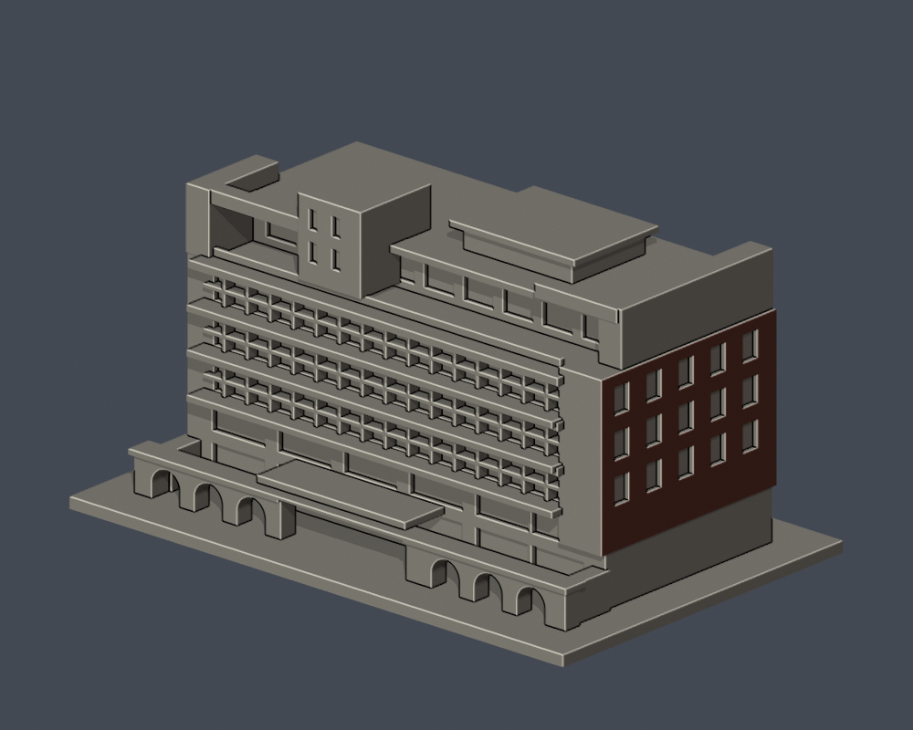

# 蘭大衛紀念圖書館主量體｜長榮大學

## 模型預覽

| 前斜視 | 右短翼正視 |  |
| :---: | :---: | :---: |
|  |  |  |

點圖可開啟當版原始 PNG。兩張皆為同一份 `brick-side-20261120` 補色模型的實際渲染，並非來源照片。

僅將右短翼三排窗周圍的磚牆外皮 **92 個三角面**補為近似暖紅磚；另 **3,850 個三角面**維持原展示材。未改 STL 幾何、未新增建築，也不是全棟完成補色。照片未校色，未實體試印。

[補色版說明與驗證](brick-side-20261120/README.md) · [彩色 3MF](brick-side-20261120/appearance.3mf) · [補色 Blender 場景](brick-side-20261120/scene.blend) · [學校目錄](../../../README.md) · [校區目錄](../../README.md)

## 範圍與外觀
保留六個地上使用層的高層主量體、三層連續水平玻璃帶及外挑白色帶、上層退縮、前端屋頂核心、右側紅磚窗列與底層拱廊。

這是圖書館主量體外觀近似，排除相接的計算機與網路中心低層翼，不聲稱整座圖資群完整重建。背面和左短側缺乏充分實拍，為簡化無窗包絡；屋頂與進深視覺估計。地下樓層不挖空，正面坡地化為平底座。

這是公開外觀照片推估的可編輯、可再建構縮尺模型，不是測量、竣工圖或完整BIM。各件獨立縮尺；包含平底座的外框為 150.00 × 96.00 × 81.00 mm，最大150 mm，不代表同校模型使用相同比例尺。

## 目前發布的模型下載與重建

- [彩色 3MF](brick-side-20261120/appearance.3mf) · [可編輯補色 Blender](brick-side-20261120/scene.blend) · [STL 幾何（不含材色）](brick-side-20261120/model.stl)。STL 與原版位元相同；此處只提供一份。
- [補色版完整說明、視圖與來源](brick-side-20261120/README.md) · [補色 QA](brick-side-20261120/BRICK-QA.json) · [本目錄 SHA-256](SHA256SUMS.txt) · [補色包 SHA-256](brick-side-20261120/SHA256SUMS)。
- 原幾何證據： [來源與不確定性](sources.json) · [幾何驗證](validation.json) · [0.2 mm 層檢查](layer-check.json) · [輪廓有效性](contour-validity-check.json) · [薄特徵篩查](thin-feature-check.json)。這些報告對應未變動的原 STL 幾何，非試印結果。

下載檔可直接開啟；要重建補色版，依[補色版重現說明](brick-side-20261120/README.md)先從[固定基準](https://github.com/hplin50643/taiwan-buildings-3d/tree/79c4e0f14ae31330eb87338a59972ce0a88cdef2/%E9%95%B7%E6%A6%AE%E5%A4%A7%E5%AD%B8/%E6%AD%B8%E4%BB%81%E6%A0%A1%E6%9C%AC%E9%83%A8/buildings/cjcu-library/)取原 STL 與 Blender 場景，核對基準雜湊。重建後、執行 `validate_brick_exchange.py rebuilt privateqa` 前，請把補色包內的 `verified-face-domain.json` 原樣複製到 `rebuilt/`，用來核對原定補色面域。原中性場景、舊展示圖與中性版建模／檢查程式仍可從[固定歷史交付](https://github.com/hplin50643/taiwan-buildings-3d/tree/88578077d19c33cb890500fa4267c937bc4668d5/%E9%95%B7%E6%A6%AE%E5%A4%A7%E5%AD%B8/%E6%AD%B8%E4%BB%81%E6%A0%A1%E6%9C%AC%E9%83%A8/buildings/cjcu-library/)取回，不混入目前預覽。

## 驗證與列印限制
原始STL未經repair：驗證水密、邊流形、頂點環單一、原始法向與繞序、正體積、單一連通表面殼、無分離內腔殼、150mm外框、獨立重建SHA及儲存Blender幾何一致。0.2mm節距、起始z=0.071mm逐層檢查閉合及degree2，並驗證各閉合多邊形及合併多邊形有效。

薄特徵篩查使用canonical edge interpolation，在1mm節距截面做0.8mm參考形態開運算；尖角與曲線也會造成損失。此檢查不是全面壁厚測量，不代表0.8mm最小壁厚合格，也不是實際切片、支撐可拆除性、走線或實體試印保證。

三條水平簷帶、雨棚與底部拱廊需在實際切片器評估支撐。細窗格增厚，不是全模型最小壁厚保證。

## 來源
- [學校官方：キャンパス紹介／校園導覽](https://www163.cjcu.edu.tw/web2023/ja/about_campus_tour.php)：將圖書館及計算機與網路中心分別介紹，單位命名不直接證明實體分棟。
- [學校官方：蘭大衛紀念圖書館外觀](https://www163.cjcu.edu.tw/images/campus/campus_lib.jpg)：清楚確認主立面玻璃帶、右短侧窗列和低拱廊。
- [華豐營造股份有限公司：行政大樓工程旁的圖書館側面](https://www.hwa-fong.com.tw/upload/201807271455032.jpg)：圖左可見圖書館側立面和水平玻璃帶轉角，補充官方正側照片。
- [學校圖書館：歷史沿革及服務](https://dweb.cjcu.edu.tw/lib/article/7424)：核對蘭大衛紀念圖書資訊大樓別名及2008-11-05啟用。

公開封包不再散布來源照片，只提供連結與原創模型。全校尚未完成；見學校目錄的逐項缺口。
