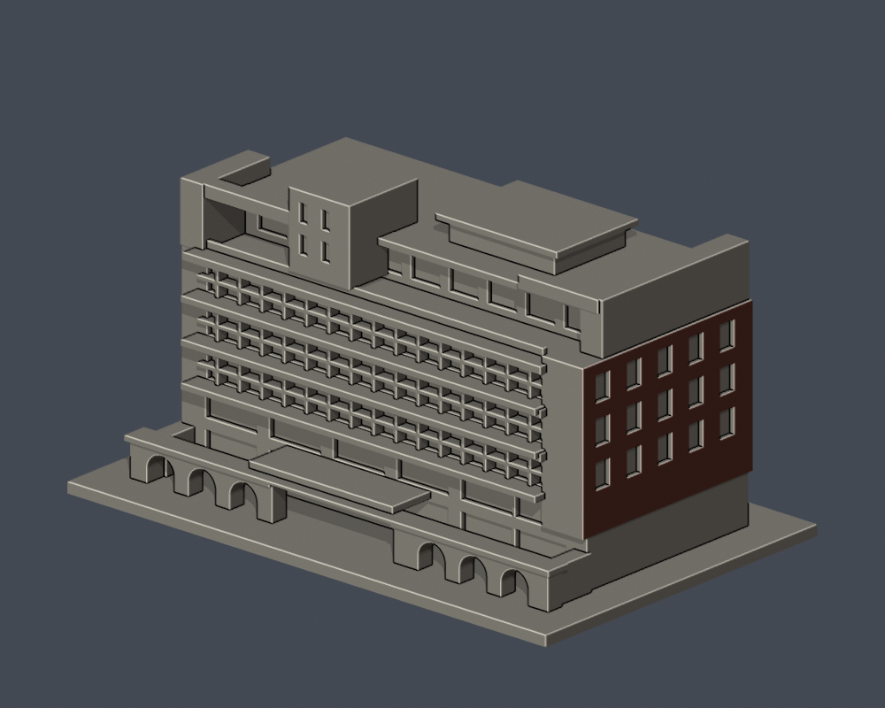
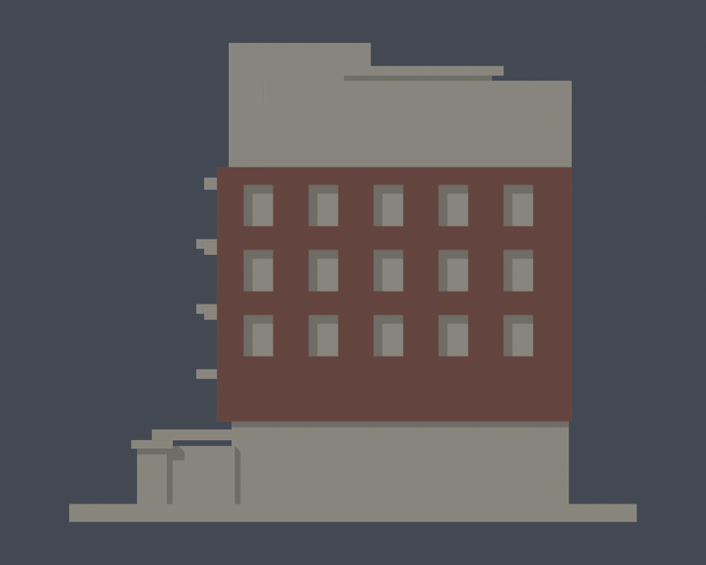

# 長榮大學蘭大衛紀念圖書館 | 右短翼磚牆外皮

## 模型預覽

| 前斜視 | 右短翼正視 |  |
| :---: | :---: | :---: |
| [](previews/front.png) | [](previews/right-side.png) |  |

展示圖使用無損 WebP；點圖可開啟同版原始 PNG。原始六張技術渲染及 QA 檔案未改動，可查[固定發布版本的完整證據](https://github.com/hplin50643/taiwan-buildings-3d/tree/d3d082b4f58fecd9399329acc34abf7ed5159ffa/%E9%95%B7%E6%A6%AE%E5%A4%A7%E5%AD%B8/%E6%AD%B8%E4%BB%81%E6%A0%A1%E6%9C%AC%E9%83%A8/buildings/cjcu-library/brick-side-20261120/)。

這是既有 [主量體模型](../README.md) 的局部外觀補色；不新增建築、不改原 STL 幾何。僅右短翼 +X 外向磚牆原有 92 個三角面設為名義暖紅磚。其餘 3,850 面保持原展示材；不是全棟完成補色，也不代表未驗證面的實景顏色。

- [彩色 3MF](appearance.3mf) · [可編輯 Blender](scene.blend) · [原樣 STL](model.stl) · [逐面資料 NPZ](color-mesh.npz)
- [面域](verified-face-domain.json) · [材色統計](palette.json) · [品質檢查](BRICK-QA.json) · [SHA256](SHA256SUMS)

## 來源與界線

[校方外觀照](https://www163.cjcu.edu.tw/images/campus/campus_lib.jpg) 可辨三排窗周圍的連續暖紅磚外皮；[營造廠影像](https://www.hwa-fong.com.tw/upload/201807271455032.jpg) 交叉顯示圖左這一量體的磚牆與下方異材。兩照所見上屋緣、窗洞和下方玻璃不納入。前立面三條白簷及其側回面的原不確定性不解除；同樣不推左側、背面、屋面、遮棚或拱廊。照片拍攝日期未核定。參考原圖未隨公開包，也未當作材質貼圖。

外皮域為原座標 x=64.5、y=−23…37、z=17…60 mm，以外法向、全頂點及共享邊取完整連通面；面積 2,055 mm²（外包 2,580 減原 15 窗洞 525）。只對現有模型「三排窗紅磚外皮」的離散對應，不逐像素配準：原窗數、尺寸、磚牆高度比例與下界皆是原模型近似。窗底、窗返、洞背未改，照片中光照／陰影不當色票。保留原獨立縮尺、未見背面簡化、工程未知及未試印限制。

## 重現

從 [固定基準](https://github.com/hplin50643/taiwan-buildings-3d/tree/79c4e0f14ae31330eb87338a59972ce0a88cdef2/%E9%95%B7%E6%A6%AE%E5%A4%A7%E5%AD%B8/%E6%AD%B8%E4%BB%81%E6%A0%A1%E6%9C%AC%E9%83%A8/buildings/cjcu-library) 取得原 model.stl、scene.blend 並置於 baseline；程式核固定 SHA256。原圖與外部程式不需要用於重建。依序執行：

```sh
blender -b -t 2 --python-exit-code 1 -P rebuild_brick_side.py -- baseline rebuilt
blender -b -t 2 --python-exit-code 1 -P render_brick_views.py -- rebuilt
python finalize_brick_views.py rebuilt
python validate_brick_exchange.py rebuilt privateqa
sha256sum --strict -c SHA256SUMS
```

最後校驗命令在本發行目錄執行，重建檢查則使用隔離輸出。PNG 清理需 Pillow，交換驗證需 numpy、lib3mf。原編輯場景、相機、光照、使用中的原材保留；新增一個磚材與兩個範圍記錄屬性。原無使用者的 Blender 預設 Material/node tree 以 fake user 留存，該旗標不影響渲染。原四個視角保留，另加一張右短翼驗證角度與原前後排版。
