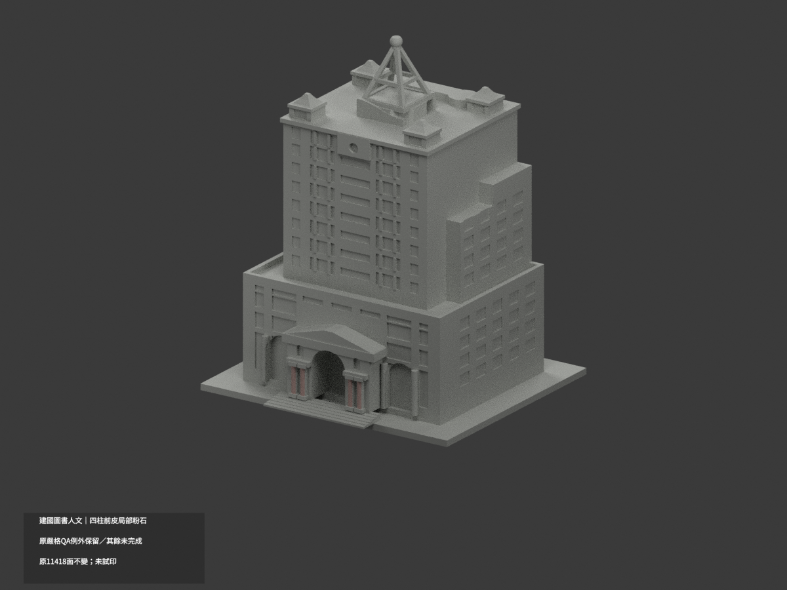
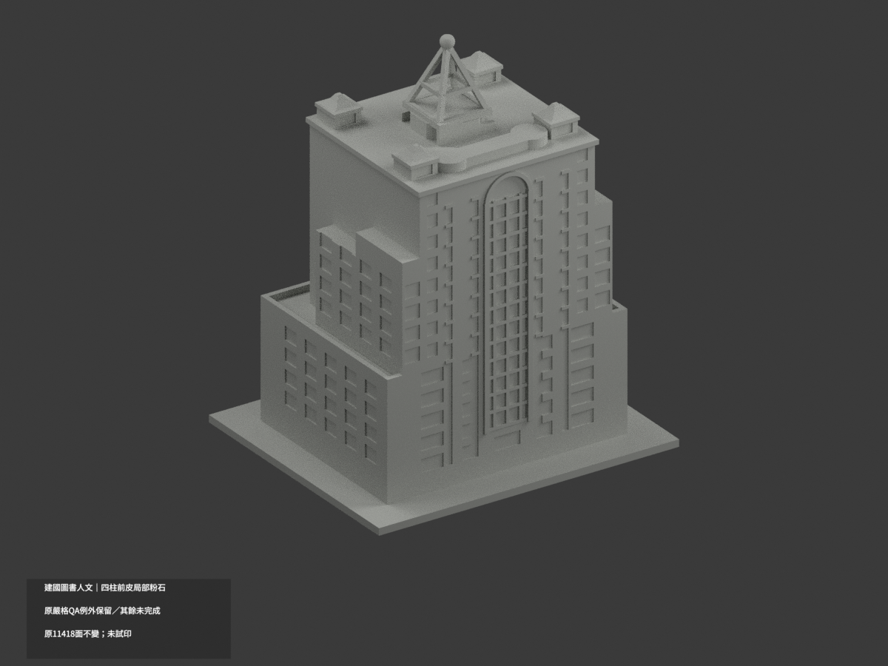
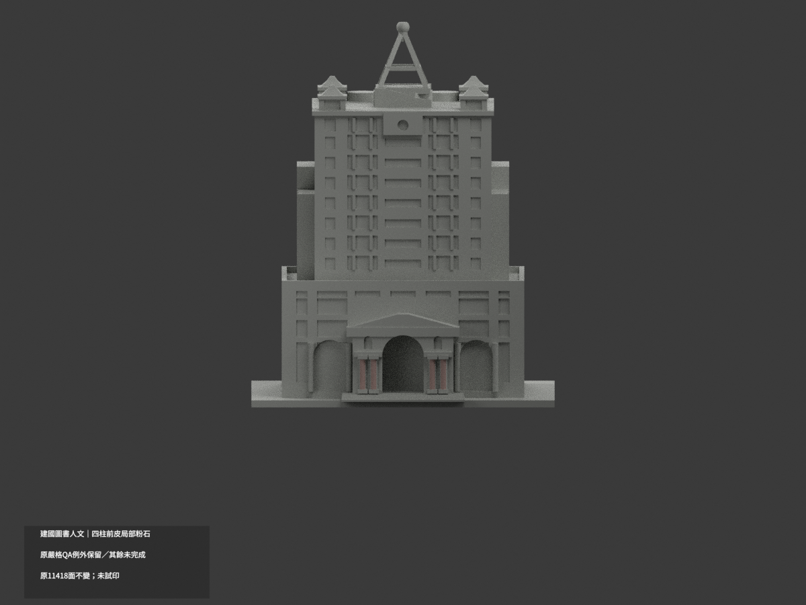
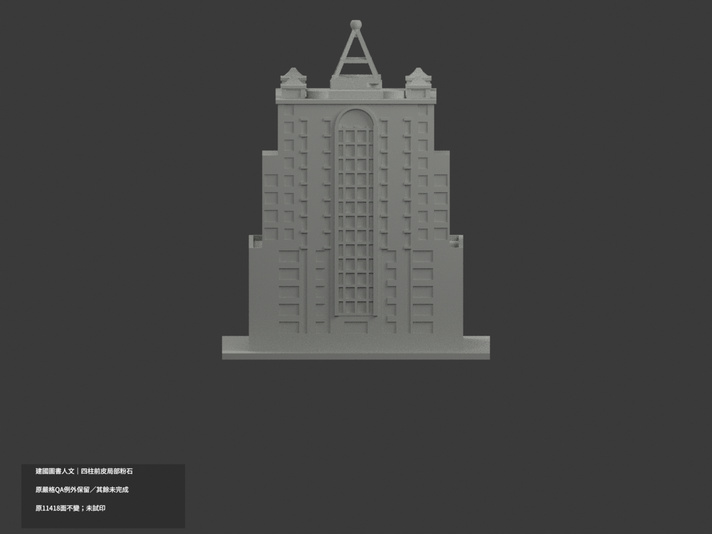
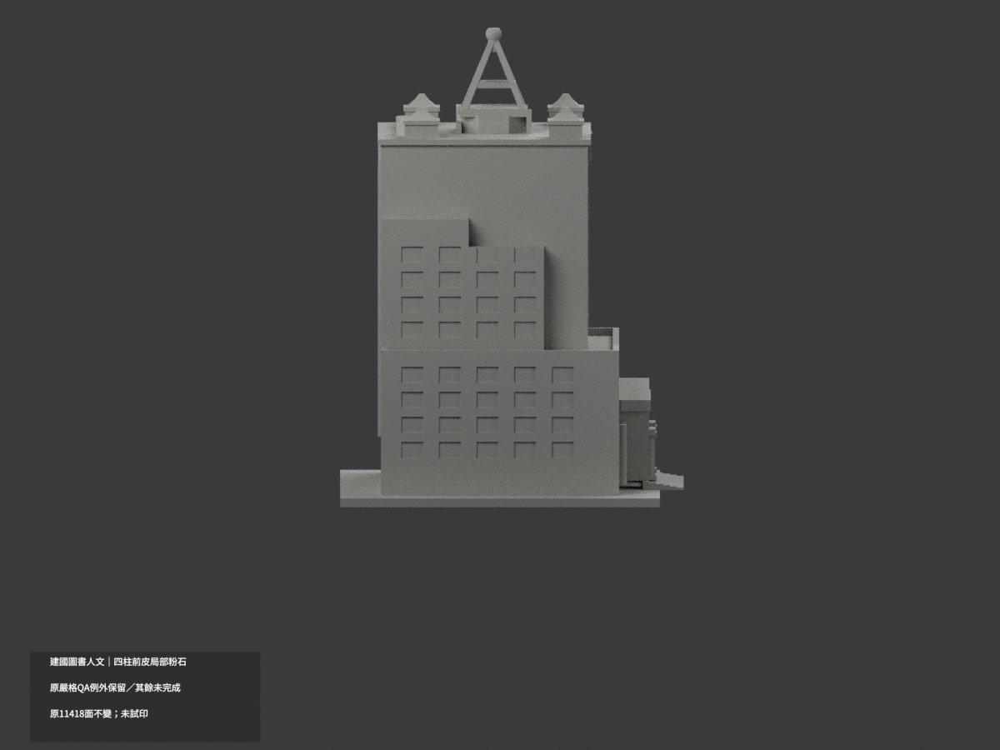
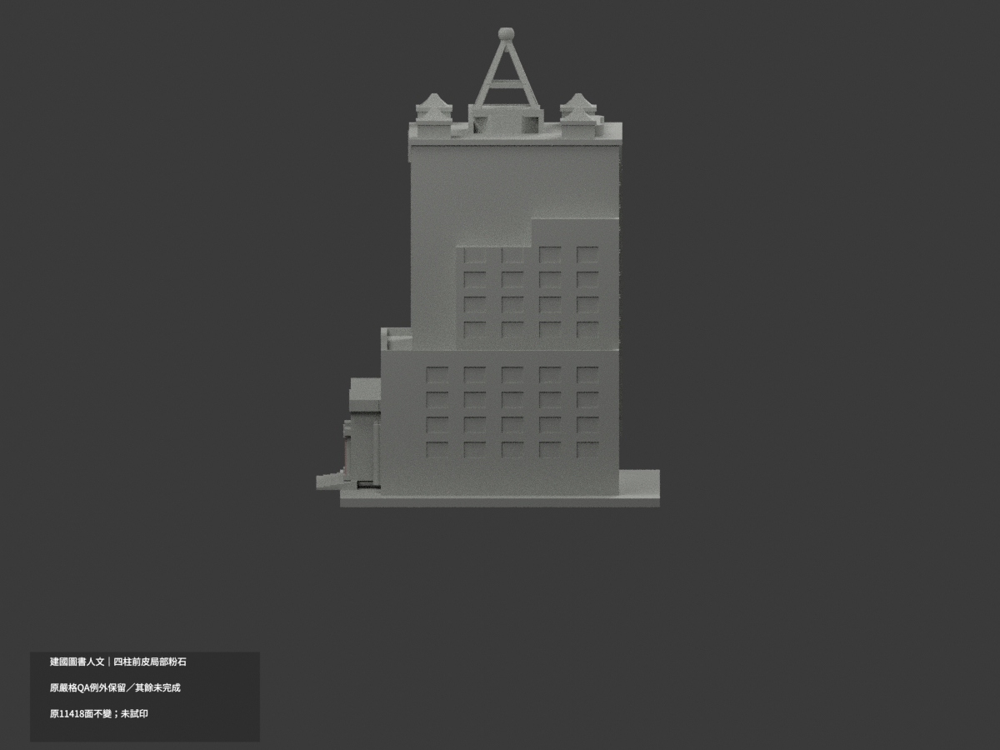
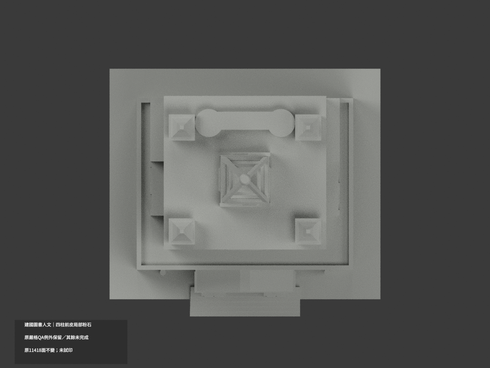
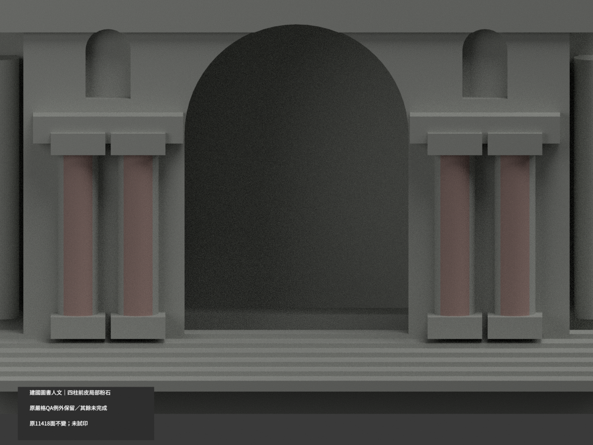
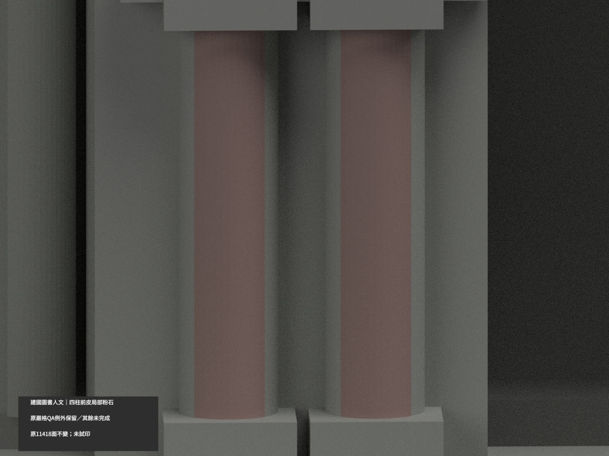
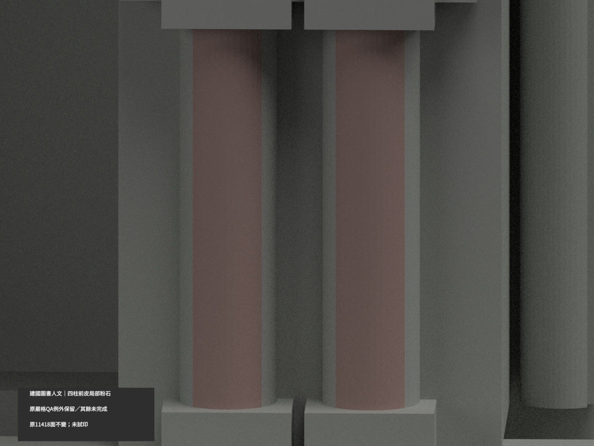

# 建國圖書人文研發大樓｜四入口柱前皮局部粉石色

**局部補色未完成：只四入口圓柱正前 1/4 的 96 原三角名義粉石色，其餘面尚未分色。** partial_color_incomplete=true、fully_colored_exterior=false。同項 ctu-library-humanities-2002／count_delta=0，建國科技大學校本部。身份 CTU Library Humanities 2002 partial color。

**這是來源材色批准，不是全幾何或列印 QA 通過。原嚴格 component／surface false、有限例外與未試印限制完整保留。** 四冠腳向下控制實際 1.4874984741mm 未達要求 1.75mm；作者83/獨審215短首弦、24條0.7424642782mm首段後0.0048272640mm真空氣均不改寫。328為跨層高損樣本而非構件數。原獨審只接受指定根接有限證據，不能保證全域最小壁厚、免支撐或任意縮小。詳見未修改的 [原獨審](independent-review.md)。

| 前斜視 | 後斜視 | 正面 |
|---|---|---|
|  |  |  |
|  |  |  |
|  |  |  |
|  | | |

## 材色範圍

原四柱中心 x=-8,-5.8,5.8,8m，y=-24m、半徑0.75m、48邊，原尺度1.75。只k30..41共48個完整有限chord立面，每域2三角，共96。以原三頂點plane/tangent與原union露出z6.125..16.625mm核，不用normal/centroid漏面；不造照片凹槽。柱基/帽/側後、黑邊拱/有字門楣山花、混框反光玻璃、主牆/露台/亭屋/鋼冠全部未知中性。資料界線不代表真實材料接縫，中性不是已證實現場灰。

原11418三角不改，96名義粉石色#BBA09A、11322未知中性#B8BAB5。不是精確石種/色票，兩外航拍只補身份與全貌，不擴柱全周。

## 原件與限制

42 immutable 原件無OBJ；原code也不因本次補色生成新原件聲稱。原STL/build、原qa-summary/validation/independent-review及所有原false值原樣保留。原README.md另存ORIGINAL-PREVIEW-README.md，原scene公開別名ORIGINAL-PREVIEW-scene.blend及私存全包，原renderer/previews不改。原實際scene單展示材不等於已驗精確實景色。

原四角亭/冠球/山花截尖與加粗近似保持，不加厚、尖化或改善原網格。來源capture未知，網站URL/發布日及2017/2023正射影像年代不構成同一時點或2026現況。照片只私存不公開貼圖。

## QA範圍

本次只檢原字節/三角multiset不變、共面一致、材色格式、隔離原build+color重現、3MF/reopen與十張1200×900。新同幾何identity PASS不是舊strict false變PASS；不重新執行或追認全域厚度/列印認證。隔離重建保留不刪，未試印/多料切片；STL無色。原有限例外需試切片、適當支撐與小心拆支撐。

CTU Library Humanities 2002 partial color. Only the front quarter of four existing 48-gon entrance shafts receives nominal pink stone: 96 original triangles; 11322 unknown neutral. Original 11418 triangles and all 42 immutable files remain unchanged, no original OBJ exists. No fluting or geometric repair is added.

SOURCE-COLOR APPROVAL ONLY. Format and unchanged-geometry identity checks do not certify all original geometry or printability. Original component/surface strict false values, downward crown-foot control 1.4874984741mm versus required 1.75mm, author83/independent215 short first chords, and 24 first segments of0.7424642782mm followed by a real0.0048272640mm air gap remain unchanged.328 means cross-layer samples, not structures. Original finite-root exceptions do not establish global minimum thickness or support-free printing. Retain flattened lantern/crown/gable approximations and no physical-print limitation. Consult unchanged independent-review.md and original structured QA. No2026/single-date survey claim; no public source photos; count_delta=0.
