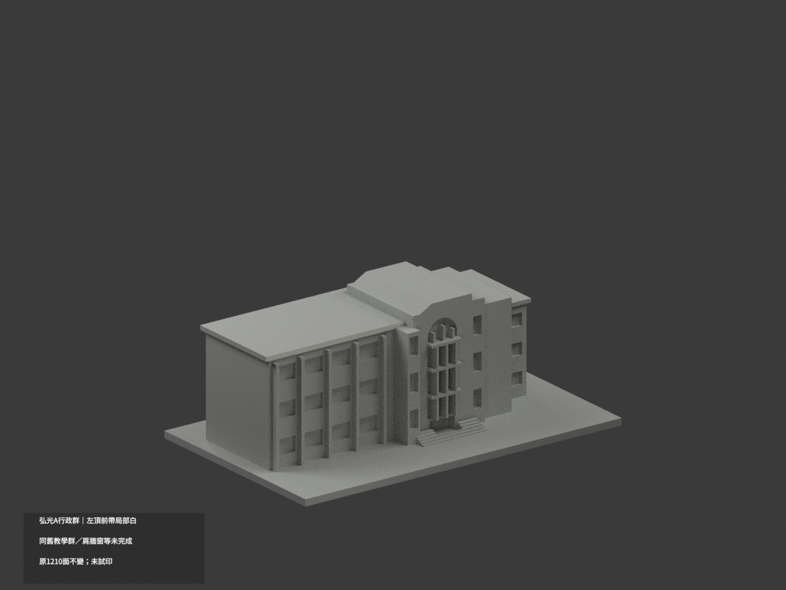
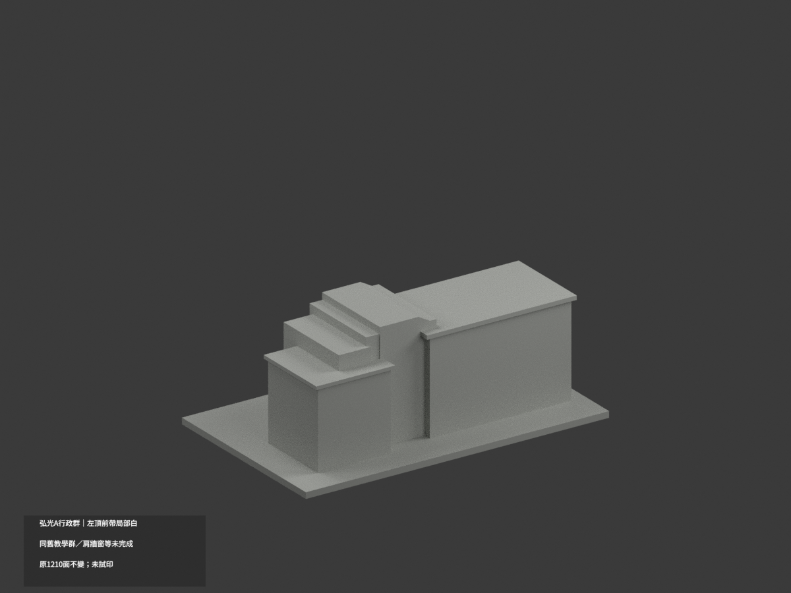
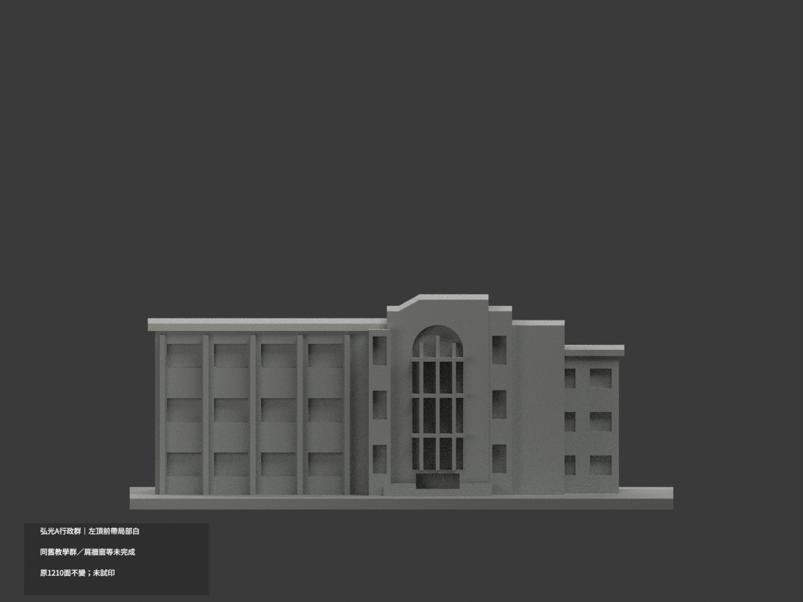
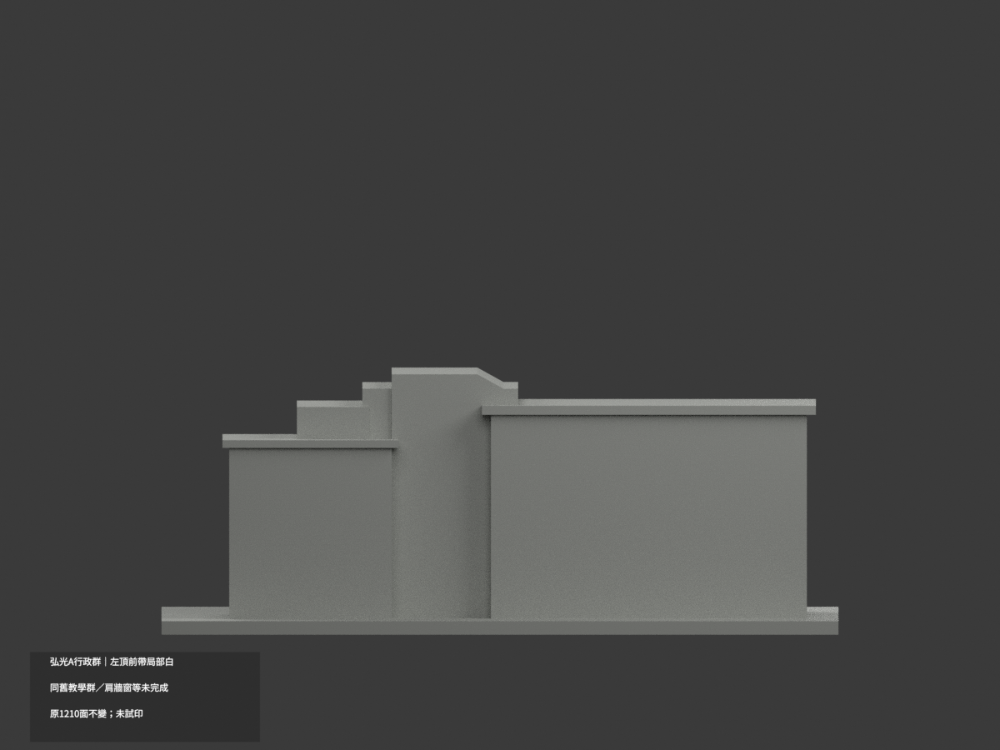
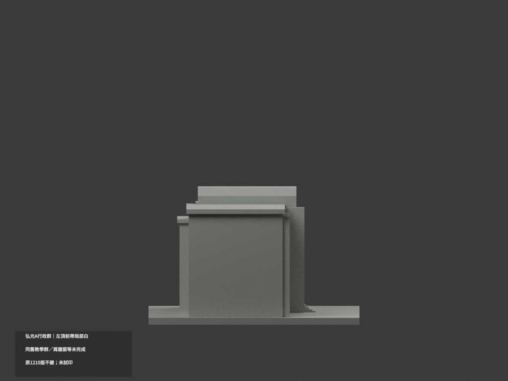
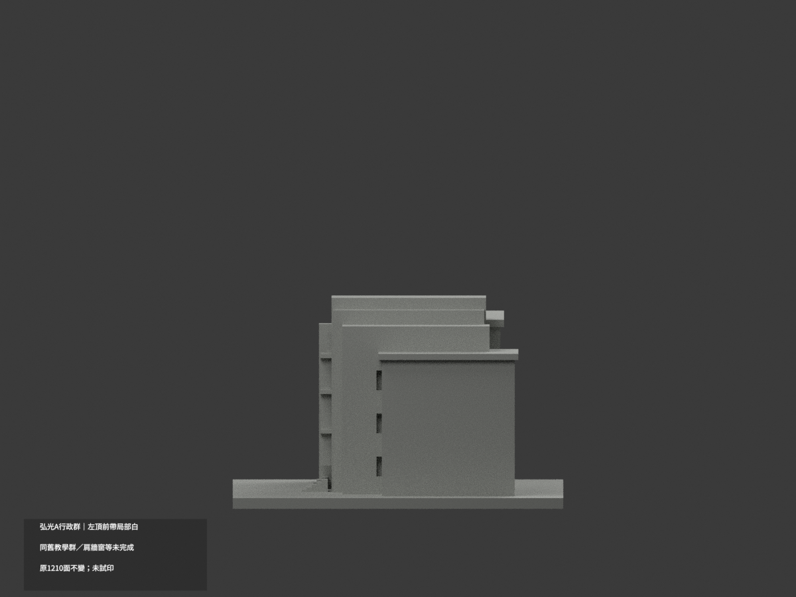
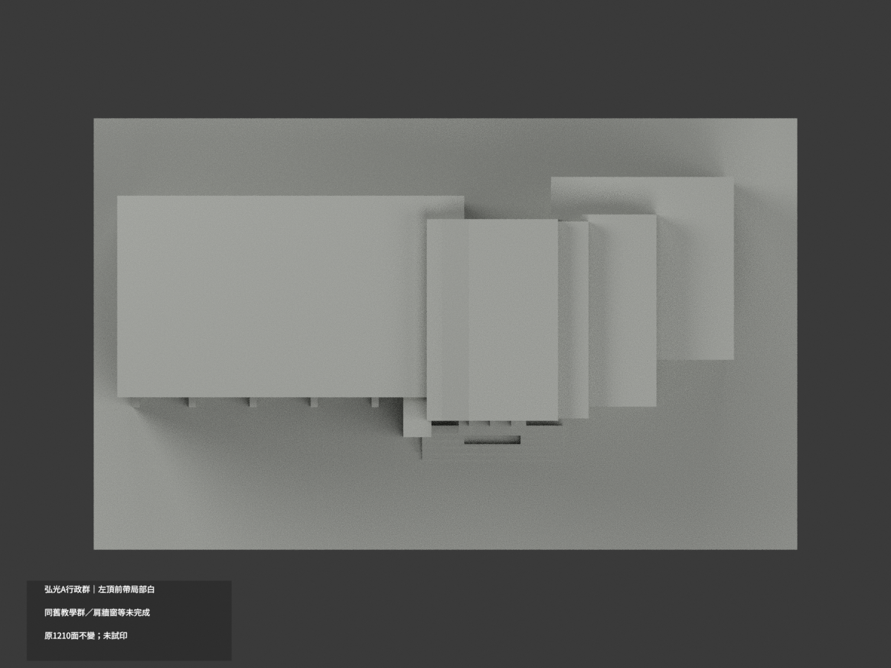
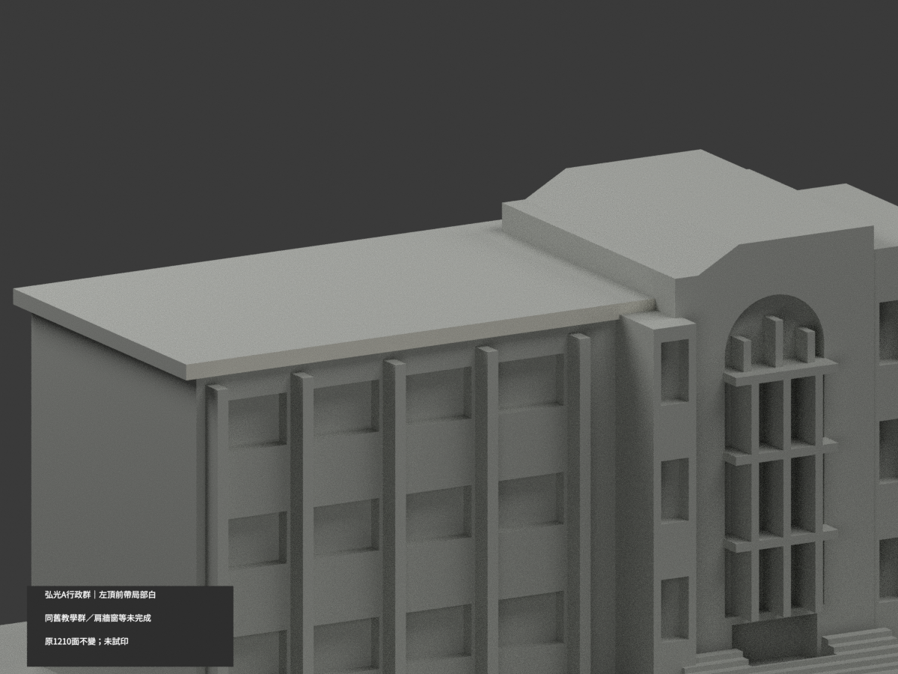
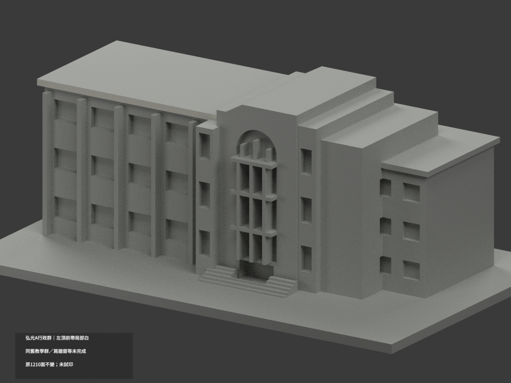
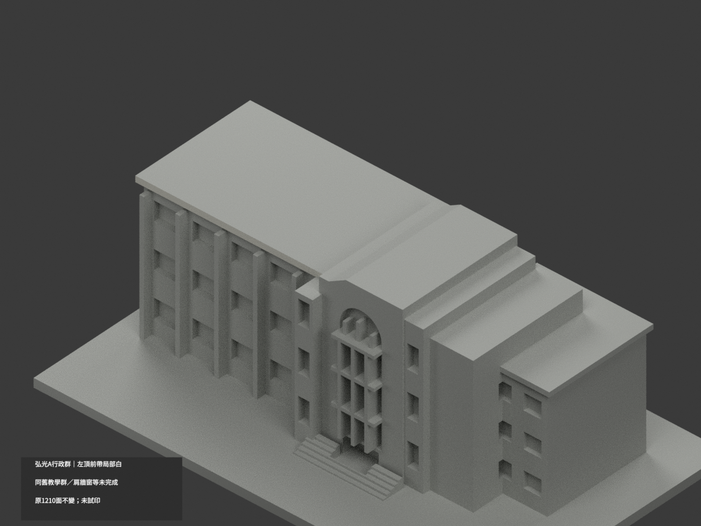

# 弘光A行政／舊教學群｜左頂前帶局部白

**紅肩、窗牆與其餘材域未完成分色。** partial_color_incomplete=true、fully_colored_exterior=false。僅左長翼屋cap前面4原面名義白，非全棟完整補色。

| 總覽 | 背側 | 正面 |
|---|---|---|
||||
||||
||||
||||

## 材色範圍
同 hku-a-administration 原項目，same-item、count_delta=0。1210原三角面、STL與build_model.py字節不變。弘光科技大學校本部A行政／舊A教學是同一群，舊新名稱不另拆棟計數。右低翼未由本張實照核材。原公開包無OBJ，不假稱保存不存在的原件，程式可產生不代表原包存在。
- 原左屋cap add(−33,8,48.2,74,43,2)完整前平面y−13.5，原x−70..4、z48.2..50.2，4原Boolean三角名義暖白。
- 全三頂點有限plane核，整無限plane全部4原面等於有限域；左紅肩合併讓近端底抬至48.8、中央量體遮至x−4，這是原Boolean邊界非人工材色裁線，全部碎面保留、不補三角缺口。
- 其餘1206中性：中央白面跨下部門／樹遮、左紅肩缺真下門洞、右紅肩金徽無獨立面，均不能整塗白紅；教室牆混紅白，弧窗背混棕填板／反光／框，細通風口及所有窗背、屋頂／側／底、右低翼、階與未知背均不硬染。
- 原粗化群體／拱與右翼形狀不因補色被追認為實測。材色／中性分界表證據範圍非真實材縫。不新造徽字／細通風／門窗界。

## 來源與日期
親看校方已建成外觀實照，左翼最上前帶白色有據；原preview只供面域對照，不作右低翼色證。拍攝日未知，不宣稱2026現況。
原照私人參考、不公開、不貼圖；未確認CC或再散布授權，不保證商用。HEX為名義白族非校準色票。正式GO已發行，繼承的先期review-only文字不改狀態，仍須builder QA。

## 格式與列印
[原STL](model.stl) · [逐面材色3MF](appearance.3mf) · [Blender](scene.blend)
原150×92mm展示底座，照片近似非測量比例。STL無色；3MF／Blender有真逐面材。兩材標籤不是驗證兩色／四色耗材切片，未實際列印，無切片路徑。

## 重建與 QA
原build_model.py → colorize_model.py → export_appearance.py → validate_color.py；Blender render_color.py／verify_color_scene.py。完整隔離原build＋color重建、原bytes／全三角multiset、閉合正體積、3MF逐面材、scene重開、十圖1200×900及圖文hash。原依賴隔離使用，不改原碼；程序不替代人工來源核對。
原README／previews／validation／renderer保留歷程，不冒充新QA；沒有刪檔。

## English scope
Partial only:4original Boolean triangles onthe whole leftwing roofcap front,nominaloffwhite;1206neutral. Original1210triangles unchanged,no originalOBJ. Hungkuang A administration/formerAteaching samegroup,count0;rightlowwing unverified. Entire infiniteplane equalsoriginalfinite domain;shoulder/centralunion boundaries retained. Mixedred shoulderswithdoor/emblem,centralwhitewall,windows,roofskins andotherwalls neutral. Captureunknown,not2026condition. Not fullsurvey,testprinted or validatedfilament slicing.

## 版本 2 名稱勘誤

3MF 與 Blender 物件顯示名稱統一更正為「HKU A Administration partial color」，並同步匯出、渲染與驗證程式的名稱。場景重新開啟與保存後，除物件名稱及非渲染執行期記錄外，網格、材質、變換、相機、燈光與字幕語義完全相同；場景檔案雜湊因此更新。原 STL、材色陣列與十張預覽位元不變，未重新渲染。原有局部補色及未試印限制不變。
