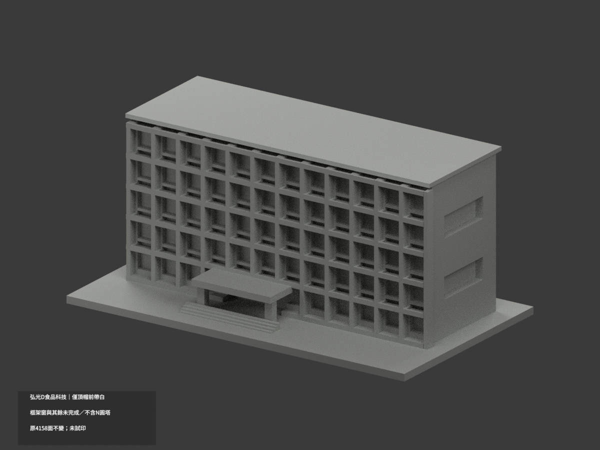
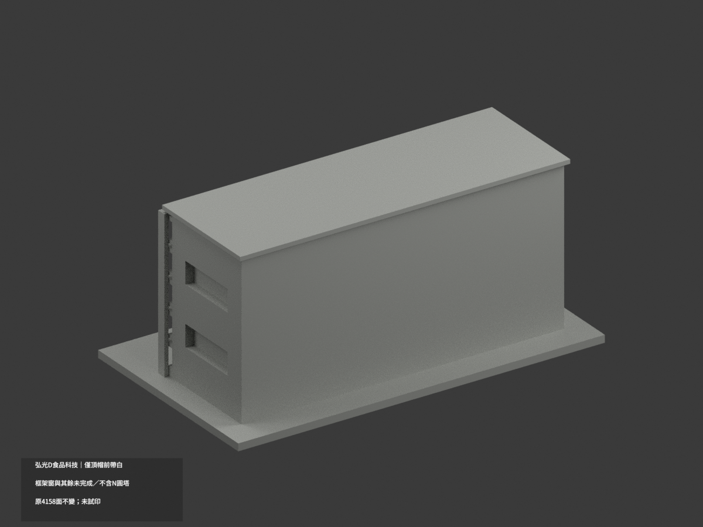
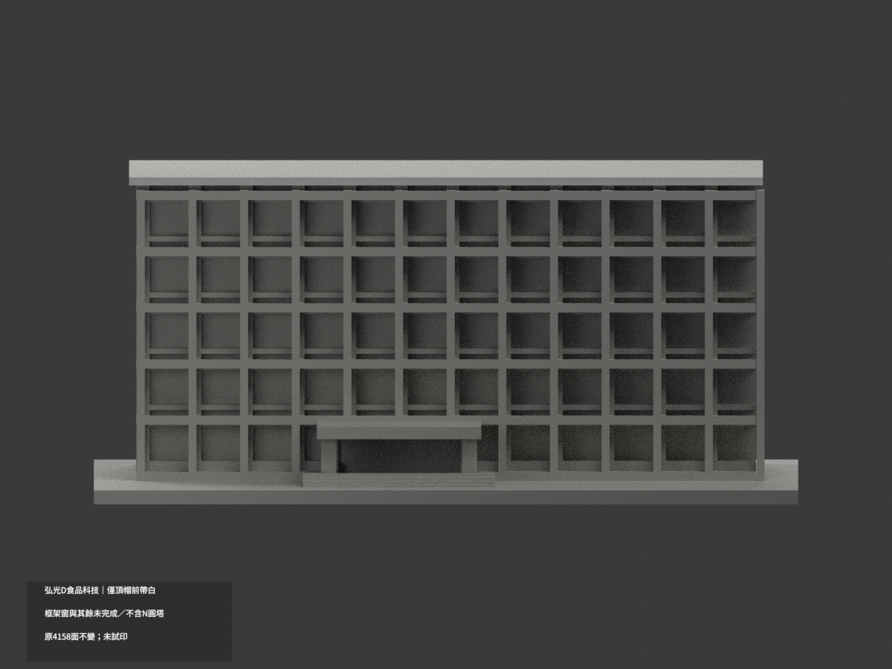
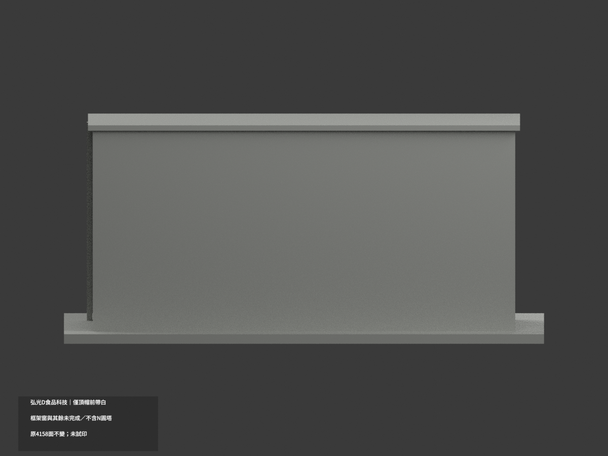
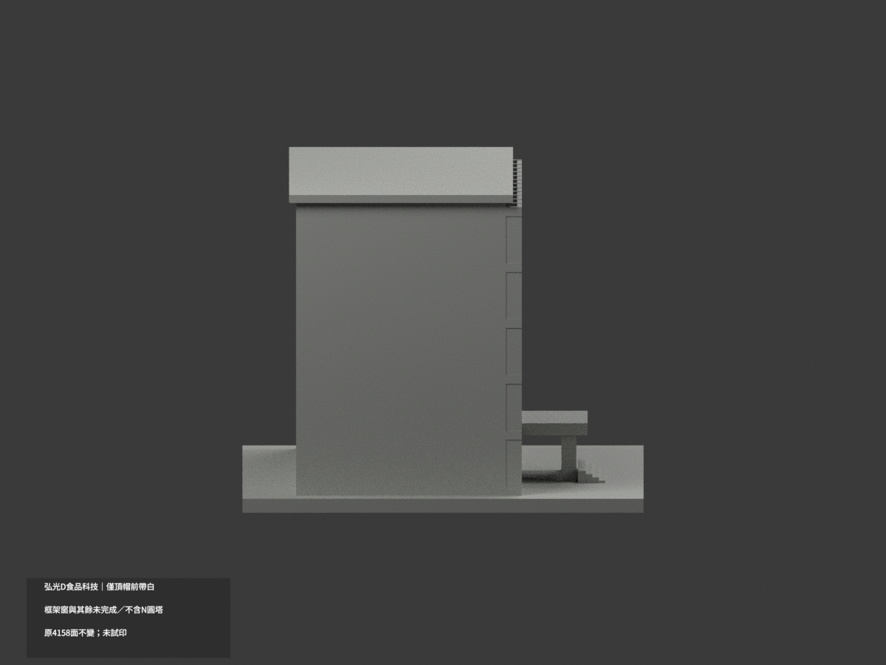
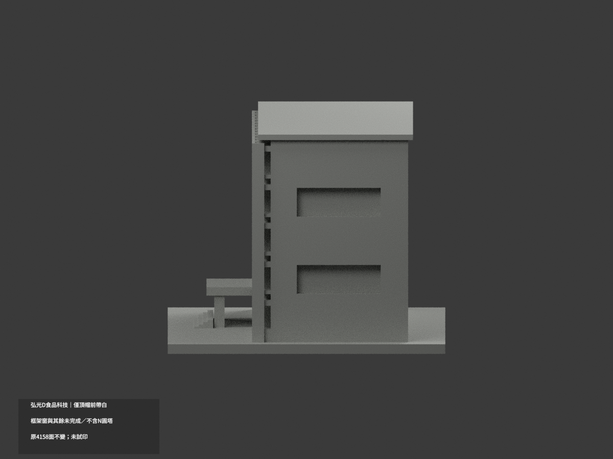
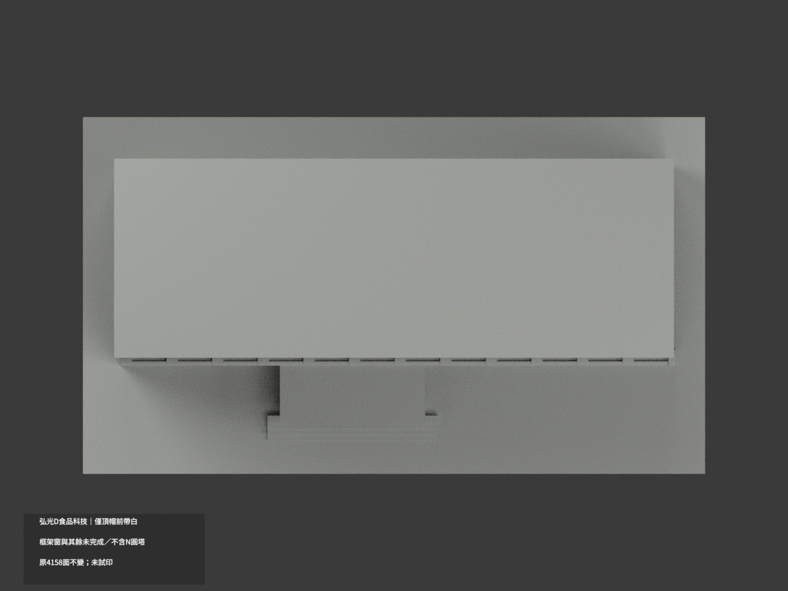
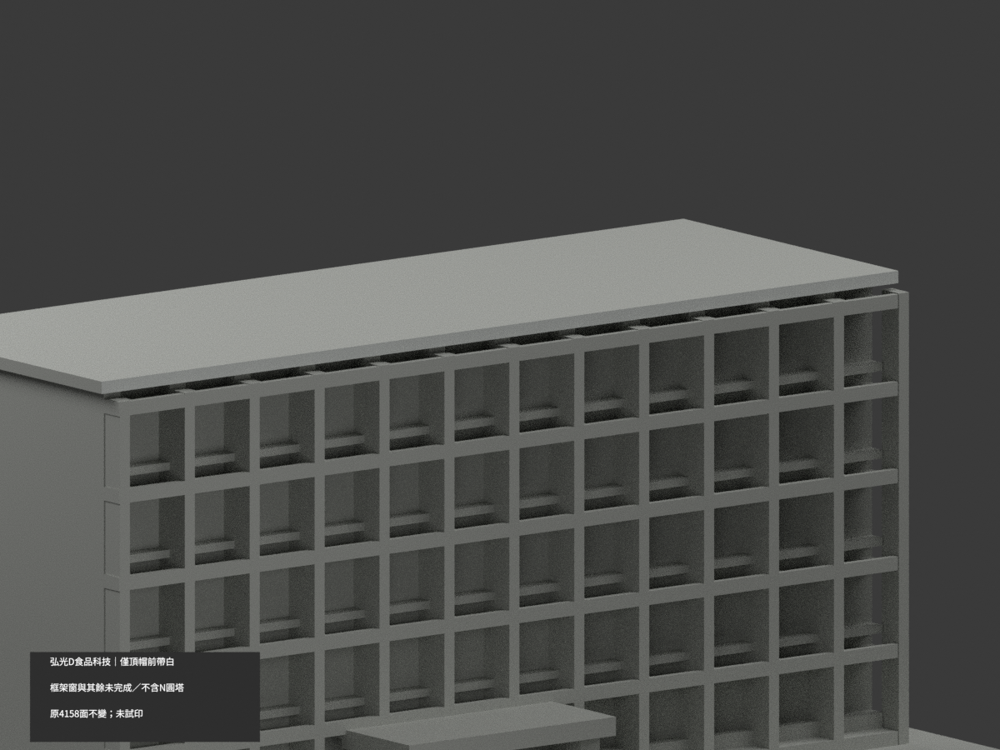
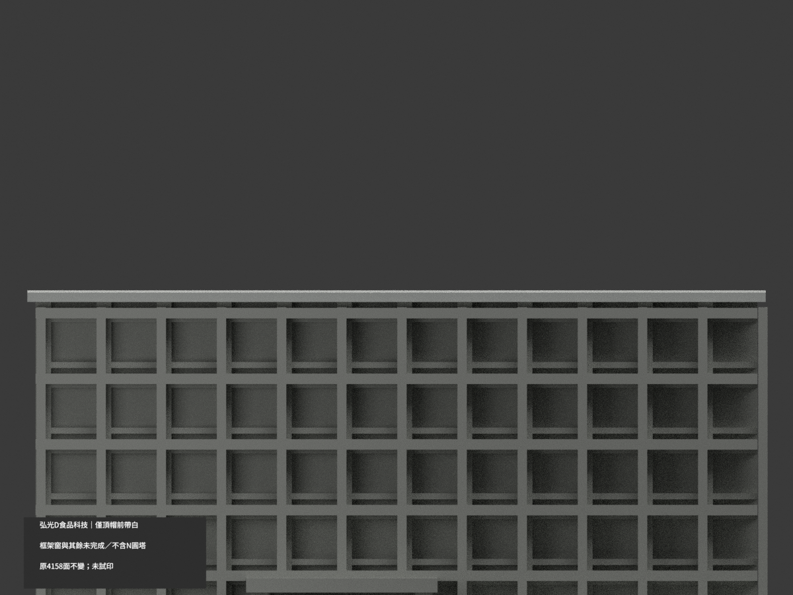
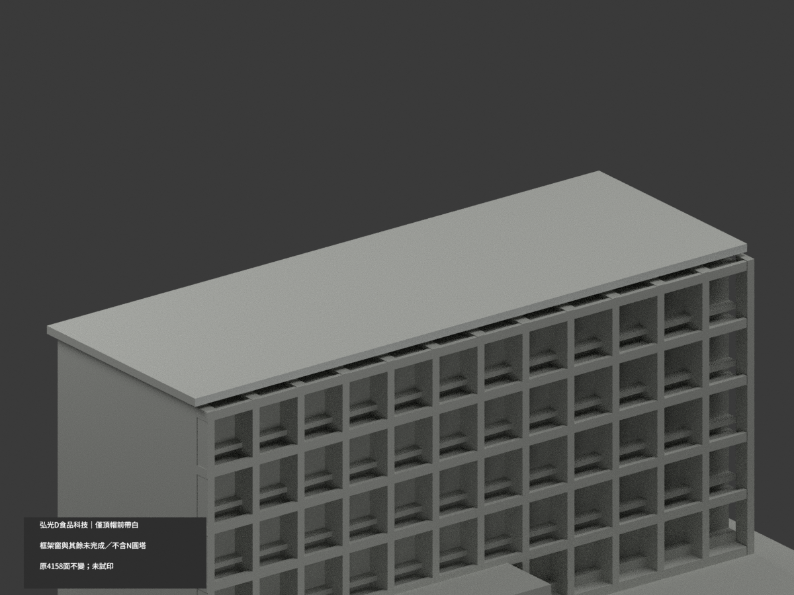

# 弘光D食品科技｜頂帽前帶局部白

**局部補色未完成：只頂帽前帶2原三角淺白；框架窗與其餘未完成／不含N圓塔。** partial_color_incomplete=true、fully_colored_exterior=false。同項hku-d-food-science／count_delta=0，弘光科技大學校本部；D食品科技不等於F餐旅，也不包含左鄰N圓塔。

| 前斜視 | 後斜視 | 正面 |
|---|---|---|
|  |  |  |
|  |  |  |
|  |  |  |
|  | | |

## 材色範圍

先枚舉原y−15整個無限plane，所有三頂點容差0.0001mm；恰2面共邊單component，完整覆蓋原x±67.5、z66..67.7矩形。不是截一半面或按normal/面心判定；2白、4156中性，957原共面連通域uniform，原4158三角與頂點不變。

頂帽前窄帶有白色族證據；不外推屋上面、側邊、背面。大格架右側有巨幅廣告、底部植栽遮蔽，整個原連通格架中性，不把廣告當白結構，也不隨意只截左側原三角染白。窗洞背板混酒紅窗間板、框、玻璃、冷氣，整體中性。入口棚含金字，無原材界不整白。原右側陽台凹口無本照色證、階地/未見後面全中性，左N圓塔完全排除。中性不是實景灰，資料覆蓋界不是材接縫。

## 來源與版本限制

親看校方提供外照及原碼/預覽，只支持頂帽前緣名義白色，不模擬污斑/細欄/植物。拍攝日期未知，不聲稱2026現況。原D食品科技五主要樓層與通風短帶近似不因補色追認實測，通風短帶不是新增樓層。原右側/屋背估算保留，不新增設備或幾何。照片私人，不公開貼圖，不推未見CC為商用許可。

## 檔案與 QA

原STL/build與4158三角字節/座標不變；immutable18件無OBJ，原builder雖輸出OBJ，隔離生成只私存，不宣稱原repo有OBJ。原README存ORIGINAL-MONOCHROME-README.md，舊單色previews/QA保歷程。appearance.3mf兩展示材、scene.blend實際面材、color-mesh.npz同原三角。精確requirements隔離build+color、閉合正體積、3MF面材座標/Blender重開/10張1200×900檢核；重建保留不刪，未實際列印或證多色切片。

## English limitations

Partial only:entire y=-15 plane exactly2 shared-edge triangles covering original x±67.5,z66..67.7 front roof-cap fascia offwhite;4156neutral. No centroid/normal/bbox clipping;957coplanar domains uniform,original4158triangles/STL/build unchanged,noimmutableOBJ,count_delta0. Isolated builder-generated OBJ private,not an original repo file. Billboard-covered connected grid,windowbacks mixing burgundy panels/frames/glass/AC,lettered entrance canopy,right balcony pockets,roof top/side/rear and ground remain neutral. D Food Science only,not F Culinary or neighboring N round tower. Unknown capture,no2026survey or geometry recertification. No public source images/textures,not testprinted.
