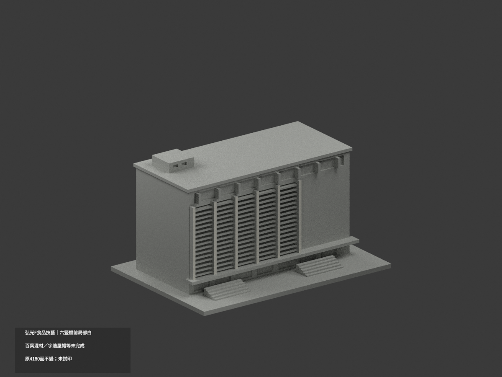
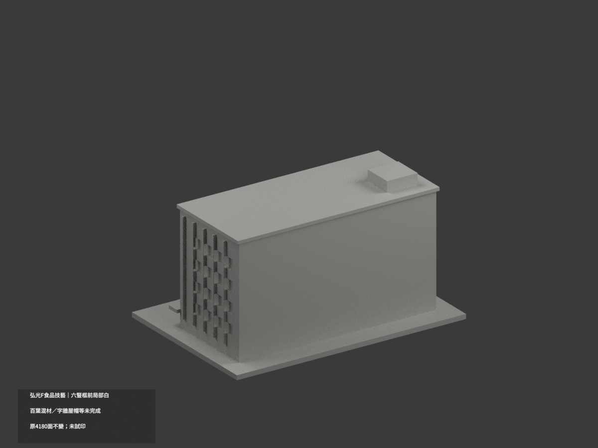
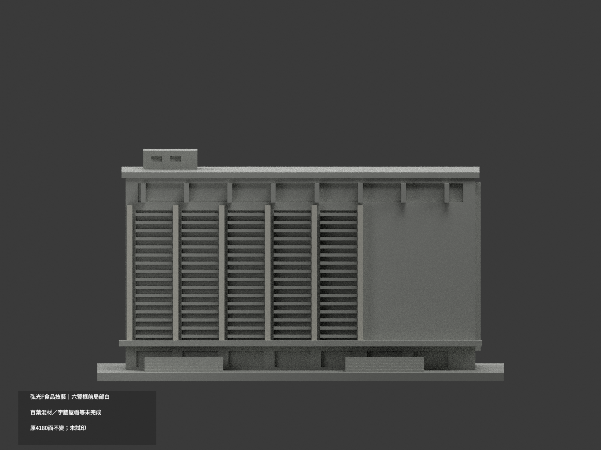
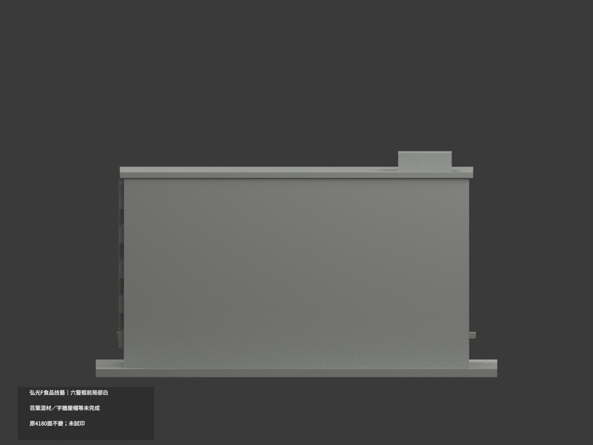
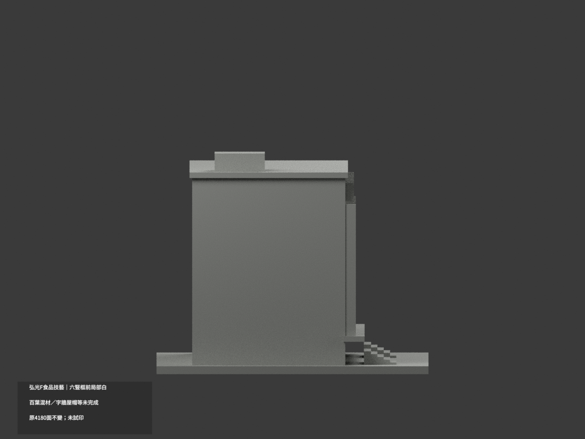
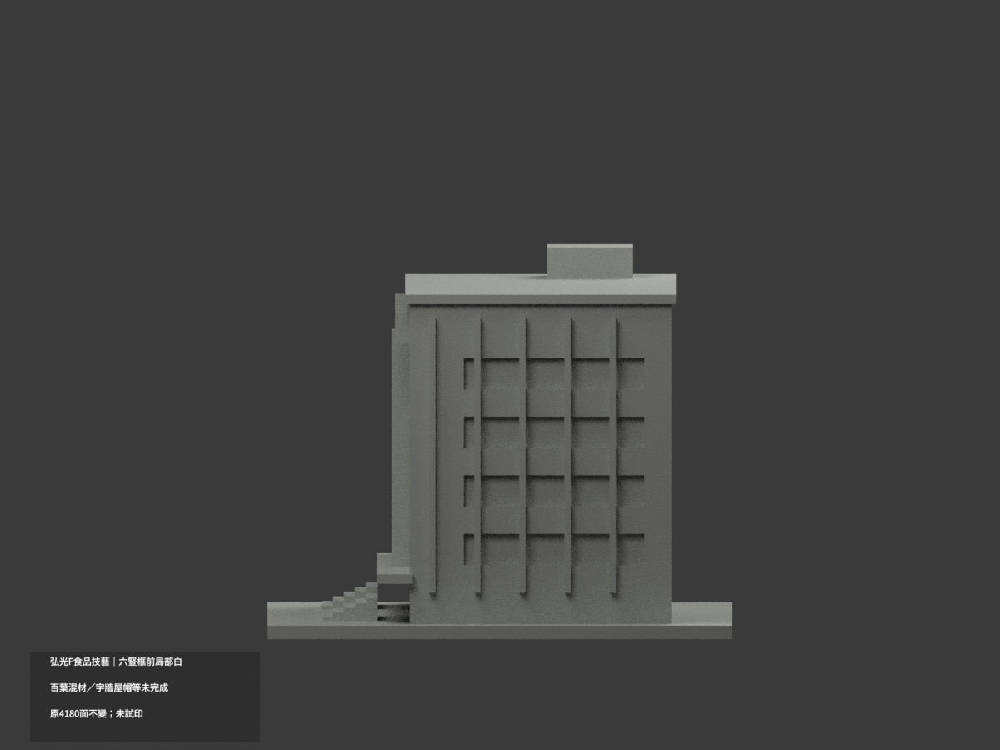
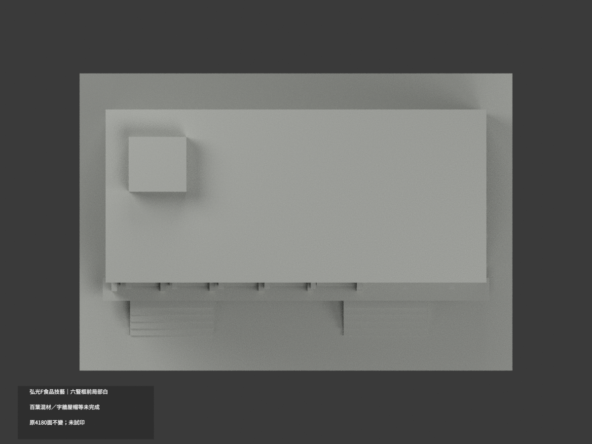
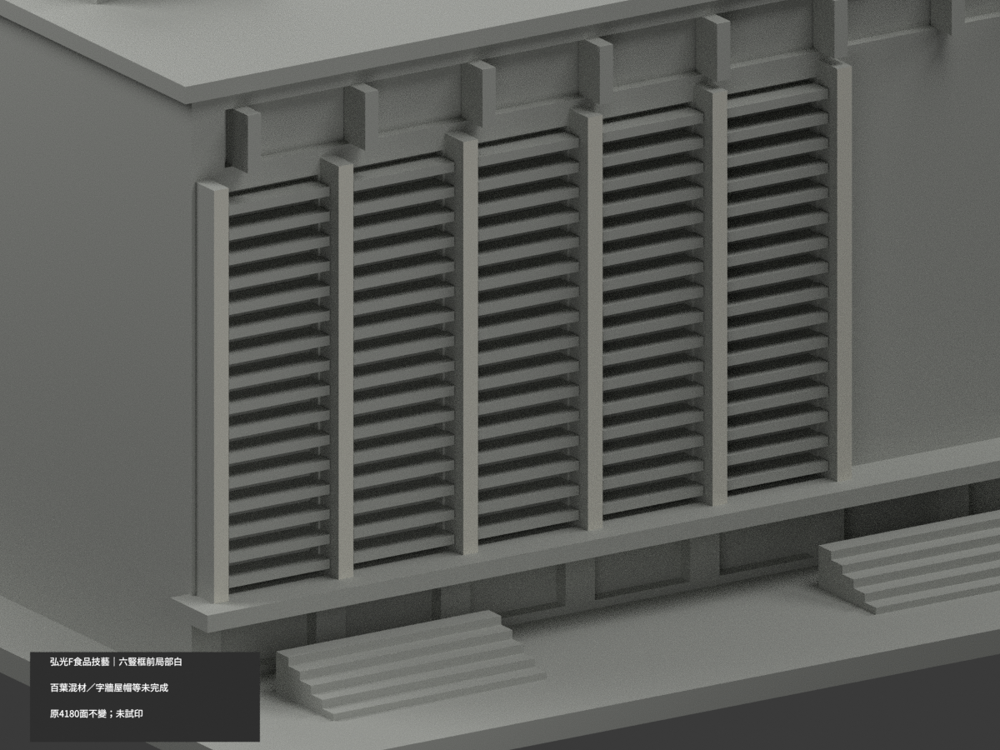
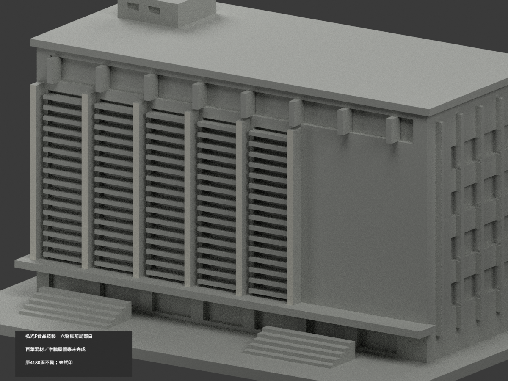
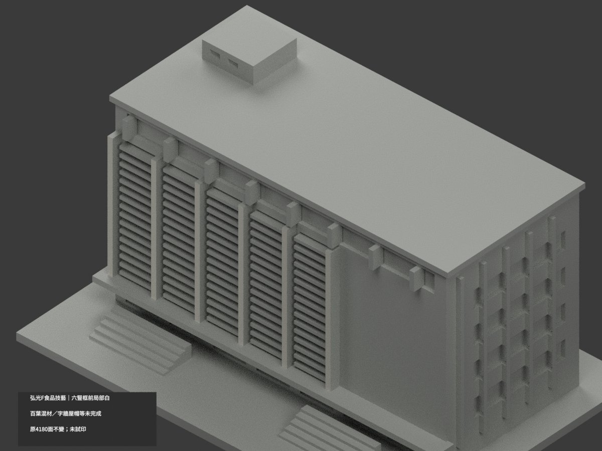

# 弘光F食品技藝大樓｜六豎框前局部白

**百葉、字牆與屋帽等材域未完成分色。** partial_color_incomplete=true、fully_colored_exterior=false。僅六直框完整前表面12原三角名義白，非全棟補色完成。

| 總覽 | 背側 | 正面 |
|---|---|---|
||||
||||
||||
||||

## 材色範圍
同 hku-f-culinary-arts 原項目，same-item、count_delta=0。4180原三角面、STL與build_model.py字節不變。弘光科技大學校本部F食品技藝大樓，不是活動頁標題L棟，也不是另棟D食品科技。原公開18件無OBJ；原碼可生成不代表原包存在，不造原件。
- 僅原六獨立框前y−24，中心x−63/−46/−29/−12/5/22、寬2、原z12..64，完整12原面名義暖白。全三頂點有限矩形核，整無限plane12面恰等於六矩形聯集，不靠normal或centroid。
- 原雨棚Boolean自然遮去框底至z14.1，這是原幾何邊界，不是材色人工裁線。全部原裁切保留，無新增頂點/缺口/彩繪線。
- 其餘4168面中性：頂帽原全寬與照片上退縮跨度不唯一，整帽不染不裁半。五片浮雕百葉混棕黑實板／玻璃，右金字牆、紅字棚、窗背、側後、屋皮、階及設備均未證，不整塗。
- 原粗化百葉與群體不因補色追認為實測；中性分界僅表示證據範圍，不是現實材縫。無補造文字、門窗、周邊棟或人物。

## 來源與日期
親看官方活動導引中的已建成外觀，照片食品技藝字樣辨識F；活動頁L標題不套到此棟。畫面2024旗是場景內容，非精確拍攝日期，拍攝日未證，不稱2026現況。
原照私存不公開／不貼圖，未確認CC或再散布授權，不保證商用；HEX是近似名義白非色票。正式GO已發，先期review-only標籤不免除builder QA。

## 格式與列印
[原STL](model.stl) · [逐面材色3MF](appearance.3mf) · [Blender](scene.blend)
原150×103mm展示底座，照片近似非測量比例。STL無色，3MF與Blender實際逐面分材；兩材標籤不等於驗證兩色／四色耗材切片，未實際列印，無切片路徑。

## 重建與 QA
原build_model.py → colorize_model.py → export_appearance.py → validate_color.py；Blender render_color.py／verify_color_scene.py。完整隔離精確原build＋color重建、原bytes／全三角multiset、閉合正體積、3MF逐面材、scene重開、十圖1200×900及圖文hash。隔離原依賴，不改原碼；程序不替代人工來源核對。
原README／previews／validation／renderer保留歷程，不冒充新QA；沒有刪檔。

## English scope
Partial only: twelve original triangles on six complete front framing strips are nominal off-white;4168 faces remain neutral. All4180 original triangles and source bytes unchanged. Original18-file package contains noOBJ. F Culinary Arts is not the event-page L venue or separate D Food Technology building. Whole y−24 plane equals six original finite rectangles; awning Boolean boundaries retained. Topcap correspondence is unproven, so no partial-span painting. Mixed brown louvers/glazing, gold lettering wall, marked awning, windows, sides and roof remain neutral. Visible2024 flag does not establish capture date; no2026 condition or survey claim. Not testprinted or filament-slicer validated.
