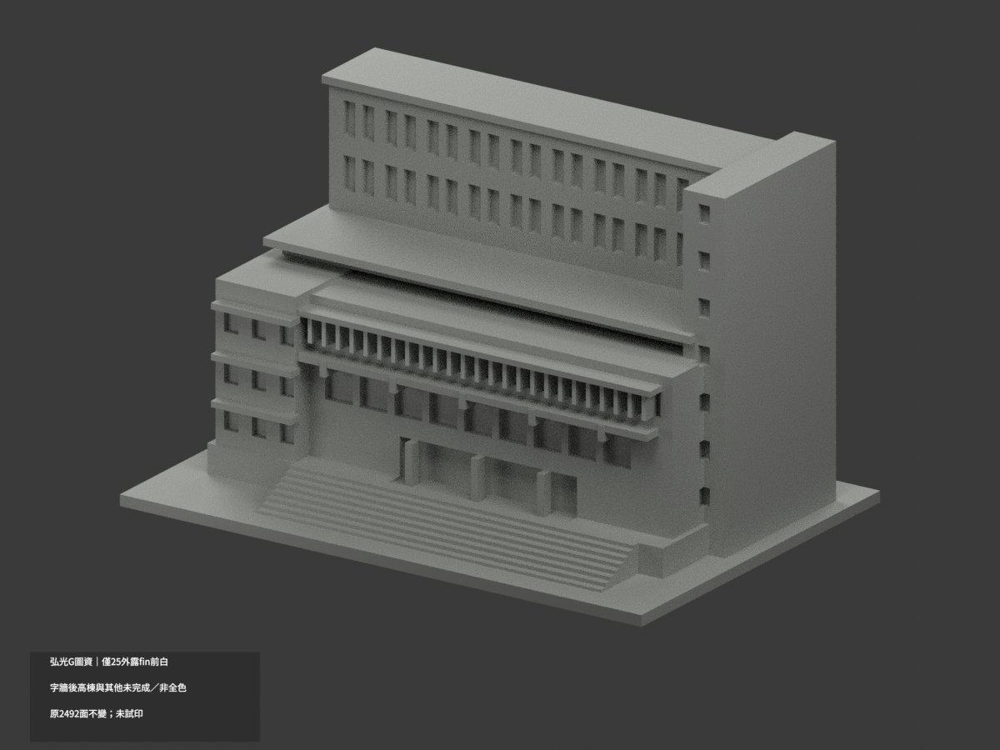
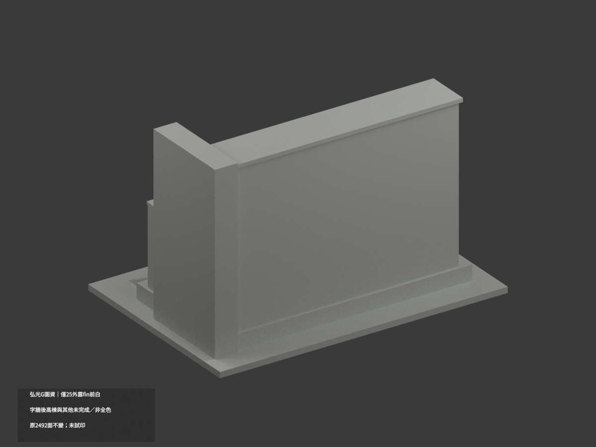
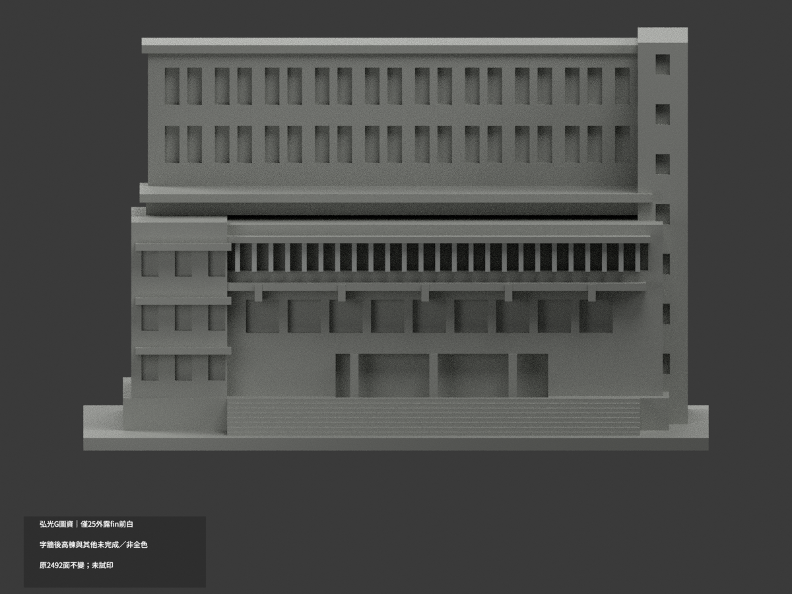
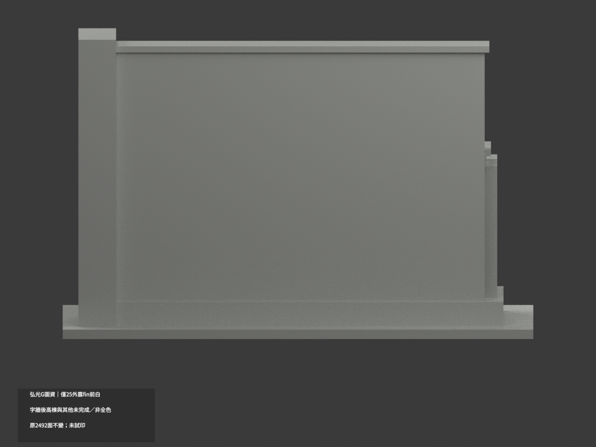
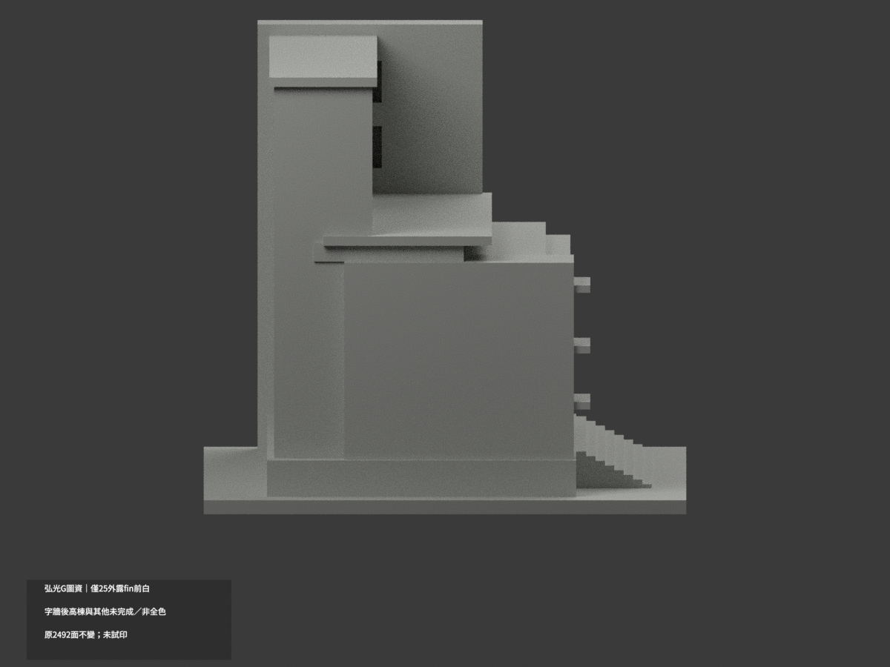
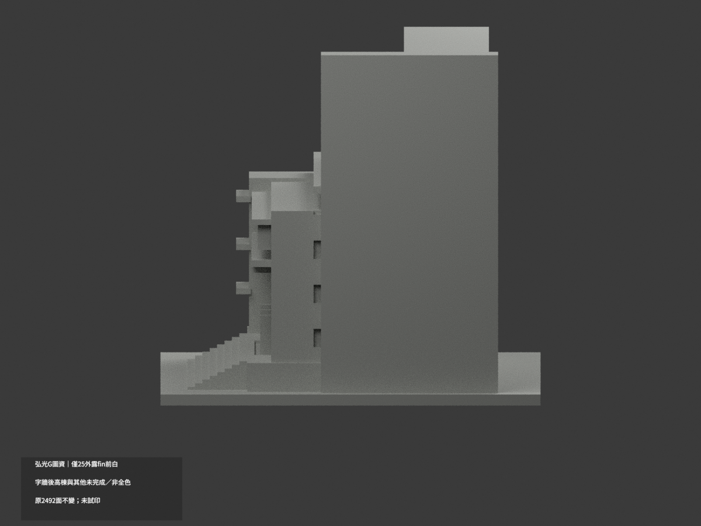
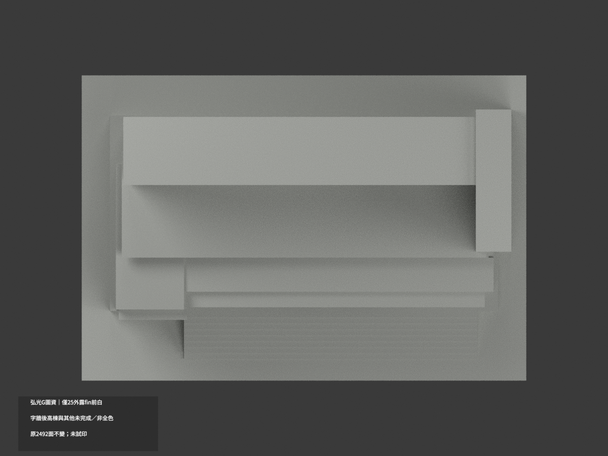
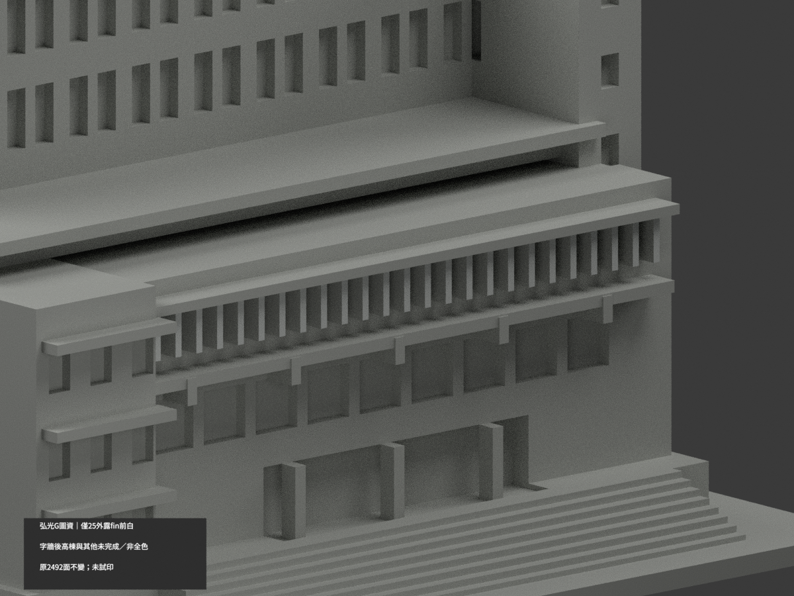
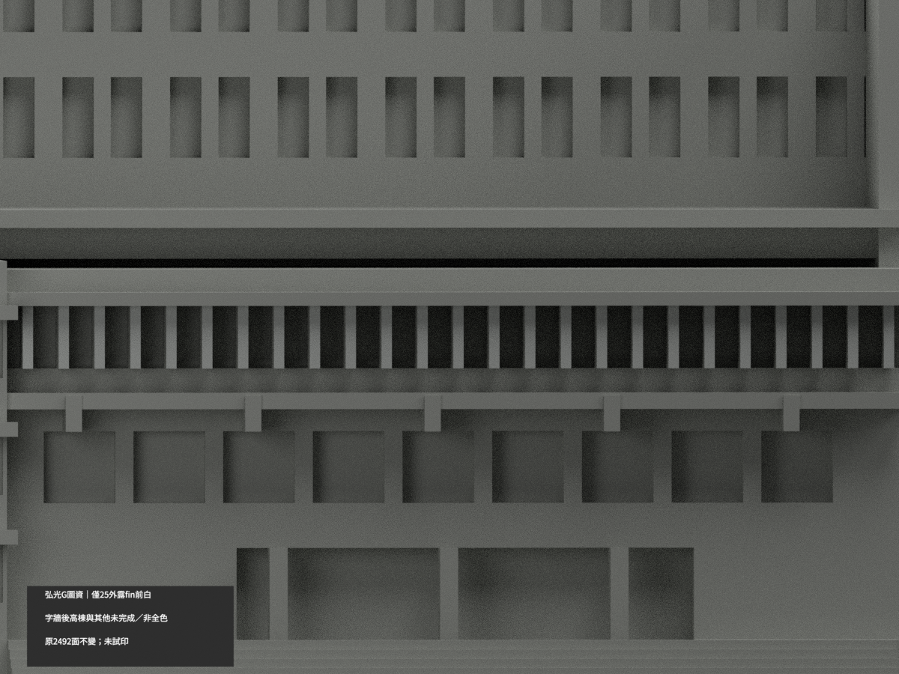
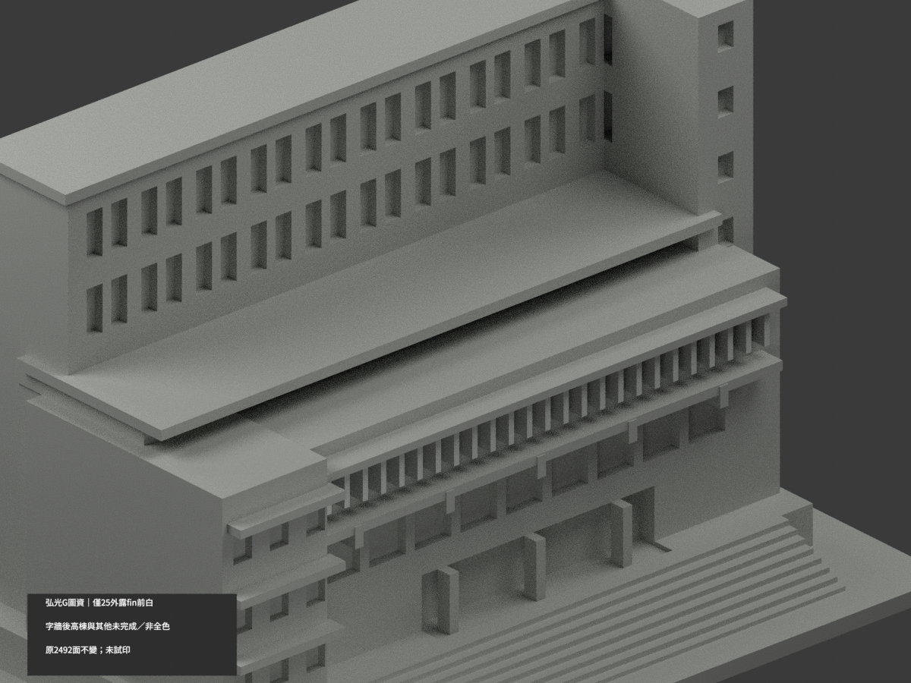

# 弘光G圖資群｜25條外露窗格fin正面局部白

**局部補色未完成：只前低館25條外露fin正面50原三角淺白；字牆後高棟與其他未完成／非全色。** partial_color_incomplete=true、fully_colored_exterior=false。同項hku-g-library-information／count_delta=0，弘光科技大學校本部。圖書館前低館與後資訊高棟同一原群，不按名稱拆兩套。

| 前斜視 | 後斜視 | 正面 |
|---|---|---|
|  |  |  |
|  |  |  |
|  |  |  |
|  | | |

## 材色範圍

枚舉全原y−25.1無限plane，所有三頂點容差0.0001mm，50面恰25個共邊連通矩形各2面。原碼有26條fin，但x−42被左量體union吞掉，原STL沒有可見前面，不能補造52面。原fin前完整選取，不任按面心/高度切色；共608共面連通域uniform，原2492三角與頂點不變。50淺白、2442中性。

只窗格fin外朝前面，不外推側返、玻璃背或橫框。上方有字牆、粉色長簷與深影未有原對應材界，整體中性；大面石紋/分縫/立柱、遮陽、門窗框反光、階與底座不硬合一色。後高棟、右塔、屋面與未核側背中性，不以原碼描述紅色當色證。中性不是實景灰，資料範圍不是材料接縫。

## 來源與版本限制

親看官方前低圖書館外照，白細fin前緣連續有據；只名義展示色族，非測色或石材紋理。官方2025發表脈絡不等於獨立確認拍攝年；原幾何另參2013照片，後高棟本輪未獲色證，不能聲稱2026現況或用本輪色審追認整群幾何。前低館與後高棟仍同一原模型群，未新增內部/構造/棟數。照片私人，不公開貼圖，不推未見CC為商用許可。

## 檔案與 QA

原STL/build與2492三角字節/座標不變；immutable18件無OBJ，原builder雖會輸出OBJ，隔離生成僅私存，不偽稱原repo有OBJ。原README存ORIGINAL-MONOCHROME-README.md，舊單色previews/QA保歷程。appearance.3mf兩展示材、scene.blend實際面材、color-mesh.npz同原三角。精確requirements隔離build+color、閉合正體積、3MF面材座標/Blender重開/10張1200×900檢核；重建保留不刪，未實際列印或證多色切片。

## English limitations

Partial only:whole original y=-25.1 plane50triangles forms25 separate shared-edge fin-front rectangles,offwhite;2442neutral. Code specifies26fins,but x=-42 is swallowed by original union and has no exposed front;do not invent52faces. All608coplanar domains uniform,original2492triangles/STL/build unchanged,noimmutableOBJ,count_delta0. Generated isolated OBJ is private,not an original repo artifact. Lettered wall,pinkcanopy/mixedshadow,glassbacks,finreturns,crossframes,stonewalls,stairs and rear information tower/roof neutral. One original library/information building group,not two new packages. Official2025 publication not verified capture;original2013 geometry source does not certify rear colors or2026current condition. No public source images/textures,no geometry recertification,not testprinted.
