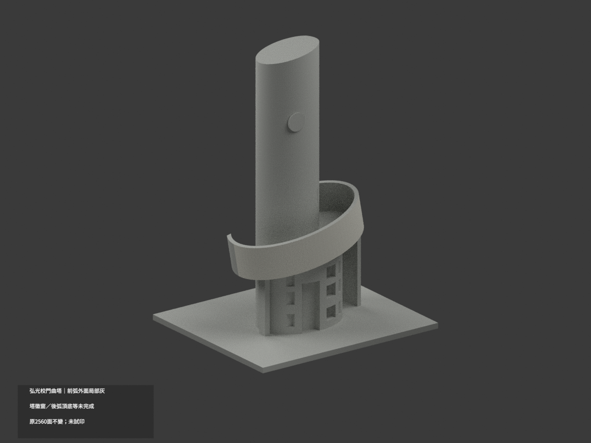
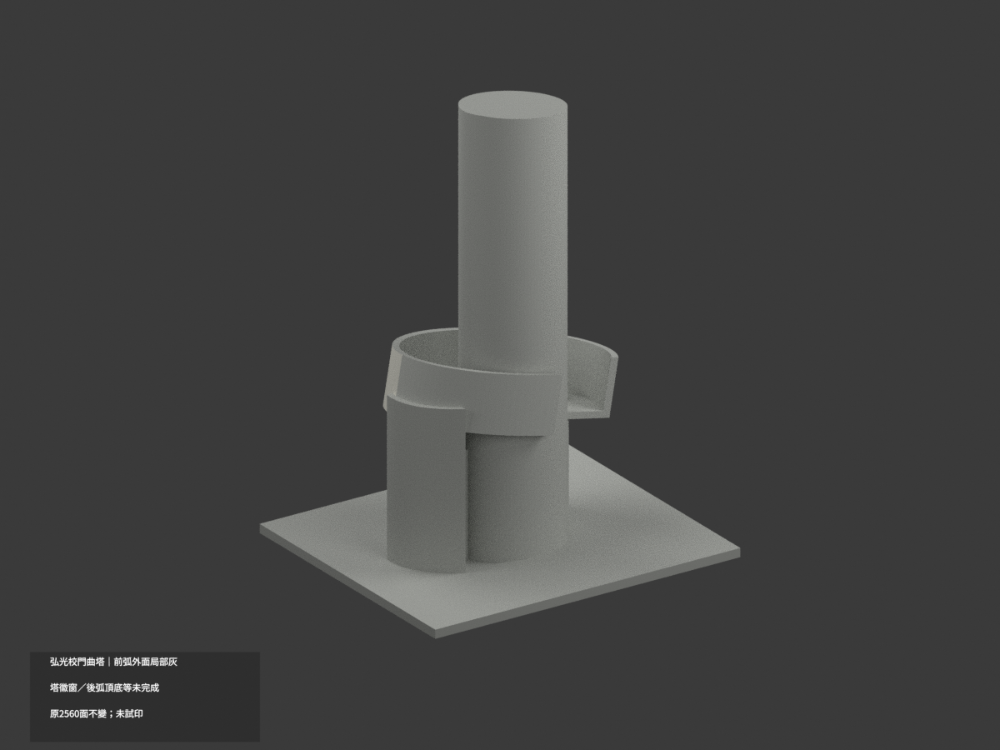
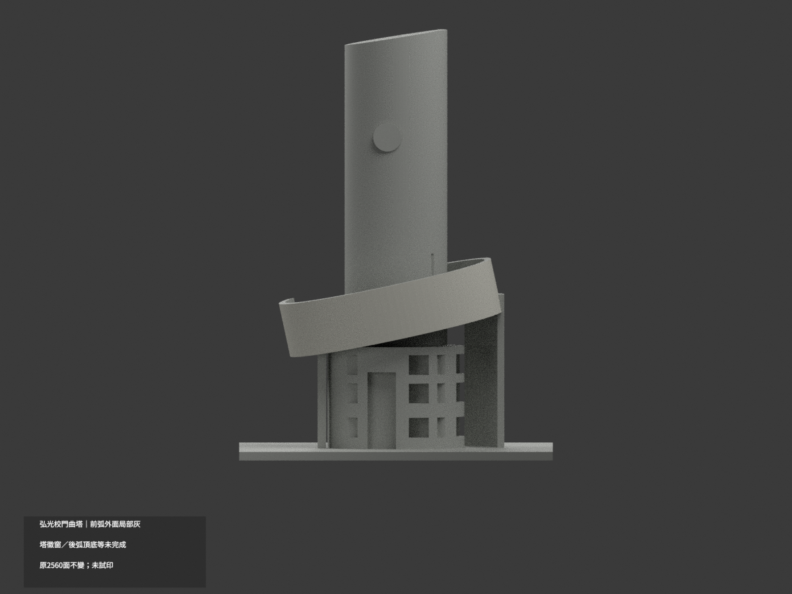
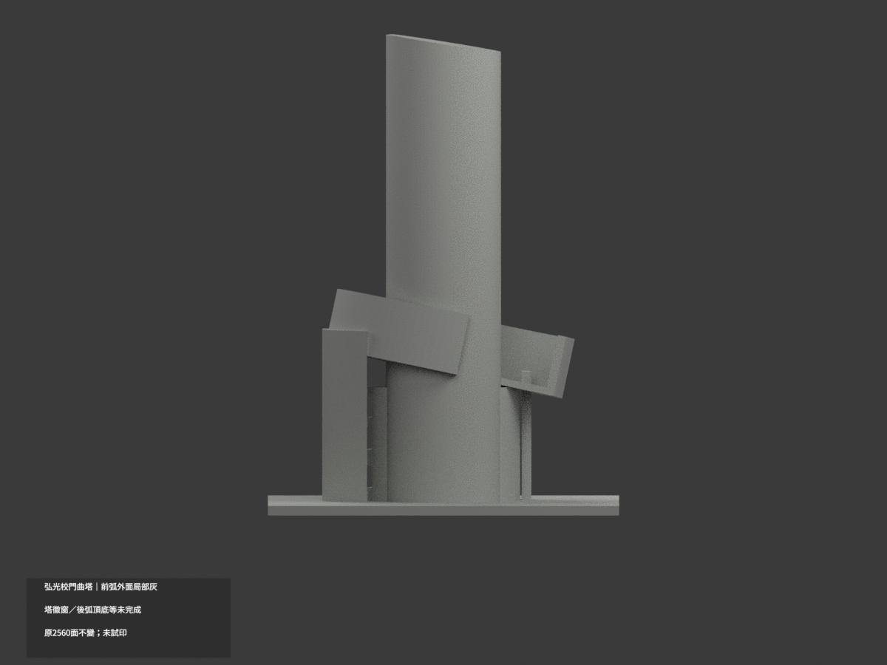
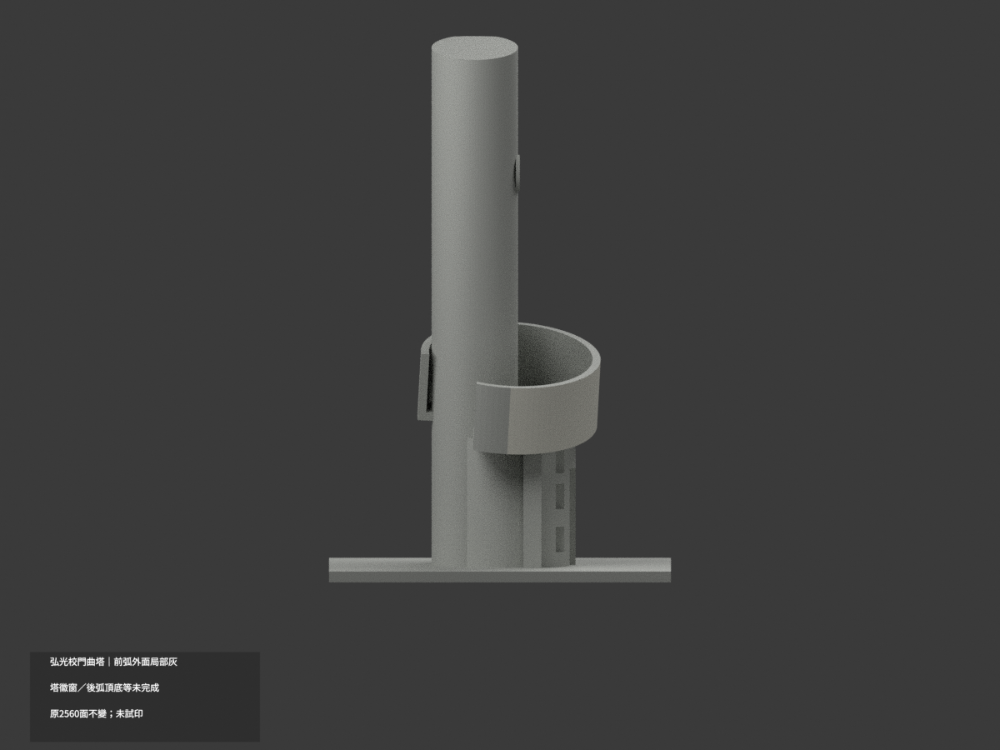
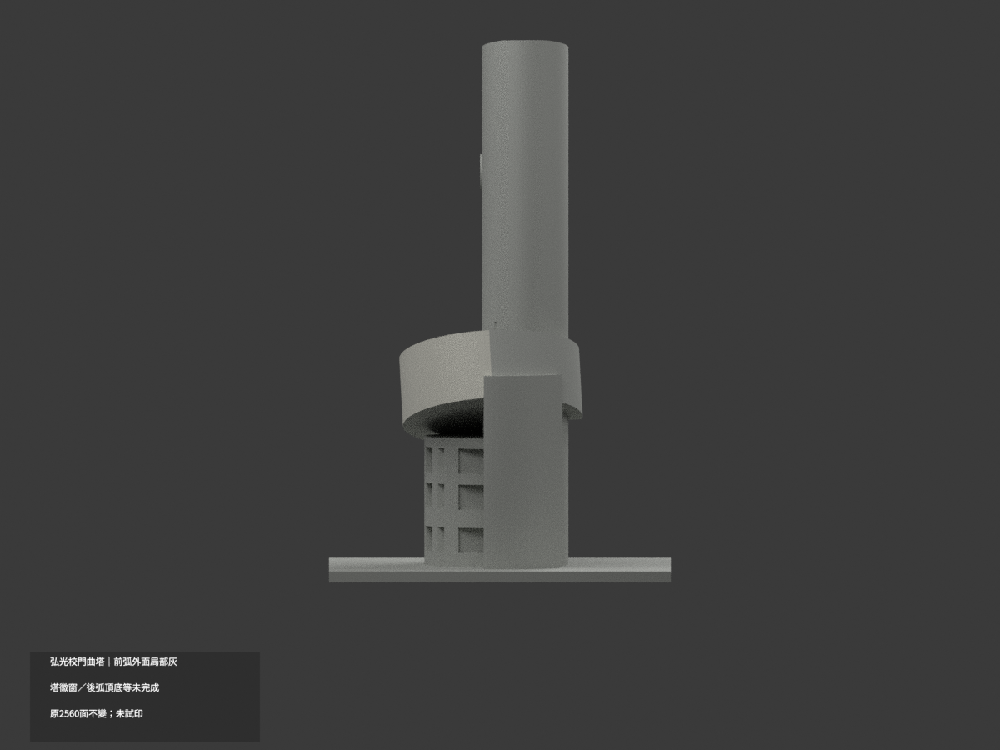
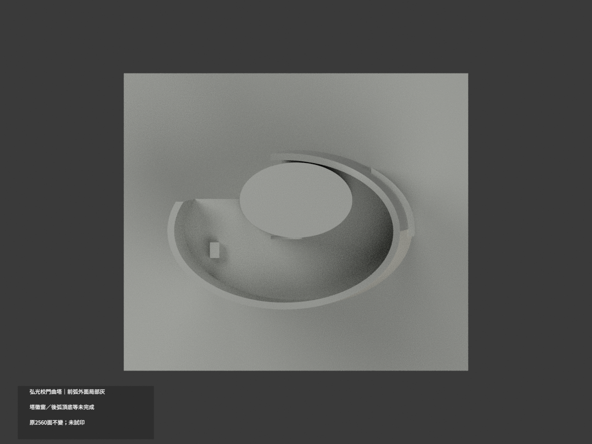
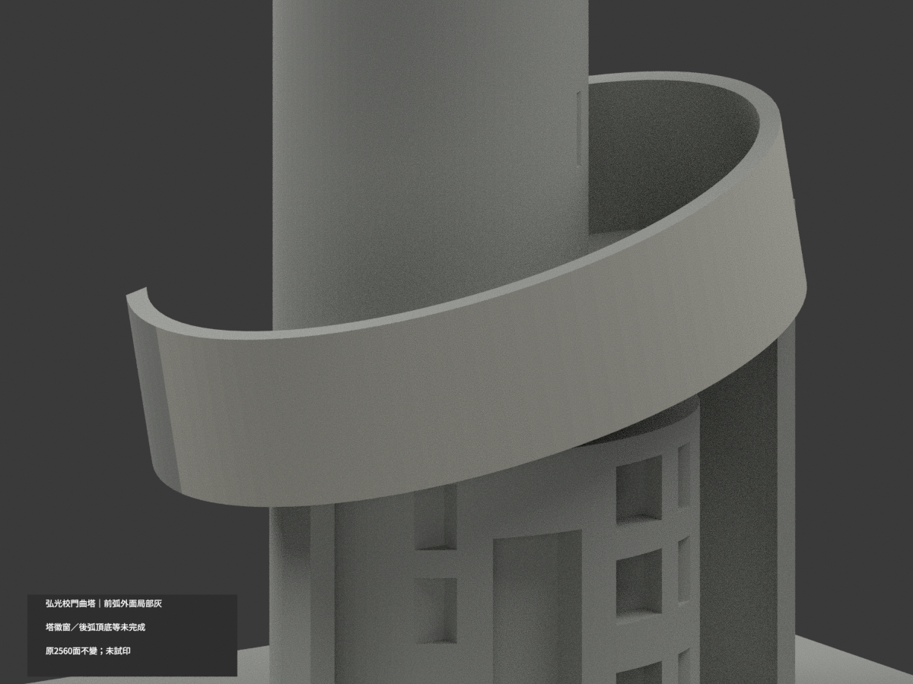
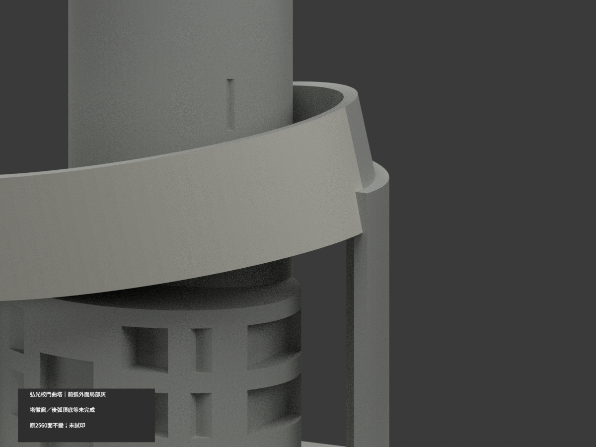
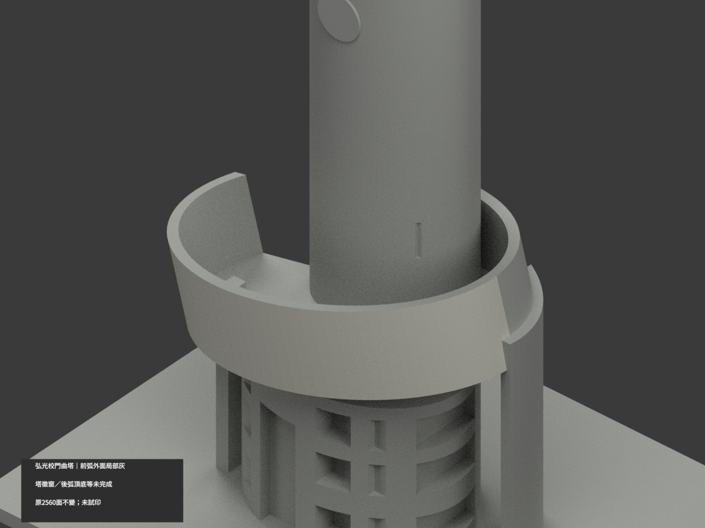

# 弘光校門警衛室與曲塔｜前弧帶外面局部淺灰

**塔身、徽牌、玻璃與後弧等材域未完成分色。** partial_color_incomplete=true、fully_colored_exterior=false。僅前半弧帶原外立面98三角名義淺灰，非全體完整補色。

| 總覽 | 背側 | 正面 |
|---|---|---|
||||
||||
||||
||||

## 材色範圍
同 hku-gate-guardhouse 原項目，same-item、count_delta=0。弘光科技大學校本部警衛室／整合曲塔單群，獨立校名字牆不在此模。2560原三角、STL與build_model.py字節不變，原18件無OBJ，不造原件。
- 原弧帶96邊ellipse半徑38/25、中心y−2、局部z0..19，原先Rx3°再Ry−12°、平移z43，最後全模uniform scale。由STL原底座x跨度/110重算scale，再反旋全三頂點。
- 僅前半facet48..95完整有限chord外立域。每facet所有原無限plane三角均符合弦切向0..length與局部z0..19；不以normal或centroid篩面。47片各2三角，facet94原Boolean四碎片全保，共98面，並非假設96。
- 其餘2462中性：整塔身／徽牌／槽／斜頂、弧後半／內壁／頂底、未核下垂端與支柱、混門窗玻璃警衛室、地面全部不擴染。
- 原粗化橢圓、旋轉、厚度、支柱與Boolean交界保留；不改幾何補精度。中性邊界是證據範圍非真實材縫，不造徽字或透明玻璃。

## 來源與日期
親看正側官方外觀及另一後視實照，前弧外淺灰與下玻璃混皮可區別；後視只輔助辨識，不自動放行未證全塔。照片精確拍攝日期未由本次核定；檔名2024非唯一日期證據，不稱2026現況。
原照私人不公開、不貼圖，未確認CC或再散布授權，不保證商用。HEX是名義色族非校準色票。正式GO與保留先期獨審分開，不免builder QA。

## 格式與列印
[原STL](model.stl) · [逐面材色3MF](appearance.3mf) · [Blender](scene.blend)
原最高150mm整體縮放展示，非測量比例。物件名 HKU Gate Guardhouse partial color，由真slug／館名獨立核。STL無色，3MF及Blender逐面分材；兩材標籤非驗證兩色／四色耗材切片，未實際列印。

## 重建與 QA
原build_model.py → colorize_model.py → export_appearance.py → validate_color.py；Blender render_color.py／verify_color_scene.py。完整隔離精確原build＋color重建、原bytes／全三角multiset、閉合正體積、3MF逐面材、scene重開、十圖1200×900及圖文hash。隔離原依賴，不改原碼；程序不替代人工來源核。
原README／previews／validation／renderer保留歷程，不冒充新QA；沒有刪檔。

## English scope
Partial only:98 original exterior faces on the front half curved ribbon, pale gray;2462 neutral. Original2560 triangles and bytes unchanged,18 immutable files noOBJ. Inverse original uniform scale and Ry(-12)@Rx(3) transform, then all-three-vertex finite chords48..95 of ellipse96. Every infinite-plane selection equals its finite domain. Facet94 has4 Boolean fragments; all retained. Tower/emblem, booth glazing, rear half, inner wall, top/underside and unknown supports remain neutral. Separate lettered wall excluded. Approximate shape retained, no2026 survey/capture claim. Not tested filament slicing or full color.
