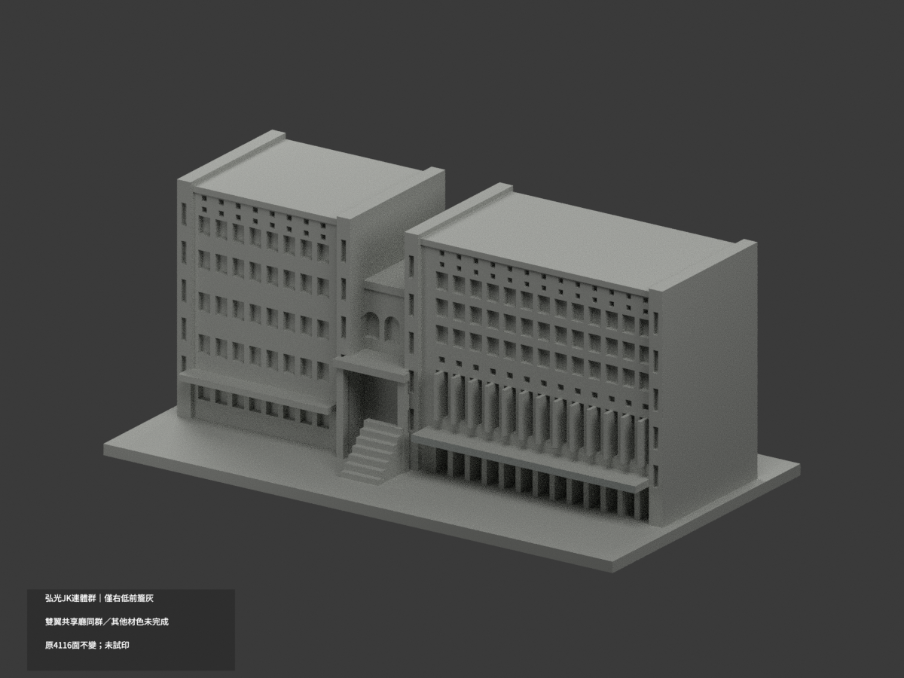
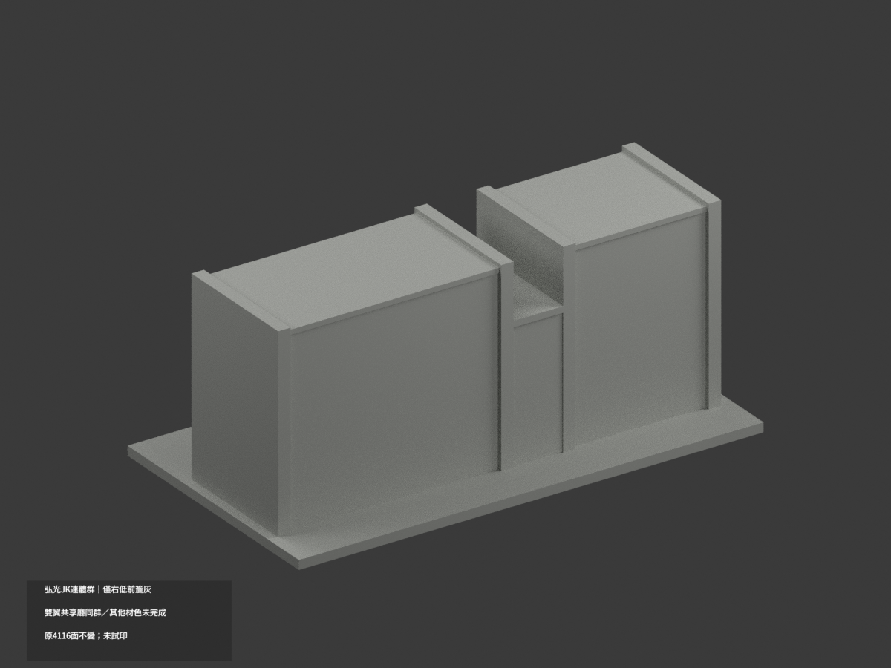
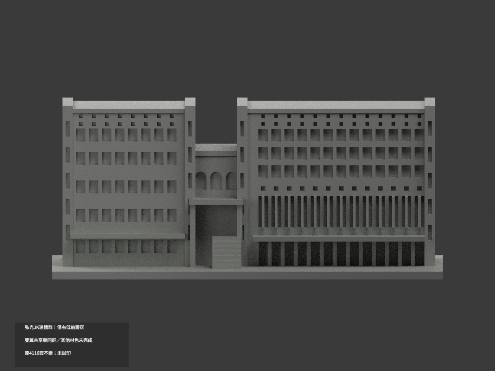
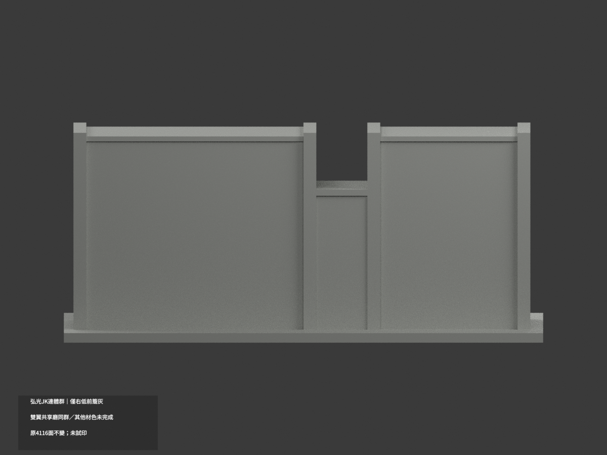
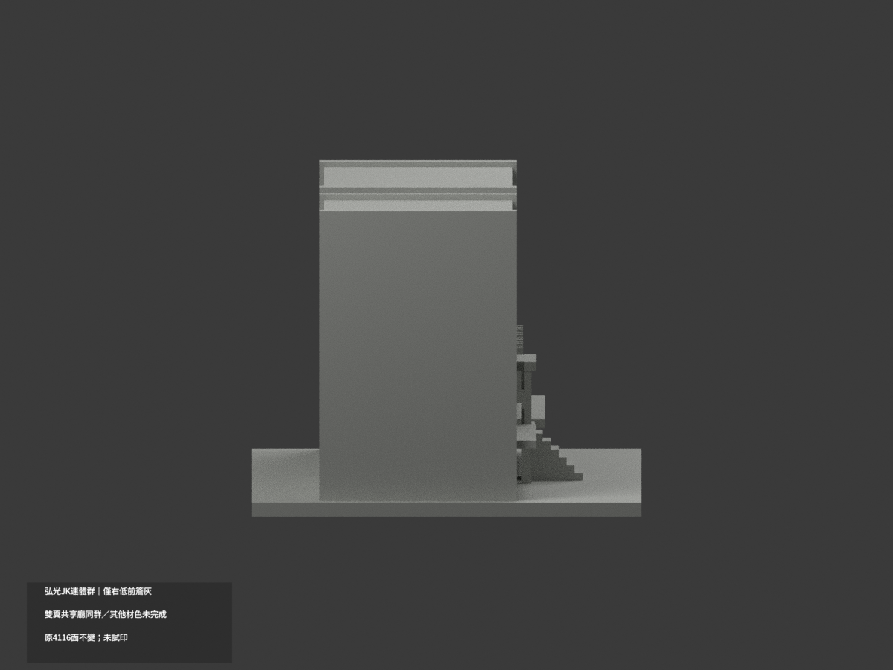
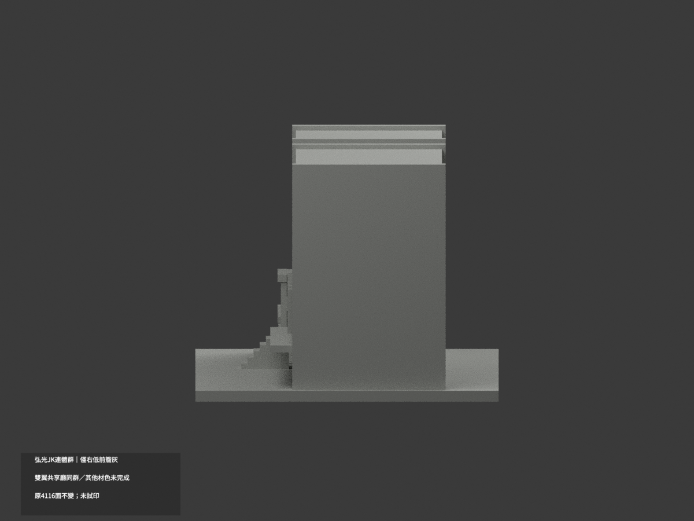
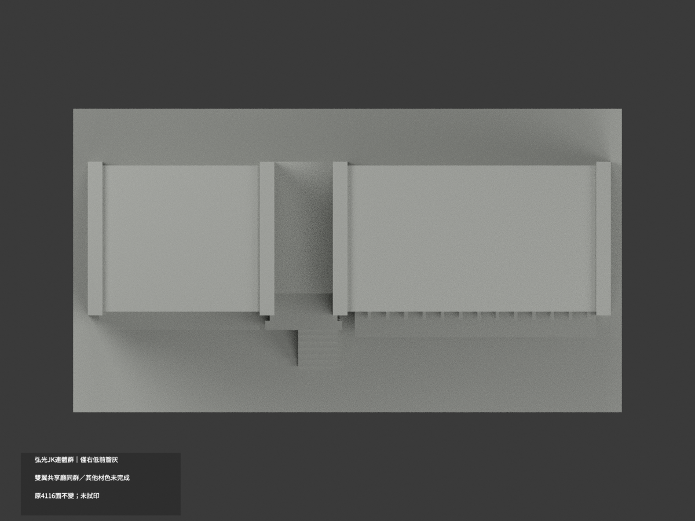
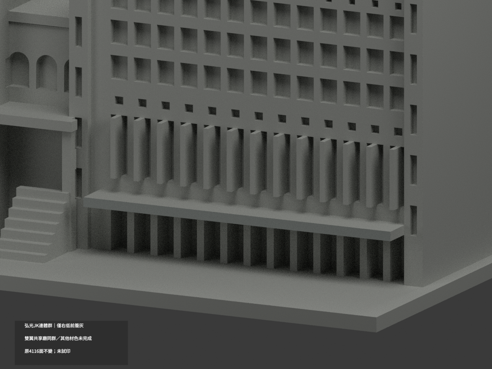
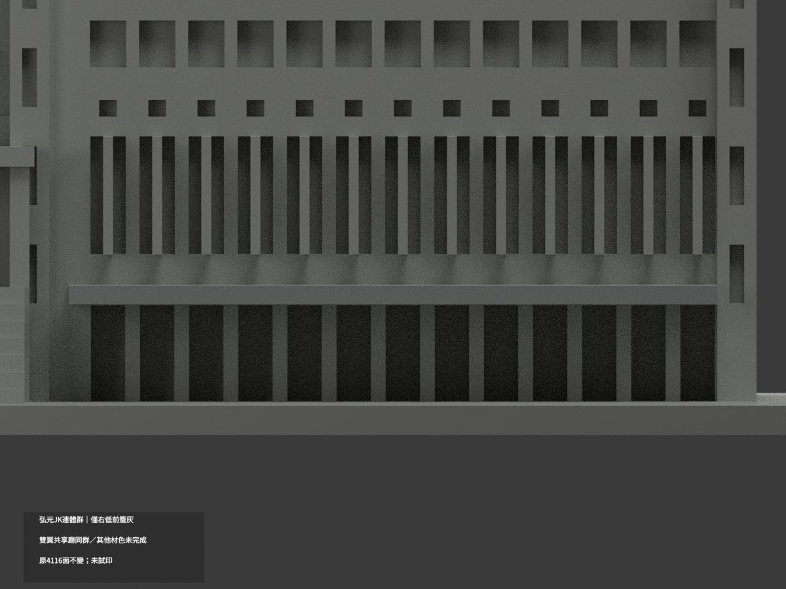
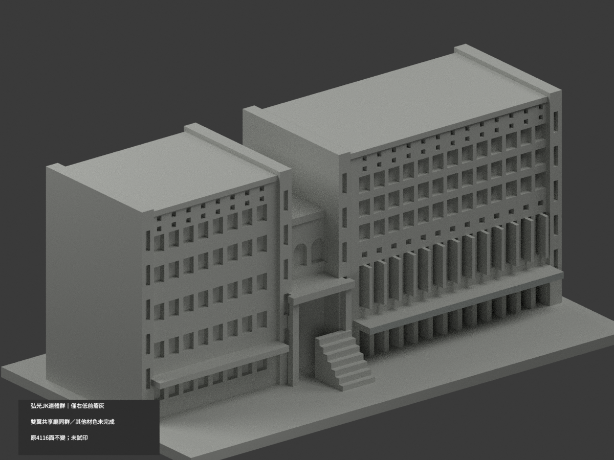

# 弘光JK科技體育連體群｜右低柱廊前簷局部灰

**局部補色未完成：只右低柱廊前簷2原三角灰；雙翼共享廳同群／其他材色未完成。** partial_color_incomplete=true、fully_colored_exterior=false。同項hku-jk-technology-gymnasium／count_delta=0，弘光科技大學校本部。英文身份為 HKU JK Technology Gymnasium partial color。J/K雙翼與共享低廳同一原群，不拆成兩套。

| 前斜視 | 後斜視 | 正面 |
|---|---|---|
|  |  |  |
|  |  |  |
|  |  |  |
|  | | |

## 材色範圍

只全原y−21無限plane，所有三頂點容差0.0001mm；恰2面共邊單component，完整原x2..68、z13..14.9矩形。2面名義中淺灰、4114中性，1155原共面連通域uniform，原4116三角與頂點不變。不按面心或只裁帳篷未遮半邊，不把上方藍灰窗間帶染成此灰。

兩翼整牆/格網含不同色域、窗背含玻璃與框/實板、門廳拱孔、字帶、左低簷、屋上、側背、柱與階地保持中性。下前灰邊不外推棚頂、底或側端。中性不是實景灰，資料範圍不是材料接縫。

## 來源與審核歷程

親看photo77與photo65：77帳篷遮住右低廊中央，初0438審因此HOLD；65另一角度完整露出窄灰前緣，review0438-v2解除該來源缺口，GO0441只放行這一原完整面。原HOLD/修訂都私存，不重寫歷史、不以移除帳篷造新幾何。photo77頁列2024-10-19 10:49:36，無時區或相機鐘校證，不自行換算；65拍攝日期未證，不從URL推。不是2026現況測繪。既有雙翼共享廳近似不因補色追認實測；照片私人，不公開貼圖，不推未見CC為商用許可。

## 檔案與 QA

原STL/build與4116三角字節/座標不變；immutable18件無OBJ，原builder雖輸出OBJ，隔離生成只私存，不宣稱原repo有OBJ。原README存ORIGINAL-MONOCHROME-README.md，舊單色previews/QA保歷程。appearance.3mf兩展示材、scene.blend實際面材、color-mesh.npz同原三角。四腳本與實際3MF/scene均必須精確身份 HKU JK Technology Gymnasium partial color，不用舊模板名互比。精確requirements隔離build+color、閉合正體積、3MF面材座標/Blender重開/10張1200×900檢核；重建保留不刪，未實際列印或證多色切片。

## English limitations

HKU JK Technology Gymnasium partial color. Entire y=-21 plane exactly2 connected triangles covering original x2..68,z13..14.9 right low canopy front,nominalgray;4114neutral. All1155coplanar domains uniform,original4116triangles/STL/build unchanged,noimmutableOBJ,count_delta0. Original HOLD0438 due tent in photo77 resolved only by unobstructed photo65 and review0438-v2;both historical records preserved privately. Photo77 reported2024-10-19 10:49:36 has no timezone/camera-clock certification;photo65captureunknown,no2026survey. J/K plus shared hall onegroup,not two packages. Mixedwalls/windowbacks/upperbluegraystrip/leftcanopy/rooftops/rear neutral. No public source images/textures,no geometry recertification,not testprinted.
