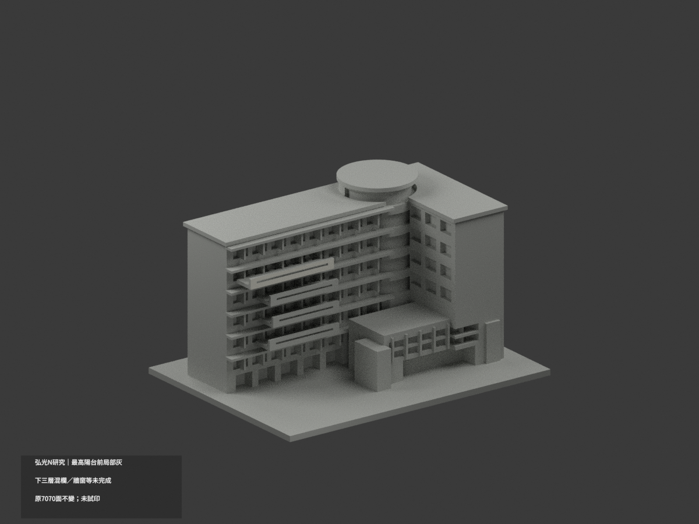
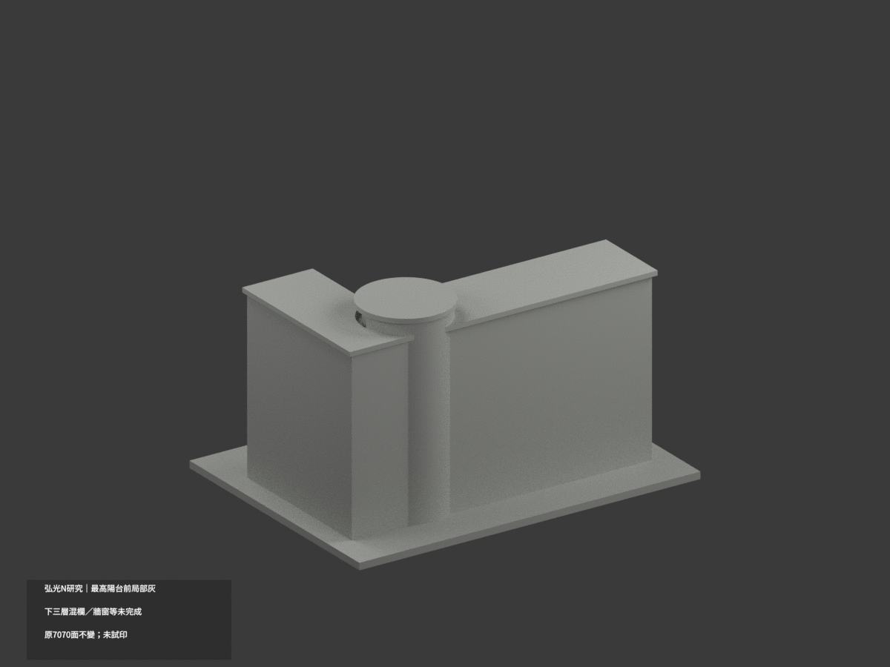
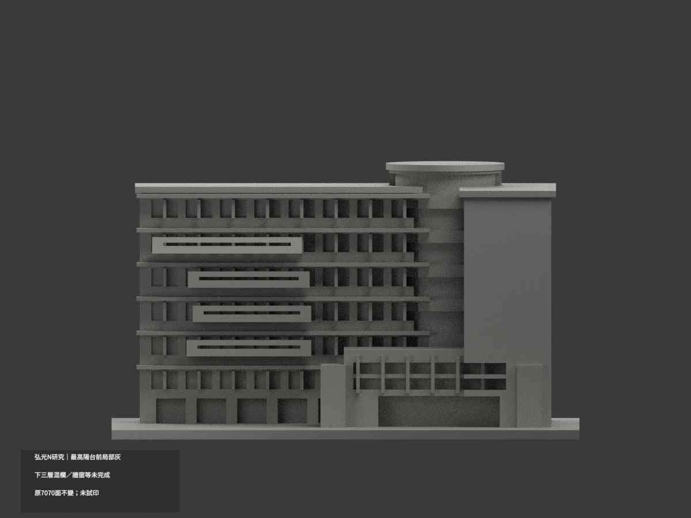
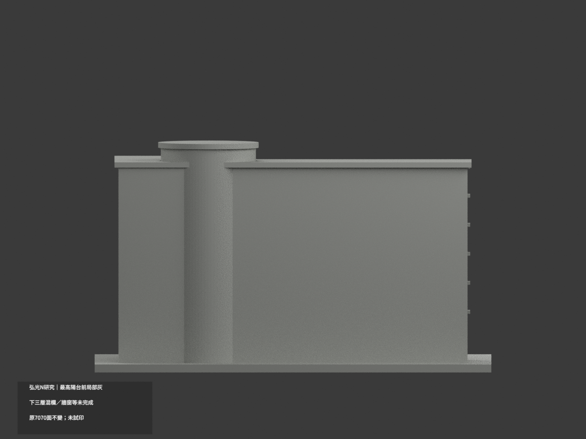
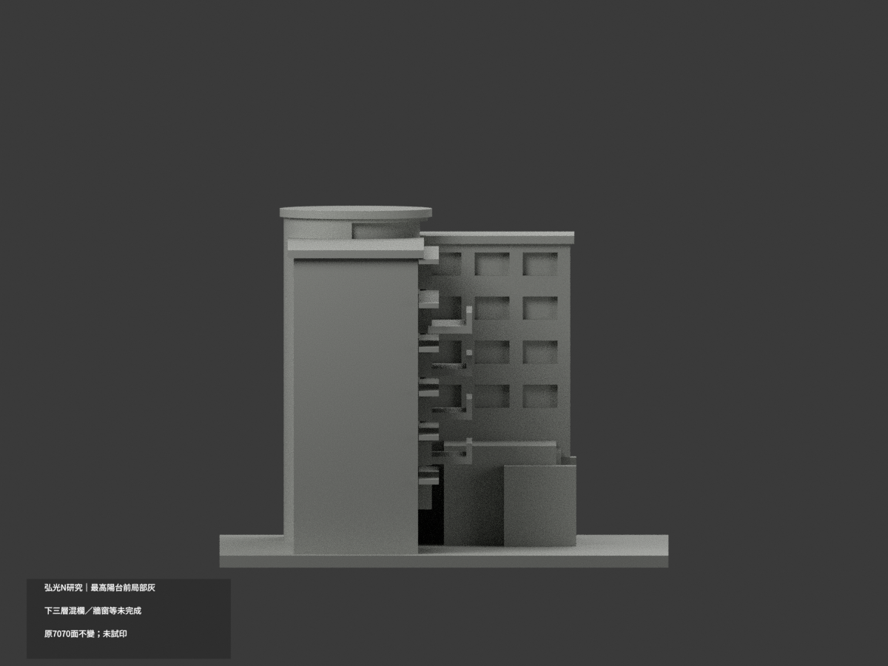
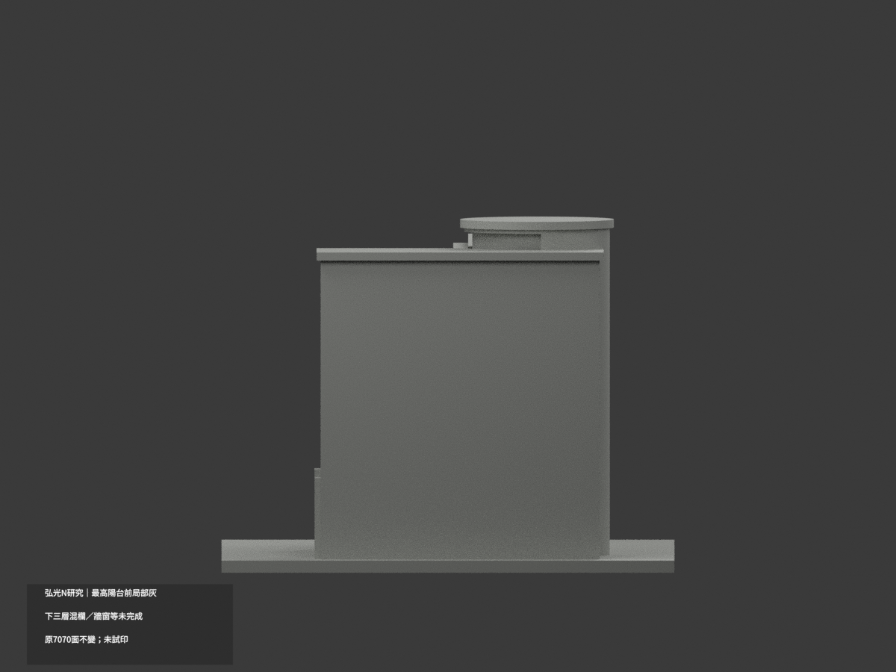
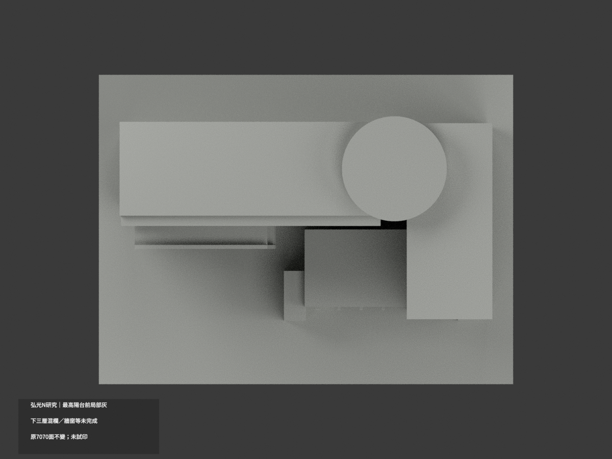
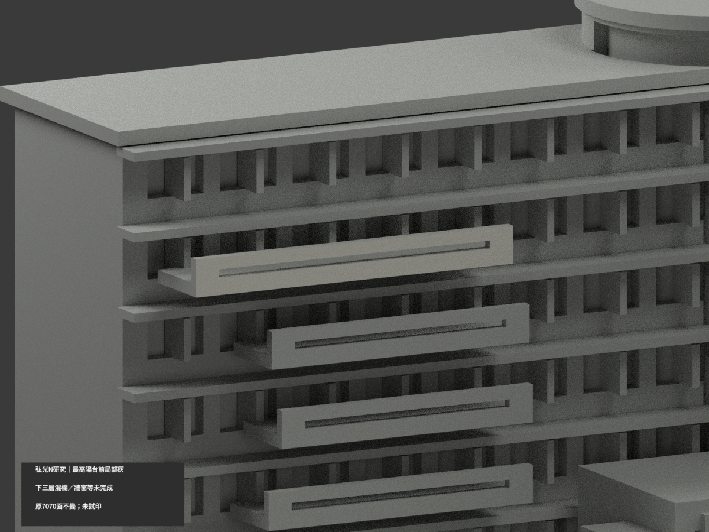
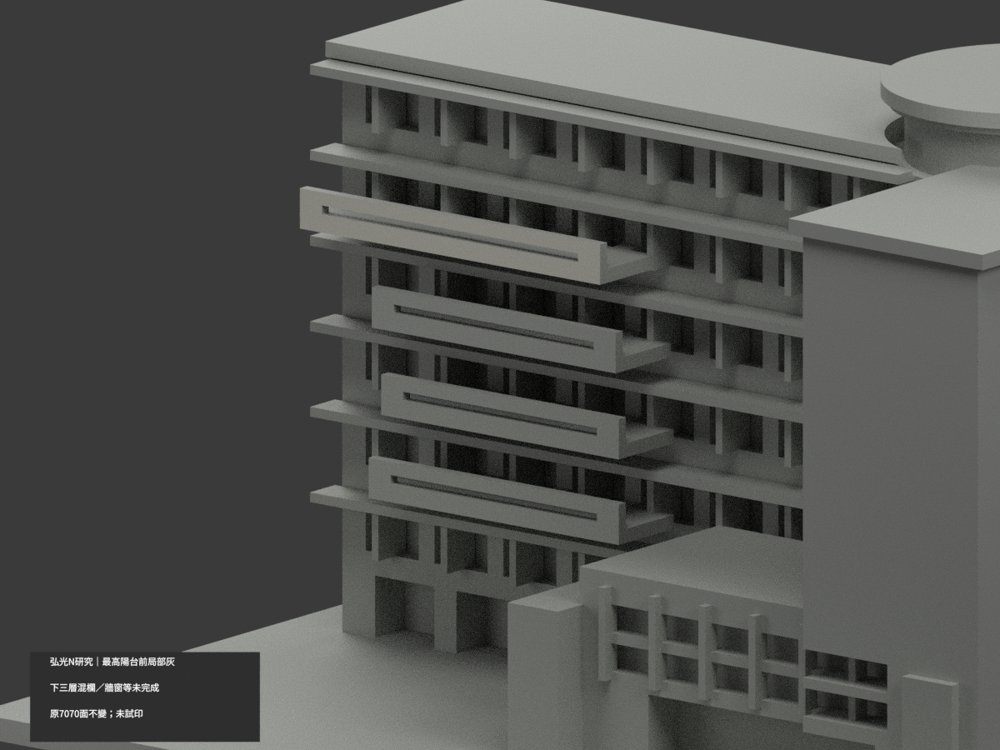
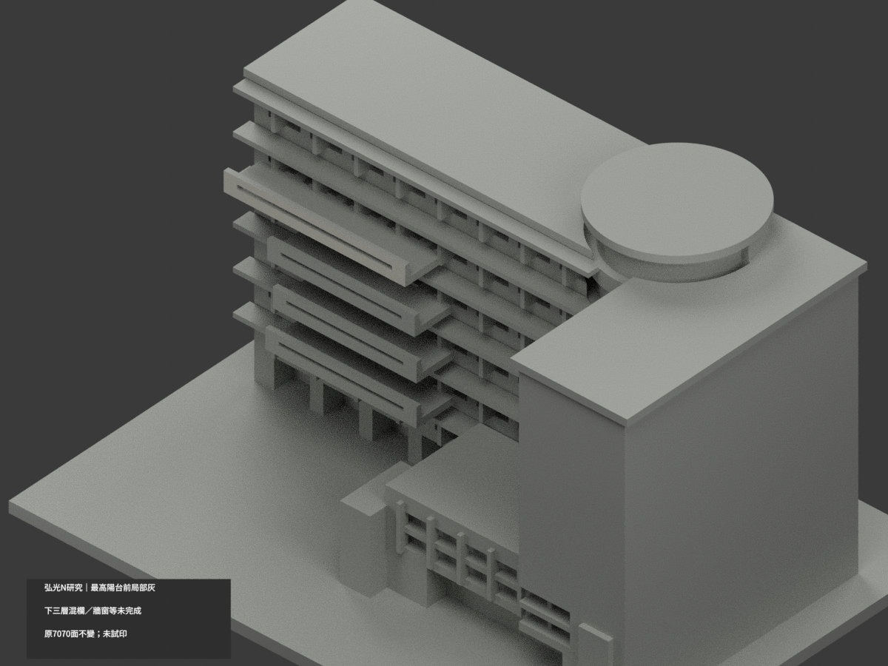

# 弘光N研究大樓｜最高陽台前局部淺灰

**下三層陽台、牆窗等材域未完成分色。** partial_color_incomplete=true、fully_colored_exterior=false。僅最高陽台完整前實欄與連續板緣12原三角淺灰，非全棟完整補色。

| 總覽 | 背側 | 正面 |
|---|---|---|
||||
||||
||||
||||

## 材色範圍
同 hku-n-research 原項目，same-item、count_delta=0。弘光科技大學校本部N研究大樓單一連通群，不含D棟與獨立雕塑。7070原三角面、STL與build_model.py字節不變；原18件無OBJ，不假稱保存不存在原件。
- 原y−7全平面先列44原三角，分四個共享邊連通域12/10/10/12；只最高一個完整域12面淺暖灰。原有限x−62..−14、z58..63.2，全三頂點核；不按normal、centroid或局部高度選面。
- 原板緣／實欄union及橫凹槽完整保留，不只染z59.6以上。真實多個小凹槽與原單一近似槽不同，不改幾何補精度。
- 下三陽台實照左段為通透紅欄、右段白實板，原全寬實心代理沒有材界，三個完整共面域全部中性，不能只挑右半三角。
- 其餘7058面中性：主磚牆／窗帶混框板、曲玻璃塔與低入口為不透明代理，不假染藍透明；車庫字牆／側返／屋／地面／最高欄頂底及槽內亦未證。
- 材色邊界是證據範圍而非真實材縫，原近似比例與群體不因補色成為實測。無新增文字、欄杆、門窗或人物。

## 來源與日期
親看承包商已建成外觀，最高錯落陽台前為連續淺灰實板，與下三層左側紅通透欄區別明確。工程2004/06–2005/10及URL180524均非拍攝時間，拍攝日未知，不稱2026現況。
原照私存不公開、不貼圖，未確認CC或再散布授權，不保證商用；HEX名義色非校準色票。正式GO已發行，先期review-only標籤不免除builder QA。

## 格式與列印
[原STL](model.stl) · [逐面材色3MF](appearance.3mf) · [Blender](scene.blend)
原150×112mm展示底座，照片近似非精測比例。公開物件名 HKU N Research partial color，與本slug/館名核對；STL無色，3MF和Blender有逐面材。兩材標籤不是驗證兩色／四色耗材切片，未實際列印，無切片路徑。

## 重建與 QA
原build_model.py → colorize_model.py → export_appearance.py → validate_color.py；Blender render_color.py／verify_color_scene.py。完整隔離精確原build＋color重建、原bytes／全三角multiset、閉合正體積、3MF逐面材、scene重開、十圖1200×900及圖文hash。隔離原依賴，不改原碼；程序不替代人工來源核對。
原README／previews／validation／renderer保留歷程，不冒充新QA；沒有刪檔。

## English scope
Partial only:12 original triangles on the highest whole connected balcony front component are pale warm gray;7058 neutral. All7070 original triangles and source bytes unchanged;18 immutable files have noOBJ. N Research connected group excludes neighboring D and sculpture. Enumerate all44 y−7 plane triangles first:four components12/10/10/12, only the highest complete component selected. Original slab/rail overlap and single slot remain. Lower three full solid proxies lack actual open red railing/white-panel boundaries and stay neutral, not right-half painted. Roofs, mixed walls/windows, opaque glazing proxies and garage remain neutral. Construction/project/URL dates are not capture dates. No2026 survey, full color or tested filament-slicing claim.
