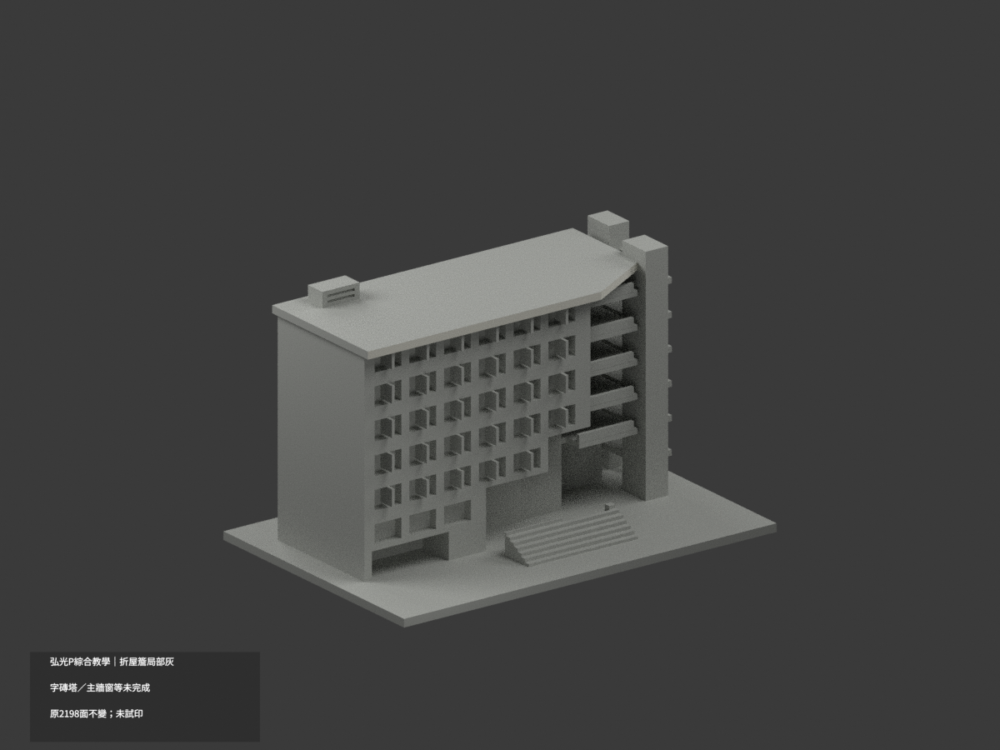
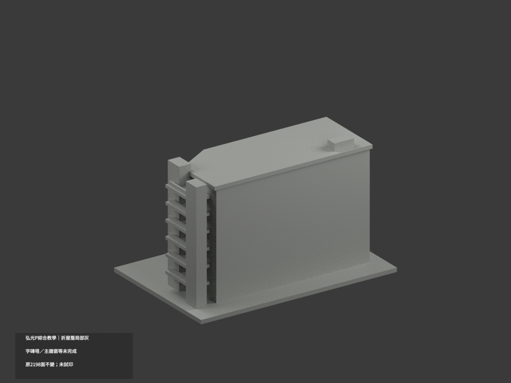
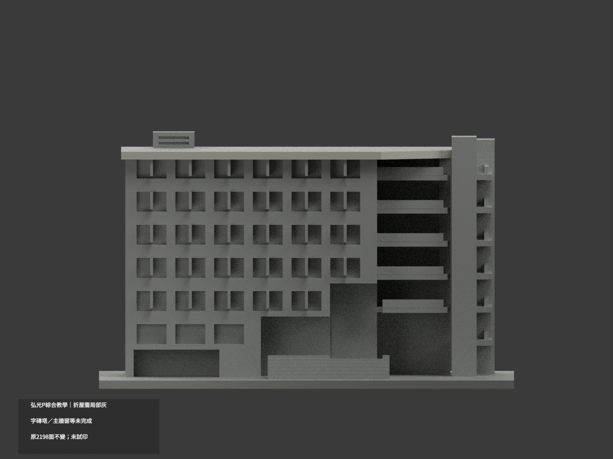
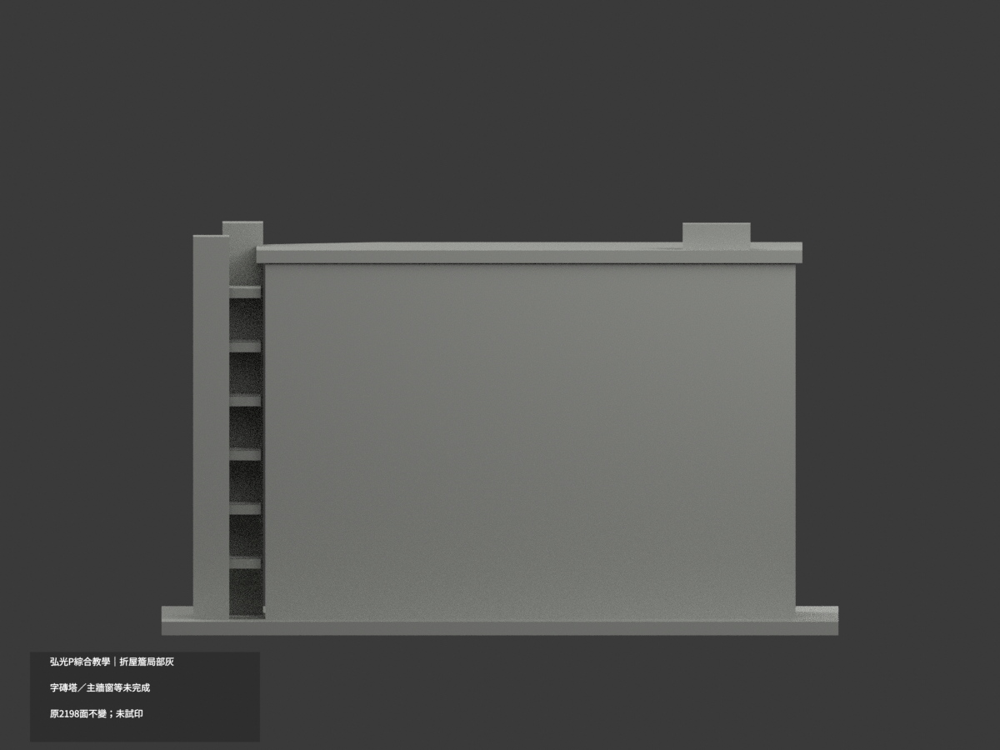
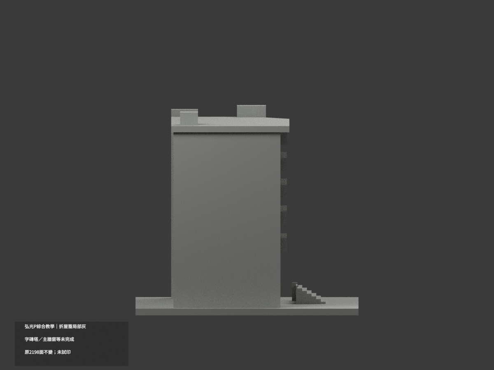
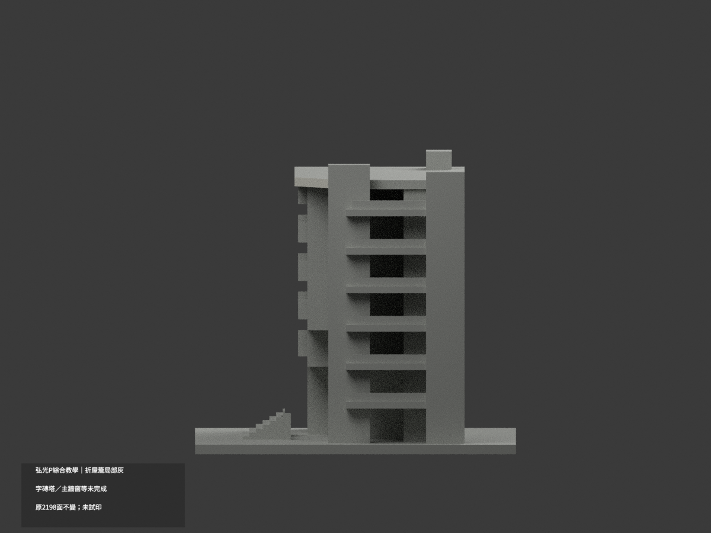
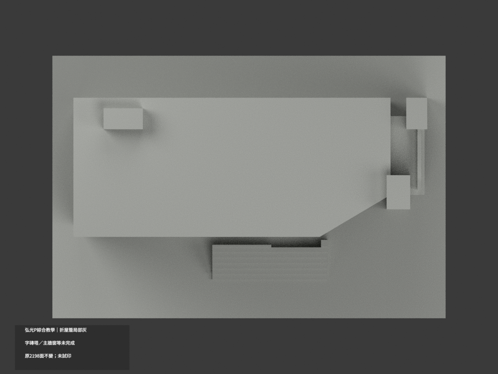
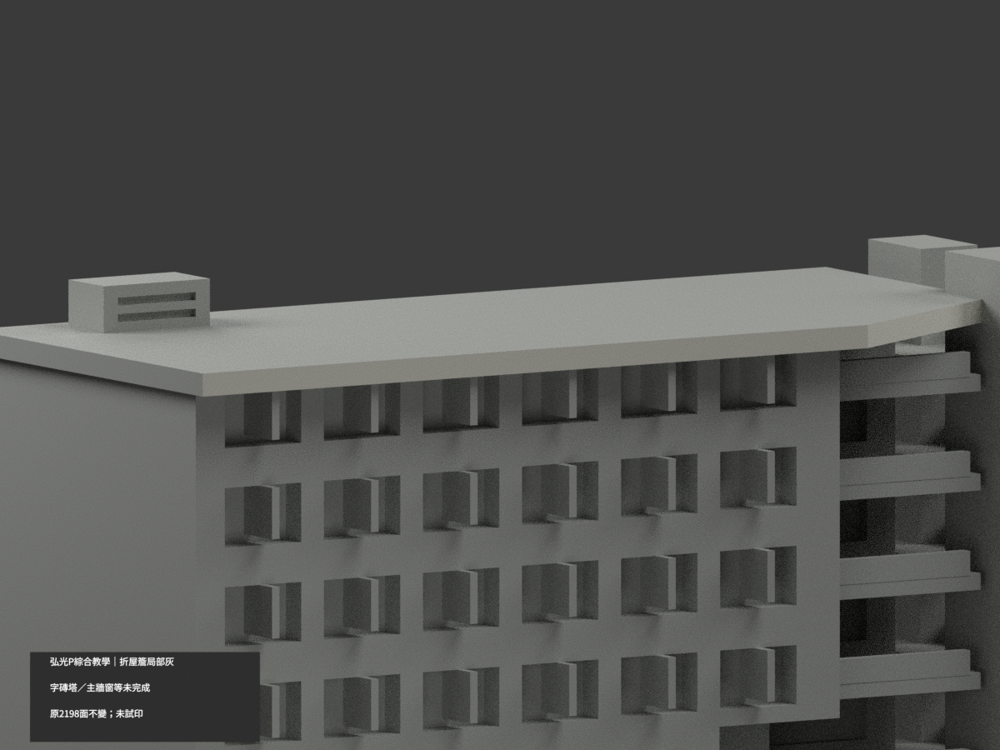
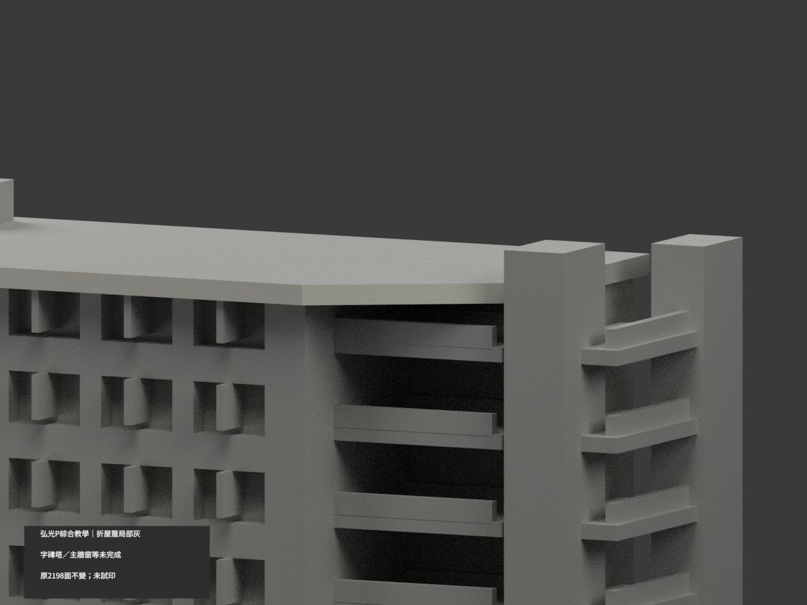
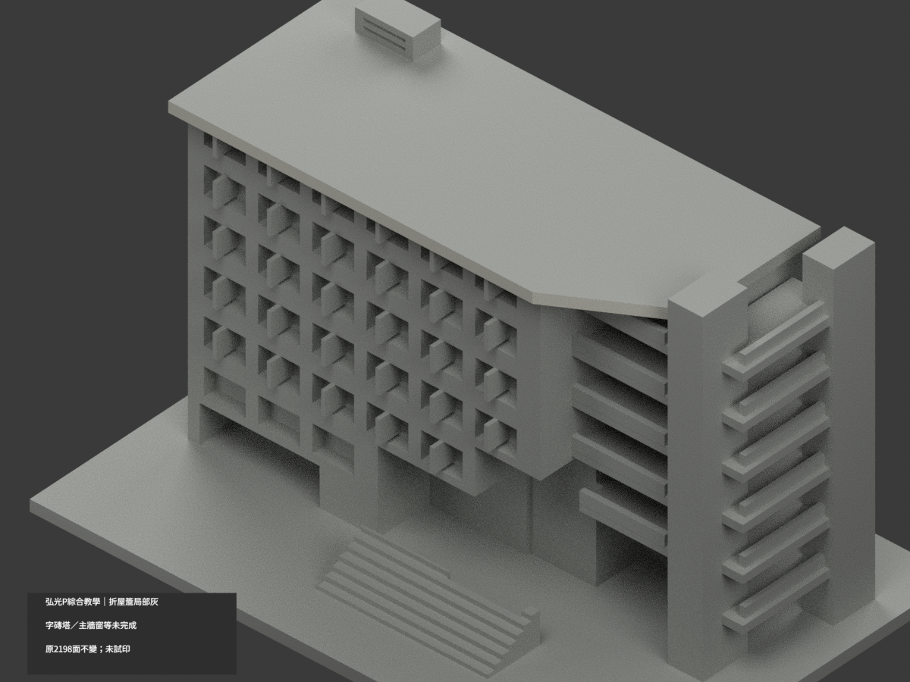

# 弘光P綜合教學大樓｜前屋簷與右折緣局部淺灰

**文字磚塔、主牆與其他材域未完成分色。** partial_color_incomplete=true、fully_colored_exterior=false。僅前屋簷2面與右折緣2面名義暖灰，非全館完整補色。

| 總覽 | 背側 | 正面 |
|---|---|---|
||||
||||
||||
||||

## 材色範圍
同 hku-p-comprehensive-teaching 原項目，same-item、count_delta=0。弘光科技大學校本部P綜合教學大樓單群，原2198三角面、STL與build_model.py字節不變；原18件無OBJ，不假稱保存不存在的原件。
- 原屋polygon前邊y−19、x−67..27，z82..84.8完整2面。右折邊16(x−27)−27(y+19)=0、原端(27,−19)→(54,−3)、同z完整2面。全三頂點有限plane核，兩整無限plane各恰2，無漏片或normal/centroid選面。
- 右折面原tower union實際止於x52.5、y−3.88888884，而非原碼端54/−3。此為原Boolean外露邊界，並非人為裁色；全2三角保留。
- 其餘2194面中性：上屋皮／陰影底／左後屋緣、文字磚塔、混框玻璃與主牆、陽台實欄／板側、階與地面／設備均不擴染。
- 不新增玻璃金字塔、文字與其他樓層。原模型6可見窗列並非認證全館只有6層；原碼層數描述不能用本次補色補造未見樓層。材色不追認原形為精測，中性邊界只是證據範圍。

## 來源與日期
親看承包商兩張實景，連續淺暖灰屋外立邊與暗底可區別；不用陰影作固有材色。2009完工不是拍攝日，拍攝日期未知，不宣稱2026現況。
原照私存不公開、不貼圖，未確認CC／再散布授權，不保證商用。HEX僅名義色族非校準色票。正式GO繼承先期review文字，不免builder幾何及域核。

## 格式與列印
[原STL](model.stl) · [逐面材色3MF](appearance.3mf) · [Blender](scene.blend)
原150×100mm展示底座，照片近似非精測比例。物件名 HKU P Comprehensive Teaching partial color，從真slug與館名獨立核對。STL無色，3MF與Blender有逐面材；兩材標籤非驗證兩色／四色耗材切片，未實際列印，無切片路徑。

## 重建與 QA
原build_model.py → colorize_model.py → export_appearance.py → validate_color.py；Blender render_color.py／verify_color_scene.py。完整隔離精確原build＋color重建、原bytes／全三角multiset、閉合正體積、3MF逐面材、scene重開、十圖1200×900與圖文hash。隔離原依賴，不改原碼；程序不替代人工來源核對。
原README／previews／validation／renderer保留歷程，不冒充新QA；沒有刪檔。

## English scope
Partial only: two whole front and right-chamfer roof fascia planes,4 original triangles, nominal pale warm gray;2194 neutral. All2198 original triangles and source bytes unchanged;18 immutable files contain noOBJ. Each infinite plane exactly equals its original finite domain. Chamfer ends at52.5/−3.88888884 through original tower union, not color clipping. Lettered brick tower, main mixed walls/windows, top roof and shaded soffits remain neutral. No pyramid, lettering or floors added; six visible window rows do not establish total building floors. Completion2009 is not photograph date, no2026/current measured survey claim. Not tested filament slicing or full exterior color.
