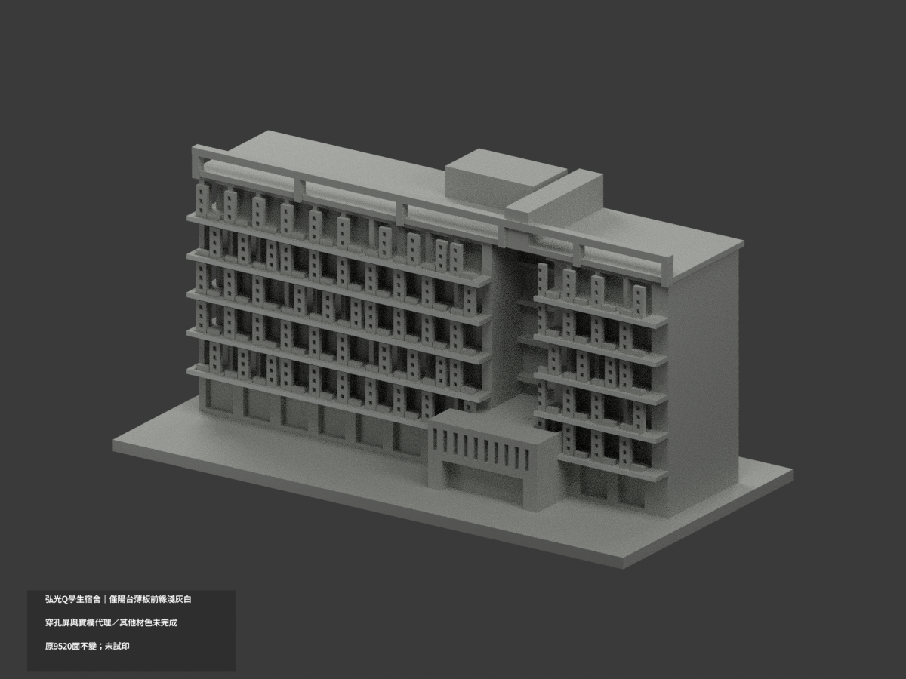
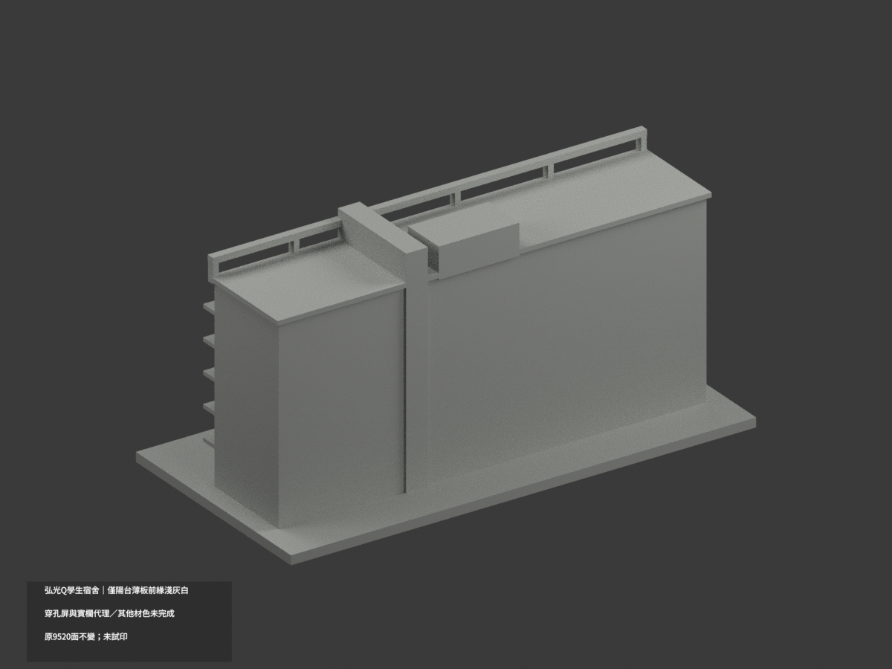
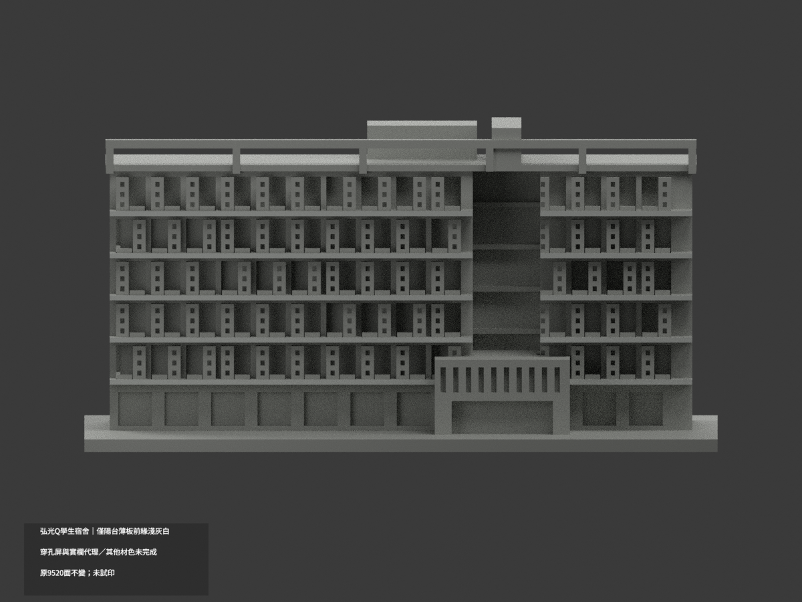
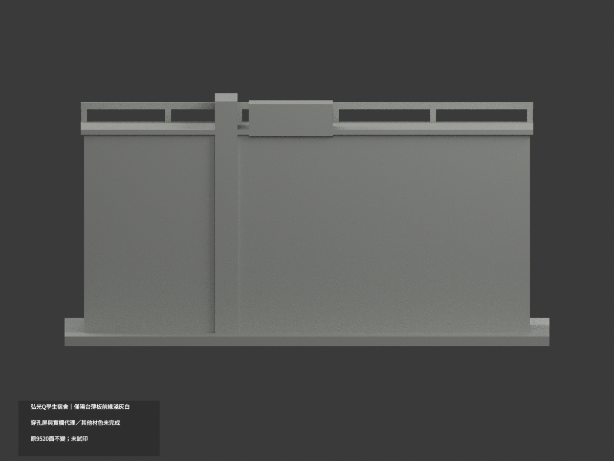
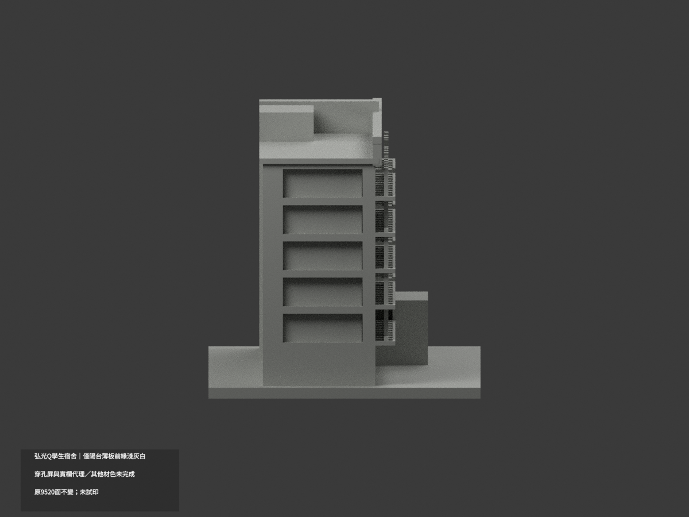
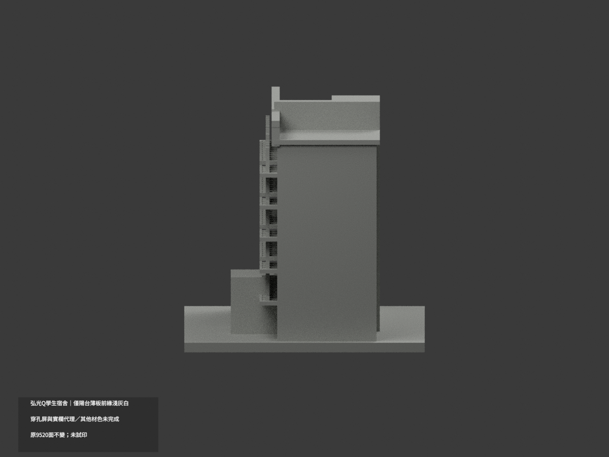
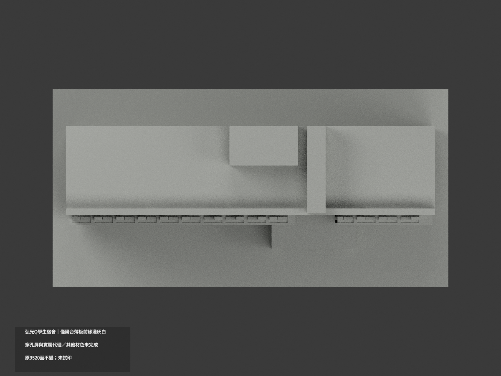
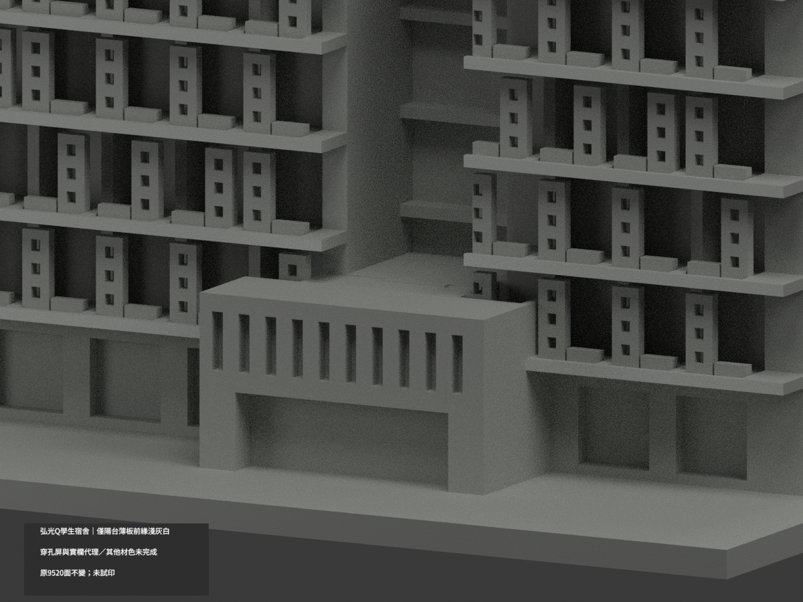
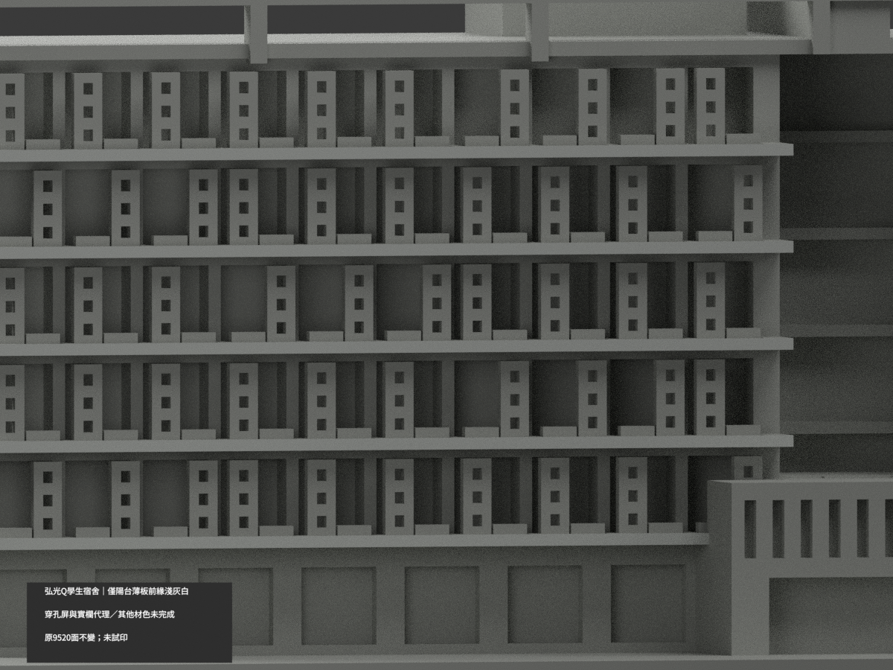
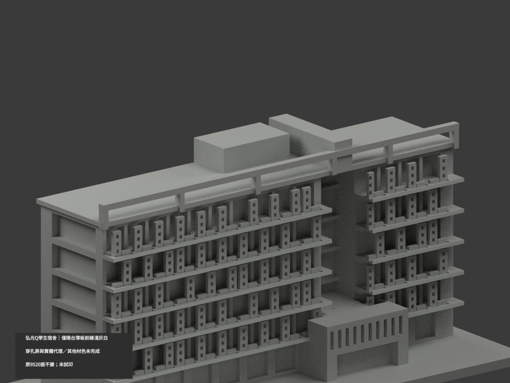

# 弘光Q學生宿舍／QUBE弘學舍｜陽台薄板前緣局部淺灰白

**局部補色未完成：只十個完整陽台樓板前緣20原三角淺灰白；穿孔屏、實欄代理與其他材色未完成。** partial_color_incomplete=true、fully_colored_exterior=false。同項 hku-q-student-dormitory／count_delta=0，弘光科技大學校本部。英文身份 HKU Q Student Dormitory partial color。舊 hku-q-dormitory 僅收件slug誤稱，並非另一建築或新增模型。

| 前斜視 | 後斜視 | 正面 |
|---|---|---|
|  |  |  |
|  |  |  |
|  |  |  |
|  | | |

## 材色範圍

全原y−14無限plane以所有三頂點0.0001mm檢核，正好20面，十個完整共邊2tri矩形。五層z14.2/24.2/34.2/44.2/54.2起高1.2；最低x−69..8與40..69，上四層x−69..17與33..69。原入口盒union及中央循環凹口造成的缺段保留，不補成連續全長帶。20面名義淺灰白、9500中性，2284共面連通域uniform，原9520三角不變。不靠面心/normal/原索引硬套，也不將原可見片段跨孔延伸。

正向photo2可識別偏右凸入口，支持前樓板窄邊色族；photo1是另一側上坡面，只辨身份與方向，不能把彩色凹口套到前面。穿孔屏和低實欄代理混不同真材料，所有孔內/窗門背/屋頂開框/藍色核心含缺失窗/板頂底與端面/背側/入口盒保持中性。中性不是實景灰，資料涵蓋界不是實際材質接縫，不宣稱精確色票、材質紋理或孔數。

## 時期、權利與原始限制

兩照片拍攝日未知，完工/施工年不是拍攝日期，不稱2026現況。保留原公開照片推估外觀與粗化穿孔、開口、實欄代理，不因補色追認測繪幾何。原資料私存，不發布原照/貼圖，不推未見CC為商用許可；slug更正歷程保留。

## 檔案與 QA

原STL/build與9520三角座標/拓撲保留，immutable18件沒有OBJ；原builder雖可產生OBJ，隔離生成只私存，不虛稱原repo有OBJ。原README另存ORIGINAL-MONOCHROME-README.md，原單色previews與QA保歷史。appearance.3mf兩展示材、scene.blend實際面材與color-mesh.npz使用同原三角。export/validate/render/verify及真3MF/scene必須為 HKU Q Student Dormitory partial color。精確依賴隔離原build+color、閉合正體積/3MF座標面材/Blender重開與10張1200×900檢核，重建保留不刪。未實際列印、未驗多料切片，STL本身不含色。

## English limitations

HKU Q Student Dormitory partial color. Only entire y=-14 plane:20triangles in10complete shared-edge rectangular balcony slab front components,original Boolean interruptions retained;9500neutral,2284coplanar domains uniform. Original9520triangles/STL/build unchanged,noimmutableOBJ,count_delta0. Original hku-q-dormitory intake was only an alias mistake,not another model. Photo2supports modeled front by asymmetric entry;opposite uphill photo1does not authorize front recess colors. Perforated screens/solid rail proxies,windowbacks,roof frame,bluecore,slab tops/undersides/ends,entrance,rear and sides remainneutral. Both capture dates unknown,constructionyear not capture,no2026survey. No geometry recertification,no public sourcephotos/textures,no exact color calibration,not testprinted.
