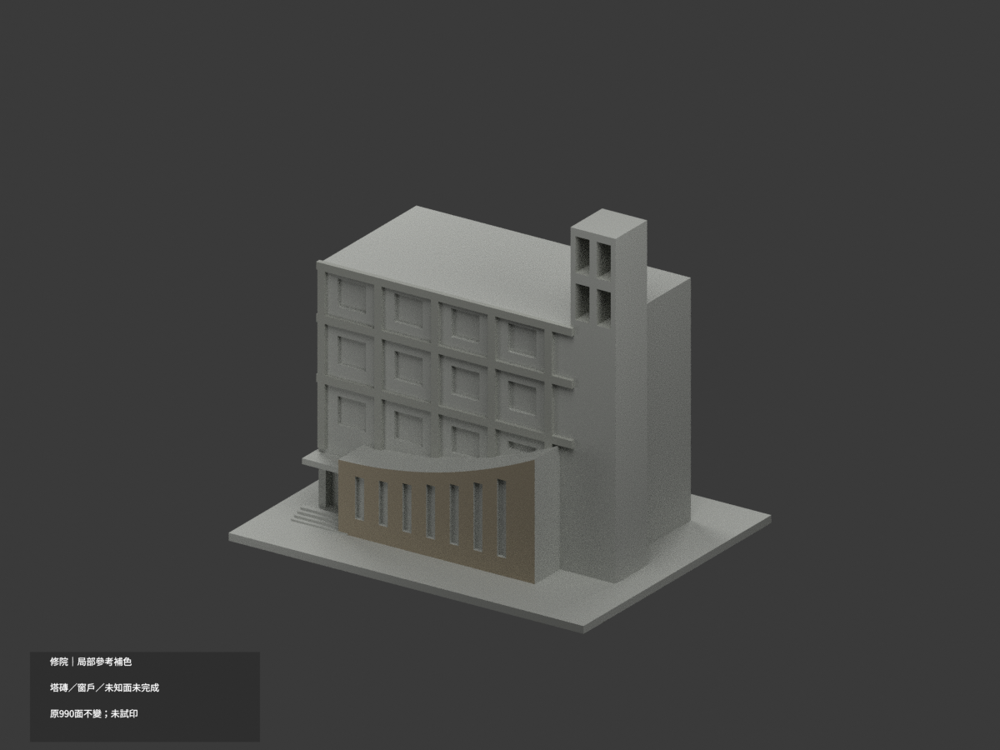
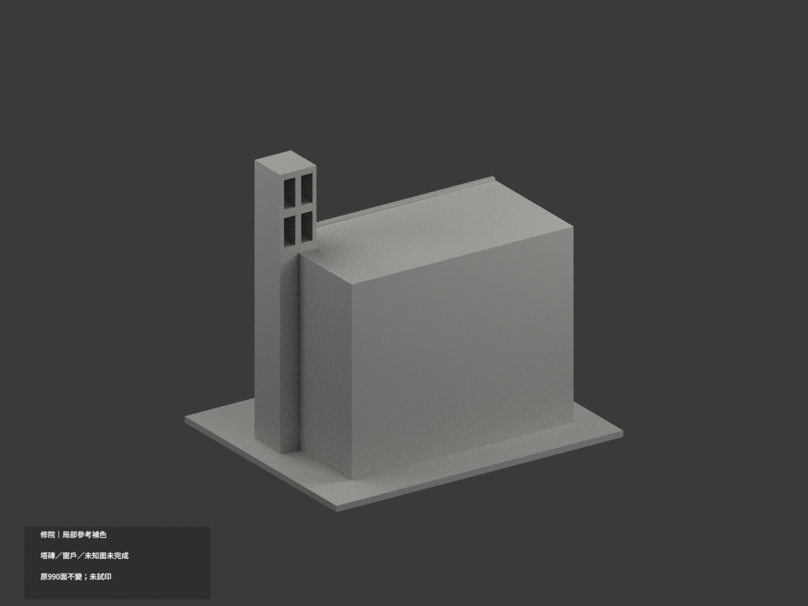
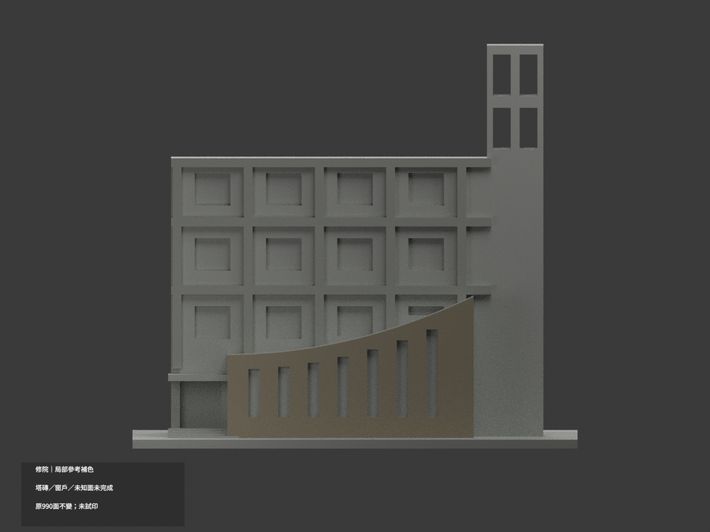
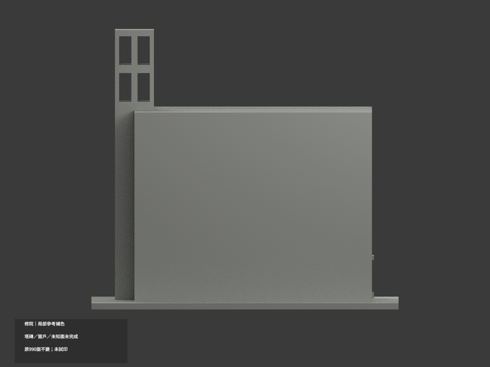
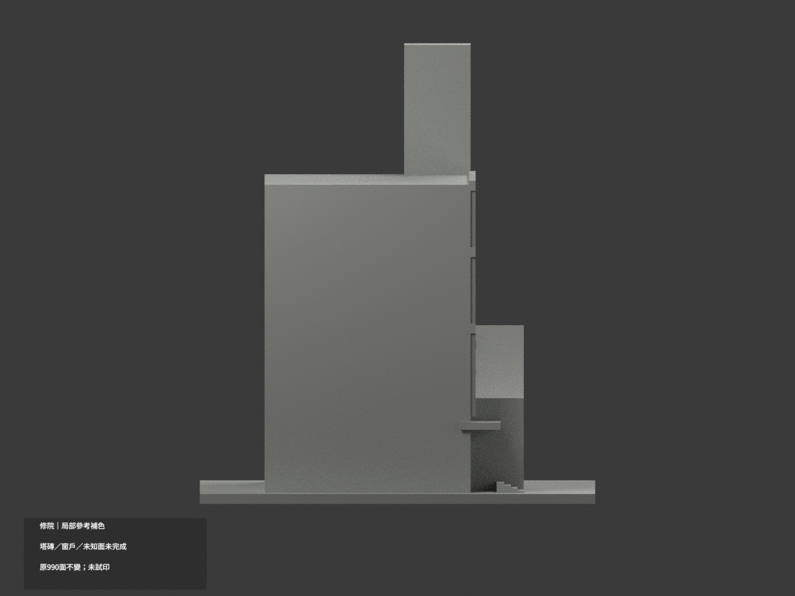
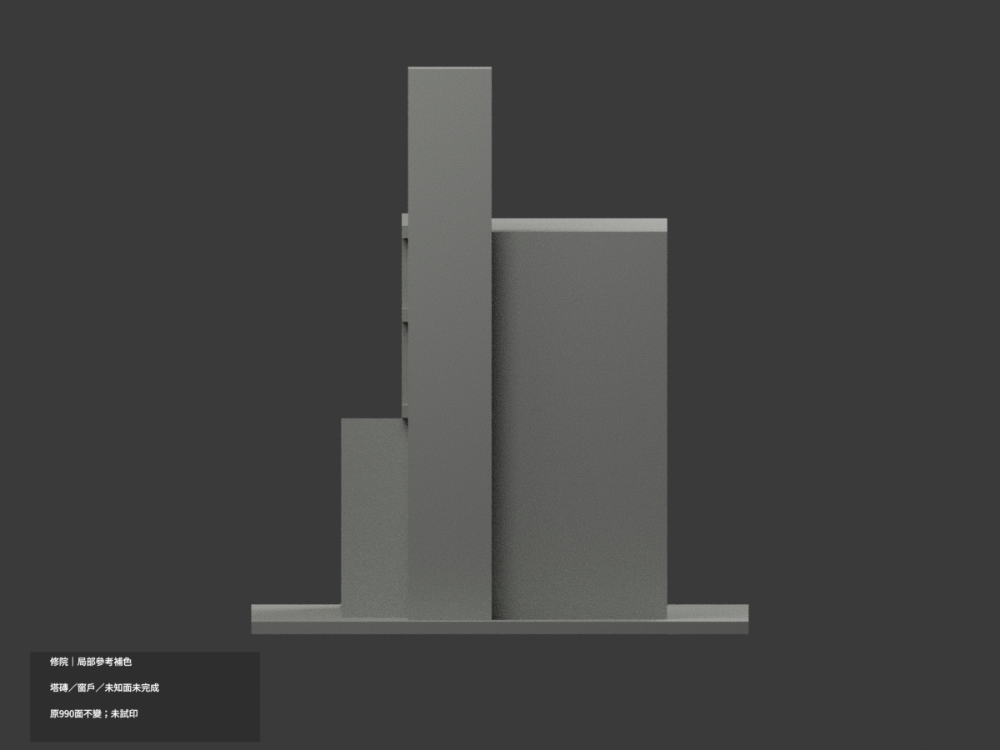
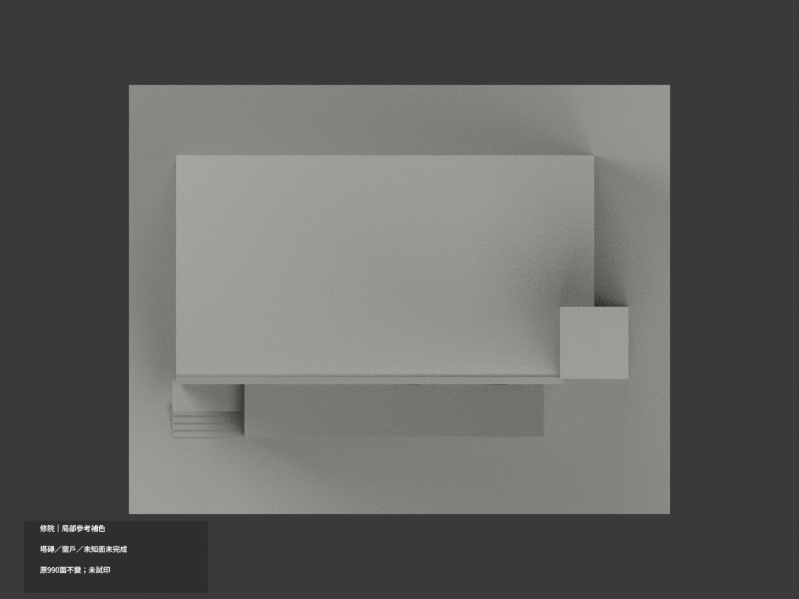
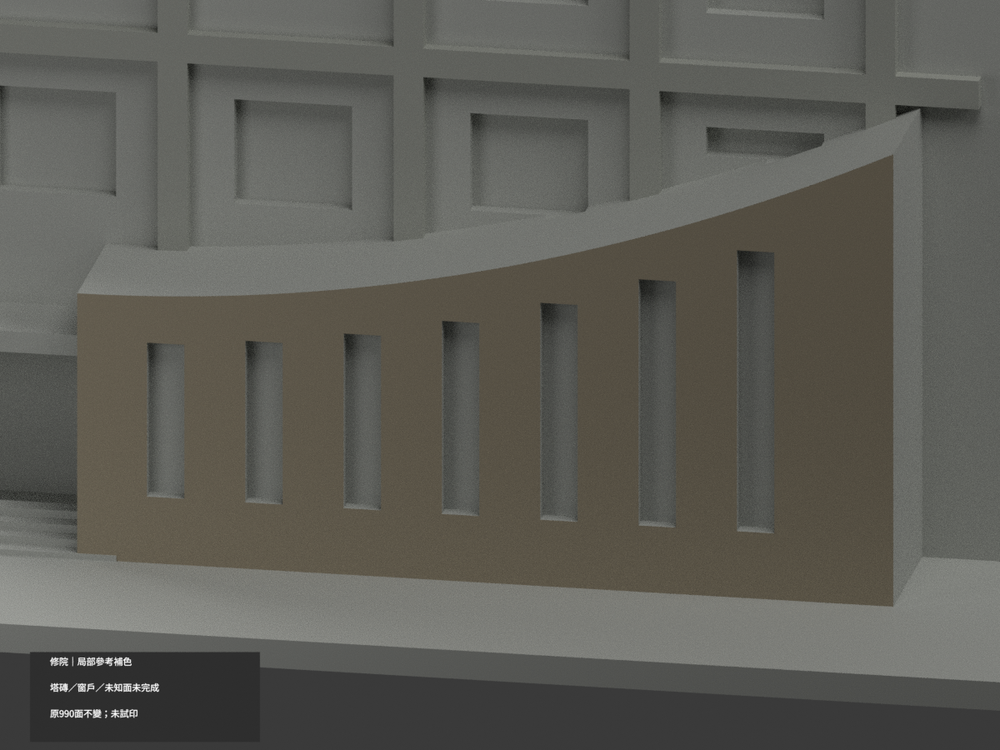
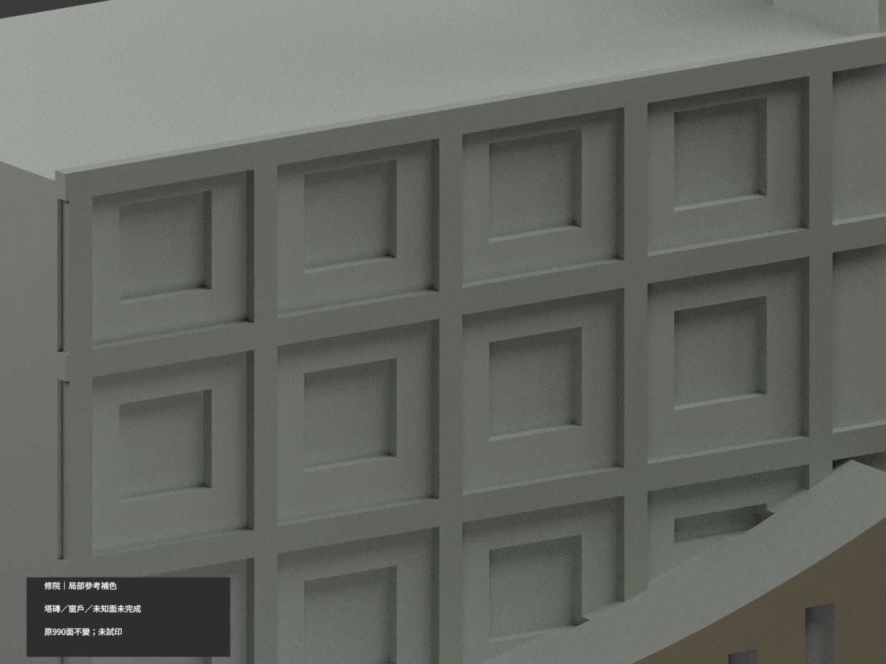
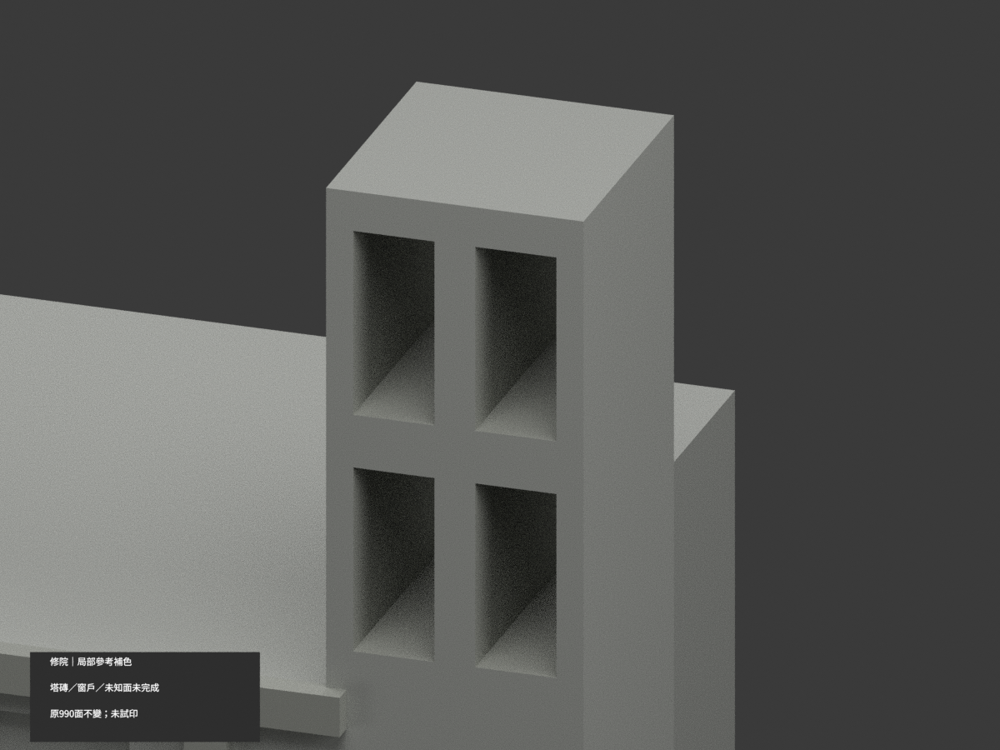

# 修院｜既有模型局部參考補色

**局部補色未完成：僅帆形前壁、獨立灰色格框及塔孔內壁局部補色；塔身紅磚帶、窗戶及未知面未完成。** `partial_color_incomplete=true`、`fully_colored_exterior=false`。同項目`wzu-convent`／`count_delta=0`，不新增套數。

| 前斜視 | 後斜視 | 正面 |
|---|---|---|
|  |  |  |
|  |  |  |
|  |  |  |
|  | | |

## 材色範圍

帆形低壁真正前平面y=-38之79面，作低飽和暖灰褐石材近似；七個窄窗的背板與洞返不隨牆上色。原五凸柱與三橫梁223面、四個真透孔內壁32面採灰石色族，共255面。其餘656面未知中性，**不是實景灰色證明**。

左端梁面與主樓未知側壁共面連通，該完整域全中性，不在x=-62平面截色。格框採原box實際外表面，不把同高度主牆當梁。塔孔只採切孔四周朝內的x/z面，沒有玻璃背板；整塔正／側外壁跨紅磚帶但原沒有真分面，完整中性，禁止z100切割上色。主體窗背含窗框、反射、簾而原無分界，全中性。帆頂側、後屋、鄰棟與入口未核域中性。來源範圍差不表示實際接縫。

原990三角／坐標／尺寸／STL／原build字節完全不動，沒有新窗框、logo或幾何細節。色審不追認原近似造型，不稱現況精測。

## 來源與權利

文藻[官方校園頁](https://c005.wzu.edu.tw/category/132558)照片與官方PDF實體43頁外觀照片。拍攝日未知，PDF2025-03-12版本／2023-12表格不是拍攝日。僅看建築外觀，不使用內部應變資訊。精確URL／SHA／GO2148與獨審2147-v1在`COLOR-SOURCE-REGISTER.json`。

未確認CC授權；原照/PDF私存、不隨模型公開或作貼圖。來源權利不被repo license取代，不保證商用。來源另已私人備份，不在本公開包重傳。

## 檔案與重建

`appearance.3mf`含3展示材標，`scene.blend`含實際面材與相機，`color-mesh.npz`保留原三角與material index。STL自身無色且原字節不變。原公開包無OBJ；原build隔離生成的OBJ只私存，不聲稱保留原OBJ。

依`requirements.txt`執行`python colorize_model.py`、`python export_appearance.py`、`python validate_color.py`；Blender執行`render_color.py`及`verify_color_scene.py`。完整原build＋color隔離重建目錄保留不自動刪。原場景及全部原件另私存；`ORIGINAL-MONOCHROME-README.md`、舊`previews/`與原QA是單色歷程，不是本次色材QA。

## QA與列印限制

原STL／三角multiset、封閉正體積、3MF索引與隔離重建見`COLOR-*QA.json`；Blender重開見`SCENE-QA.json`；10張1200×900圖與三欄展示／圖文hash見`DELIVERY-QA.json`。人工實看另交父終審。

**未實際列印。** 三展示材標不是驗證過的四色列印工程，切片、材料映射、支撐和薄細部強度另驗，不保證直接多料成功。
