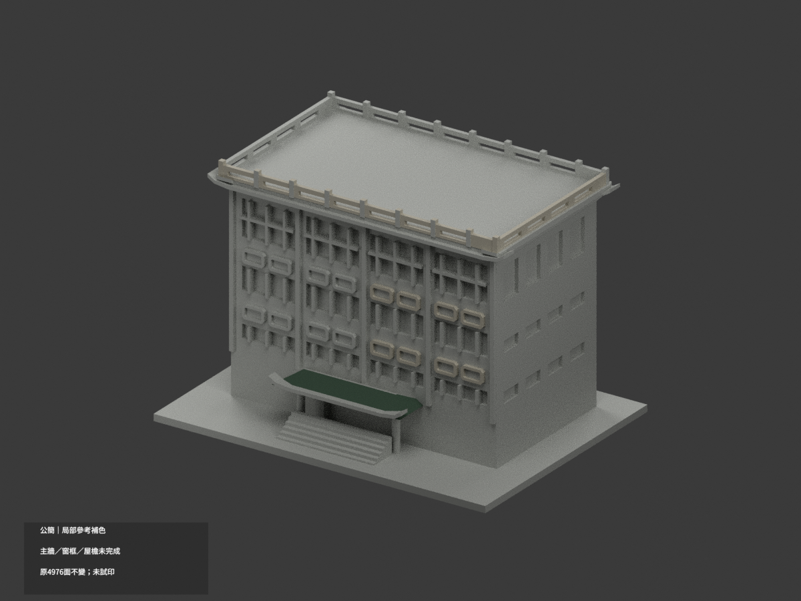
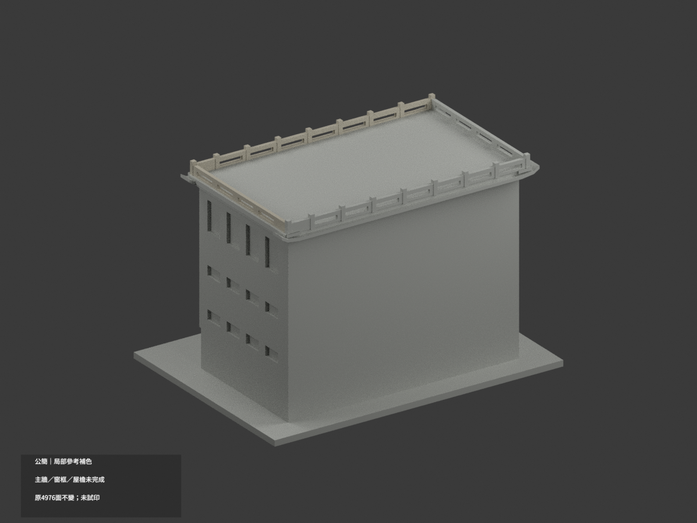
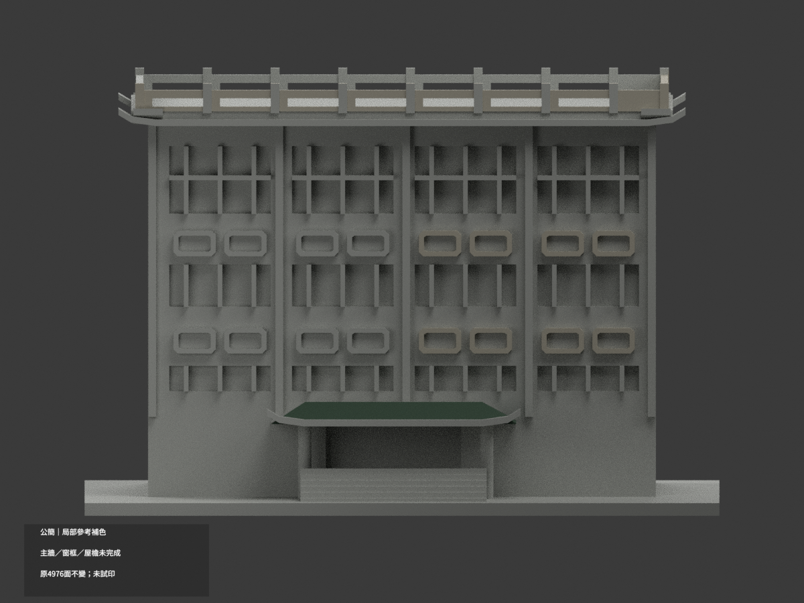
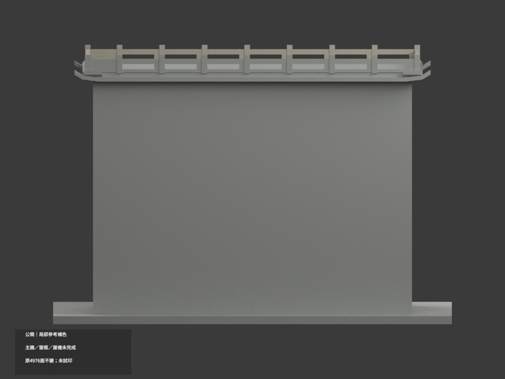
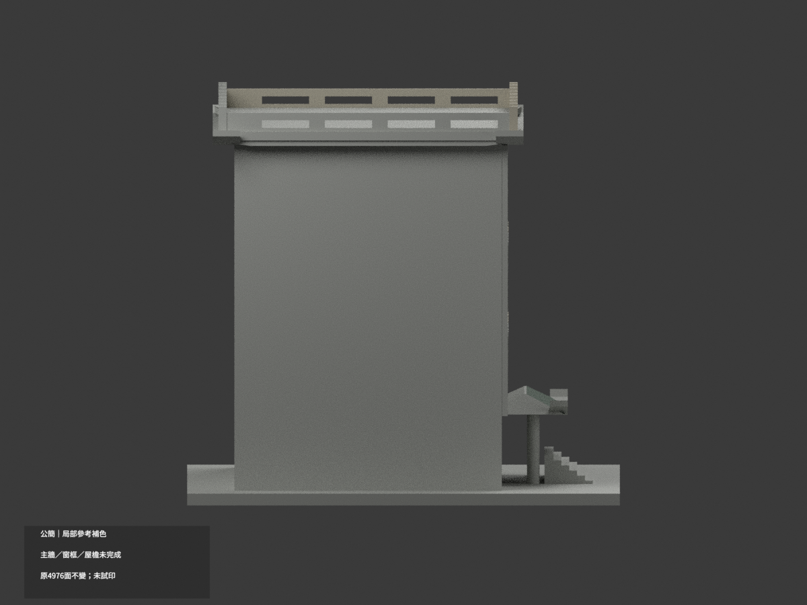
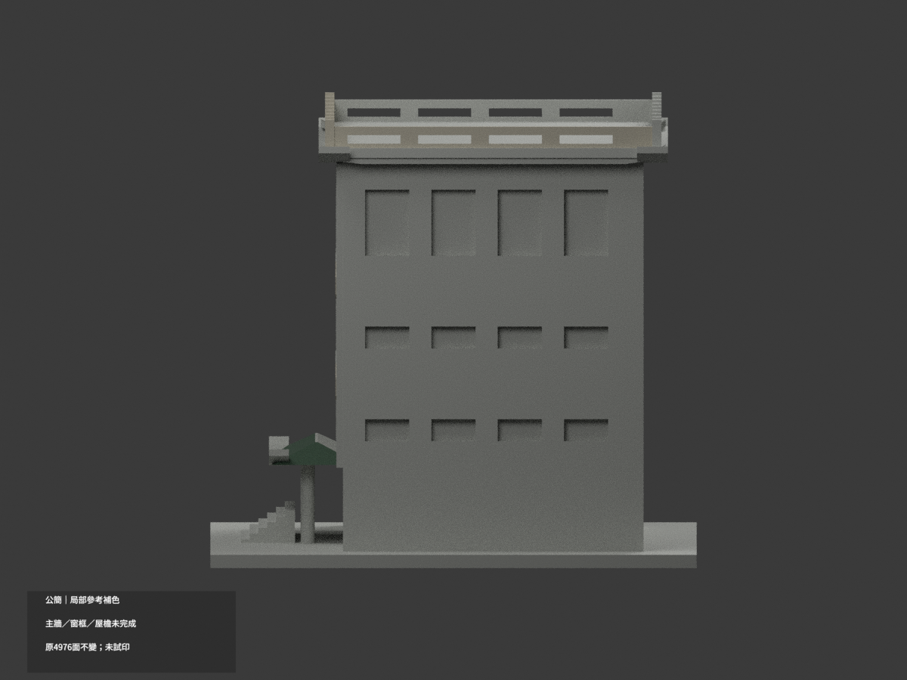
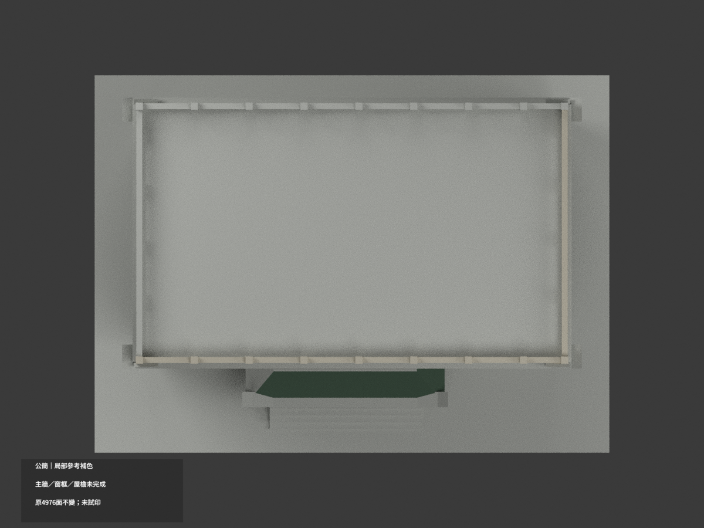
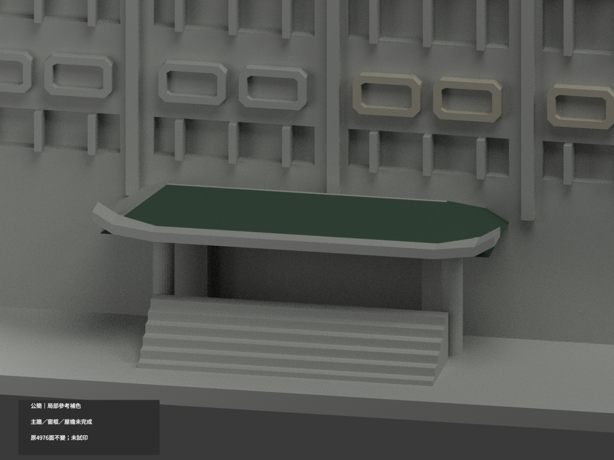
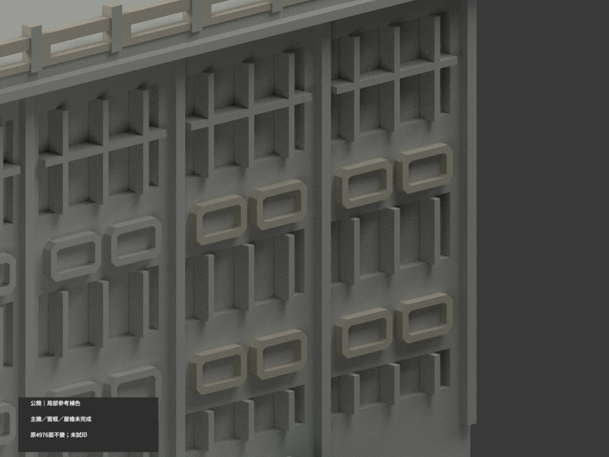
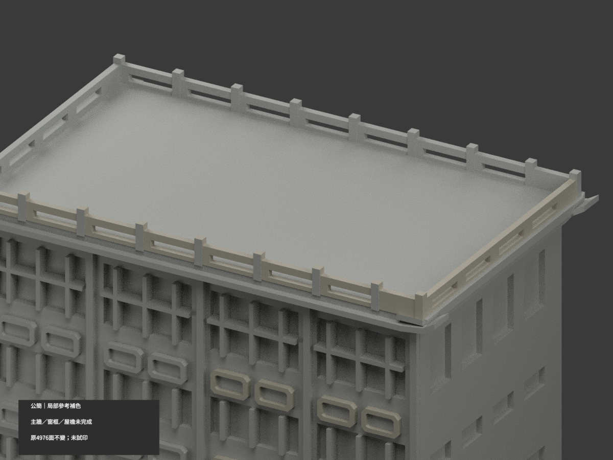

# 公簡｜既有模型局部參考補色

**局部補色未完成：局部浮雕、前右欄杆及入口屋坡補色；主立面混材、窗框版本及屋檐細分未完成。** `partial_color_incomplete=true`、`fully_colored_exterior=false`。原項目 `wzu-gongjian`／`count_delta=0`，不新增套數。

| 前斜視 | 後斜視 | 正面 |
|---|---|---|
|  |  |  |
|  |  |  |
|  |  |  |
|  | | |

## 材色範圍

暖灰903面：右側八個原獨立八角浮雕環384面、前／右上欄519面。原八角內部背板不納環色；樹遮左側浮雕保持中性。入口屋蓬只有前／右真正上斜面15面採低飽和暗綠，全部頂點需符合原hip斜面，並有向上法向；不是把整屋頂box染綠。其餘4058面中性，**不是實景灰色證明**。

前與右全高大牆混合上暖石／下灰塊但原面無分界，全部中性，不按高度挑三角造色楔。原上翹檐唇含綠瓦、紅椽與暗底混材無分面，全部中性；不染整片紅邊。窗框兩組無日期照片呈淺／綠差異，不選任一時期，玻璃、框與入口暗凹都保持中性。主屋頂是露臺，不塗成整坡綠瓦；左／後欄及右後交界跨未核域的大面中性。來源範圍邊界不表示真實材料接縫。

原4976三角、頂點、尺寸與STL／程式字節完全保留；不加窗、字、框或小瓦／不切面，色審不追認原簡化幾何精度。

## 來源與權利

文藻[官方校園頁](https://c005.wzu.edu.tw/category/132558)照片及官方PDF實體83頁外觀照片。拍攝日期未知，PDF2025-03-12版本／2023-12表格不是拍攝日。只用建築外觀，不使用內部應變資訊。精確來源URL與SHA在`COLOR-SOURCE-REGISTER.json`；採2126 GO及2125-v2獨審，早期整牆暖灰許可撤回。

未確認CC授權；原照片/PDF私人保留、不隨模型公開、不作貼圖。來源權利不被repo license取代，不保證商用。

## 檔案與重建

`appearance.3mf`含3個展示材標，`scene.blend`為實際面材／相機，`color-mesh.npz`存原三角與material index。原`model.stl`本身無色且字節不改。原公開包沒有OBJ；原程式隔離生成OBJ只私人保留，不稱原OBJ已保存。

依`requirements.txt`，先`python colorize_model.py`、`python export_appearance.py`、`python validate_color.py`；Blender執行`render_color.py`、`verify_color_scene.py`。完整原build＋color隔離重建目錄保留不自動刪。原場景與全原件另私存；`ORIGINAL-MONOCHROME-README.md`、舊`previews/`及原驗證只是單色歷程，不是本次色材QA。

## QA與列印限制

本次`COLOR-*QA.json`記原STL、三角座標multiset、封閉正體積、3MF材質索引及隔離重建；`SCENE-QA.json`為Blender重開，`DELIVERY-QA.json`綁定十張1200×900圖／首段三欄展示／最後README。人工實看另由父終審。

**未實際列印。** 三展示色不是驗證過的四色列印工程；切片、色料映射、支撐與細部強度另驗，不保證直接多料成功。
