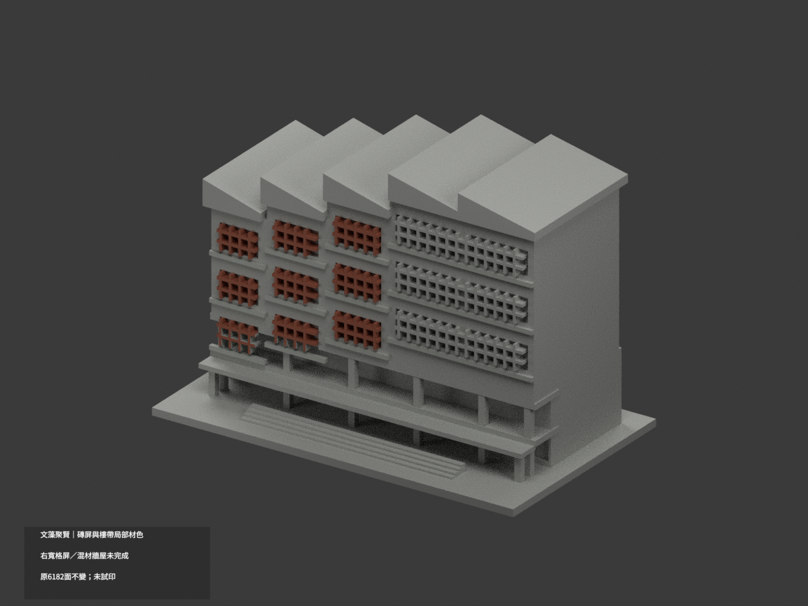
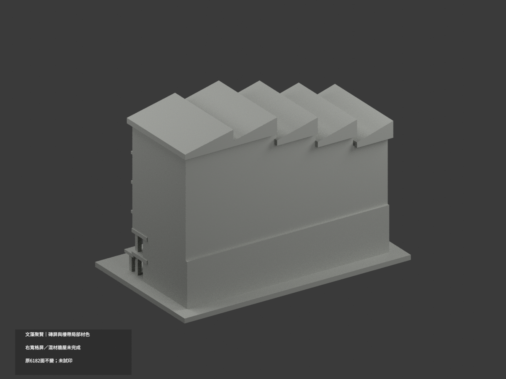
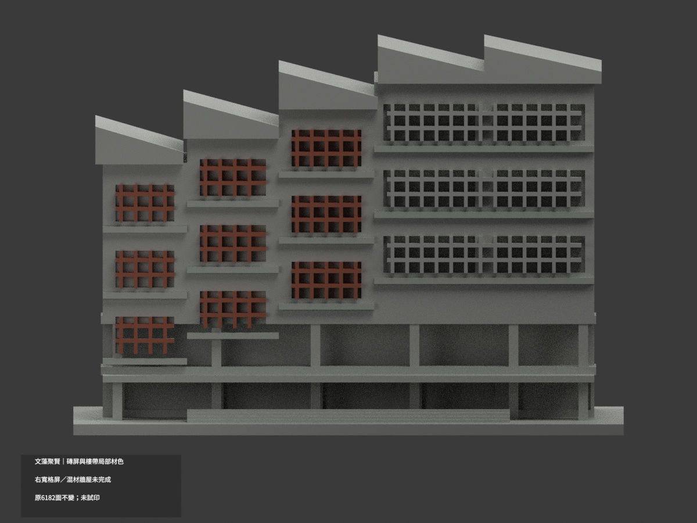
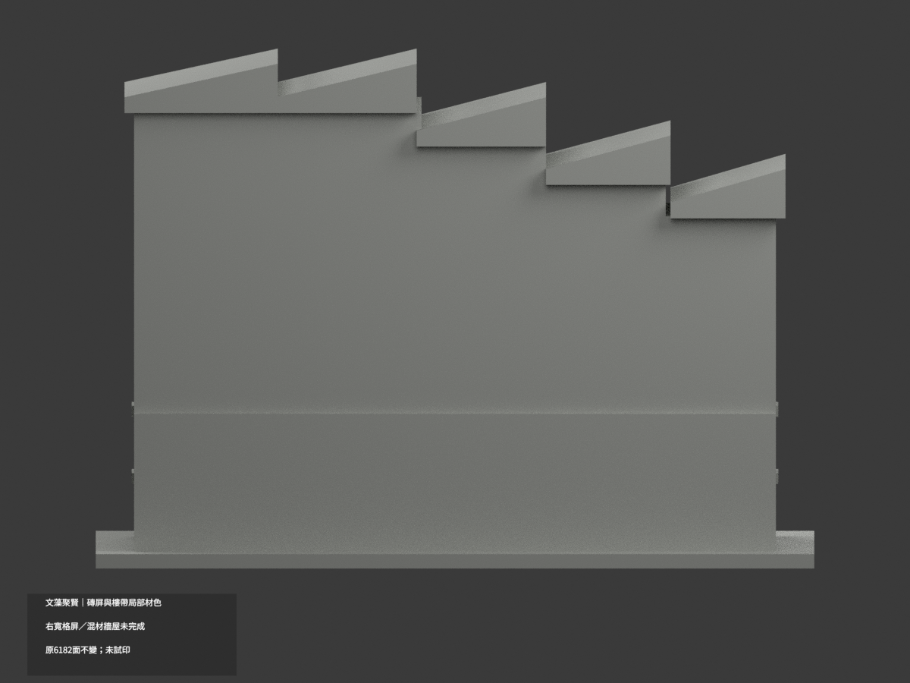
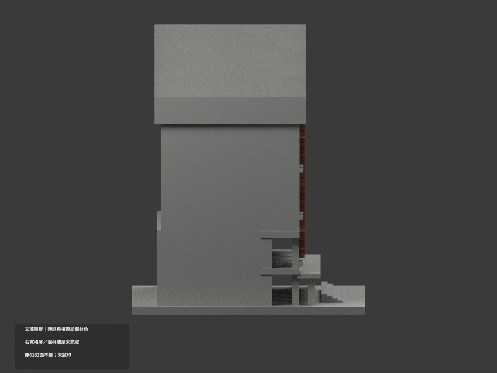
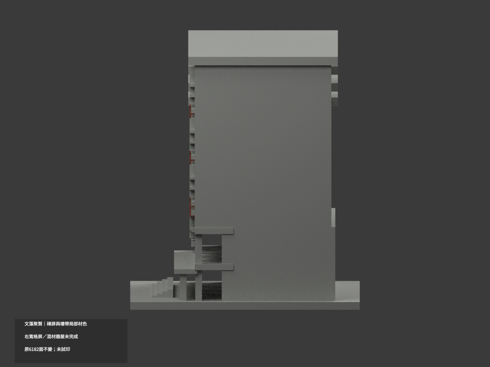
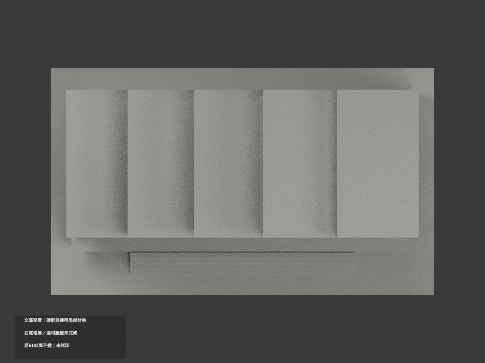
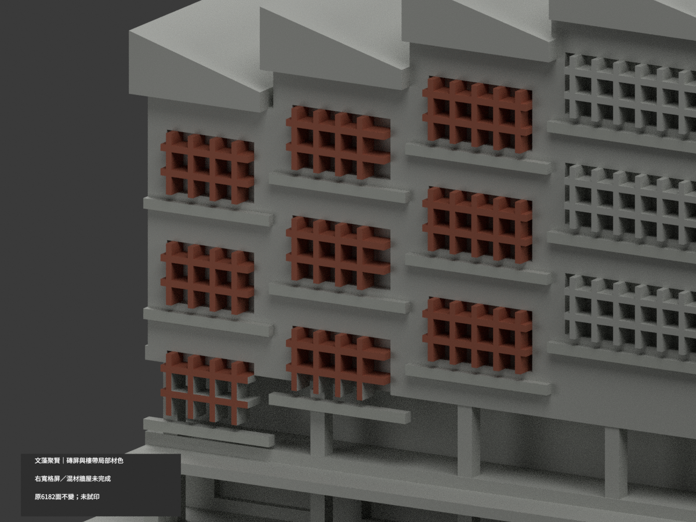
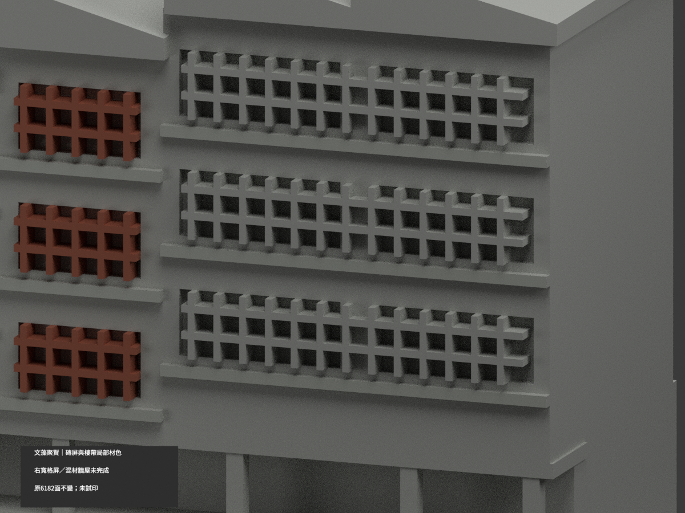
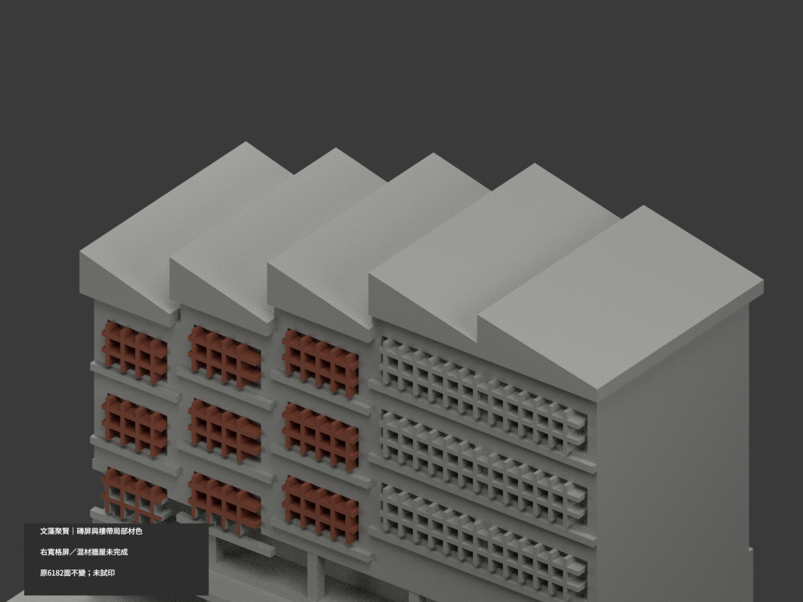

# 文藻聚賢館｜磚屏及樓帶局部材色示意

**右寬格屏、混材主牆及屋面未完成分色。** `partial_color_incomplete=true`、`fully_colored_exterior=false`。只有前三窄段有據格條與獨立樓帶，不是全館完成。

| 總覽 | 背側 | 正面 |
|---|---|---|
||||
||||
||||
||||

## 材色範圍
同 `wzu-juxian` 原項目，same-item、count_delta=0。**6182 個原三角面、頂點與原 STL/build_model.py 位元組不變**，沒有切面、新幾何或修正原近似外觀。原公開包無 OBJ；隔離重建的 OBJ 不冒稱原公開件。

- 前三窄段實際屏洞內的原獨立格條，共1790面近似低飽和磚紅，後方實心替代背板不染成磚。每個頂點與真構件域均核對。
- 四段共12條原獨立樓帶外前緣24面灰，不擴展到全部主牆。
- 最右60寬段實景有兩屏，中間5寬是灰隔；原x36豎條與跨中隔橫格融合在同前平面。**本輪整個右寬段格屏中性**，不按三角挑紅色造成假斜邊。
- 其他混色邊緣揭露面經相鄰同平面連續性檢查，15個原候選紅面撤回中性，使完整共面域一致；不切面湊色。
- 全部placeholder背板、階梯狀主牆、五個厚實屋楔（頂／邊／底）、下廊、柱、後側與地階維持中性。照片深色屋底可能陰影，不能整屋黑色。
- 色與中性分界只是來源與原拓撲限制，不宣稱真材接縫。原粗化格數與實景不同，補色不替原幾何背書；不增磚孔、文字、人物、草木或鄰棟。

## 日期與來源
採校方聚賢館照片及官方PDF第67實頁／印刷2-61外觀照。拍攝日期未載，2023-12是填表日、2025-03-12是文件版本，**不是攝影日期或現況精測**。只使用外觀照片，不取室內防災配置。
原照及PDF私人保存，不公開或作貼圖；未確認CC／再散布授權，不保證商用權利。HEX僅展示近似色族，不是校準色票。

## 格式與列印
[原 STL](model.stl) · [材色 3MF](appearance.3mf) · [Blender](scene.blend) · [原說明](ORIGINAL-MONOCHROME-README.md)
原底座150×89 mm為獨立照片近似展示，非測量比例。3MF basic materials及Blender真正逐面材質；STL不含色。三材質標籤不是已驗證三色／四色耗材切片專案。**未實際列印**，未產生切片工具路徑；格條／屋挑風險不因補色解除。

## 重建與 QA
依原 requirements 安裝後 `build_model.py` → `colorize_model.py` → `export_appearance.py` → `validate_color.py`。Blender 執行 `render_color.py`、`verify_color_scene.py`。
包含原位元組、逐三角座標、正體積閉合、3MF材質與完整隔離重建；scene重開、十圖與README/hash另驗。材域檢查另驗相鄰共面連續面同色，但程式不能取代來源人工判讀。
原previews/render/validation保留為單色歷程，不當新材色QA；未刪原件。
