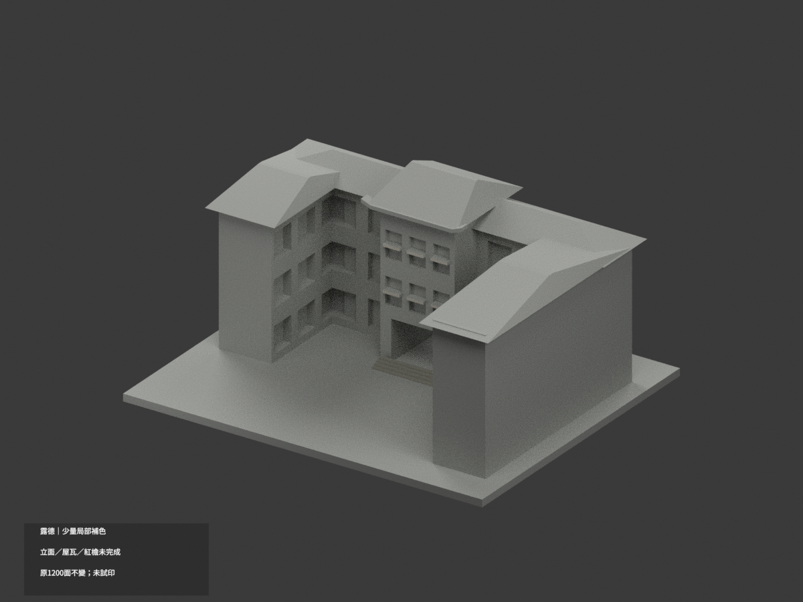
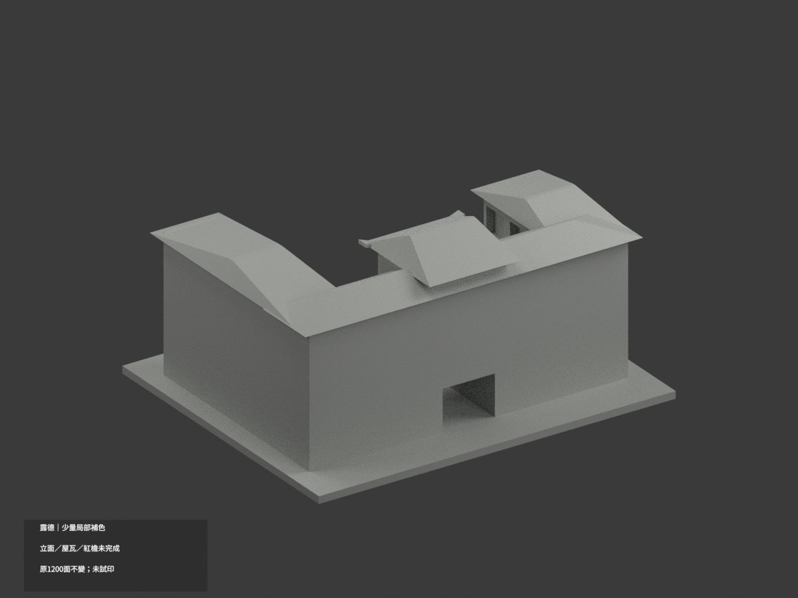
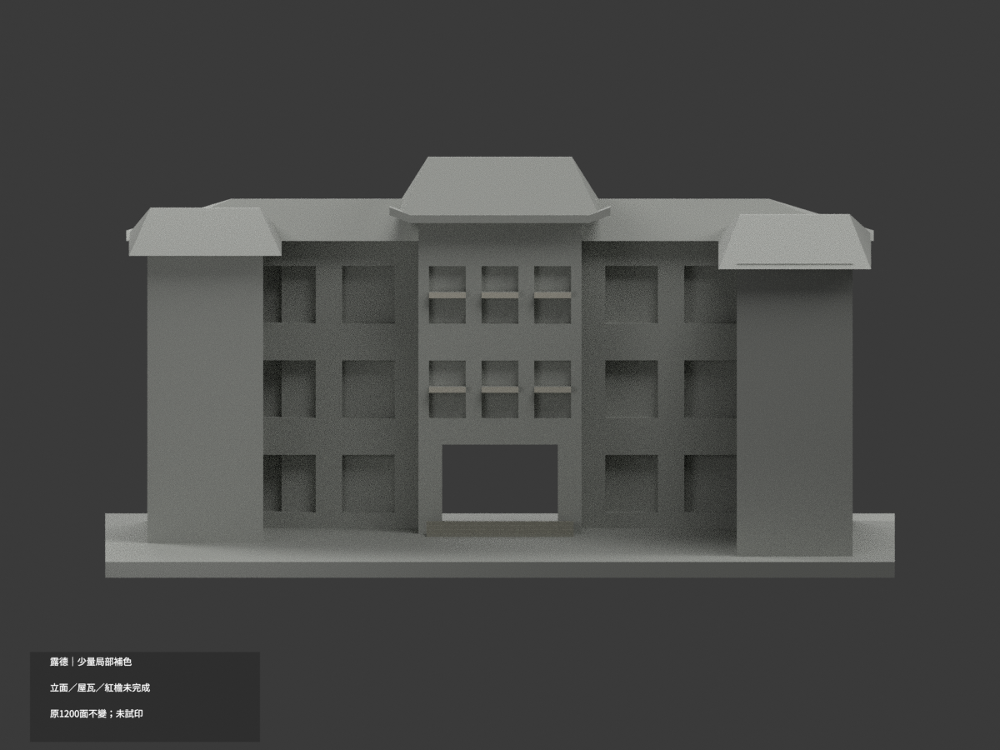
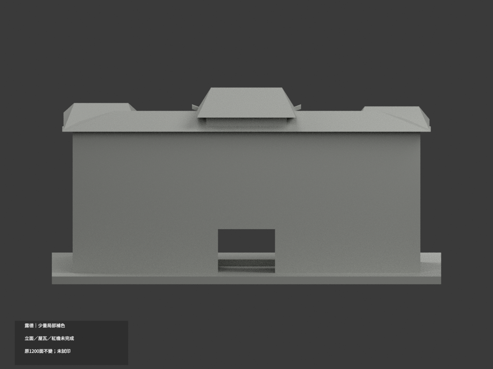
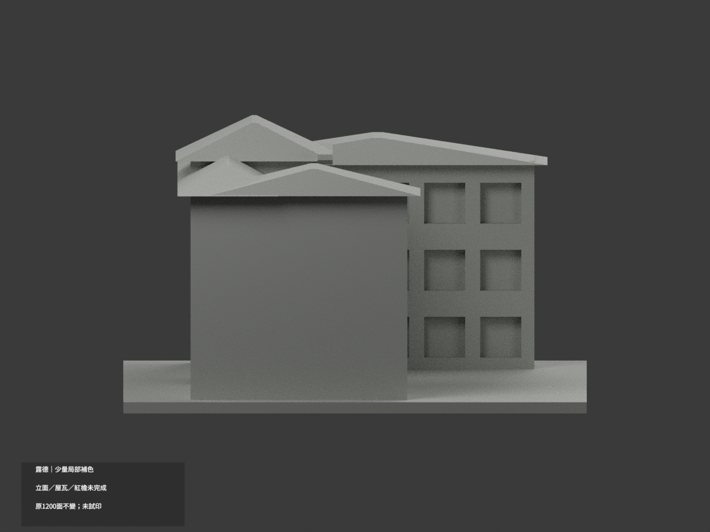
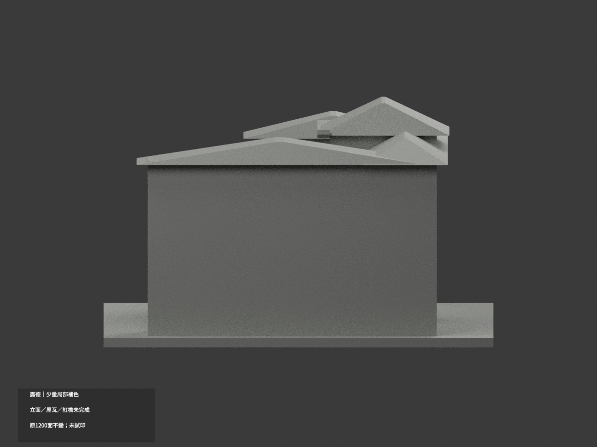
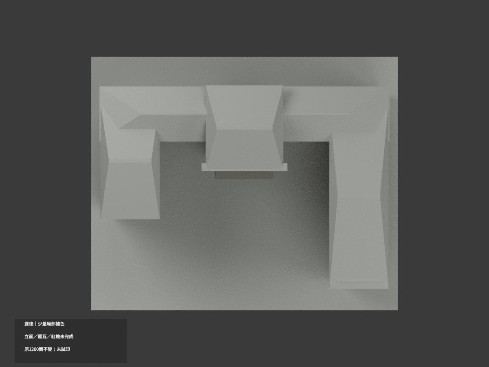
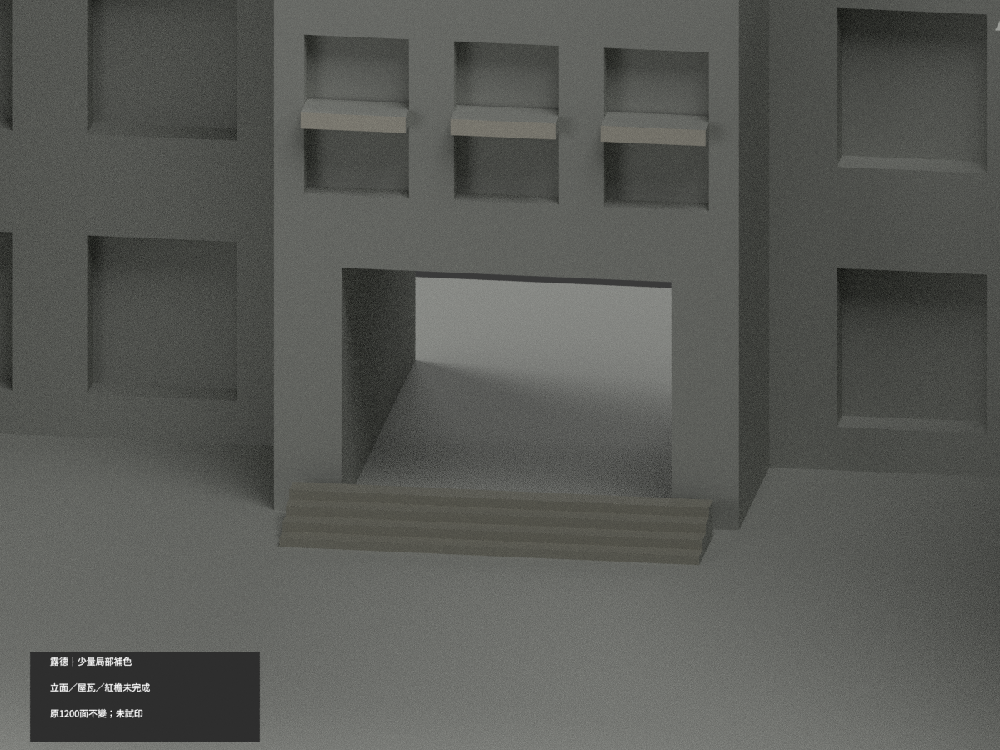
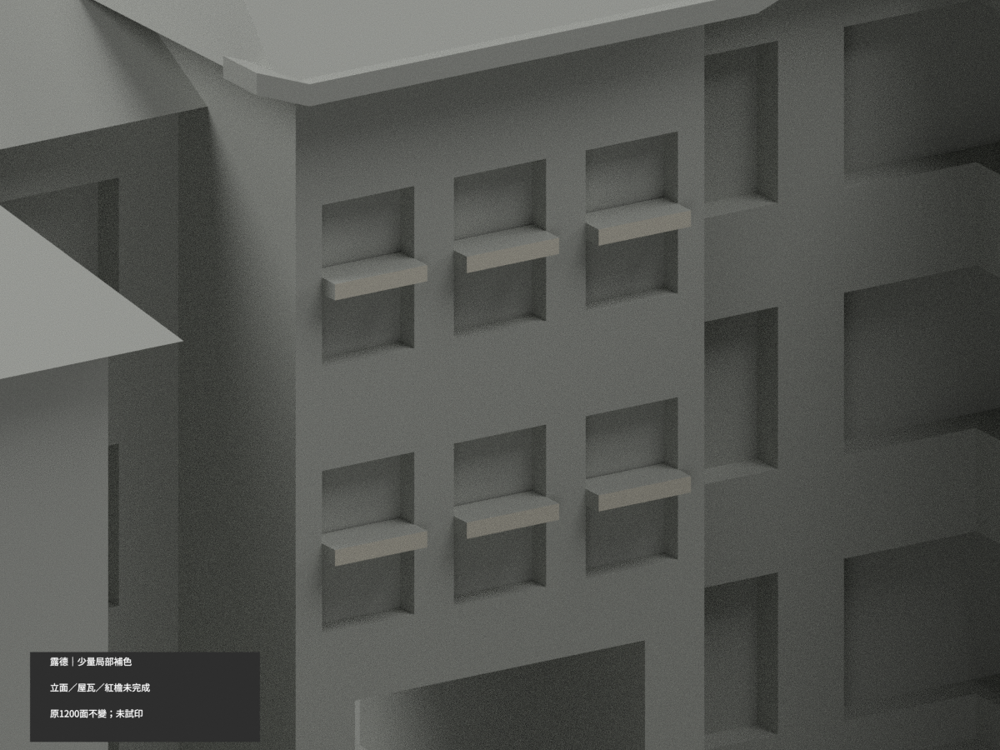
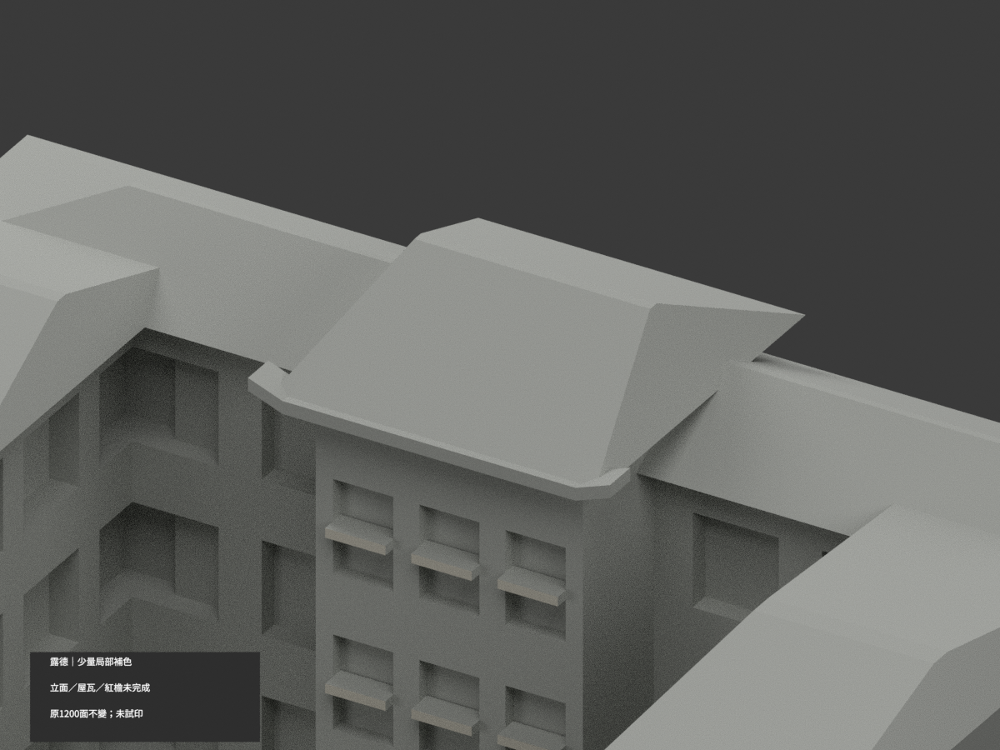

# 露德樓｜既有模型少量局部補色

**局部補色未完成：僅中央六片水平窗梃與入口階梯少量補色；立面、窗背、屋瓦與紅檐仍未完成。** `partial_color_incomplete=true`、`fully_colored_exterior=false`。同項目`wzu-lourdes`／`count_delta=0`，不新增套數。

| 前斜視 | 後斜視 | 正面 |
|---|---|---|
|  |  |  |
|  |  |  |
|  |  |  |
|  | | |

## 材色範圍

只有六片原水平梃正面（y=8.45、12三角面）採暖白，以及4個原階的實際踏面／正立面16三角採灰石色族。其餘1172三角全部未知中性，**不是實景灰色證明**。

實景窗格細密、白帶有裝飾，但粗原模型沒有這些界線；不新增細梃或把整窗塗白／深色。全高柱壁混淺石、深基座且無對應原面，整域中性。實景紅色是中央檐下椽，不能據此把上hip屋皮或整個厚檐塗紅；所有屋坡、上翹厚檐、窗背、門洞、牌匾與後院保持中性。不畫假接縫、不以高度挑三角、不填補2005已拆除西側體量。

原1200三角、頂點、尺寸、STL與原程式完全不改；本次色審不追認原近似幾何，非現況精測。色材範圍邊界不是實際材質接縫。

## 來源與權利

文藻[官方校園頁](https://c005.wzu.edu.tw/category/132558)外觀照片及官方PDF實體50頁兩張外觀照。拍攝日未知，PDF2025-03-12版本／2023-12表格不是拍攝日。只取外觀，不使用內部應變資訊。精確URL／hash／GO2142與獨審2141-v1見`COLOR-SOURCE-REGISTER.json`。

未確認CC授權。原照/PDF私存、不公開或作貼圖；來源權利不被repo license取代，不保證商用。

## 檔案與重建

`appearance.3mf`含3展示材標；`scene.blend`含實際面材與相機，`color-mesh.npz`存原面與material index。STL無色且原字節不變。原公開包無OBJ；原build隔離產生的OBJ只私存，不稱原OBJ已保存。

依`requirements.txt`先`python colorize_model.py`、`python export_appearance.py`、`python validate_color.py`；Blender執行`render_color.py`、`verify_color_scene.py`。完整原build＋color隔離重建目錄保留，不自動刪除。原場景與全部原件另私存；`ORIGINAL-MONOCHROME-README.md`、舊`previews/`及原QA為單色歷程，不是本次補色QA。

## QA與列印限制

原STL字節／三角座標multiset、封閉正體積、3MF索引與隔離重建見`COLOR-*QA.json`；Blender重開見`SCENE-QA.json`；10張1200×900圖與首段三欄／圖文hash見`DELIVERY-QA.json`。人工實看另交父終審。

**未實際列印。** 三展示材標不是驗證過的四色列印工程，切片、色料映射、支撐與細節強度須另驗，不保證直接多料成功。
