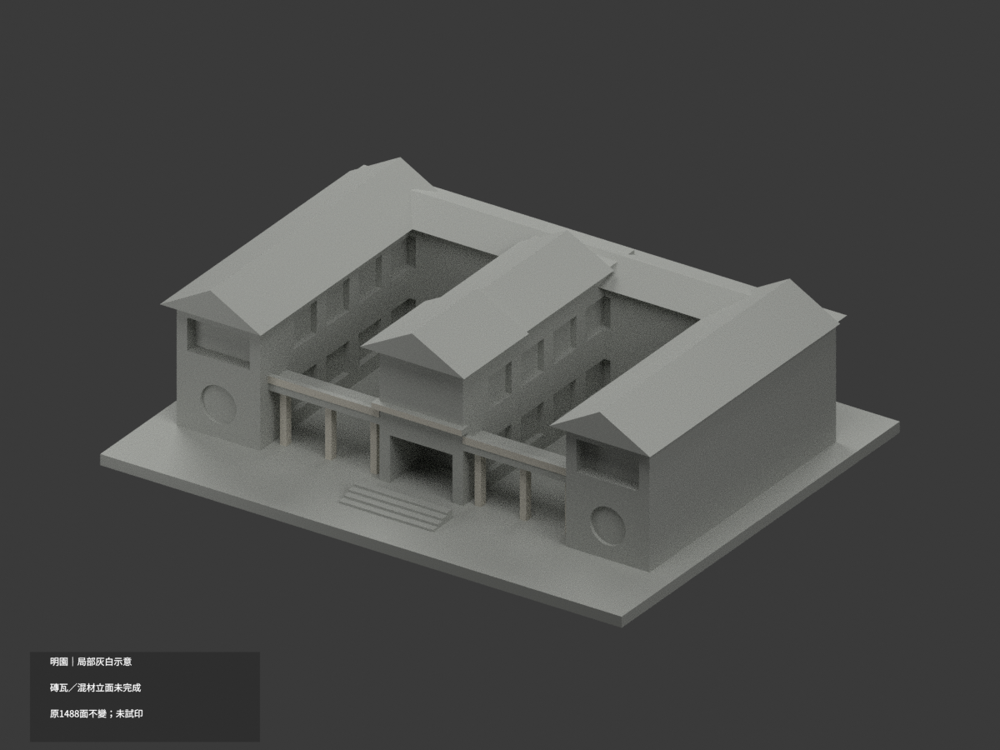
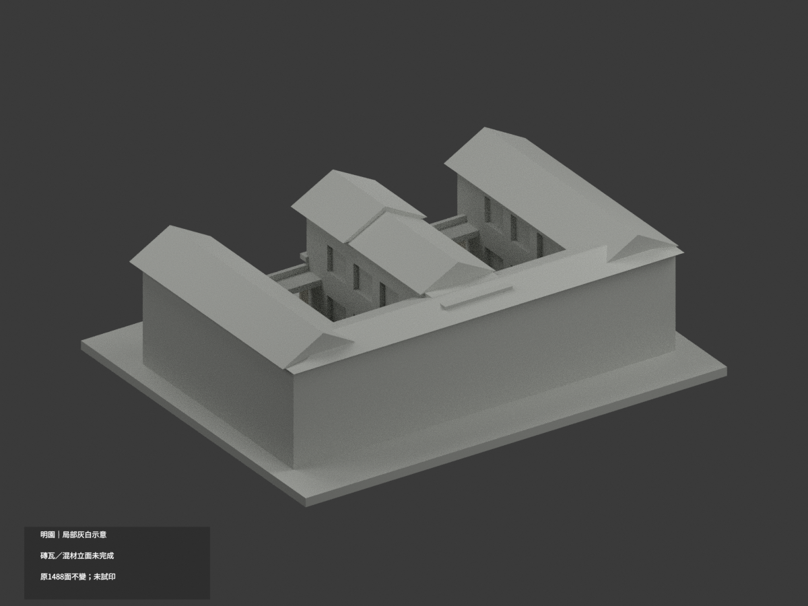
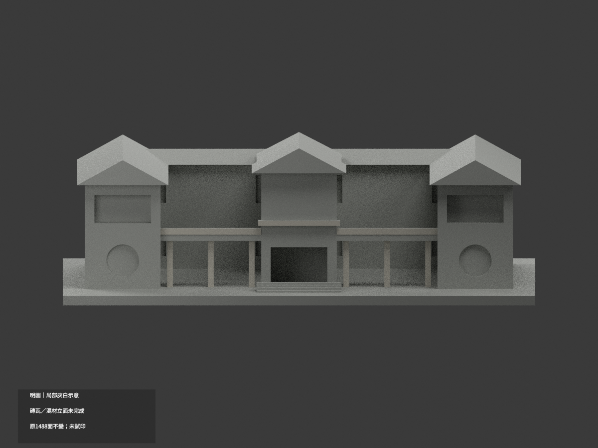
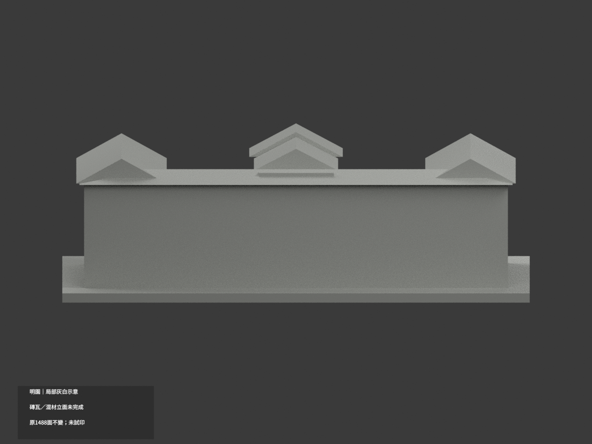
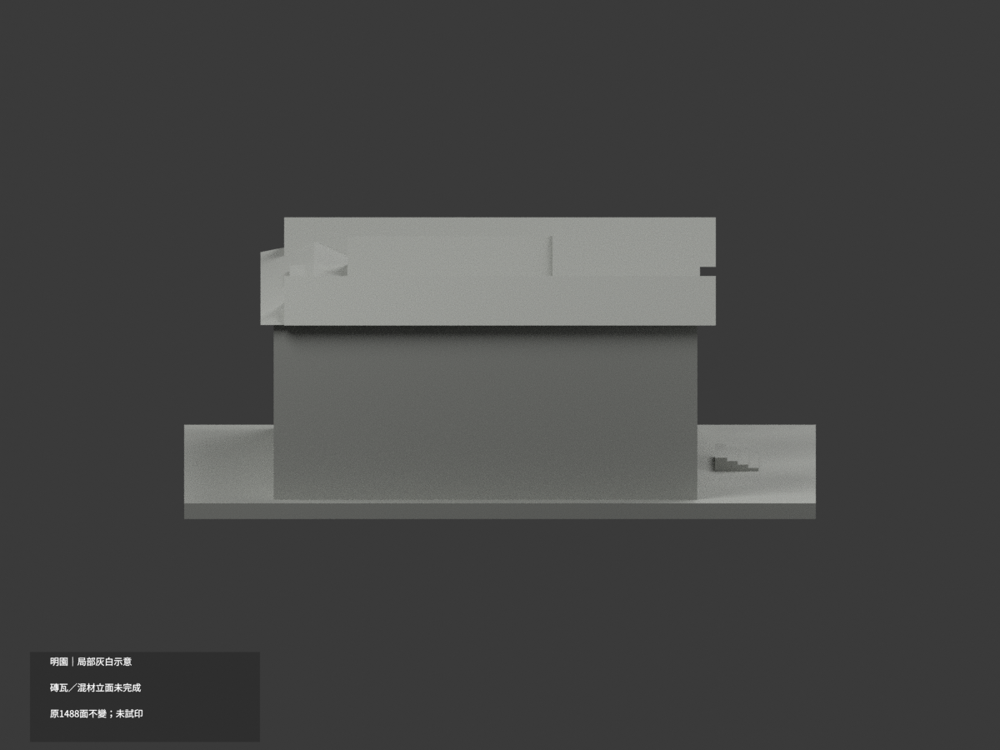
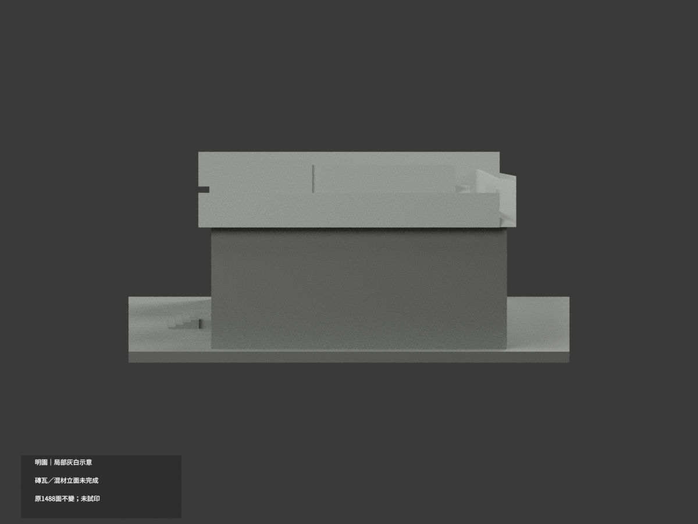
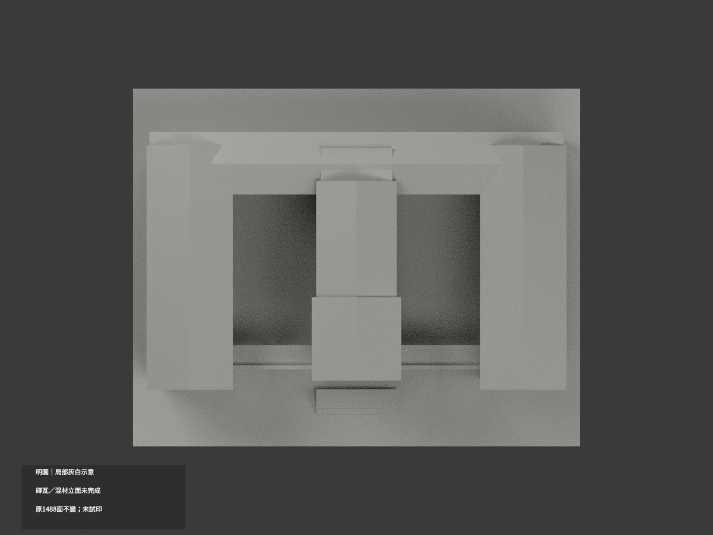
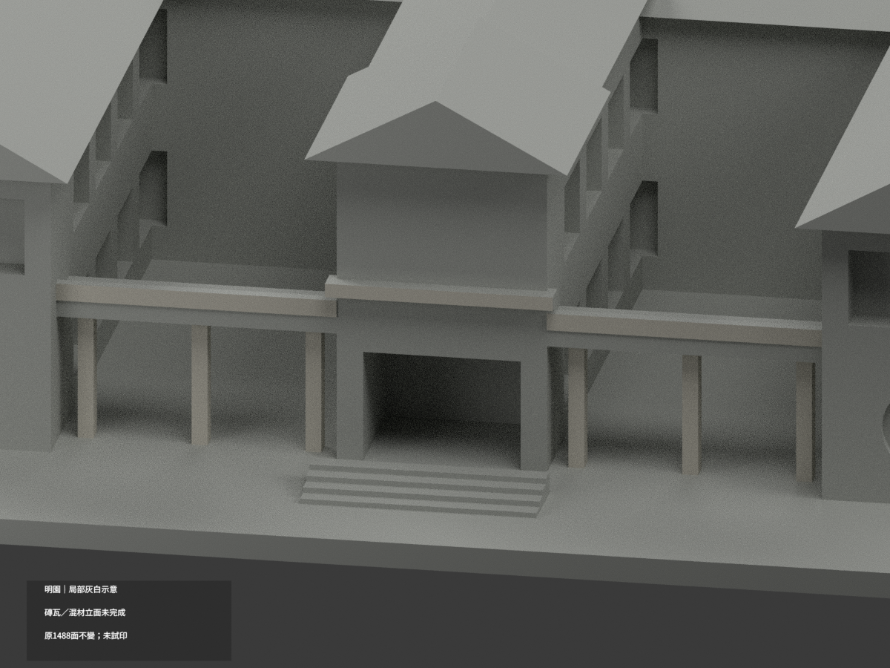
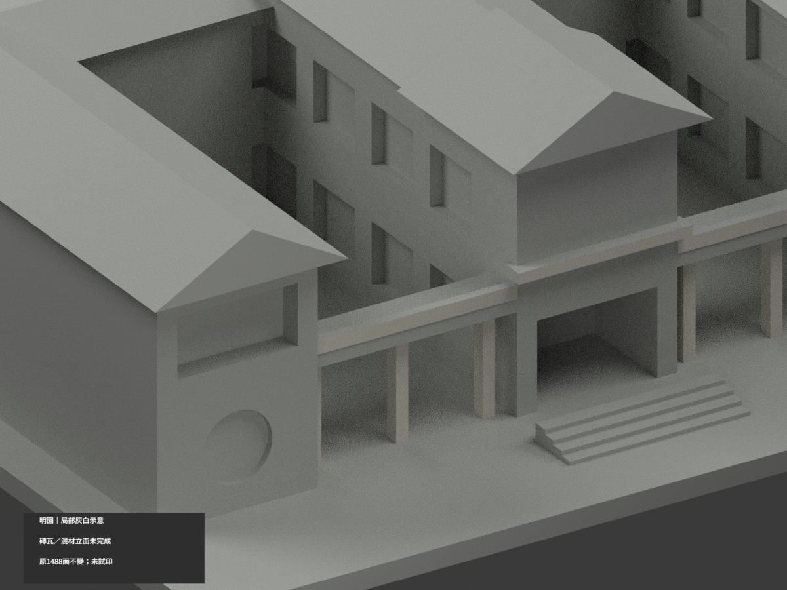
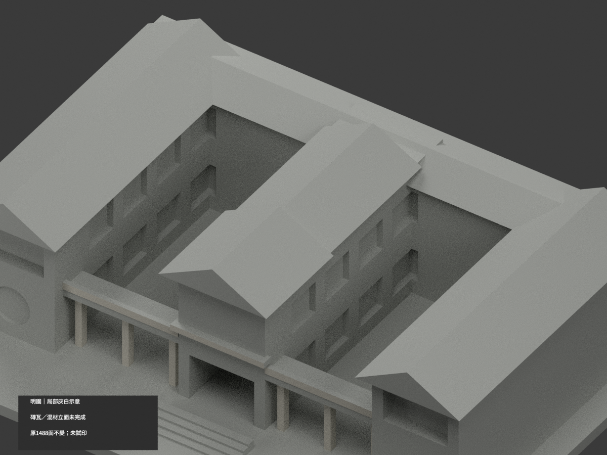

# 明園｜既有模型局部灰白示意

**局部補色未完成：僅前廊欄杆、柱及門樓獨立橫帶局部灰白補色；磚瓦與混材立面仍未完成。** `partial_color_incomplete=true`、`fully_colored_exterior=false`。同項目 `wzu-mingyuan`／`count_delta=0`，不新增套數。

| 前斜視 | 後斜視 | 正面 |
|---|---|---|
|  |  |  |
|  |  |  |
|  |  |  |
|  | | |

## 材色範圍

只有原有獨立前廊欄杆正面、六柱可見側面與門樓獨立橫帶正面採近似暖灰白，共54面。原1488三角面、頂點、尺寸、`model.stl`、`build_model.py`均不變。其他1434面為未知中性，**不是實景灰色證明**。

全山牆同時包含實際淺框及黑百葉，而原三角沒有分界，因此全片中性，不塗黑；月窗背面不是可證紅磚/黑玻璃，不畫白圓環。前牆混磚、淺框及石基座沒有原分面；所有瓦坡、後側、院內及基座保持中性。不按照片新增窗、瓦、框、植栽或切面湊色。

原簡化屋脊方向／外觀與照片有近似差異；本次只材色更新，**色審不追認原幾何精確性**，不稱現況精測。來源覆蓋與未知面分色不是實際材料接縫。

## 來源與權利

文藻官方[校園頁](https://c005.wzu.edu.tw/category/132558)及其明園實景照片；官方PDF實體第29頁的兩張建築外觀照片。照片拍攝日未知，PDF 2025-03-12版本／2023-12表格日期不是拍攝日。只採外觀，不使用內部應變資訊。精確來源URL、SHA與v2審核在 `COLOR-SOURCE-REGISTER.json`。早期黑山牆許可已撤，只有2114-v2有效。

未確認CC授權；原照/PDF私人保存、不隨模型公開、不作貼圖；來源權利不被repo license取代，不保證商用。

## 檔案與重建

`appearance.3mf`包含2種展示材質；`scene.blend`含實際面材與相機，`color-mesh.npz`保原三角及材質index。STL本身無色，原件字節保持。原遠端包**沒有OBJ**；原`build_model.py`隔離重建產生的OBJ只私人保留，不聲稱保留原OBJ。

Python依原`requirements.txt`：先`python colorize_model.py`，再`python export_appearance.py`、`python validate_color.py`。Blender執行`render_color.py`及`verify_color_scene.py`。驗證會保留隔離原程式重建目錄，不自動刪除。原場景/所有原件另完整私存；舊`previews/`、原驗證與`ORIGINAL-MONOCHROME-README.md`只是單色歷程，不是本次彩材QA。

## QA與列印限制

原STL hash／全部三角座標multiset、封閉正體積單體、3MF材質索引、完整隔離原程式＋色程式重建、Blender重開及10張1200×900圖綁定分別記在本次`COLOR-*QA.json`、`SCENE-QA.json`、`DELIVERY-QA.json`。人工視覺核另交父獨審。

**未實際列印。** 兩個展示色標不是已驗證四色列印工程；切片／材料分配／支撐與細節強度須另驗，不保證兩料或四色直接成功。
