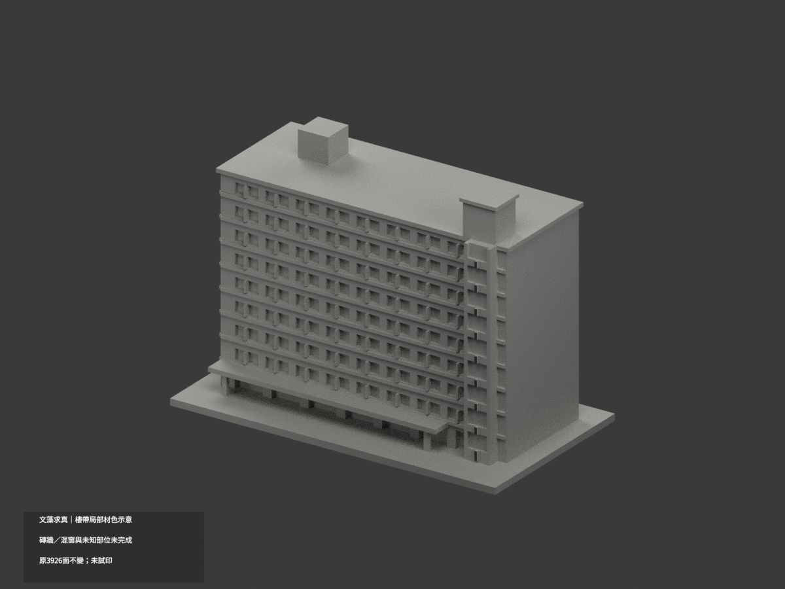
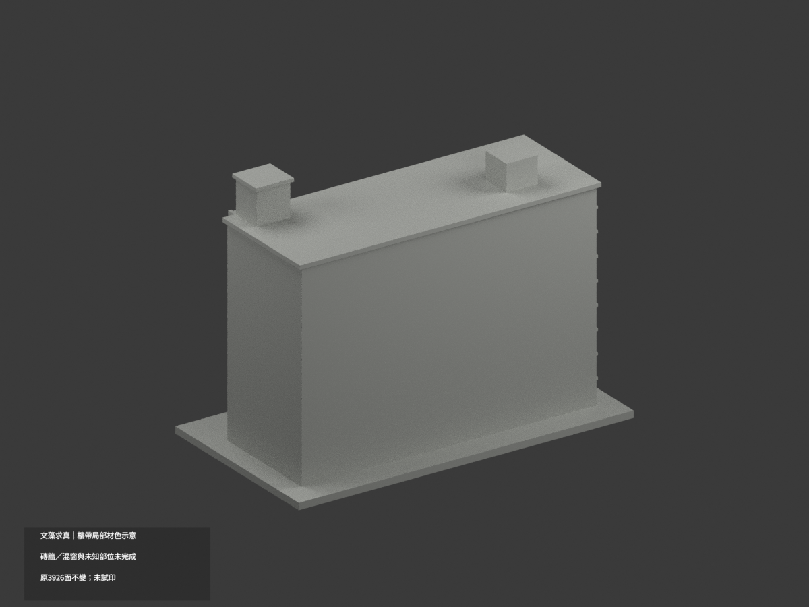
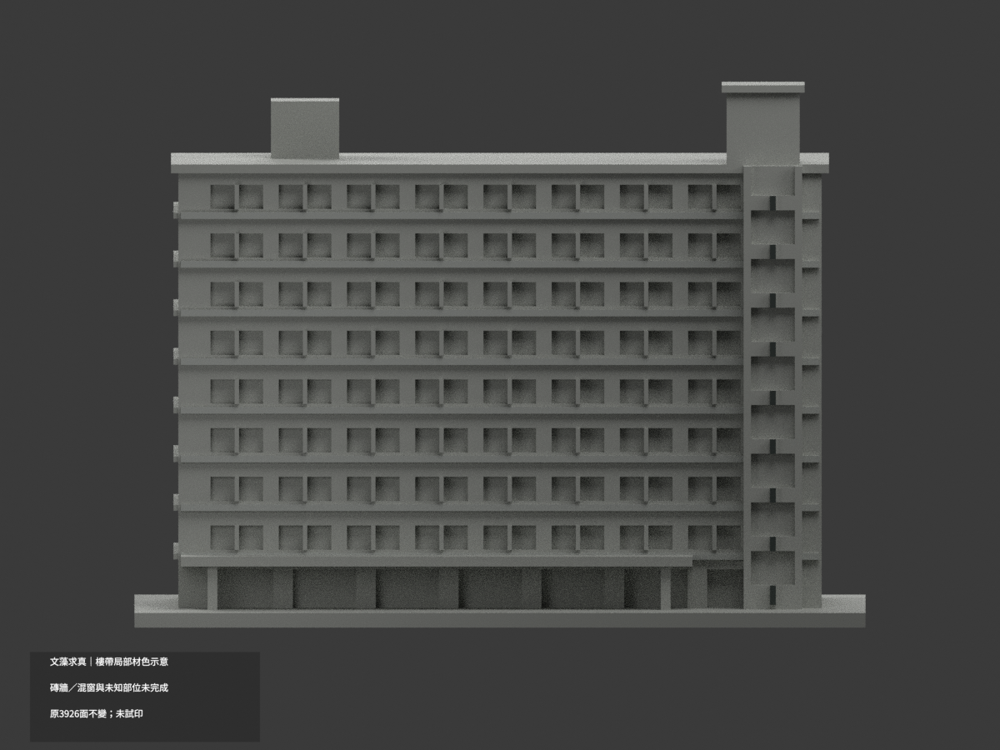
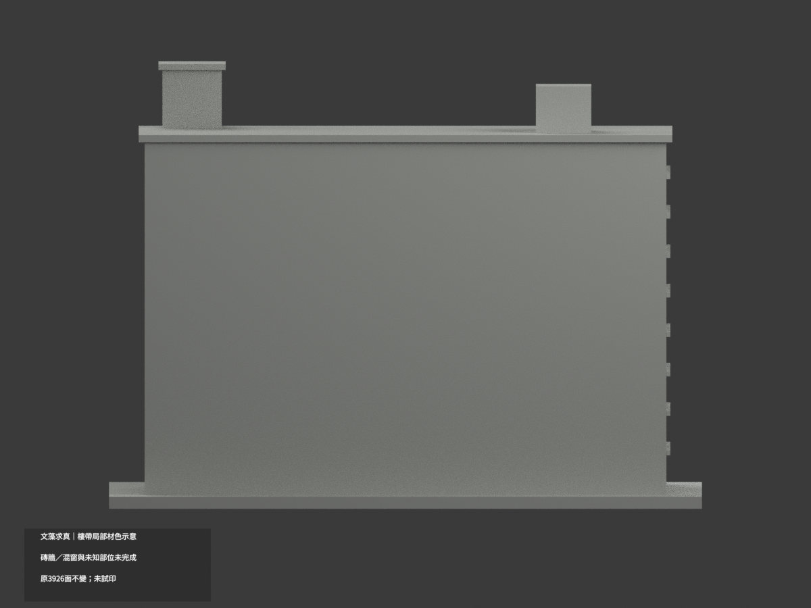
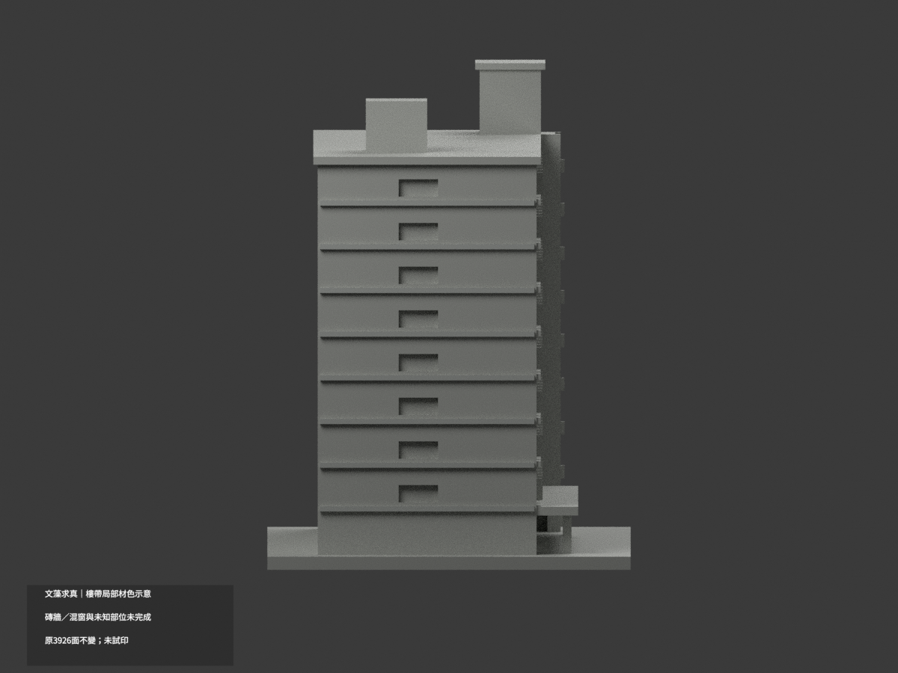
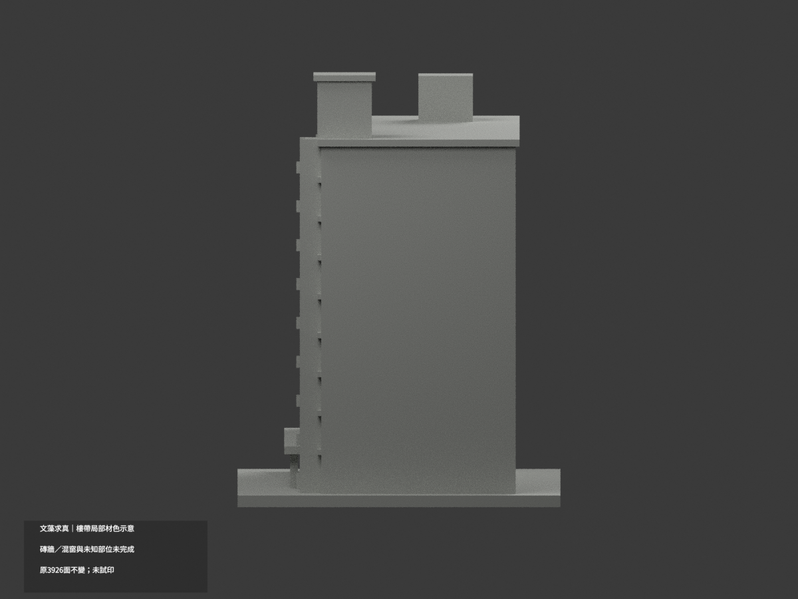
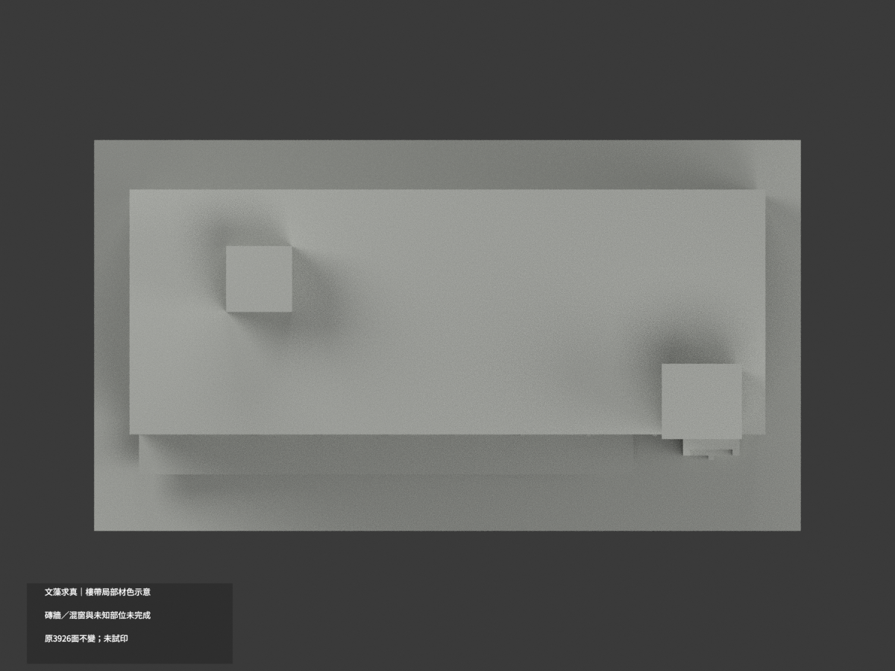
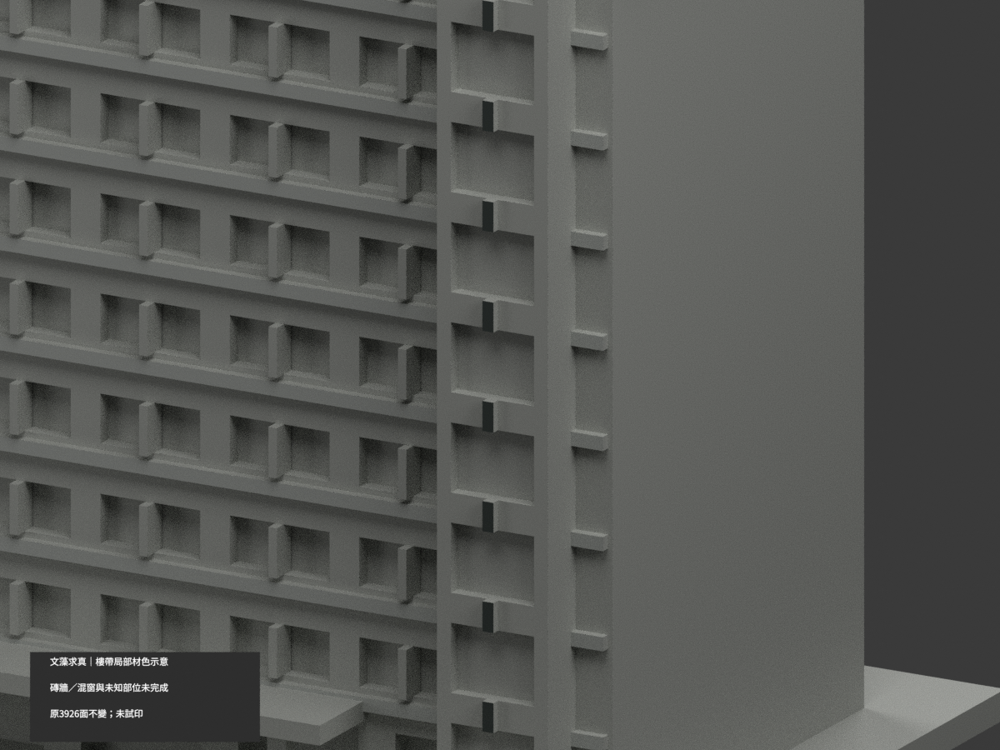
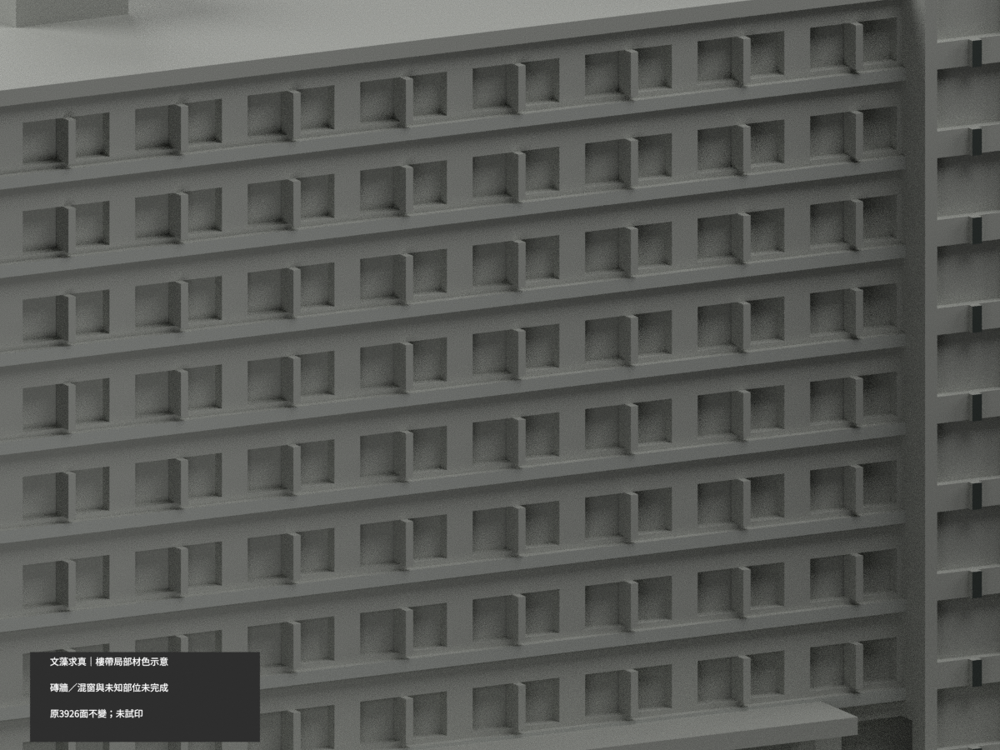
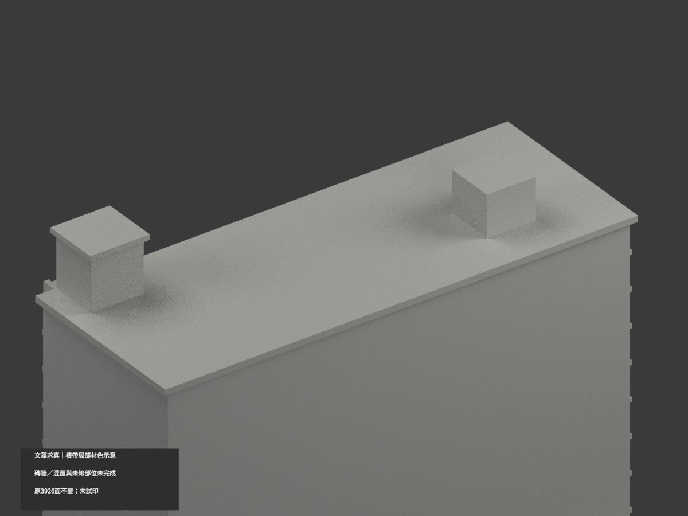

# 文藻求真樓｜局部樓帶及樓梯塔框材色示意

**磚牆、混窗及未知部位未完成分色。** `partial_color_incomplete=true`、`fully_colored_exterior=false`。只有據的樓板灰帶與樓梯塔中央前框，不是全館補色完成。

| 總覽 | 背側 | 正面 |
|---|---|---|
||||
||||
||||
||||

## 材色範圍
同 `wzu-qiuzhen` 原項目，same-item、count_delta=0。**3926 個原三角面、頂點與原 STL/build_model.py 位元組不變**，沒有切面、增加幾何或修正原近似外觀。原公開包沒有 OBJ，隔離重建產生的 OBJ 不冒稱原公開件。

- 八條獨立前樓帶 y=-20.95，只有外露前面 34 個三角面為近似淡灰；另左端 x=-67 的八條獨立板緣外面 16 個面同族灰。
- 樓梯塔中央獨立豎框 y=-26.4，只有前面 18 個三角為暗灰金屬族；不整塊塗成綠玻璃。
- 其餘 3858 面為未知中性：整面主牆雖見磚，但同面含灰帶／窗底未細分，不能用三角或高度硬畫紅磚；各窗背混窗簾、深色實板、反光及框，未細分就不一律染黑。
- 屋頂、服務室、後面、入口門、雨庇及遮蔽處中性。照片前方橘屋面是別棟，不能挪進本模型。
- 同一共面完整域一致，無假斜三角、無新窗框、字樣、草木、人物、鄰棟或塗色細節。

## 日期與來源
使用校方求真樓外觀照（拍攝日期未載），及官方 PDF 第53實頁／印刷2-47的兩張外觀照片。PDF 的2023-12是填表日期、2025-03-12是版本日期，**不是拍照日期或現況測繪日期**；不把原碼2023照片註語冒充已證實拍攝日。本次只看公開外觀照片，不使用室內防災配置。
原圖／PDF私人保存，不隨模型公開、不作貼圖；未確認 CC 或再散布授權，不保證商用權利。HEX 是近似展示色族，不是校準色票。

## 格式與列印
[原 STL](model.stl) · [材色 3MF](appearance.3mf) · [Blender](scene.blend) · [原說明](ORIGINAL-MONOCHROME-README.md)
原底座 150×83 mm 為獨立照片近似展示比例，不是測量。3MF basic materials 與 Blender 實際逐面材質，STL 不含色。三材質標籤不是已驗證三色／四色耗材切片專案。**未實際列印**，未產生切片工具路徑；原細框與挑棚列印風險不因補色解除。

## 重建與 QA
依原 requirements 安裝後 `build_model.py` → `colorize_model.py` → `export_appearance.py` → `validate_color.py`。Blender 執行 `render_color.py`、`verify_color_scene.py`。
幾何／3MF檢查包含原位元組、逐三角座標、正體積閉合、材質索引及完整隔離重建；場景重開核實，十圖與 README/hash 綁定另驗。程式檢查不取代材域／來源人工判讀。
原 `previews/`、原 render/validation 等保留為單色歷程，不當作新補材 QA；未刪原件。
