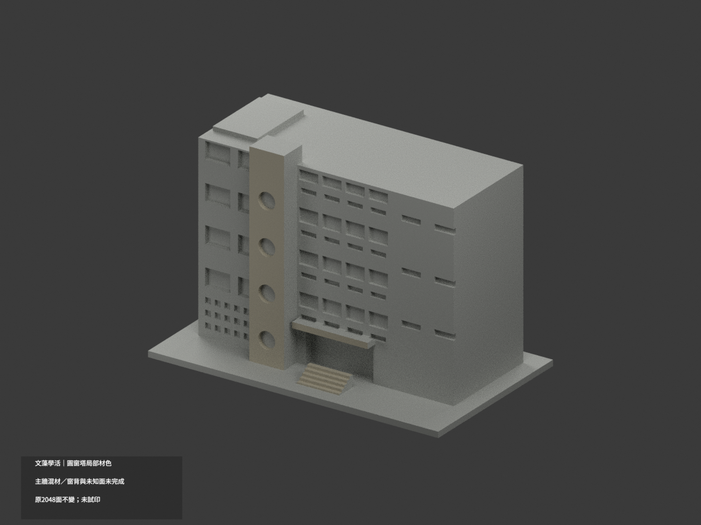
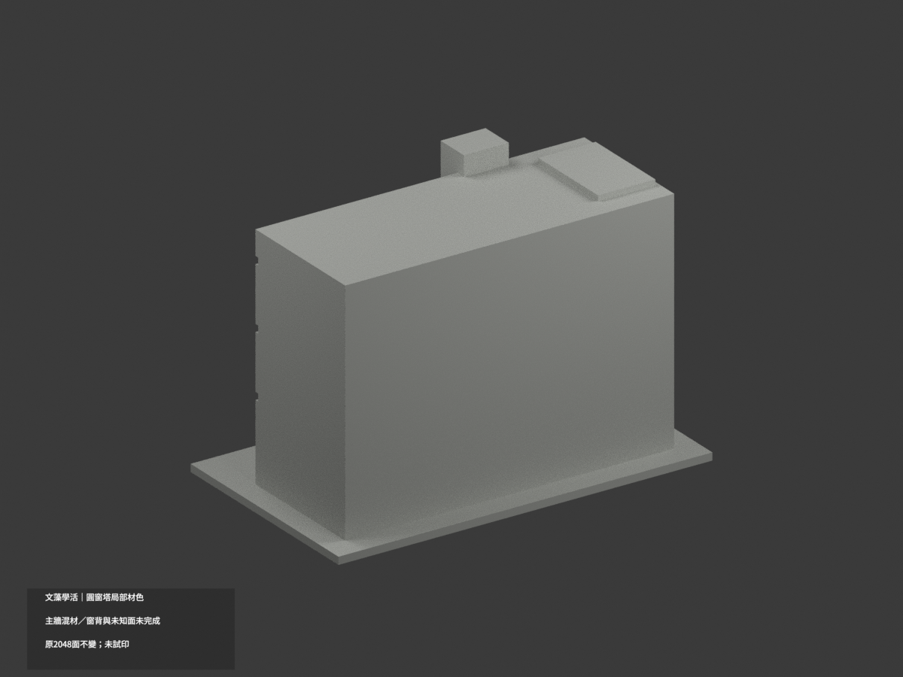
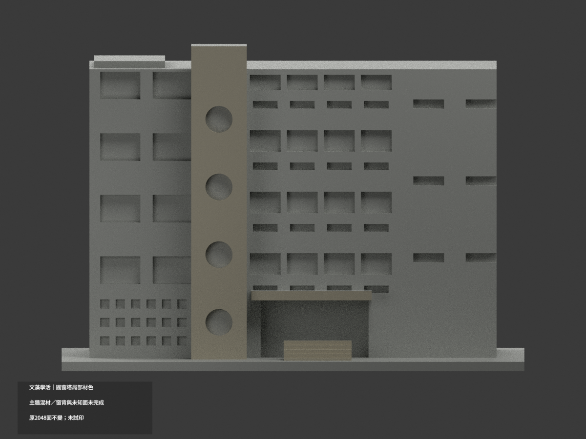
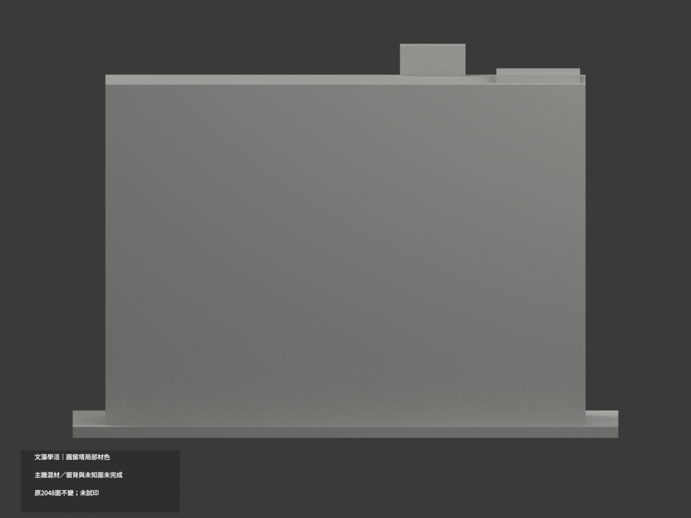
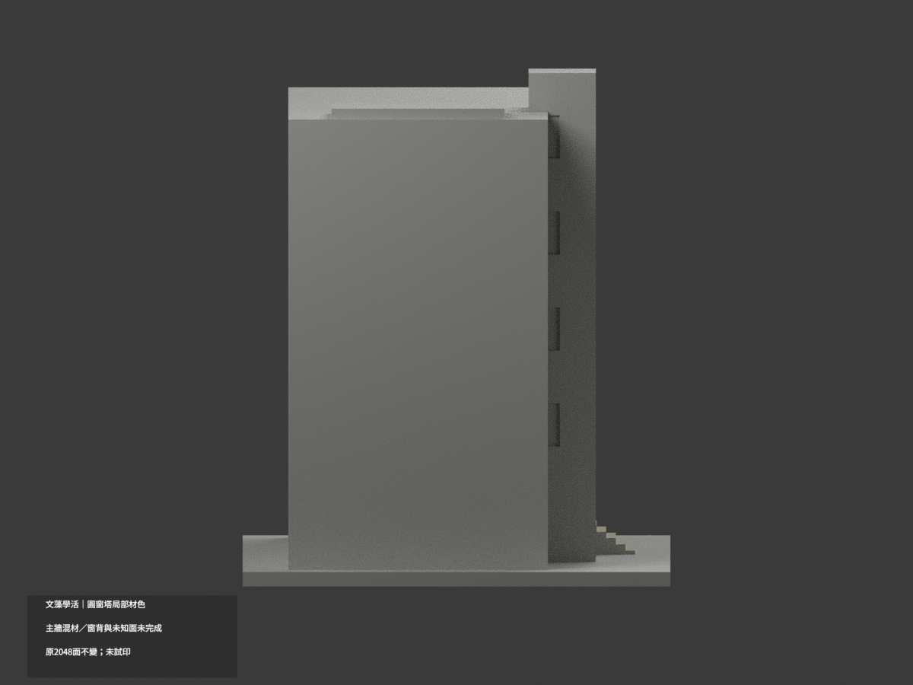
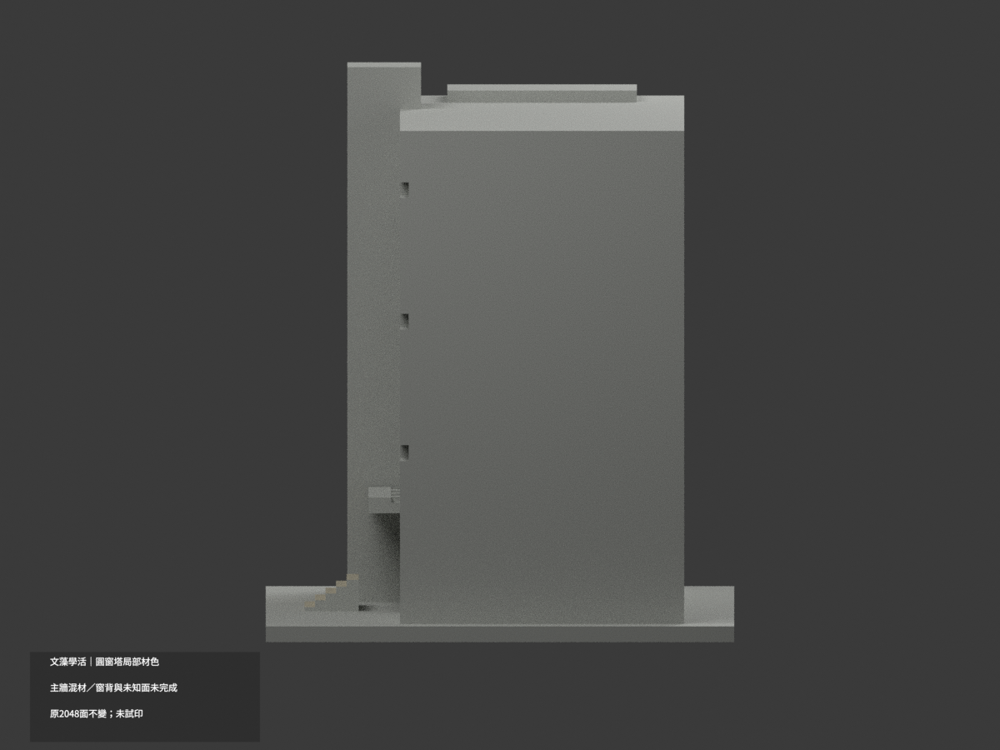
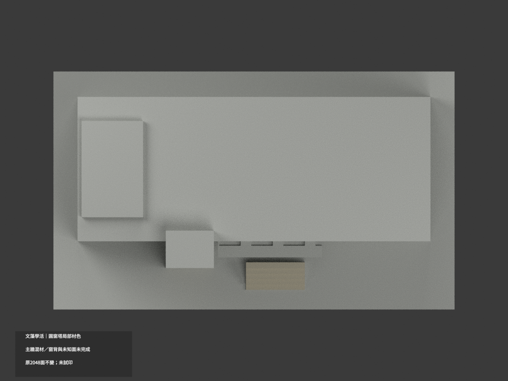
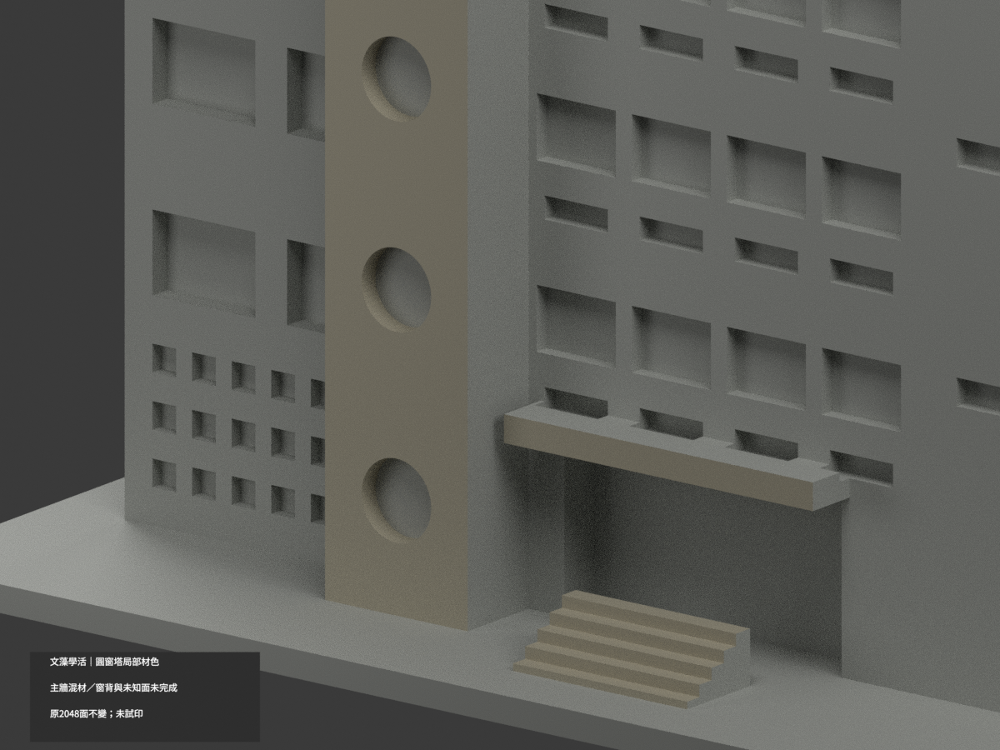
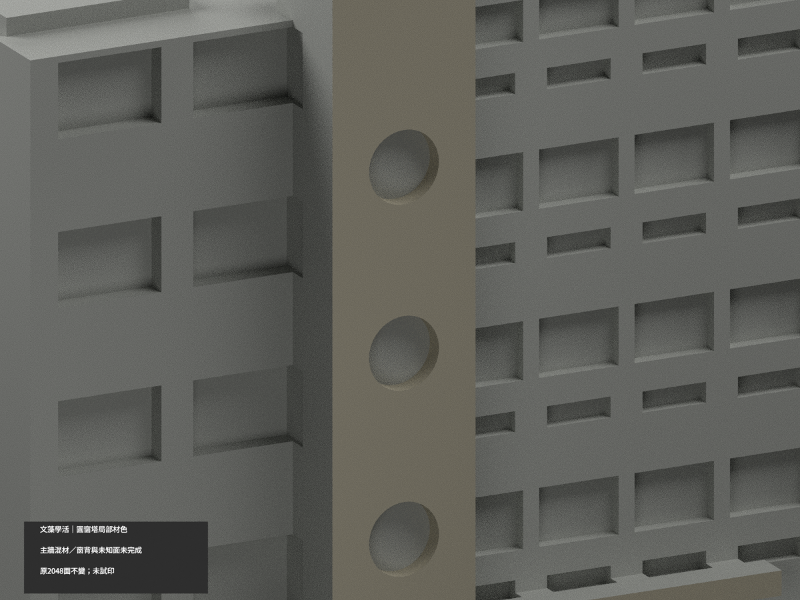
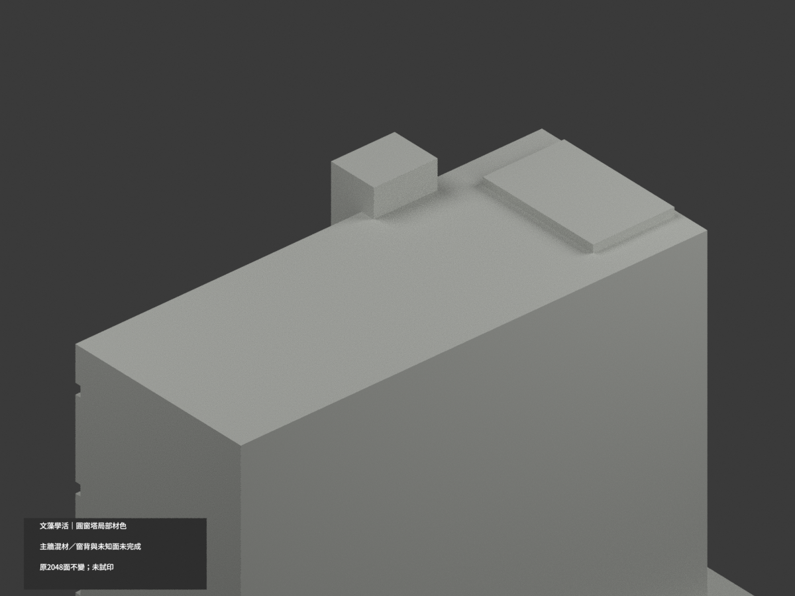

# 文藻學生活動中心｜圓窗塔及入口局部材色示意

**主牆混材、窗背與未知面未完成分色。** `partial_color_incomplete=true`、`fully_colored_exterior=false`。只做有據塔前石面／圓孔內壁、入口橫額前面與階踏立面，不是全館完成。

| 總覽 | 背側 | 正面 |
|---|---|---|
||||
||||
||||
||||

## 材色範圍
同 `wzu-student-activities` 原項目，same-item、count_delta=0。**2048 個原三角面、頂點與原 STL/build_model.py 位元組不變**，沒有切面、新增幾何或修正原近似外觀。原公開包無 OBJ；隔離重建的 OBJ 不冒稱原公開件。

- 塔前y=-29整個原外皮202面及四圓孔的真正圓柱內壁384面，為近似暖灰石色；圓孔背盤含窗框、反光、底層柵條，未分界就不塗黑／綠玻璃。
- 原獨立入口橫額前面2面、五級階梯露出踏面／前立面20面暖灰；不延伸到整底座或添加扶手／字樣。
- 可見右返原候選2面與未證後段屬連續共面，**整個右返域中性**，不是只挑兩個三角塗色。
- 主前牆y=-19連續面跨下層紅磚／百葉／支撐與上石皮，無分界就全部中性；所有普通窗背、左側、屋頂、後面、下廊與其餘未知部位也中性。
- 共608暖灰、1440中性面。色界為證據與原拓撲限制，不表示真材接縫；不因本次補色替原粗化幾何背書，不新增人物、文字、鄰棟、窗框或石材接縫。

## 日期與來源
採校方學生活動中心外觀照及官方PDF第91實頁／印刷2-85外觀照片。拍攝日期未載；2023-12是填表日、2025-03-12是文件版本，**不是攝影日期或現況精測**。只使用外部照片，不取室內防災配置。
原照及PDF私人保存，不公開或作貼圖；未確認CC／再散布授權，不保證商用權利。HEX是近似展示色族，不是校準色票。

## 格式與列印
[原 STL](model.stl) · [材色 3MF](appearance.3mf) · [Blender](scene.blend) · [原說明](ORIGINAL-MONOCHROME-README.md)
原底座150×89 mm為獨立照片近似展示，不是測量比例。3MF basic materials及Blender真正逐面材質，STL不含色。兩材質標籤不是已驗證雙色／四色耗材切片專案。**未實際列印**，未產生切片工具路徑，原薄構件與挑出風險不因補色解除。

## 重建與 QA
依原 requirements 安裝後 `build_model.py` → `colorize_model.py` → `export_appearance.py` → `validate_color.py`。Blender 執行 `render_color.py`、`verify_color_scene.py`。
包含原位元組、逐三角座標、正體積閉合、3MF材質與完整隔離重建；scene重開、十圖及README/hash另核。完整共面域材質一致另驗，但程式不取代來源人工判讀。
原previews/render/validation保留為單色歷程，不當新材色QA；未刪原件。
