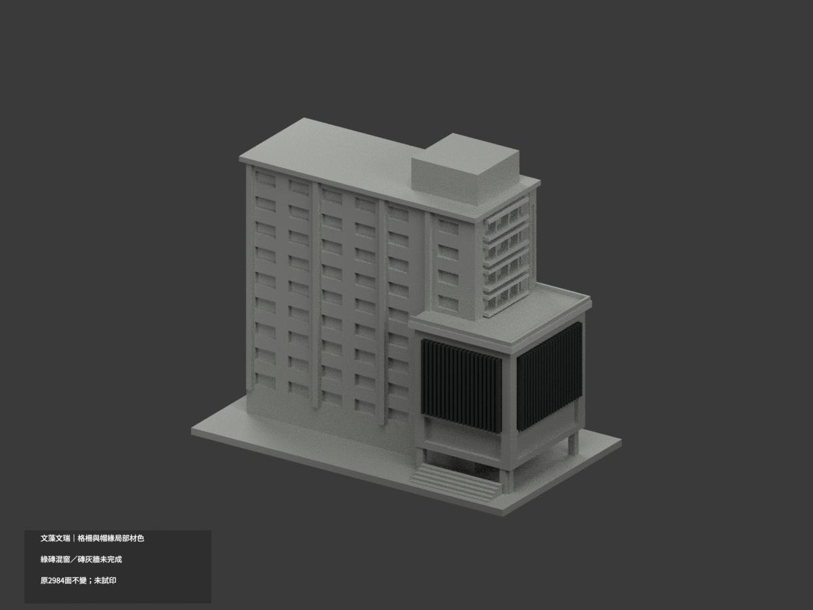
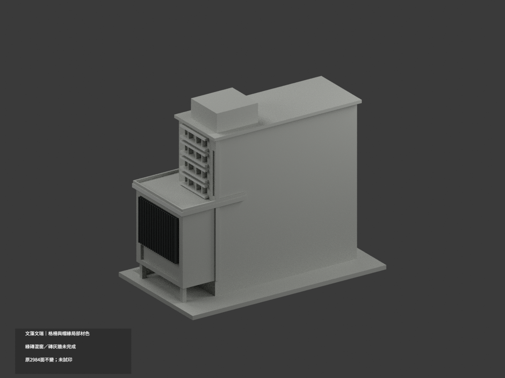
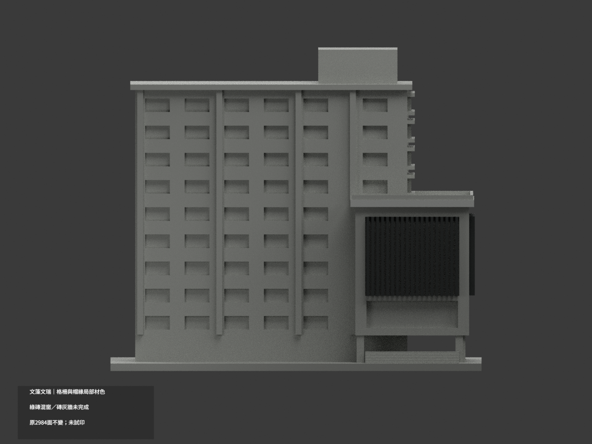
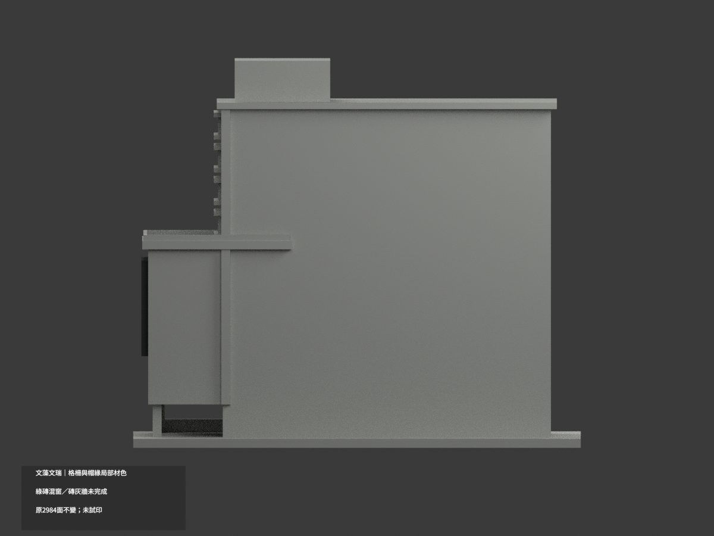
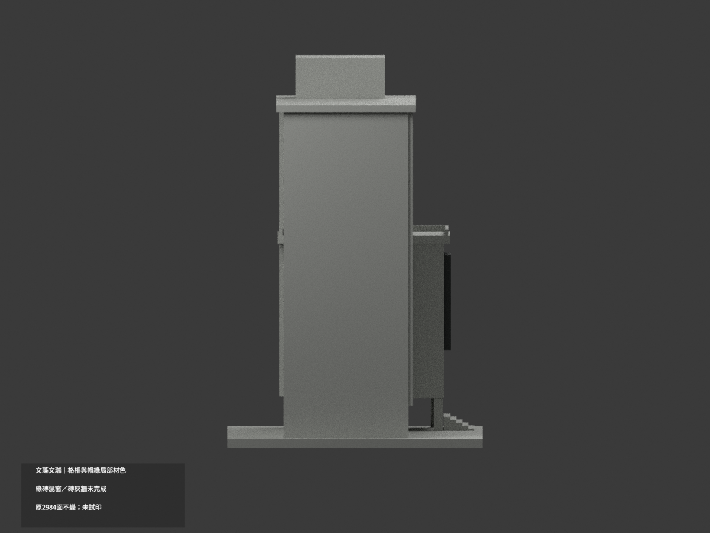
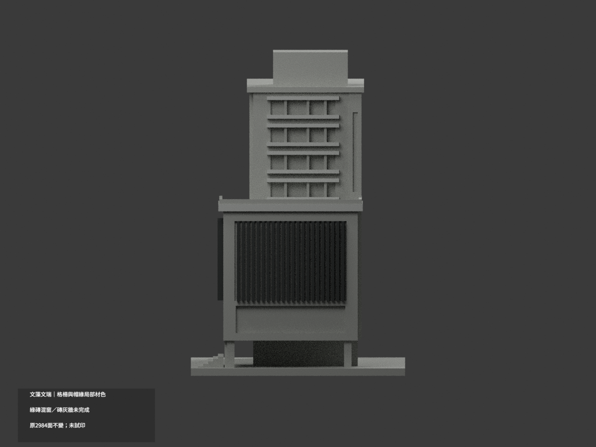
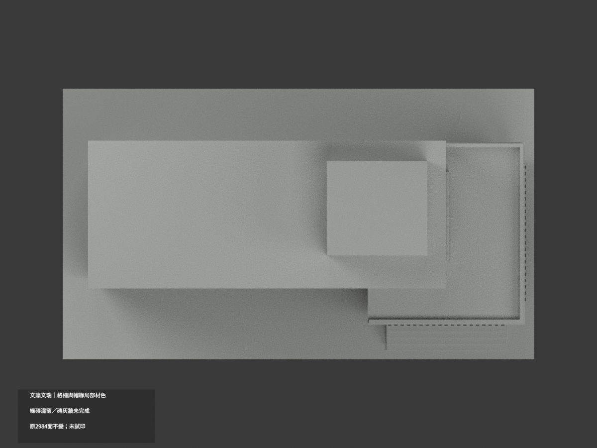
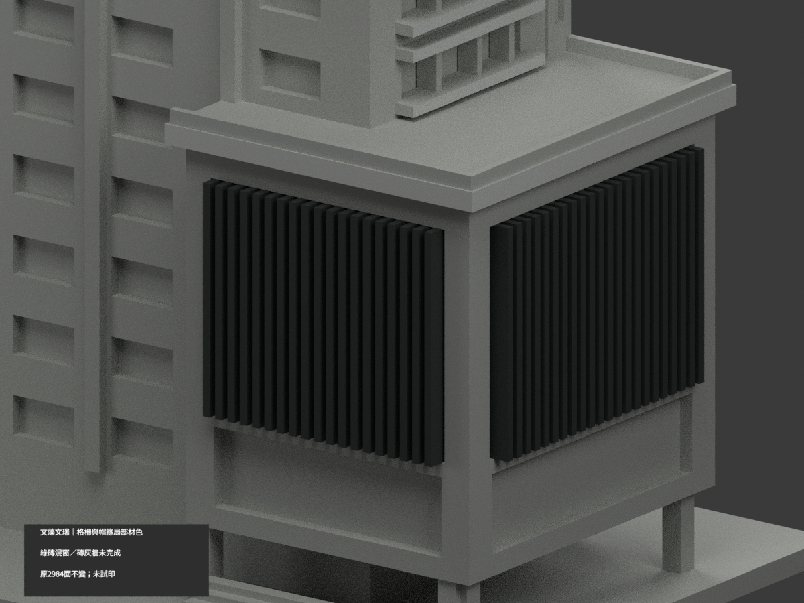
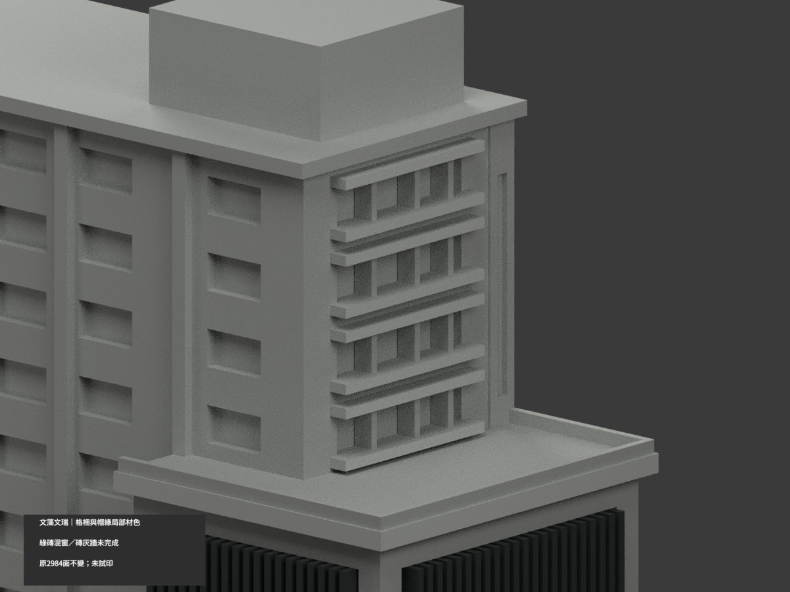
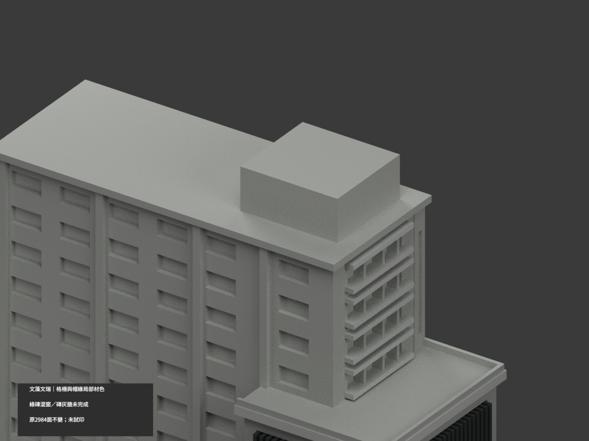

# 文藻文瑞樓｜雙面格柵及帽緣局部材色示意

**綠磚混窗、磚灰牆及未知背屋未完成分色。** `partial_color_incomplete=true`、`fully_colored_exterior=false`。只做有據原獨立格柵、上帽前／右邊與高窗眉檻端面，不是整館完成。

| 總覽 | 背側 | 正面 |
|---|---|---|
||||
||||
||||
||||

## 材色範圍
同 `wzu-wenrui` 原項目，same-item、count_delta=0。**2984 個原三角面、頂點與原 STL/build_model.py 位元組不變**，無切面、新幾何或修正原近似外觀。原公開包無 OBJ；隔離重建的 OBJ 不冒稱原公開件。

- 19 支前格柵與22支右格柵，依原獨立box構件所有外露面共656面炭灰；不是整片窗背塗黑，也沒有新增細格數。
- 低館上帽只 y=-32 前緣及x=72右邊各2面淺灰；水平露台、玻璃欄桿粗化條、後邊保持中性。
- 高窄端四組窗的原獨立眉／檻，只有x=48朝外端面共16面灰。框側、窗背與混白板窗格不一律深色。
- 低館兩個下部凹背實景混綠磚、黑窗框、灰白板與玻璃，原面無內界，**整面中性，不整片綠色**。
- 高端磚灰混材牆、長翼全高連續牆與柱、樹遮低層、屋頂／後側／階梯／基座都中性。不沿三角畫斜色邊，不把原框bbox當整片可染域。
- 色與中性分界是來源證據與既有拓撲的限制，不代表現場材料接縫。相鄰千禧樓不納；不新增字樣、草木、人物或窗扇細分。

## 日期與來源
使用校方文瑞樓照片與官方 PDF 第32實頁／印刷2-26的外觀照片。拍攝日期未載；2023-12為填表日、2025-03-12為版本日，**不是攝影日期／現況精測**。只使用外觀照片，不取室內防災配置。
照片／PDF私人保存，不公開或貼圖；未確認CC／再散布授權，不保證商用權利。HEX為近似色族而非校準色票。

## 格式與列印
[原 STL](model.stl) · [材色 3MF](appearance.3mf) · [Blender](scene.blend) · [原說明](ORIGINAL-MONOCHROME-README.md)
原底座150×86 mm為獨立照片近似展示，不是測量比例。3MF basic materials與Blender真正逐面材質，STL不含色。三材質標籤不是已驗證三色／四色耗材切片專案。**未實際列印**，未產生切片工具路徑；原細格柵與挑檐列印風險不因補色解除。

## 重建與 QA
依原 requirements 安裝後 `build_model.py` → `colorize_model.py` → `export_appearance.py` → `validate_color.py`。Blender 執行 `render_color.py`、`verify_color_scene.py`。
包含原位元組、逐三角座標、正體積閉合、材質索引／3MF與完整隔離重建；scene重開、十圖與README/hash另驗。程式檢查不取代來源及材域人工判讀。
原previews與render/validation保留為單色歷程，不當新材色QA；未刪原件。
