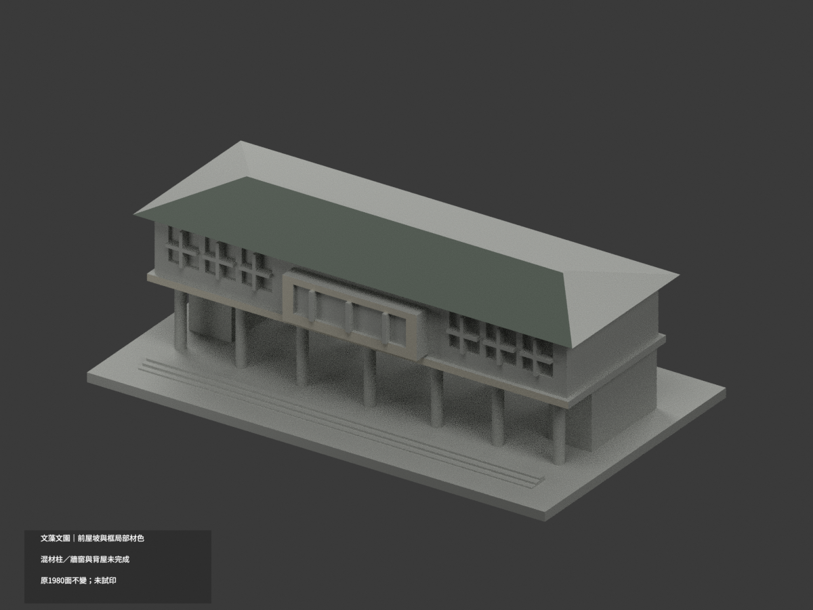
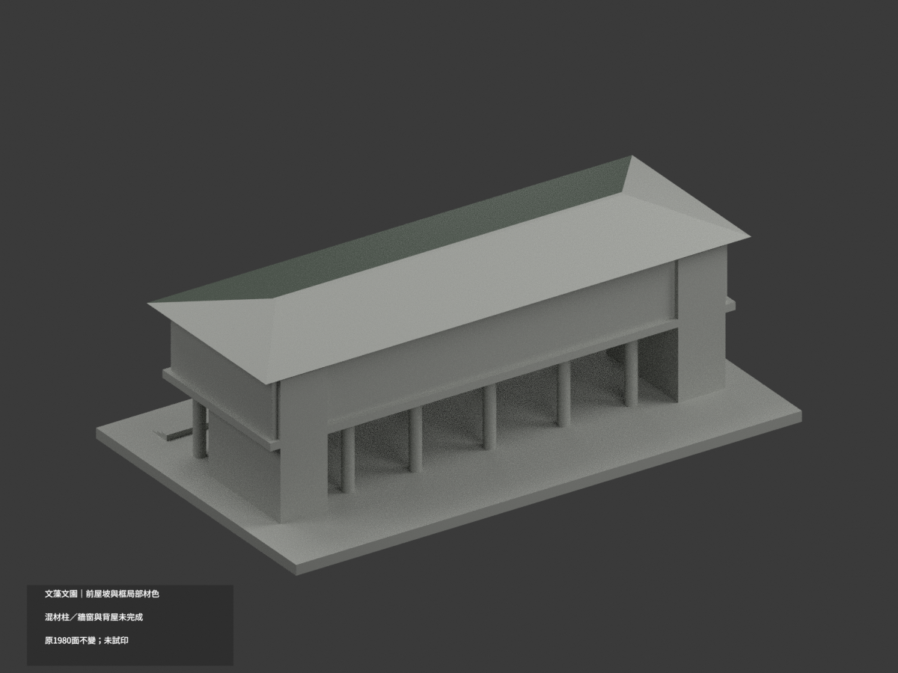
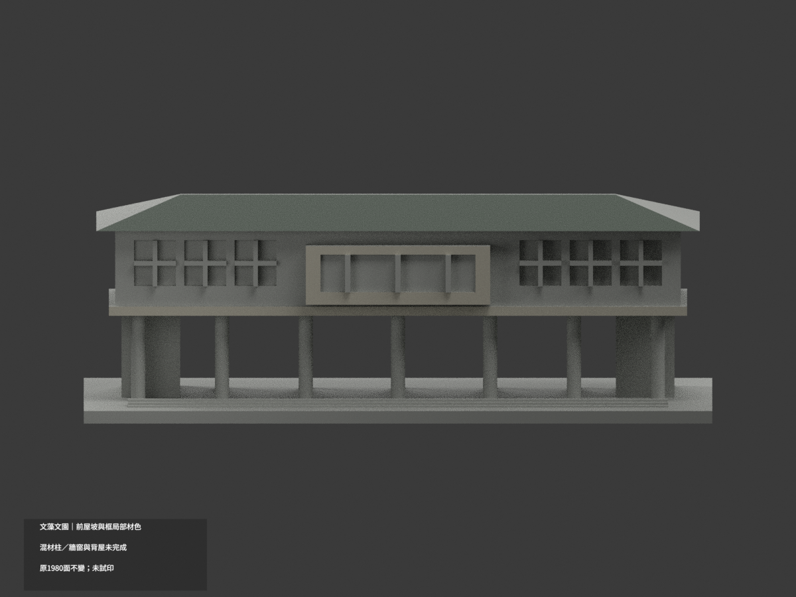
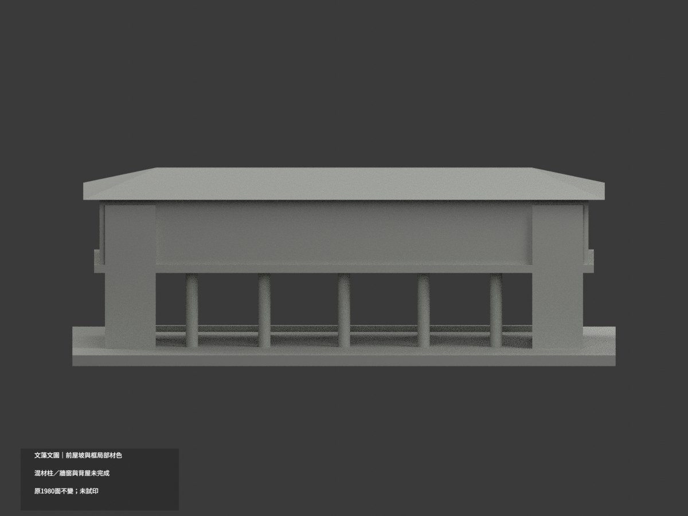
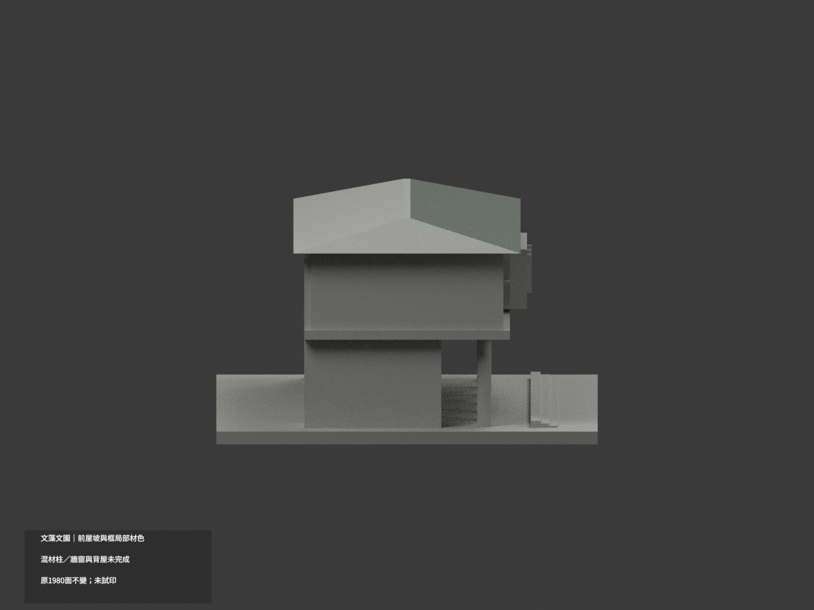
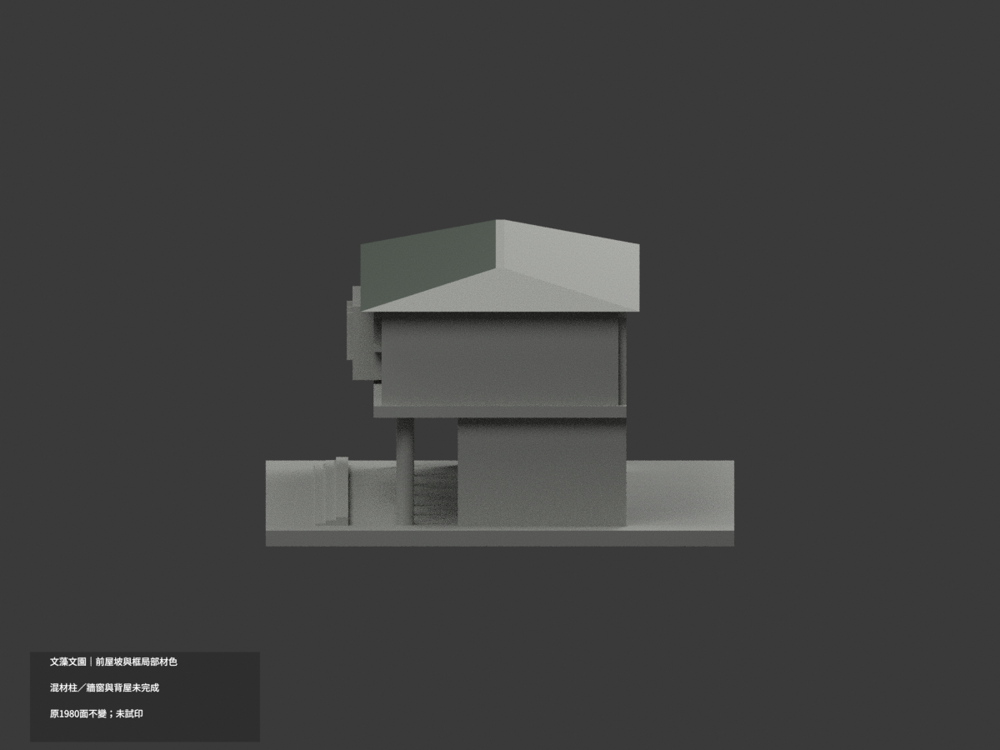
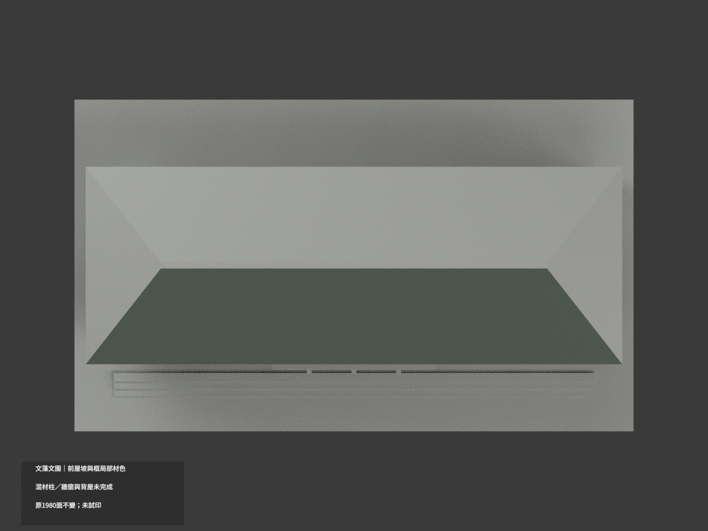
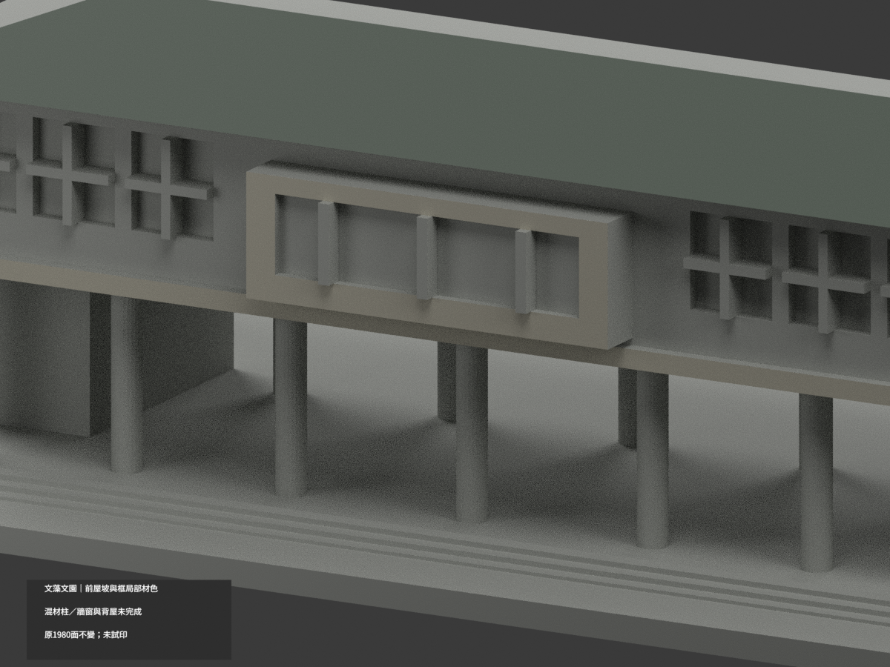
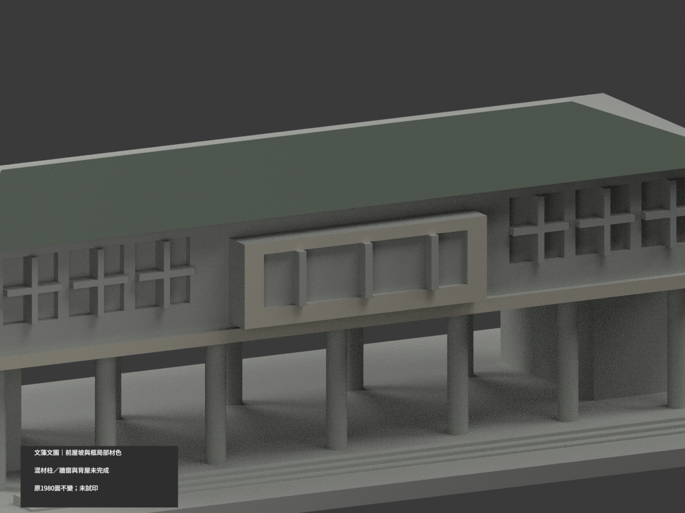
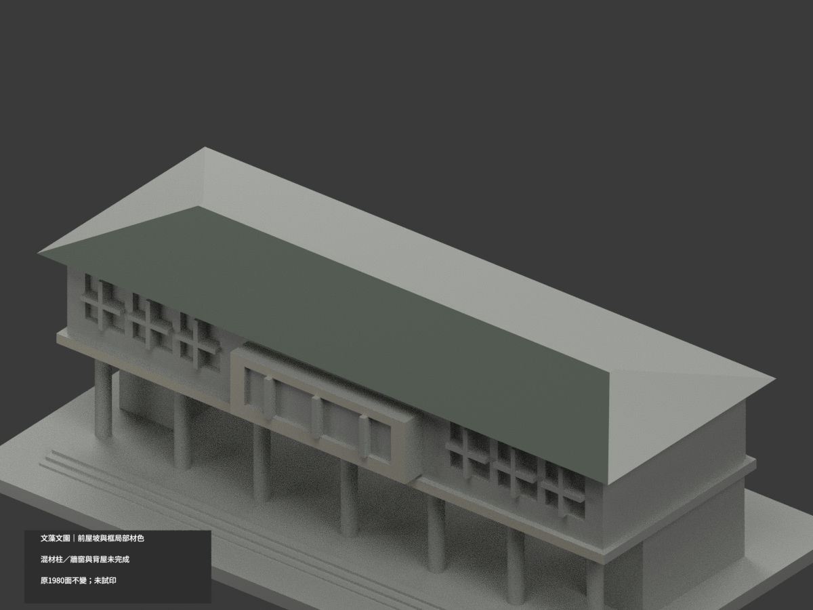

# 文藻文園｜前屋坡及外框局部材色示意

**混材柱、牆窗及未知背屋未完成分色。** `partial_color_incomplete=true`、`fully_colored_exterior=false`。僅前屋坡、名牌外框與樓板前緣；不是整棟補色完成。

| 總覽 | 背側 | 正面 |
|---|---|---|
||||
||||
||||
||||

## 材色範圍
同 `wzu-wenyuan` 原項目，same-item、count_delta=0。**1980 個原三角面、頂點與原 STL/build_model.py 位元組不變**，沒有切面、增加幾何或修正原近似外觀。原公開包無 OBJ；原程式隔離重建產生的 OBJ 不冒稱原公開件。

- 前 hip 真正朝上斜坡 2 個三角面為低飽和灰綠屋面族；依原斜平面全頂點與法向核對，並非所有朝上面。水平脊頂、兩端坡、後坡及底面都中性，不擴展到未證屋皮。灰綠與中性分界代表照片證據範圍，不代表真實材料接縫。
- 原中央名牌／窗外框 y=-28 的外前面 20 個面為米灰，原樓板 y=-24 前緣 2 個面同族；名牌內板與細框保持中性，不新增金字。
- 全高柱在照片有淺上部／深基座，但原拓撲沒有材色邊界；全部中性，不按高度切三角染色。上牆混磚、窗框及窗，不能整牆磚色。
- 官照名牌內部偏灰、PDF 前照偏深藍，日期未證，不能任選當現況。側後牆、開廊背、入口台階及遮蔽處保守中性。
- 背景較高的十字圖書館不是文園，不納本包。不新增人物、景觀、坡道、標字、窗扇或未建細節。

## 日期與來源
採校方文園外觀照，以及官方 PDF 第16實頁／印刷2-10的外觀照片。拍攝日未載；2023-12是填表日、2025-03-12是文件版本，**不是攝影日期或現況精測**。本次只使用外觀照片，不取室內防災資料。
原圖及PDF私人保存，不公開或作貼圖；未確認 CC／再散布授權，不保證商用權利。照片受光線影響，HEX僅近似展示色族、非校準色票。

## 格式與列印
[原 STL](model.stl) · [材色 3MF](appearance.3mf) · [Blender](scene.blend) · [原說明](ORIGINAL-MONOCHROME-README.md)
原底座150×89 mm是獨立展示照片近似，不是測量比例。3MF basic materials與Blender實際逐面材質；STL不含色。三材質標籤不是已驗證三色／四色耗材切片專案。**未實際列印**，未產生切片工具路徑；原柱廊、挑檐列印風險不因補色解除。

## 重建與 QA
依原 requirements 安裝後 `build_model.py` → `colorize_model.py` → `export_appearance.py` → `validate_color.py`。Blender 執行 `render_color.py`、`verify_color_scene.py`。
幾何／3MF檢查含原位元組、逐三角座標、正體積閉合、材質索引及完整隔離重建；scene重開核實，十圖與README/hash另綁定。程式檢查不取代材域／來源人工判讀。
原 `previews/`、原render/validation保留為單色歷程，不當作本輪材色QA；未刪原件。
