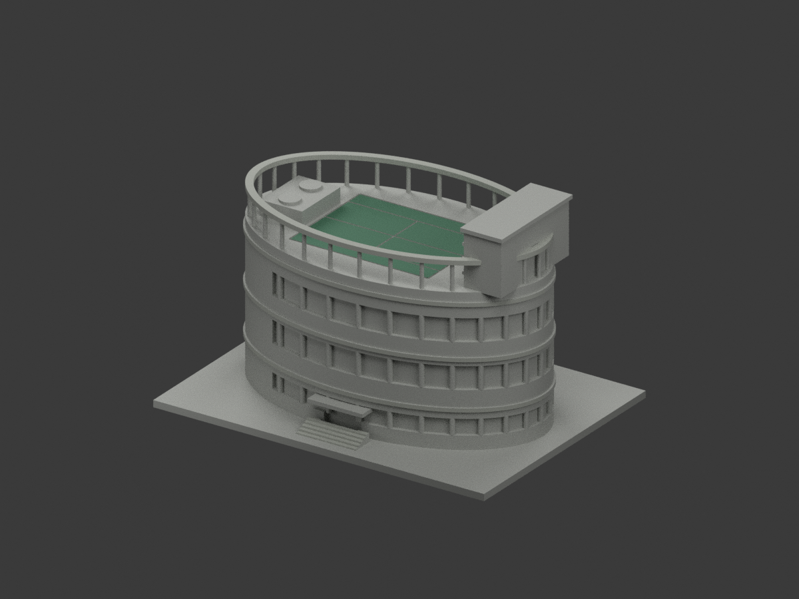
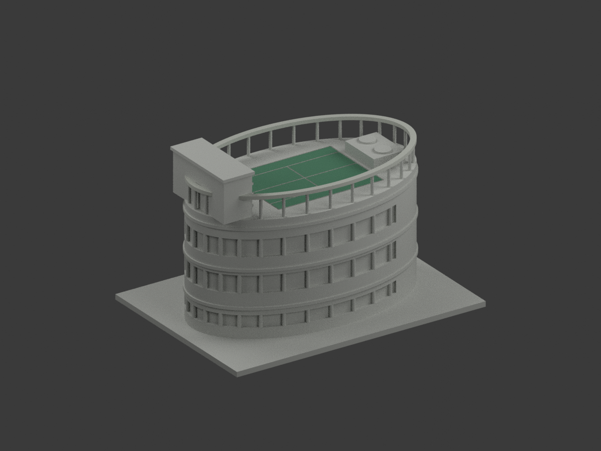
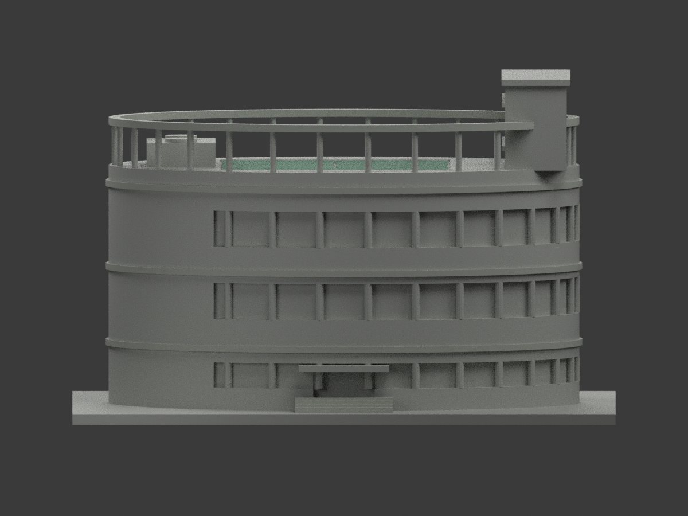
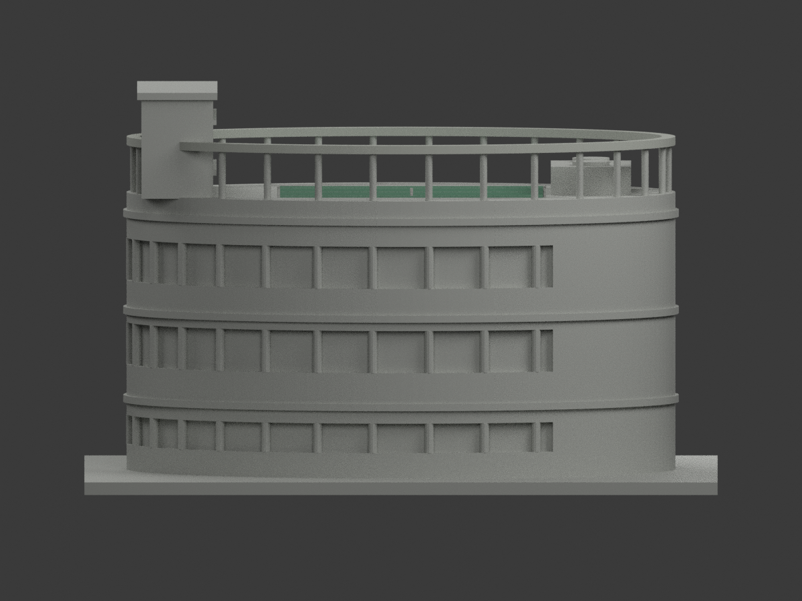
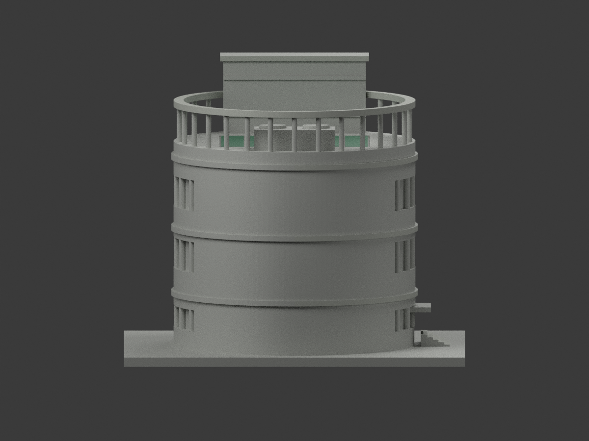
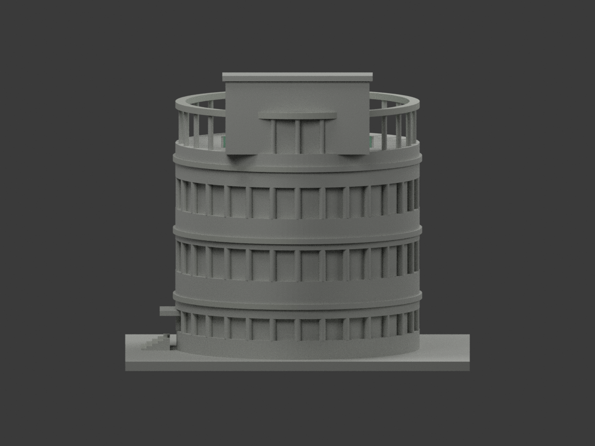
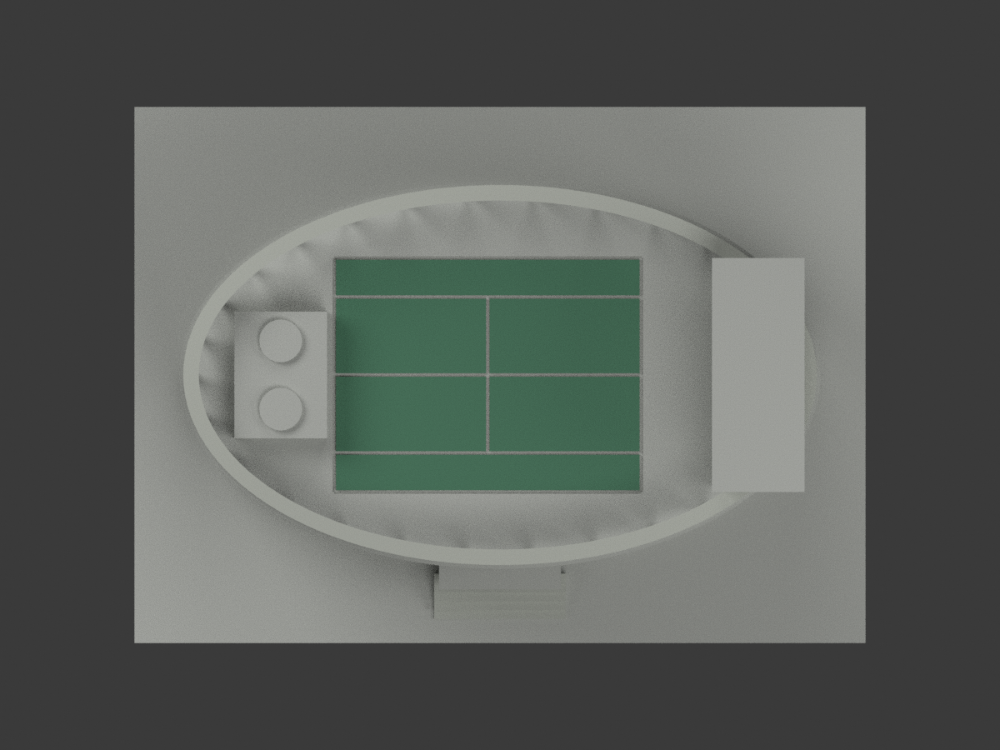
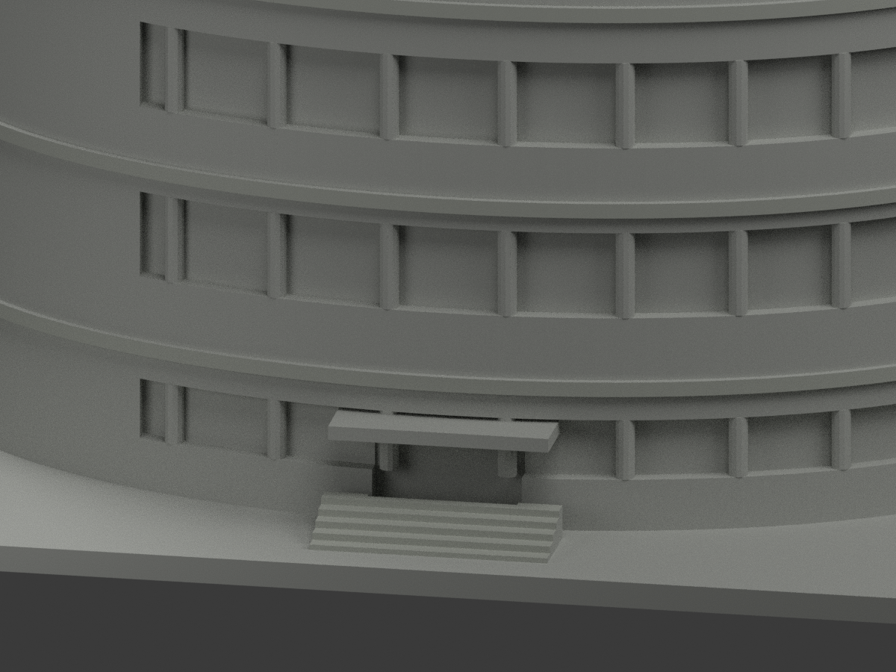
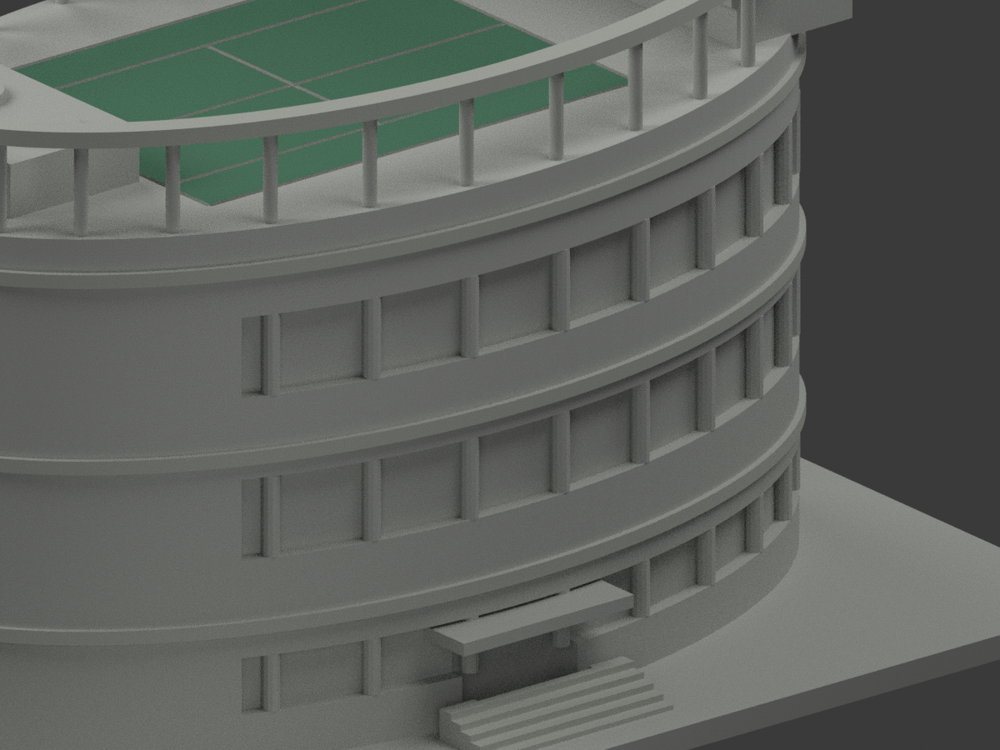
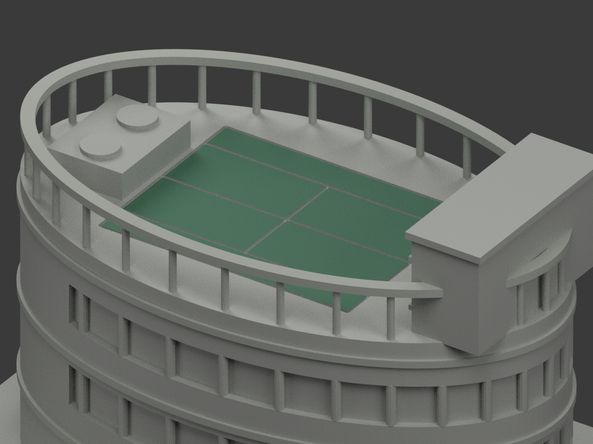

# 文藻育美體育館｜高服務牆頂帽朝球場面有限補色

僅新增原2面[13393,13398]、1完整共面域，x43.5、y[-24,24]、z92..93.7，原中性index2轉既有名義灰index1 #B8BBB3。原2134色保持，合2136配色／11670中性／13806原三角；三palette條目及歷史名稱全保留，0混域保持。原STL/build/其他索引不改，原公開包無OBJ，不新增。

新取得官體育室公開屋頂球場206846479.jpg，可見最高灰橫帽前條兩端及下方磚界，不從正面牆或柱類推；未標拍攝日期，不稱新拍照或2026現況。原帽19深、48寬、1.7厚為既有粗近似，不驗證量測、投影或實際側頂構造；只有限灰石色族，不校準HEX。

中間兩原橫條高度未唯一對位，均不取；不取頂、左右、背、整磚牆、柱灰磚交界、雨庇褐框/底、主曲牆或玻璃。新證不改原球場與前腰帶例外。原工程/薄件/印製限制及舊alias全保，未作多料列印認證。來源照片私人保存，不貼圖不公開。SOURCE pending固定快照，最終獨審另檔。

## 原版說明與限制

# 育美體育館｜既有模型局部參考補色

**局部補色未完成：僅原有球場內部分格、獨立環梁及階梯局部補色；弧牆、窗帶、設備與未知面未完成。** `partial_color_incomplete=true`、`fully_colored_exterior=false`。同項目 `wzu-yumei-gym`／`count_delta=0`，不新增套數。

| 前斜視 | 後斜視 | 正面 |
|---|---|---|
|  |  |  |
|  |  |  |
|  |  |  |
|  | | |

## 材色範圍

球場先找全部共面連通域，再選原刻槽內6個閉合頂面cell，共12三角為低飽和綠。未把整橢圓屋頂染綠，刻槽底及側不畫假白線。上環1666面、前腰環432面、5原階外露踏面/階前立面24面為淺灰，共2122面。其餘11672面未知中性，**不是實景灰色證明**。

環採原144節橢圓annulus真表面，不按bbox或同高度染支柱/主壁。前腰環只可證前原節片，跨前後共面連通面全部退中性（共821個原候選面因全域規則退色），不是依三角中心截色。所有共面連通域材色一致。材色邊界是來源覆蓋範圍，不代表真實不同材料接縫。

整弧壁與窗帶原模型缺窄窗/框/簾/反射分界，完整中性；支柱混磚灰、設備牆、屋面球場外、門簷與未知背部亦中性。原13806三角／坐標／尺寸／STL／原build字節不變，不新增構件或切面。補色不追認原粗幾何、不稱精準現況全館。

## 來源與權利

文藻[官方校園頁](https://c005.wzu.edu.tw/category/132558)正面照片及官方PDF實體71頁／印刷2-65的空照。拍攝日期未定；PDF2025-03-12版本與2023-12表格日期均不是照片日期。僅使用外觀，不採內部應變資訊。精確來源URL與hash、GO2210/獨審2209-v1見`COLOR-SOURCE-REGISTER.json`。

未確認CC授權，原圖/PDF私存，不隨公開包或作貼圖；來源權利不被repo license取代，不保證商用。色值是展示近似，不是色票校準。

## 檔案與重建

`appearance.3mf`含3展示材，`scene.blend`包含實際面材與相機，`color-mesh.npz`保留原三角和material index。STL無色且原字節不變。原公開包無OBJ；隔離原build生成OBJ只私存，不聲稱原OBJ保留。

依`requirements.txt`執行`python colorize_model.py`、`python export_appearance.py`、`python validate_color.py`；Blender執行`render_color.py`及`verify_color_scene.py`。完整原build+color隔離重建目錄保留、不自動刪。原件私存；`ORIGINAL-MONOCHROME-README.md`、舊`previews/`及舊QA是單色歷程，不是新材色QA。

## QA與列印限制

原STL/三角multiset、封閉正體積、3MF索引與隔離重建見`COLOR-*QA.json`；重開見`SCENE-QA.json`；10張1200×900圖及三欄/hash見`DELIVERY-QA.json`。人工視覺獨審另交父驗證。

**未實際列印。** 三展示材不是已驗證四色工程；切片材料映射、支撐、薄件強度須另驗，不能保證直接多料列印。
