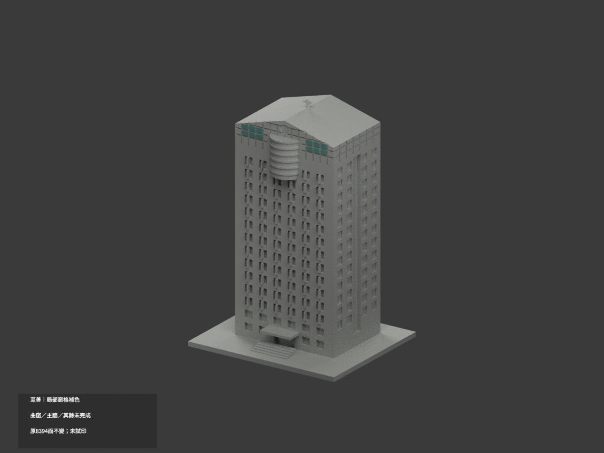
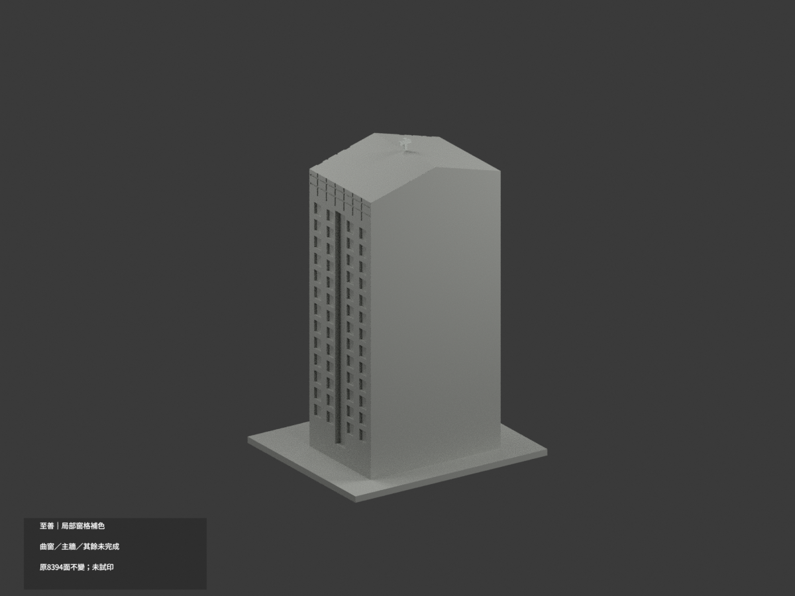
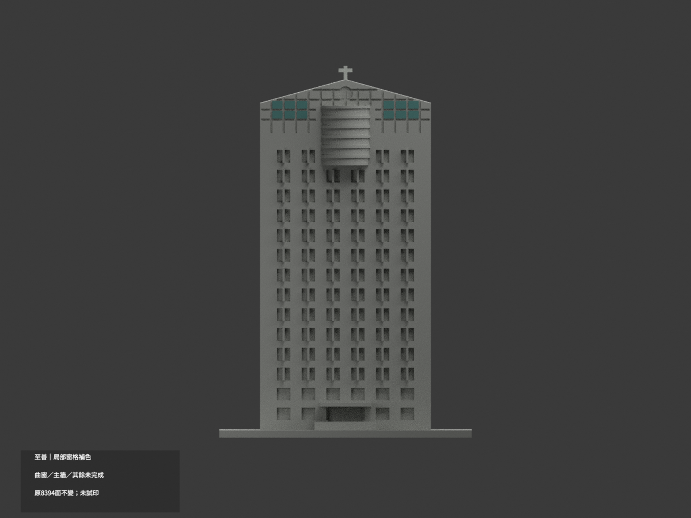
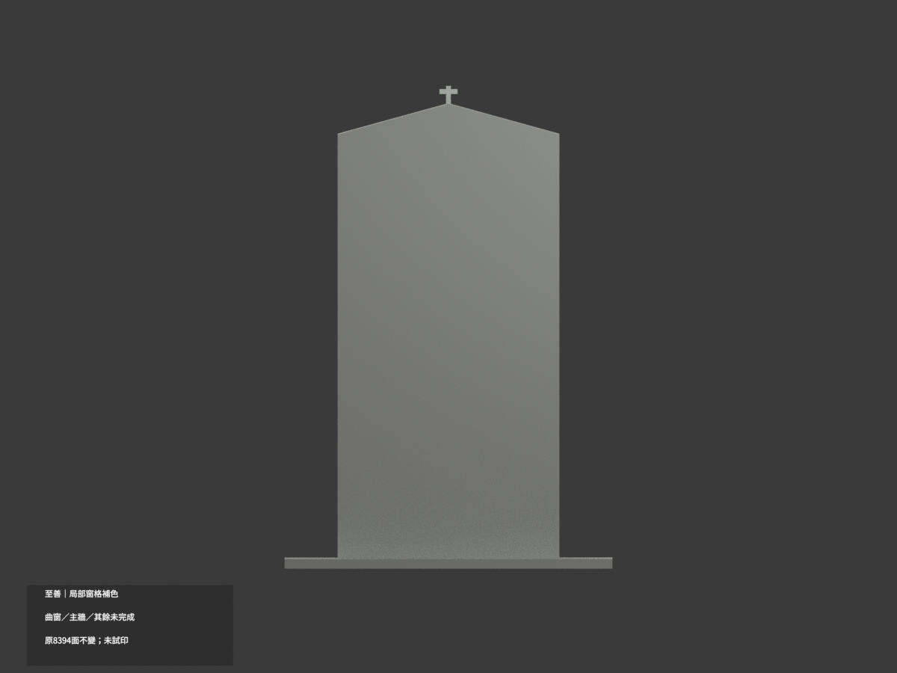
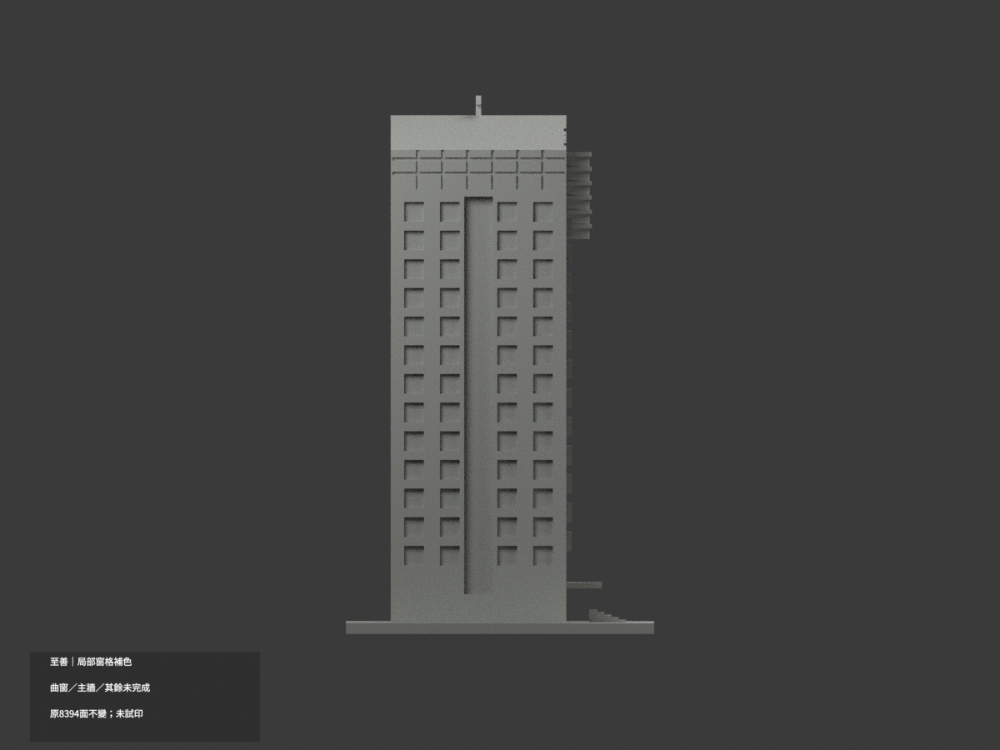
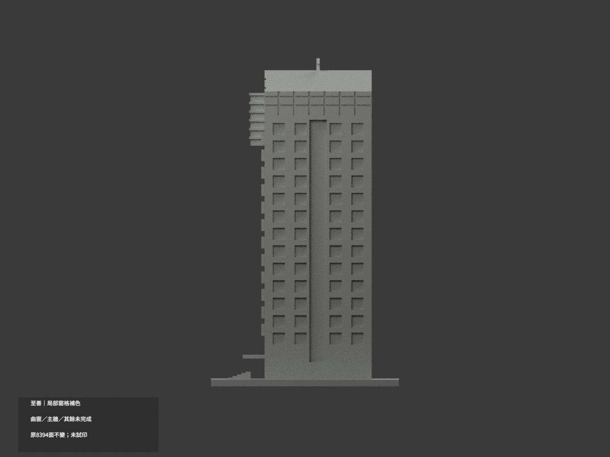
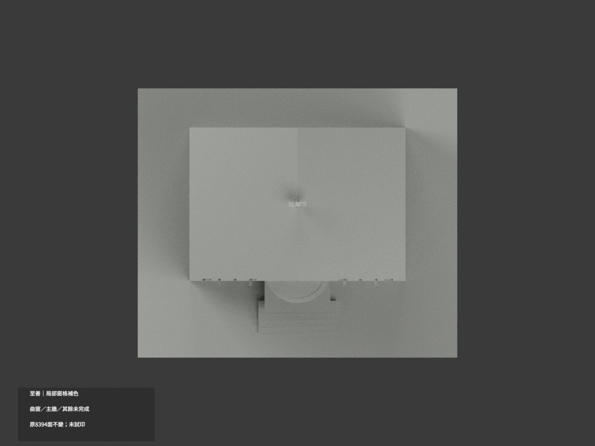
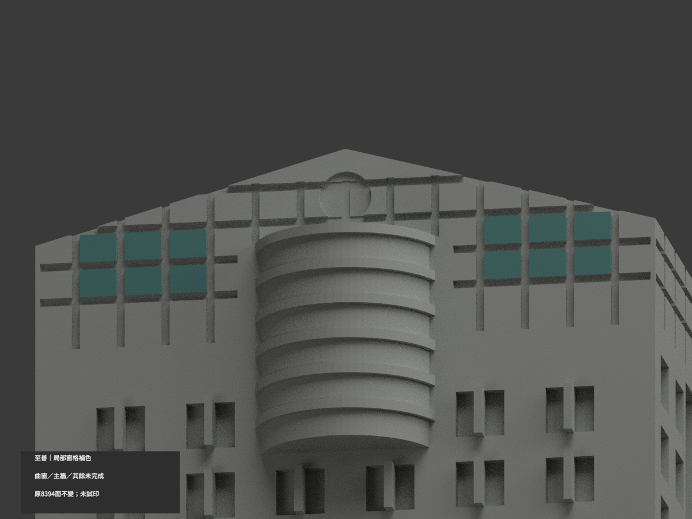
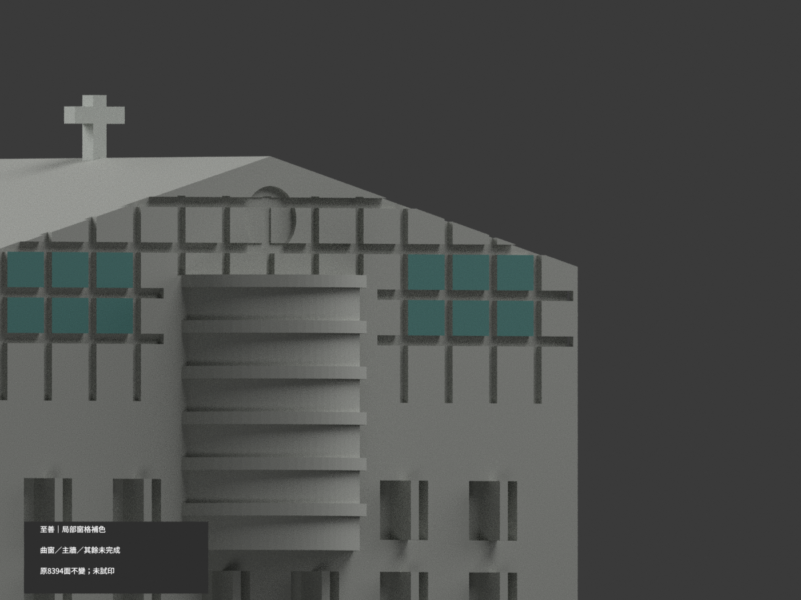
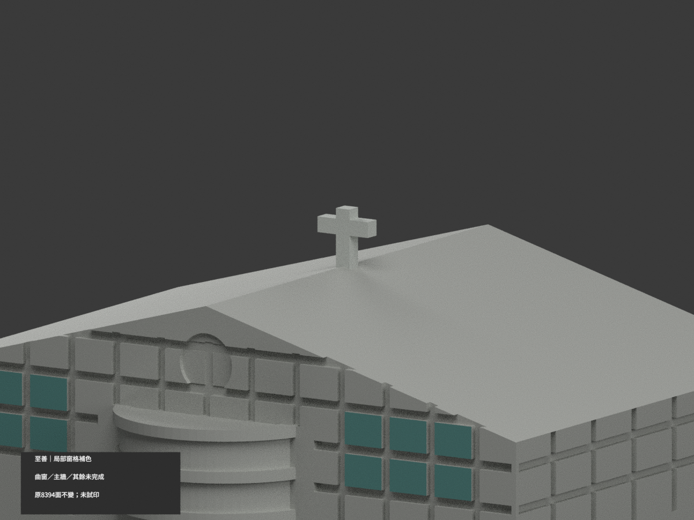

# 至善樓｜既有模型局部窗格補色

**局部補色未完成：僅經原刻槽完整封閉的上冠窗格及十字局部補色；曲窗、主牆及未知部位仍中性。** `partial_color_incomplete=true`、`fully_colored_exterior=false`。同項目 `wzu-zhishan`／`count_delta=0`，不新增套數。

| 前斜視 | 後斜視 | 正面 |
|---|---|---|
|  |  |  |
|  |  |  |
|  |  |  |
|  | | |

## 材色範圍

僅12個原有刻槽四邊完整封閉的前冠矩形面域（24三角面）採低飽和青綠；原真十字44面採淺中性金屬色族，其餘8326面未知中性，**不是實景灰色證明**。

先取完整前平面y=-18.5的所有相鄰共面components，再以原刻槽、矩形4邊與完整面積驗證，不是以z>=123切大牆。連到下部的922面主牆component一律中性；12個窗格在左右各3列、2排，完整8394面索引與component證據在`appearance-materials.json`。不完整斜頂格、外帶、凹刻槽／圓標誌不染，無新增logo或文字。

圓弧bay實景有金屬豎格，而原圓柱沒有對應分面，整個曲面與突環中性，不把facet當玻璃分界。混磚／灰石全高牆、普通窗混窗框／白簾／反射、未知側後及屋皮一律中性。材色覆蓋邊界不是實際材質接縫。

原8394三角、坐標、尺寸、`model.stl`與`build_model.py`字節不變；不切面、不加窗框、屋件、文字或新玻璃。色審不追認原簡化幾何精度，非現況精測。

## 來源與權利

文藻[官方校園頁](https://c005.wzu.edu.tw/category/132558)照片、官方PDF實體59頁之外觀照片；拍攝日未知，PDF2025-03-12版本／2023-12表格不是拍攝日。只採公開外觀，不使用內部應變資訊。精確URL／SHA與GO2134、獨審2133-v2見`COLOR-SOURCE-REGISTER.json`；早期曲bay玻璃許可已撤。

未確認CC授權。原照/PDF私存、不隨模型公開、不作貼圖；來源權利不被repo license取代，不保證商用。

## 檔案與重建

`appearance.3mf`含3展示材標，`scene.blend`有實際面材與相機，`color-mesh.npz`含原三角與material index。原STL本身無色。原公開包沒有OBJ；隔離執行原build生成的OBJ只私人保留，不聲稱原OBJ已保留。

依`requirements.txt`執行`python colorize_model.py`、`python export_appearance.py`、`python validate_color.py`；Blender執行`render_color.py`及`verify_color_scene.py`。完整原build＋color隔離重建目錄保留，不自動刪除。原場景與全原件另私存；`ORIGINAL-MONOCHROME-README.md`、舊`previews/`與原驗證只作單色歷程，不是本次材色QA。

## QA與列印限制

原STL／三角multiset、封閉正體積、3MF材質、完整隔離重建在`COLOR-*QA.json`；Blender重開在`SCENE-QA.json`；10張1200×900圖／首段三欄／圖文hash在`DELIVERY-QA.json`。人工視覺另交父終審。

**未實際列印。** 三展示材標不是驗證過的四色列印工程；切片、材料映射、支撐與細部強度另驗，不保證直接多料成功。
