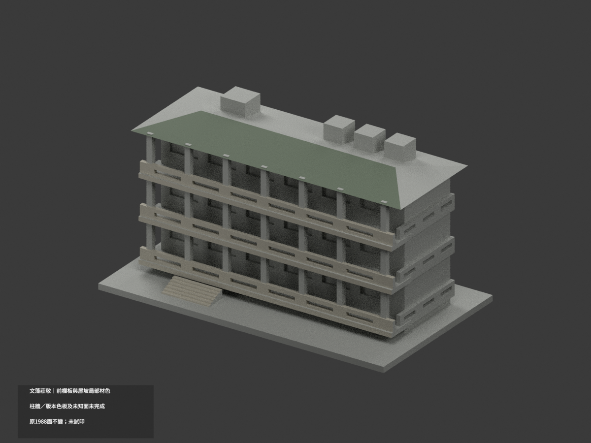
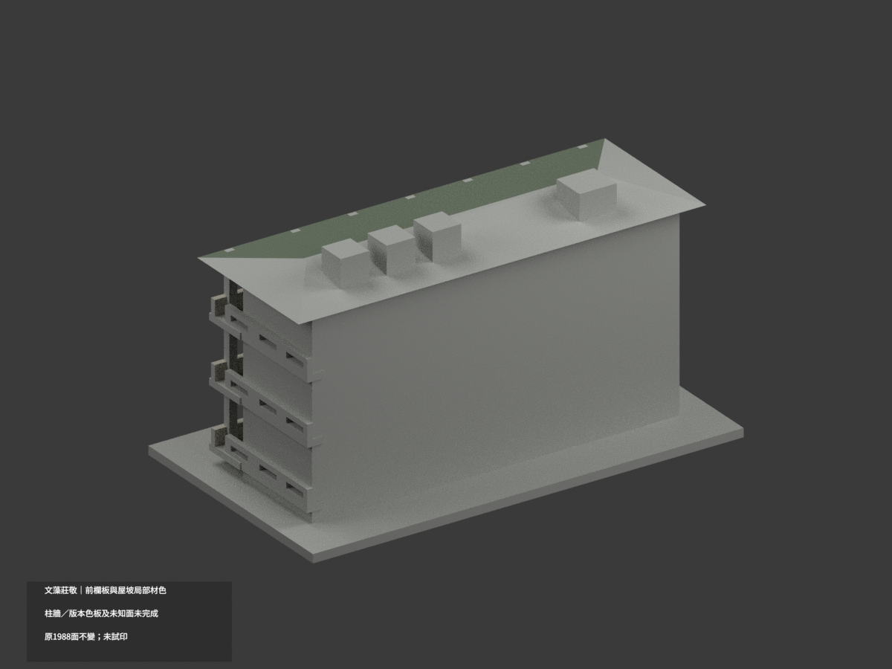
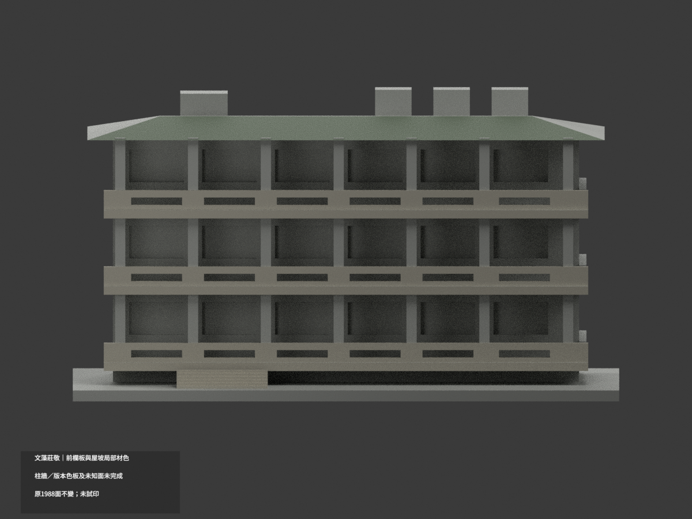
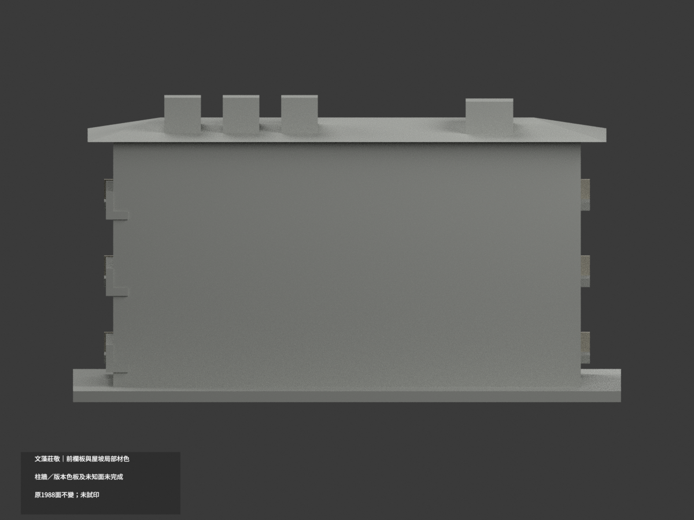
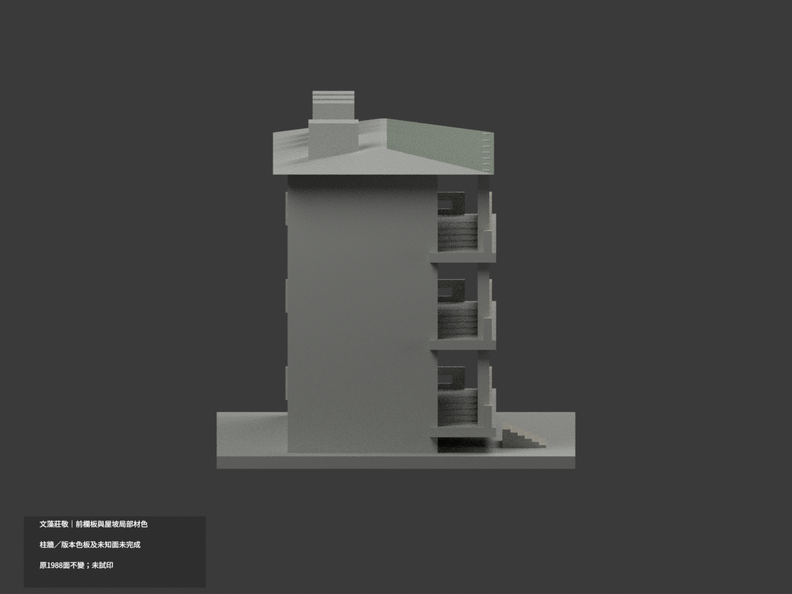
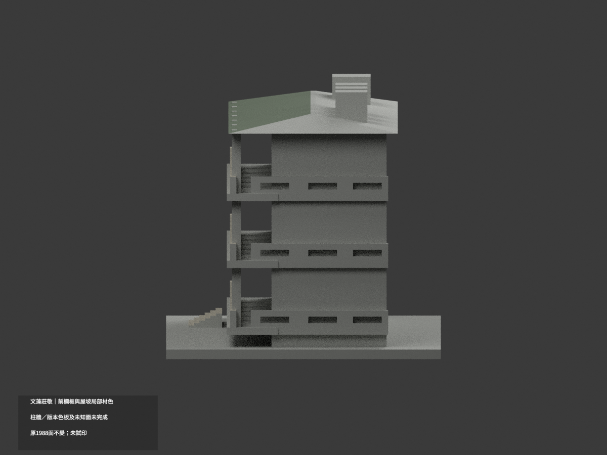
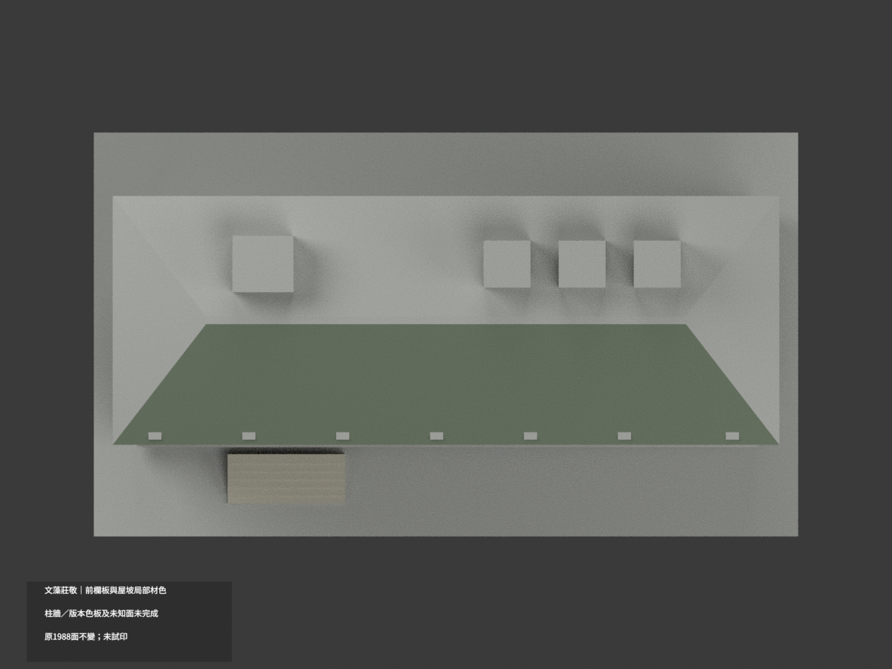
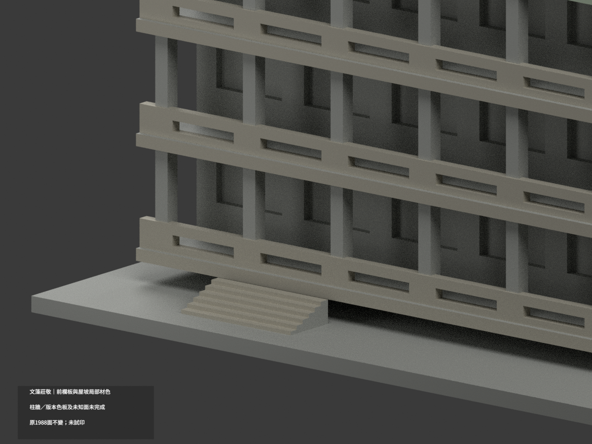
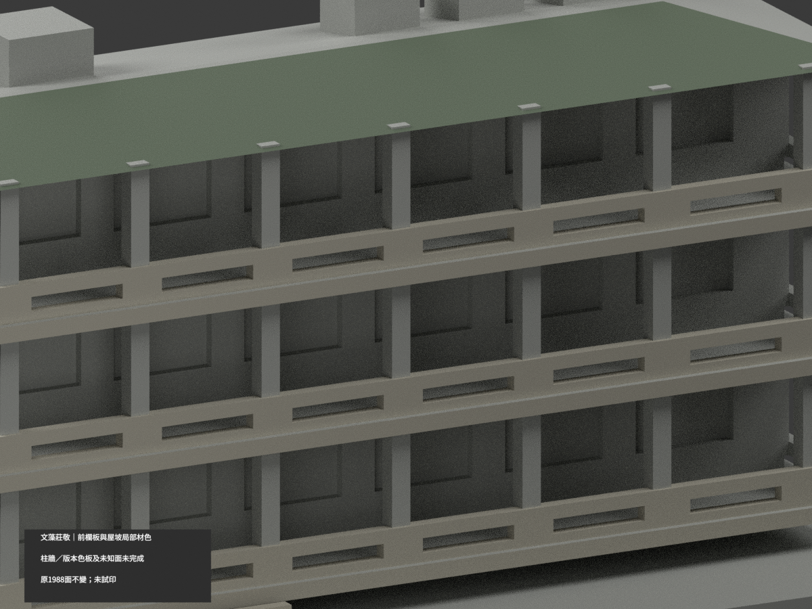
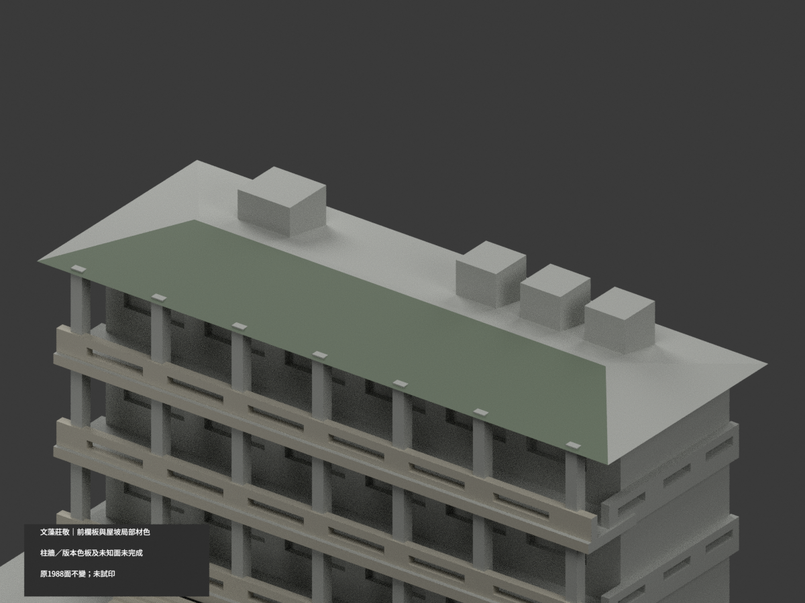

# 文藻莊敬樓｜前欄板與屋坡局部材色示意

**柱牆、不同版本裝飾板與未知面未完成分色。** `partial_color_incomplete=true`、`fully_colored_exterior=false`。只做有據前欄板、樓板邊、純前屋坡與階梯，不是全館完成。

| 總覽 | 背側 | 正面 |
|---|---|---|
||||
||||
||||
||||

## 材色範圍
同 `wzu-zhuangjing` 原項目，same-item、count_delta=0。**1988 個原三角面、頂點與原 STL/build_model.py 位元組不變**，無切面、新增幾何或修正原近似外觀。原公開包無 OBJ，隔離重建的 OBJ 不冒稱原公開件。

- 三層原獨立前欄板與真孔壁504面、樓板前fascia6面、左階梯踏／前立面24面，共534面近似暖灰。
- 真正前hip上斜坡的44個原三角面近似低飽和綠；所有頂點符合原解析斜平面，沒有把向上法線一概染綠。原坡被柱相交細分但沒有新增面。
- 淺ridge水平面、紅色簷底／屋邊、兩端坡與後坡都不染綠；這些未知處中性。色與中性界是照片／原拓撲證據範圍，不宣稱真實材接縫。
- 22個初候選灰面因與未證表面共面連通，整域撤回中性，防止假斜三角。全高柱、短回廊、完整教室主牆與窗背中性，不能把柱牆上部任意白化。
- 官照窗下紅／橘板、PDF則偏青藍，照片日期未載且原無分界，全部中性不任選最新版。屋頂設備混外殼／深格柵，沒有細界就不整白。
- 前檐七處中性柱頂小塊是原柱穿坡幾何，並非本次新增或色錯；不改形或補綠掩蓋。
- 共1410面仍未知中性。原粗幾何與真欄孔／屋面細部不同，補色不替原幾何背書；不新增彩板、窗框、文字、人物、樹木或設備細格。

## 日期與來源
採校方莊敬樓外觀照與官方PDF第87實頁／印刷2-81外部照片。拍攝日未知；2023-12為填表日、2025-03-12為文件版本，**不是攝影日期或現況精測**。只使用外觀照片，不取室內防災配置。
原照片/PDF私人保存，不公開或作貼圖；未確認CC/再散布授權，不保證商用權利。HEX僅展示近似色族，不是校準色票。

## 格式與列印
[原 STL](model.stl) · [材色 3MF](appearance.3mf) · [Blender](scene.blend) · [原說明](ORIGINAL-MONOCHROME-README.md)
原底座150×86 mm為獨立照片近似展示，非測量比例。3MF basic materials與Blender真正逐面材質；STL不含色。三材質標籤不是已驗證三色／四色耗材切片專案。**未實際列印**，未產生切片工具路徑；原細欄板／挑屋風險不因補色解除。

## 重建與 QA
依原 requirements 安裝後 `build_model.py` → `colorize_model.py` → `export_appearance.py` → `validate_color.py`。Blender 執行 `render_color.py`、`verify_color_scene.py`。
原位元組、逐三角座標、正體積閉合、3MF材質及完整隔離重建皆檢查；scene重開、十圖及README/hash另核。完整共面域同材另驗，程式不取代來源人工判讀。
原previews/render/validation保留為單色歷程，不當新材色QA；未刪原件。
