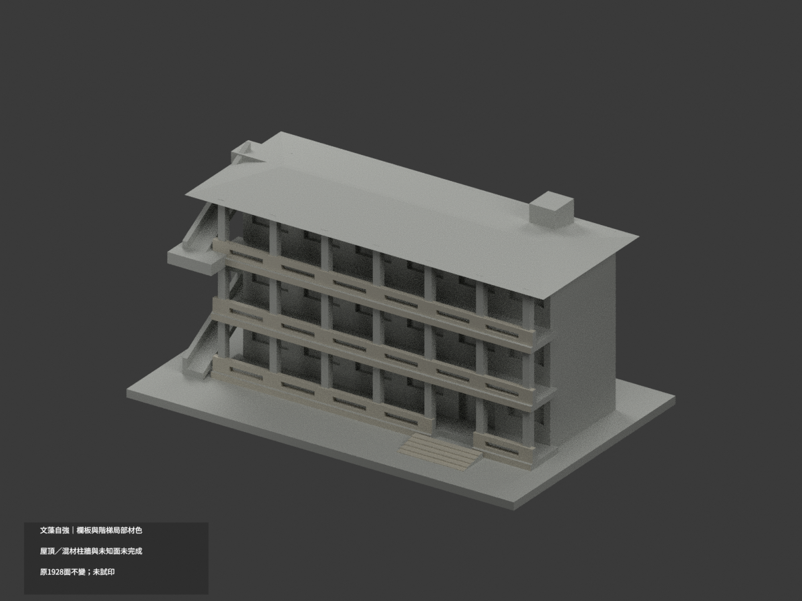
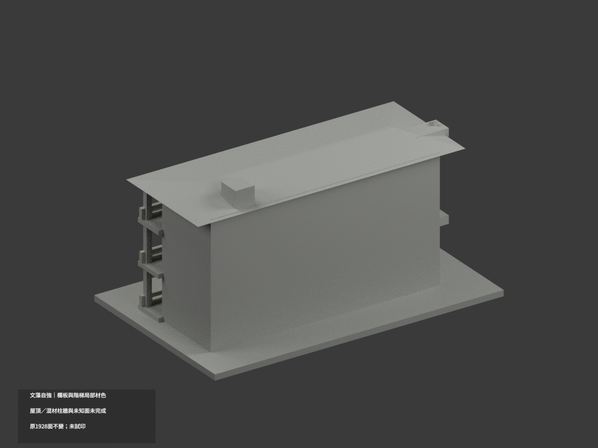
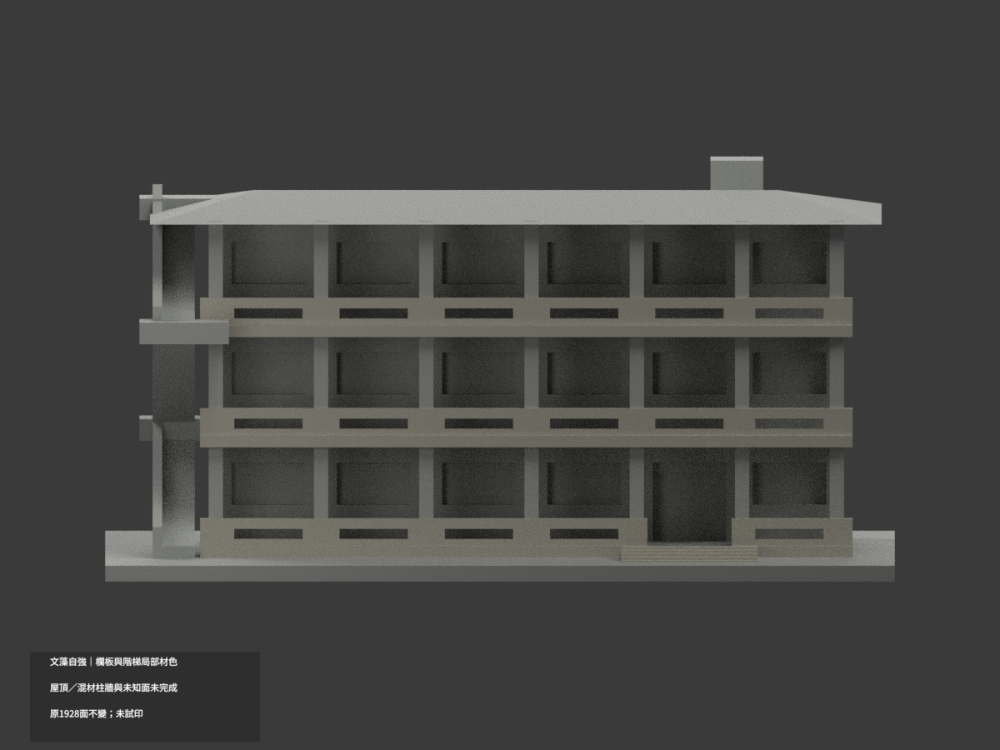
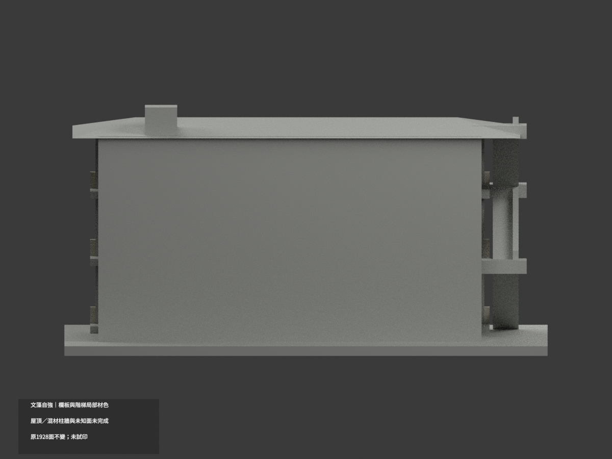
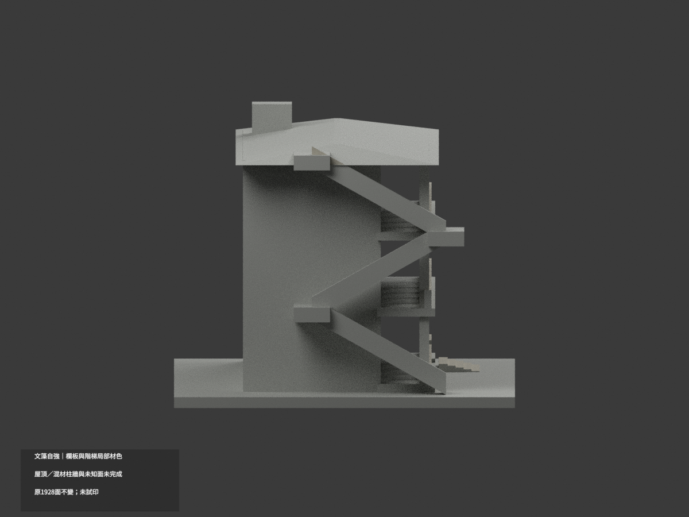
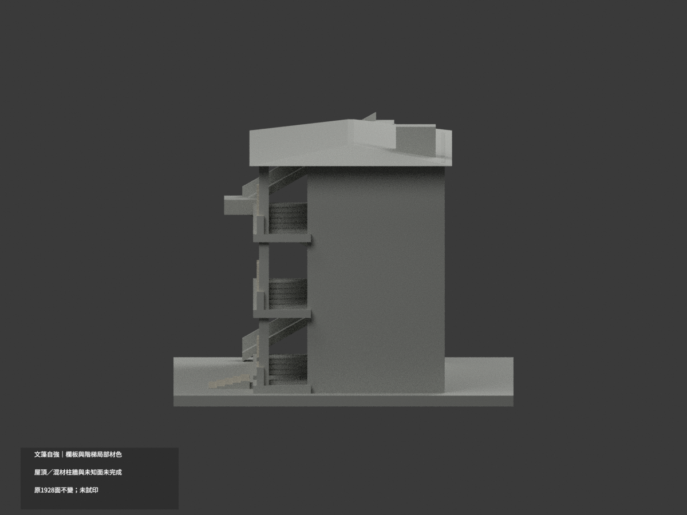
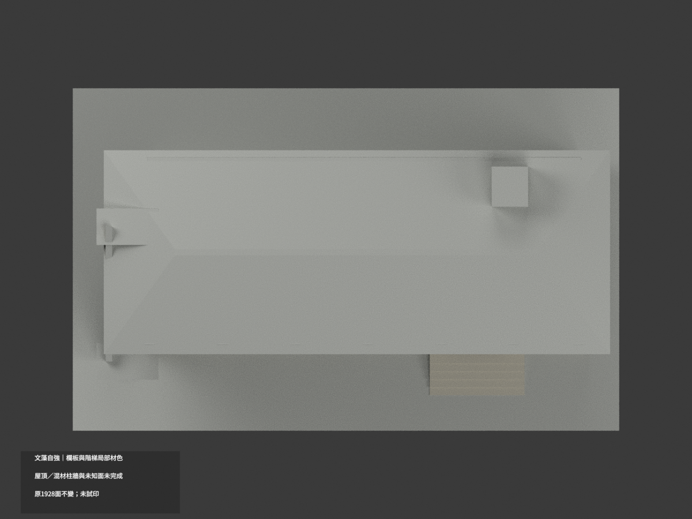
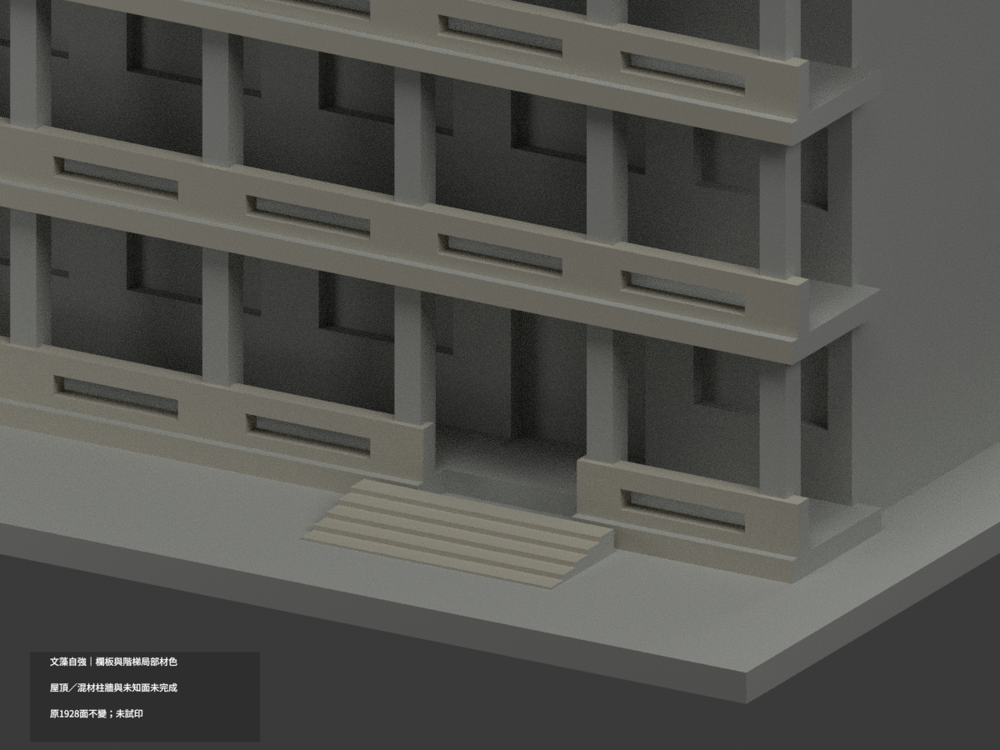
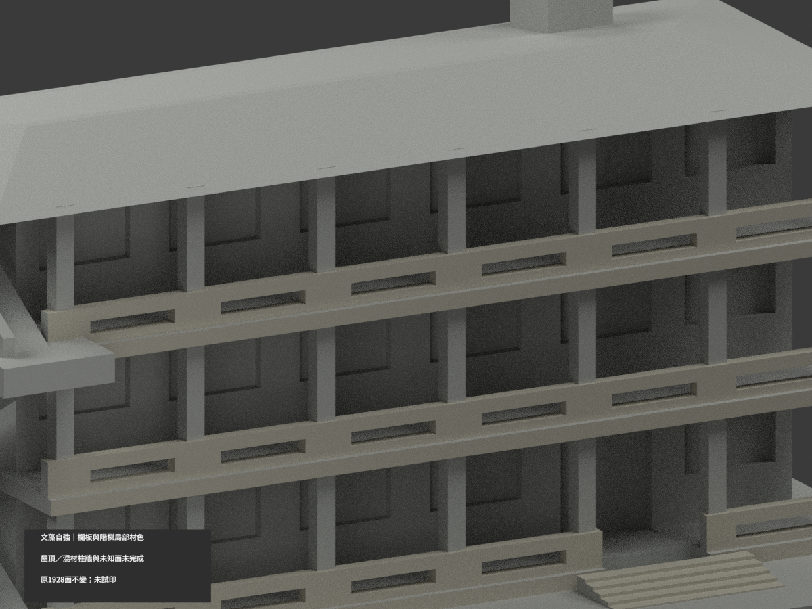
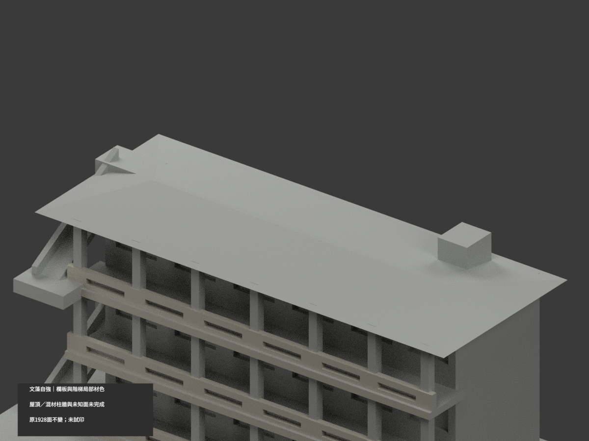

# 文藻自強樓｜欄板與階梯局部材色示意

**屋頂、混材柱牆與未知面未完成分色。** `partial_color_incomplete=true`、`fully_colored_exterior=false`。只保有據欄板／樓板邊／階梯外面，並非全館完成。

| 總覽 | 背側 | 正面 |
|---|---|---|
||||
||||
||||
||||

## 材色範圍
同 `wzu-ziqiang` 原項目，same-item、count_delta=0。原1928三角面及STL/build_model.py字節完全保留，無切面／新增幾何。原公開包沒有OBJ，隔離重建產出的OBJ不冒稱原件。
- 原前欄板492面、樓板真正前fascia8面、入口階踏立面24面、左梯外側斜欄牆完整域2面，總526面近似暖灰。
- 48個初候選面與未知表面共面連通，因此整域撤為中性；左斜梯候選不能任切長面染滿。未新增孔洞／修正原粗梯形。
- 其餘1402面中性：全hip屋頂、全高柱、主牆、窗背與反光簾、設備、側後及未證梯底。低角度綠屋邊不能證明整坡綠，未移植別棟屋色。
- 兩照片窗下板紅／藍色不同但拍攝日未定，原無板／牆細分界，所以不任選新版、不以三角面畫色塊。
- 色與中性邊界只表示證據與拓撲限制，不代表真實材接縫。原近似幾何不因補色背書，未新增文字／樹木／人物或鄰樓。

## 日期／權利
校方外觀照與官方PDF實頁79／印刷2-73；2023-12填表、2025-03-12文件版次不是照片拍攝日，不稱某年現況精測。只讀外觀，不取防災內部配置。
原照片/PDF私人保存、不公開、不作貼圖；未確認CC或再散布授權，不保證商用。HEX只是展示色族，非校準色票。

## 格式與列印
[原STL](model.stl) · [材色3MF](appearance.3mf) · [Blender](scene.blend) · [原說明](ORIGINAL-MONOCHROME-README.md)
原150×94mm展示底座非精測比例。3MF基本面材與Blender逐面材質，STL本身不含色。兩材質標籤不是已驗證兩色／四色耗材切片專案；**未實際列印**，未提供切片路徑，原薄欄與梯風險不因補色解除。

## 重建與 QA
原 `build_model.py` → `colorize_model.py` → `export_appearance.py` → `validate_color.py`，Blender執行 `render_color.py` 與 `verify_color_scene.py`。
逐三角座標、原字節、閉合正體積、3MF面材、完整隔離重建、scene重新開啟、十圖及圖文hash檢核。整個共面連通域同材另驗，程式不取代人工來源判讀。
原單色previews/renderer/validation保存為歷程，不當新材色QA；未刪除原檔。
