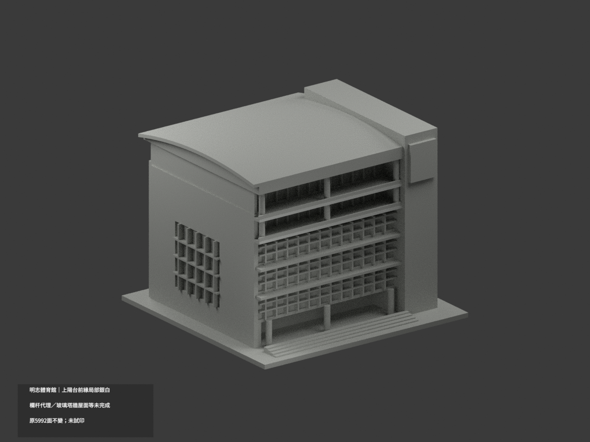
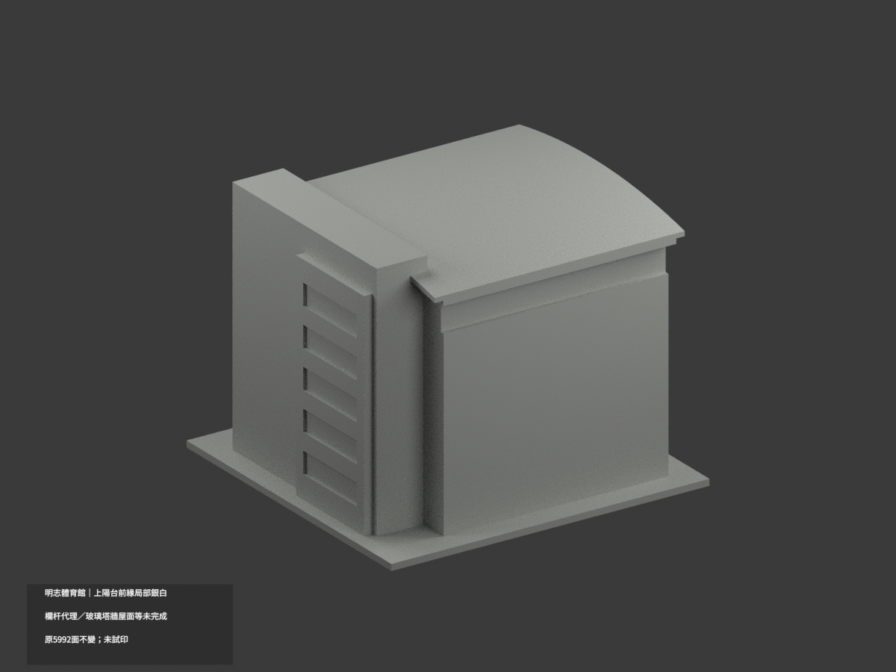
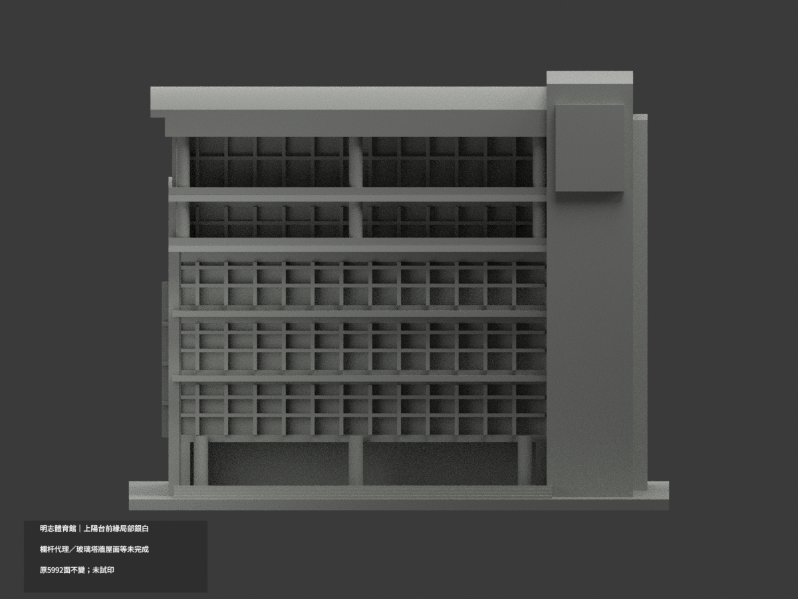
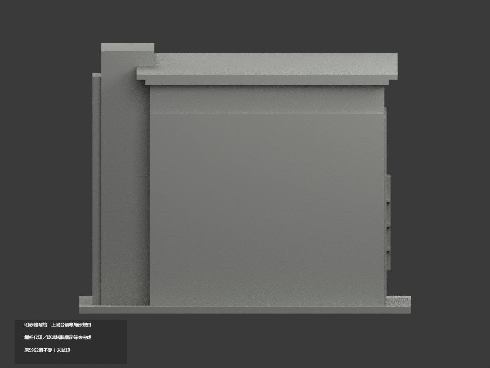
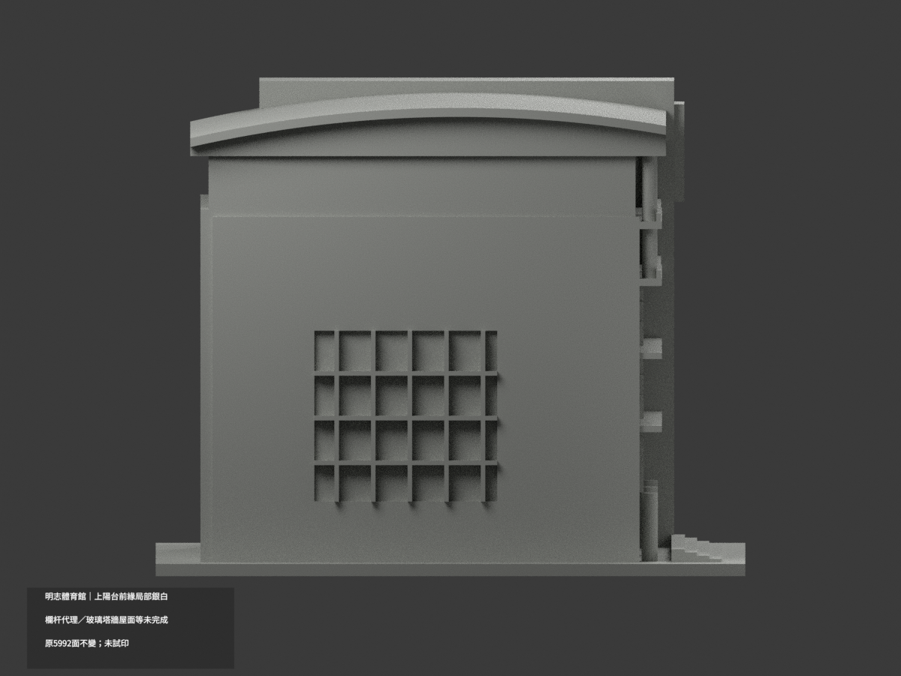
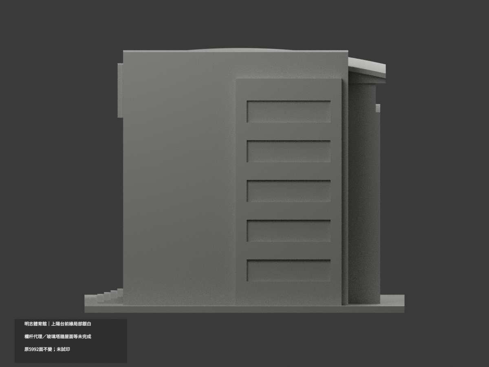
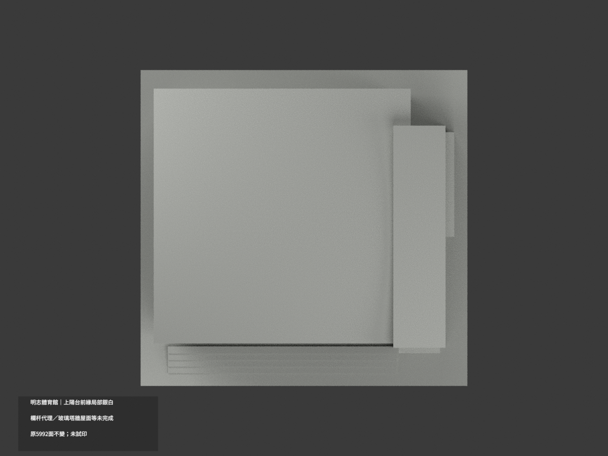
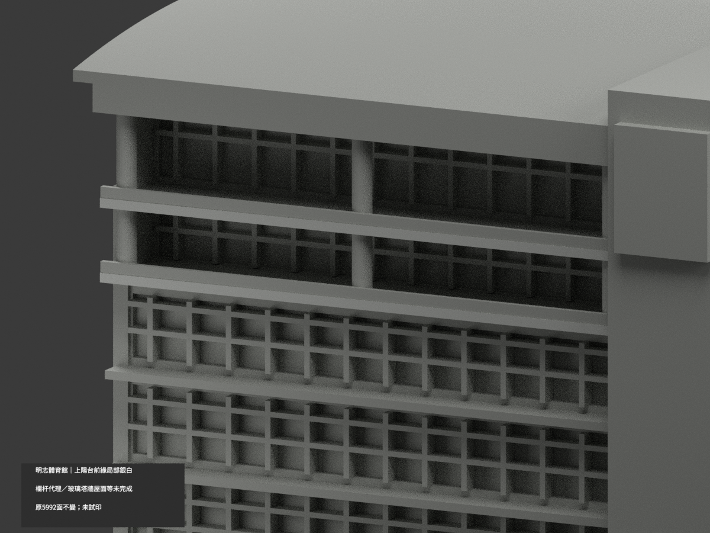
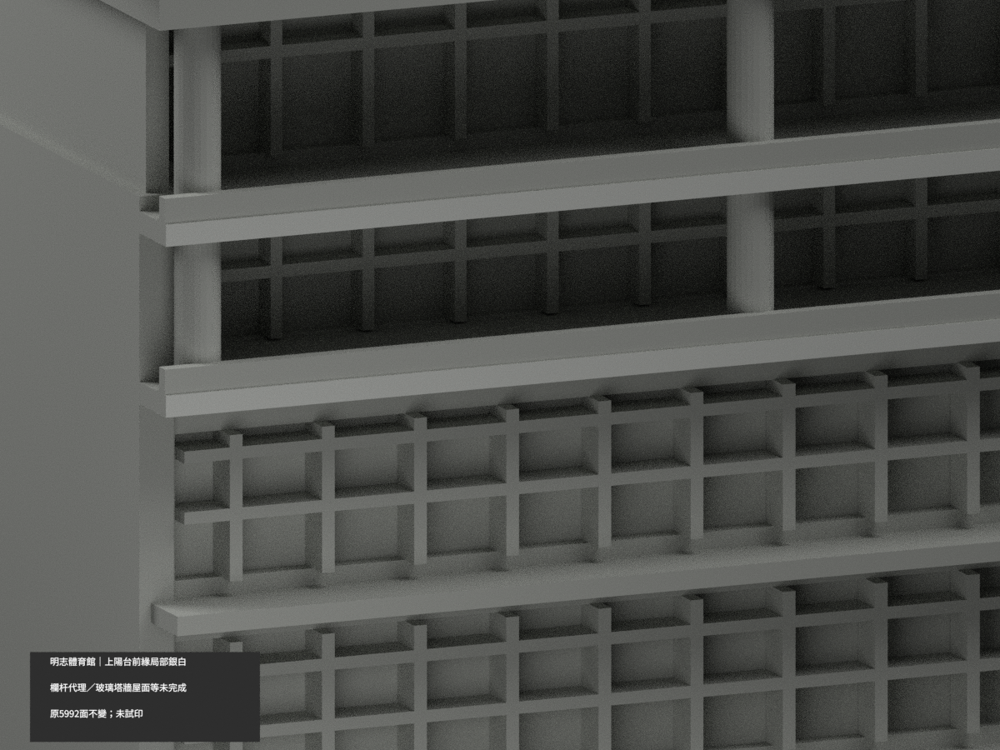
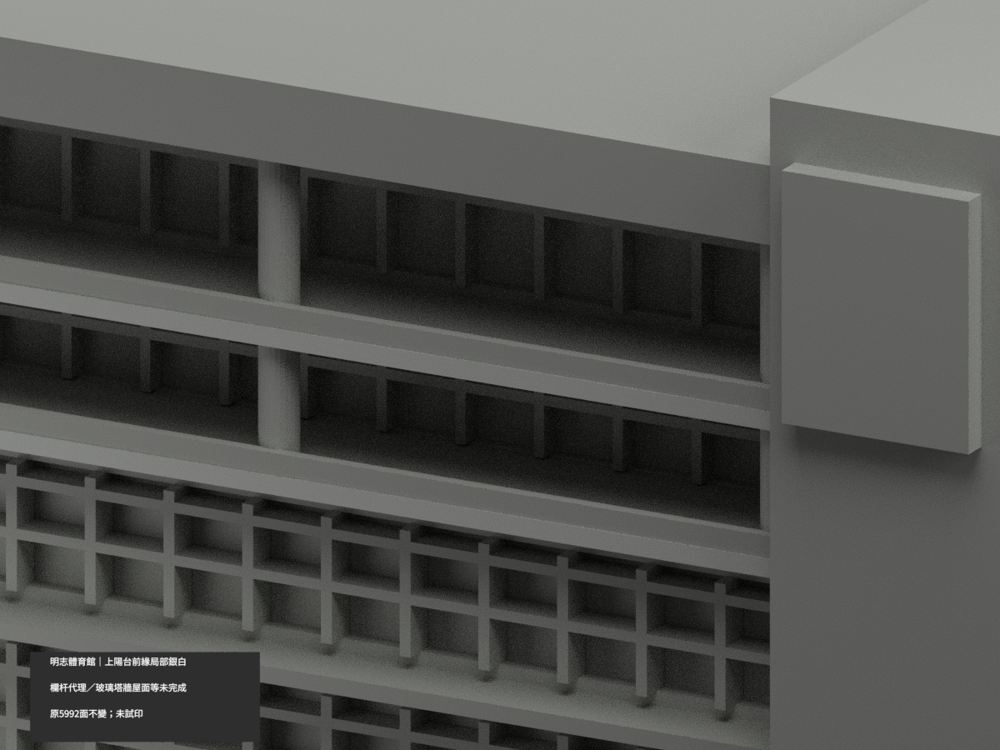

# 明志體育館｜兩上陽台前緣局部銀白

**欄杆代理、玻璃塔牆與屋面等尚未完成分色。** partial_color_incomplete=true、fully_colored_exterior=false。僅兩上陽台樓板前緣4面名義銀白，非全棟完整補色。

| 總覽 | 背側 | 正面 |
|---|---|---|
||||
||||
||||
||||

## 材色範圍
同 mcut-gymnasium 原項目，same-item、count_delta=0。明志科技大學泰山校本部體育館主體單群，不含相鄰樓或整片廣場。原5992三角及STL/build_model.py字節不變，19原件無OBJ，原code可重建輸出OBJ不等於有原件。
- whole y−52平面8三角為4完整共邊矩形；只選上部z71..72.8、85..86.8兩完整樓板前緣各2面、x−64..41。下部z35/53是另一遮陽構件，全中性。這是完整構件身份，不是切割連續面取高處。
- 其餘5988面中性：y−51.8實心欄板代理不是實景透空欄杆，原玻璃含窗簾/框、徽牌混藍白、全高柱/塔、曲屋前後/頂底、側背、樓板上下與回邊均未證完整材域。
- 原近似窗列與形體保留，不新增徽標、欄杆或未見部分；補色不追認幾何精度。中性材界只是證據範圍，不是真實材縫。

## 來源與日期
親看兩日照主體外觀，兩上樓板下方完整淺面板支持銀白族；不把細金屬欄移植到原實板。照片拍攝日未證，2023頁面更新不是capture，非2026現況。名義色族非校準色票。原照私人保存、不公開、不作紋理、不建人物，未確認再散布或CC授權，不保證商用。

## 格式與列印
[原STL](model.stl) · [逐面材色3MF](appearance.3mf) · [Blender](scene.blend)
原150mm底座示意尺寸不是測量比例。實際物件名 MCUT Gymnasium partial color，獨立核對真slug/館名。STL無色；3MF與Blender逐面分材，兩材標籤不是兩色或四色耗材切片驗證，未實際列印。

## 重建與 QA
原build_model.py → colorize_model.py → export_appearance.py → validate_color.py；Blender render_color.py／verify_color_scene.py。完整隔離Shapely2.1.2精確原build＋color重建、原bytes/全三角multiset、共面均一、閉合正體積、3MF面材、scene重開、十圖1200×900與hash。原README/previews/validation保留歷史，不冒充新QA，不刪檔。

## English scope
Partial only:4 original triangles on two complete upper balcony slab-front rectangles silver white;5988 neutral. Whole y=-52 plane has4 complete components with8 triangles; lower2 shades remain neutral. Railing proxy at y=-51.8 is not the open metal rail in photos and remains neutral, as do logo, curtains/glass, columns/tower, curved roof and backs. Original5992 triangles and19 immutable files unchanged;no originalOBJ even though originalbuild exports one. Captureunknown,page2023 update notcapture/not2026 survey. Sameitem/count0/no geometrychanges/no filament test.
