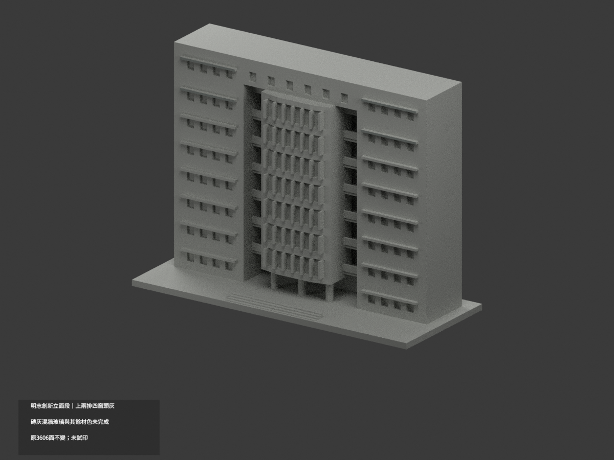
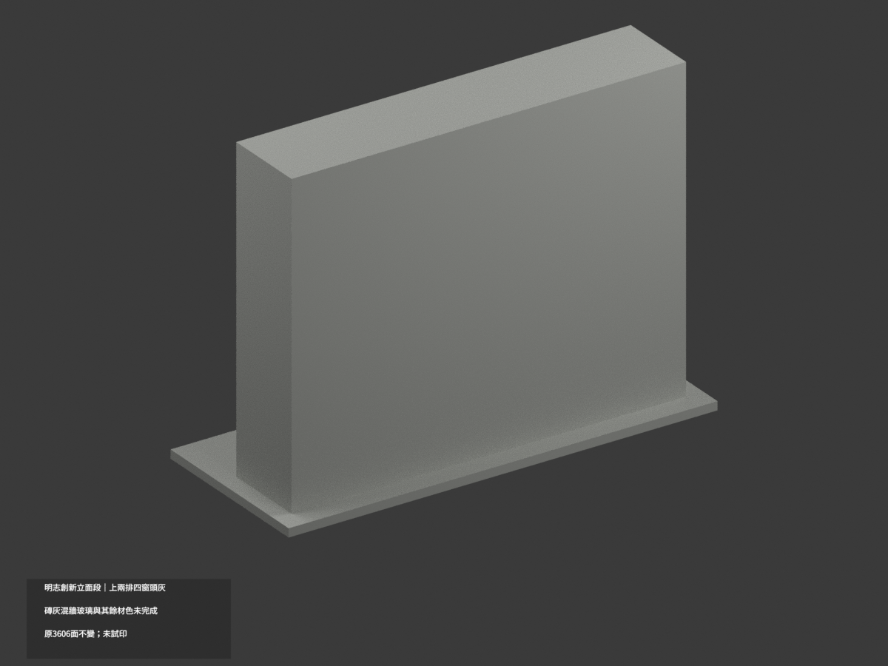
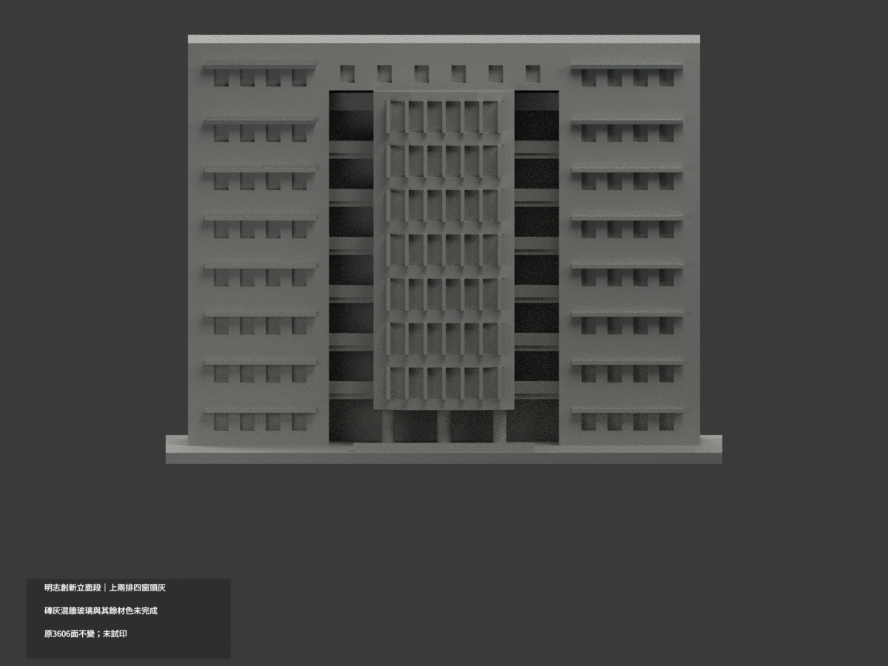
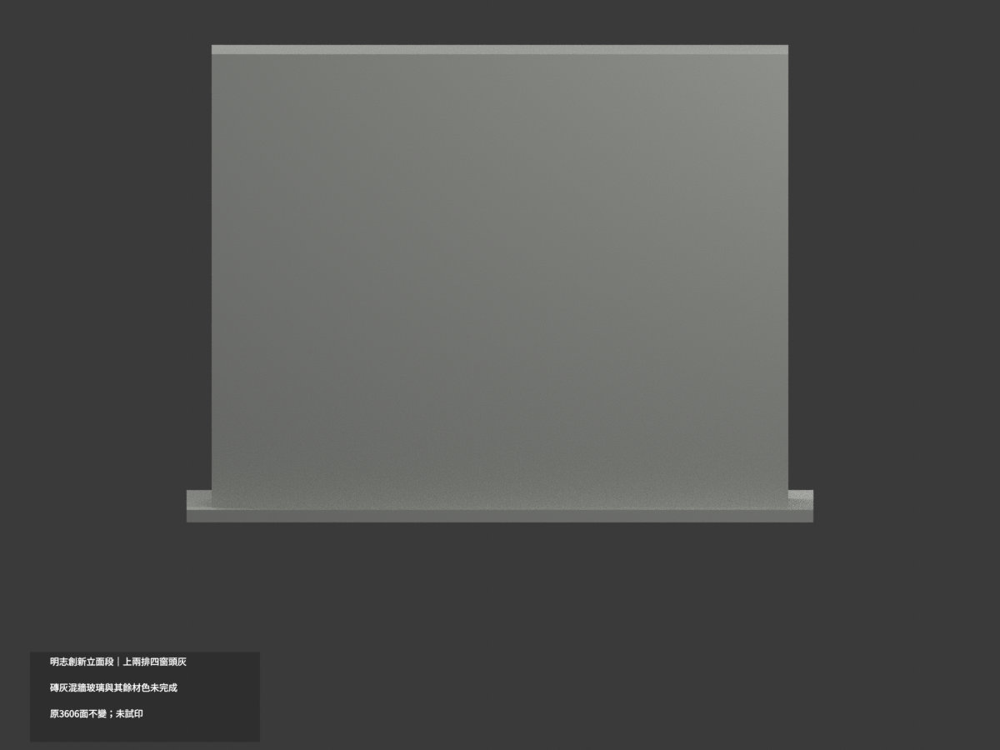
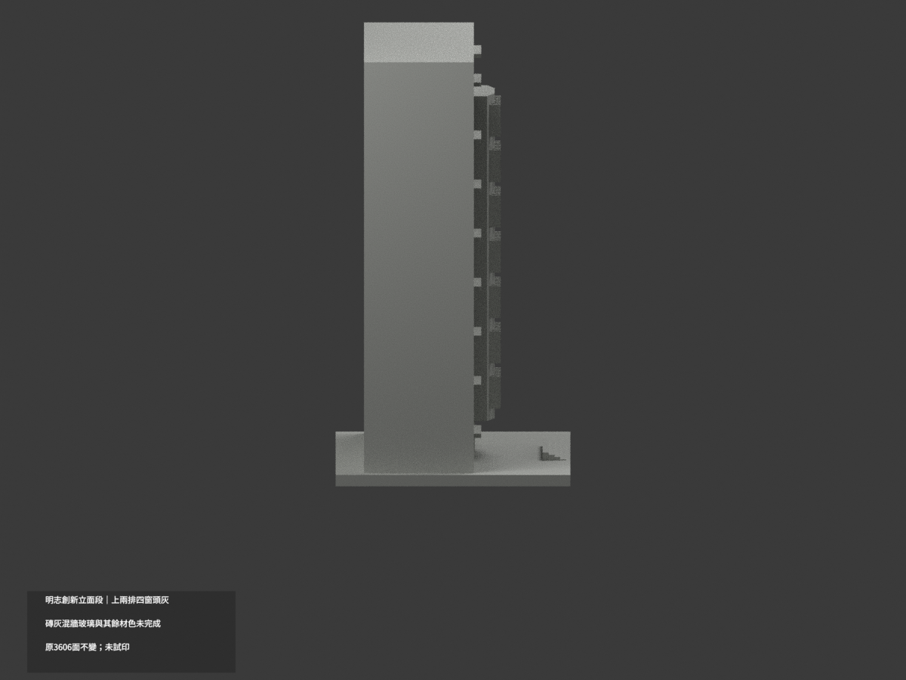
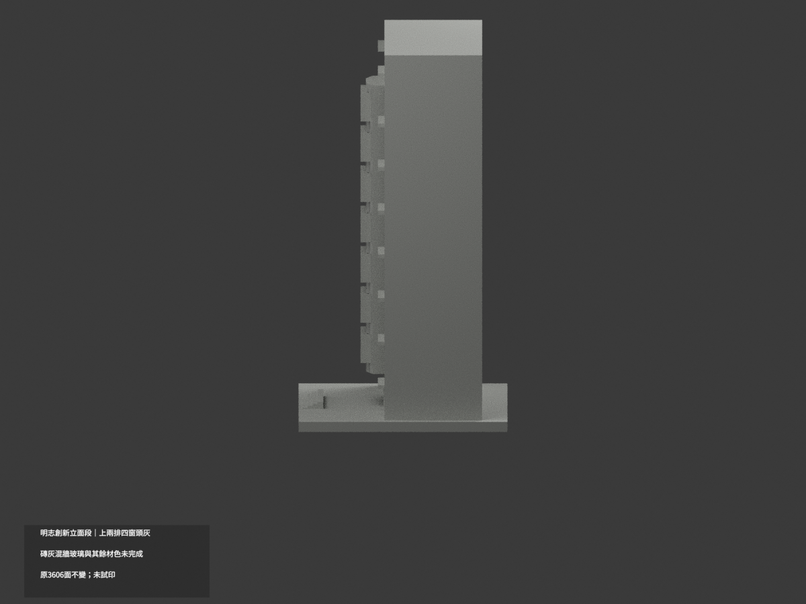
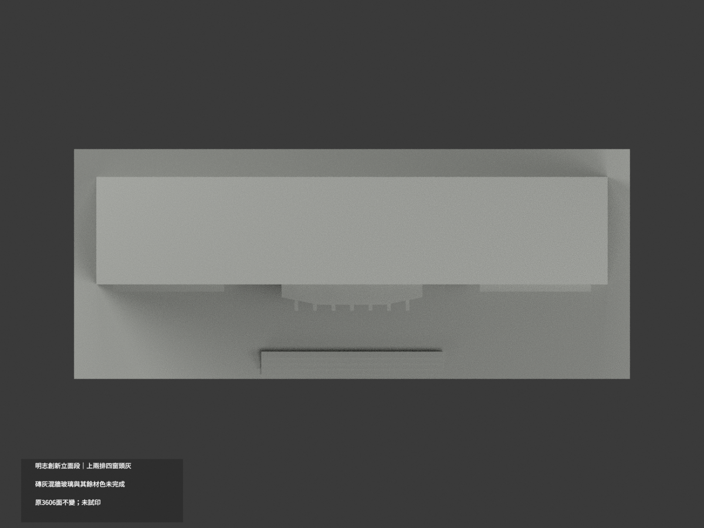
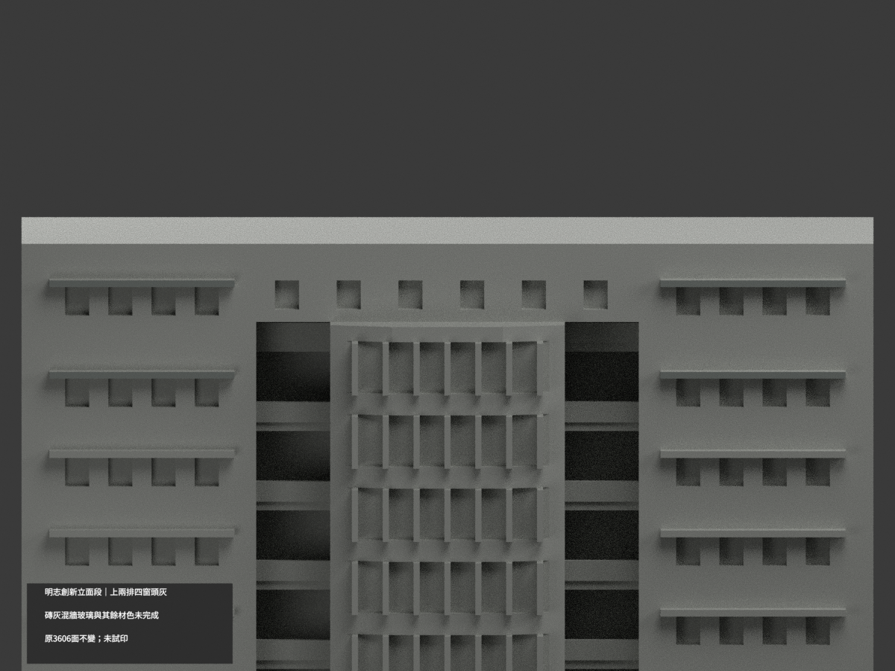
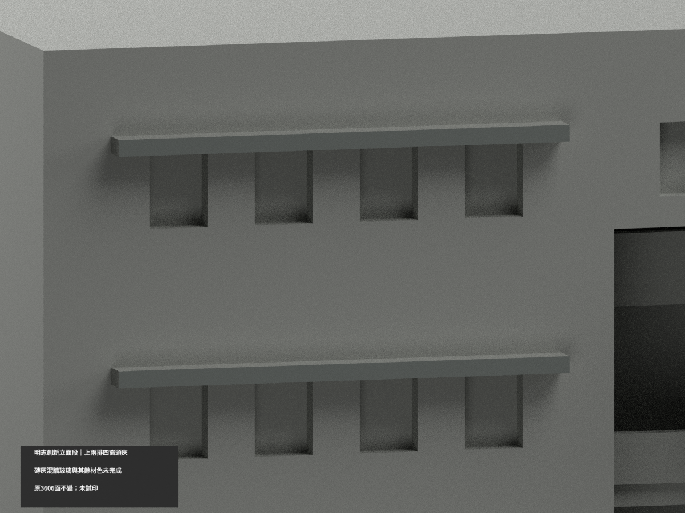
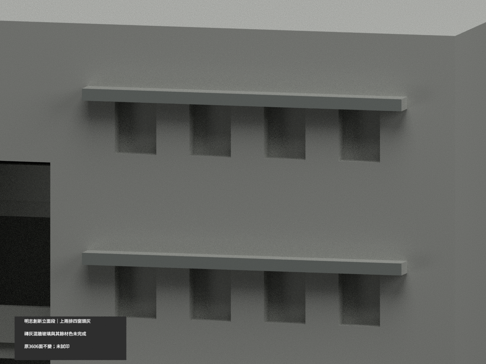

# 明志科技大學創新大樓主立面段｜四個上排窗頭局部灰色

**局部補色未完成：只左右上兩排四個完整窗頭前緣8原三角灰色；下排、磚灰混牆、玻璃、露廊與其餘面尚未分色。** partial_color_incomplete=true、fully_colored_exterior=false。同項 mcut-innovation-facade-segment／count_delta=0，明志科技大學泰山校本部。英文身份 MCUT Innovation Facade Segment partial color。

**原主立面淺截段，不是完整大樓；62mm展示深度及平後截面是建模邊界，不是實際館深或後立面。保留原照片估測、粗化與比例限制，不增幾何。**

| 前斜視 | 後斜視 | 正面 |
|---|---|---|
|  |  |  |
|  |  |  |
|  |  |  |
|  | | |

## 材色範圍

原三頂點全y−7.45無限平面0.0001mm枚舉32面，先建共享邊16個完整2面矩形，再選左右兩側z90..91.1、105..106.1四個完整窗頭。每矩形寬30mm，8面名義中灰，3598中性，原3606三角不變。高度識別完整原域，不切跨材大面、不按中心點分色，不用原index盲套。

官方正照直接看見左右上兩排，不以對稱外推。其餘12個窗頭、頂皮/底/返面中性；下排受鄰棟與植被遮擋不補。磚牆混淺色橫帶未有對應原界線，不整紅；中央玻璃混亮框、深窗間板與反光不整藍；實心欄代理與露廊不整黑。圓柱混磚灰/下部遮擋、屋面、支撐及未知後截面中性。中性不是實景灰；資料覆蓋邊界不是真實材質接縫。

## 日期與來源

兩照片EXIF無DateTimeOriginal，2008–2010營造期間不是拍攝日期，不稱2026現況。照片僅私人研究，不公開原照或貼圖，不推定商用權利。保留原立面段/估測毫米/未知完整基地與後面限制，補色不追認精準測繪。

## 檔案與 QA

原STL/build與3606三角座標、拓撲、字節不變。immutable19件無OBJ；原程式可輸出OBJ，但隔離產物私存，不冒稱原repo有OBJ。原README另存ORIGINAL-MONOCHROME-README.md，舊單色圖/QA保留；原scene另存私人原包。appearance.3mf兩展示材與scene.blend實際面材保原幾何，export/validate/render/verify及實際3MF/scene身份 MCUT Innovation Facade Segment partial color。

精確依賴隔離原build+color、閉合正體積、3MF座標/面材與Blender重開、十張1200×900檢核；保留重建不刪，未試印或驗多料切片，STL本身無色。

## English limitations

MCUT Innovation Facade Segment partial color. Four complete upper window-head fronts only: 8 muted-gray faces,3598 neutral,3606 original triangles unchanged. Whole y=-7.45 plane has32 faces in16 complete edge-connected rectangles; select the upper two rows on both sides after component construction,not by splitting triangles. Both sides are directly evidenced,not mirrored. Other heads,brick/pale-band mixed walls,glazing/spandrels/curtains,solid gallery proxies,columns,roofs and rear cuts remain unverified neutral. The62mm depth is a shallow modeling cut,not the actual building depth. No verified capture date;2008–2010 construction is not capture and no2026 condition claim. Original19 immutable files contain noOBJ; isolated builder output is private. No geometry changes,count_delta0,no public reference images,no test print.
