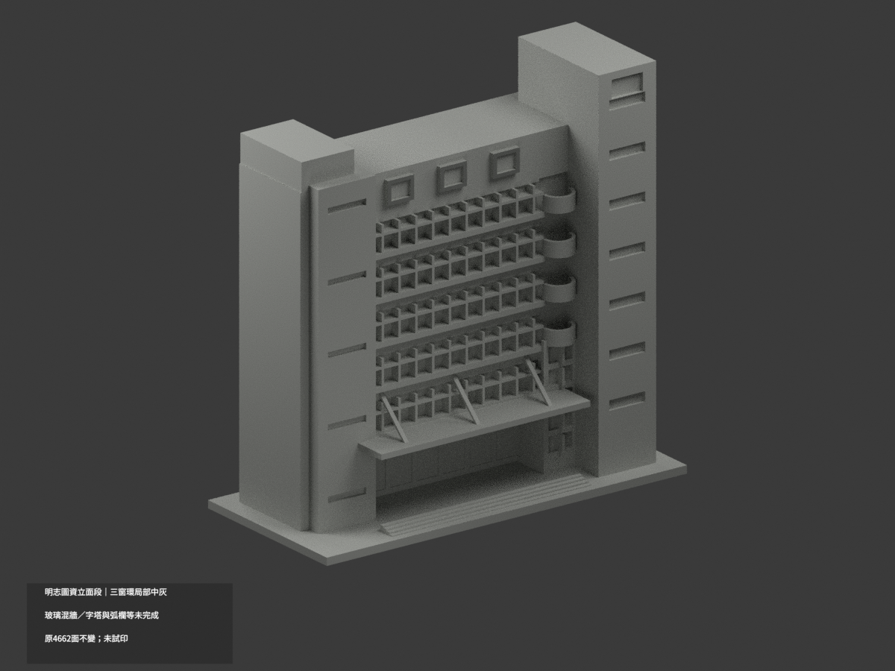
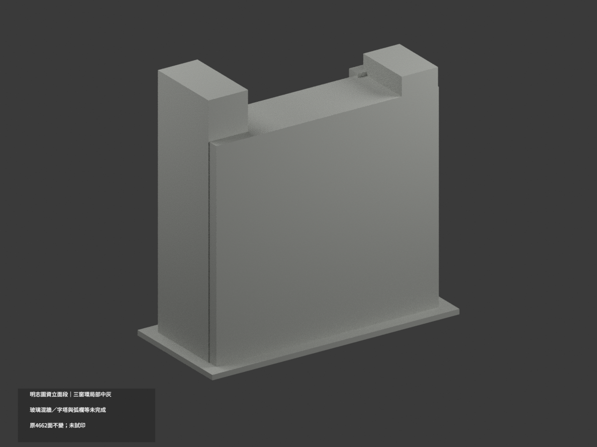
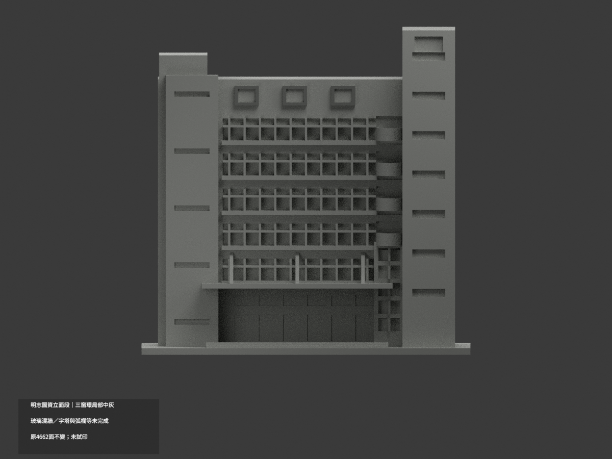
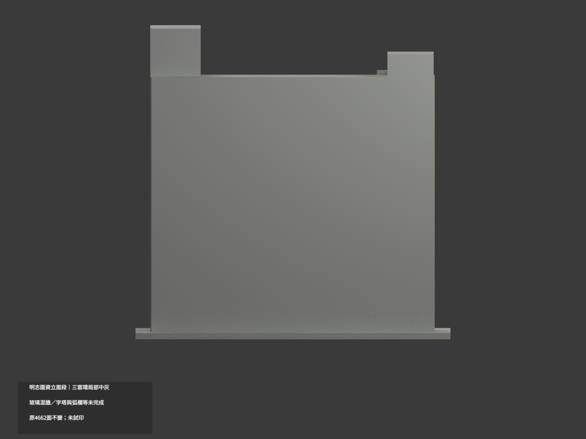
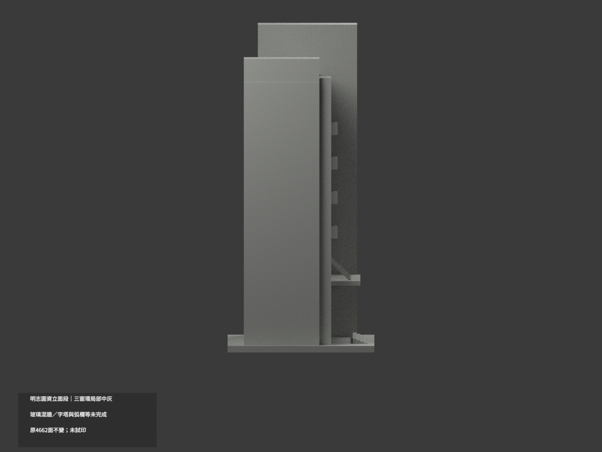
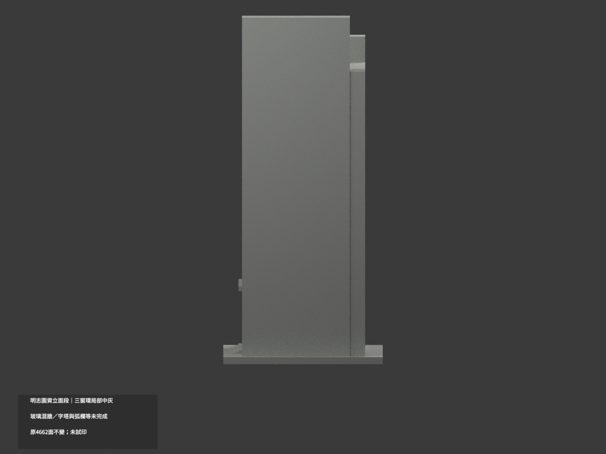
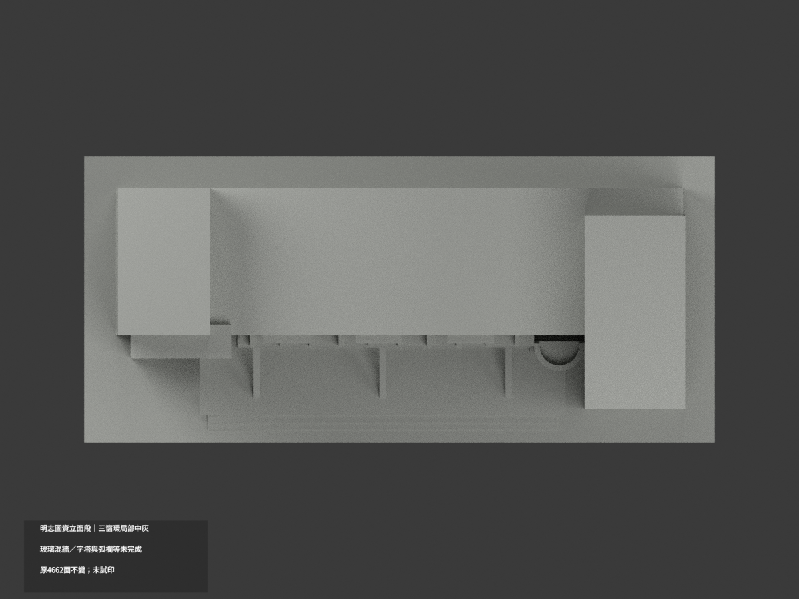
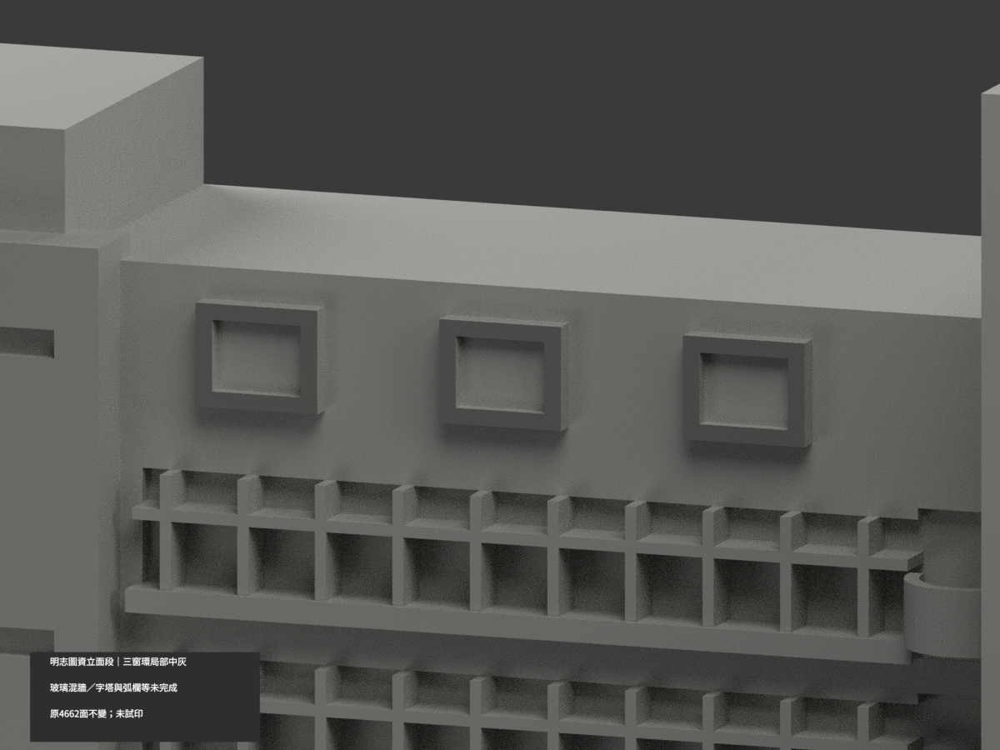
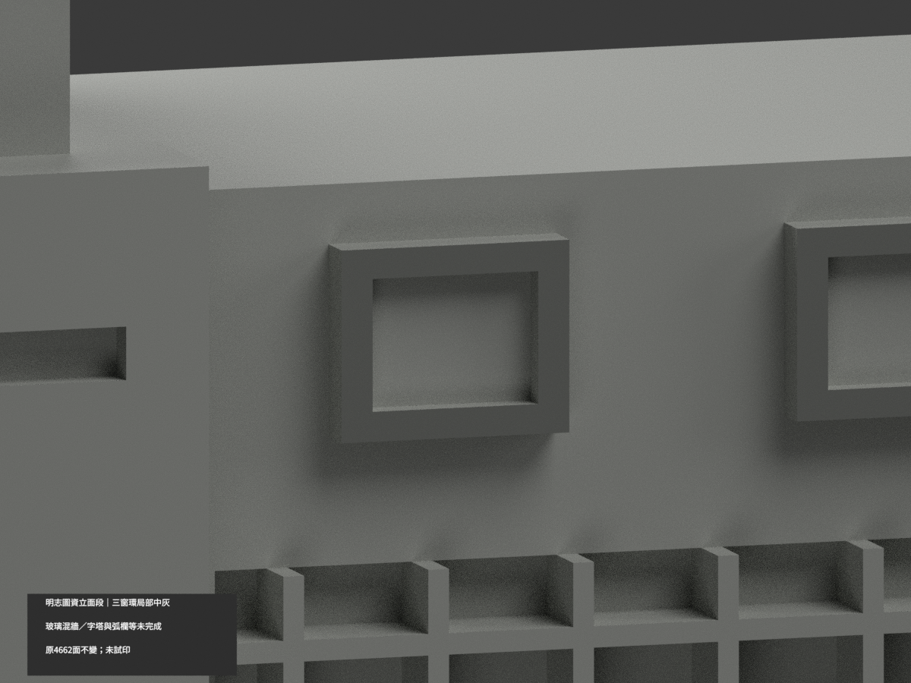
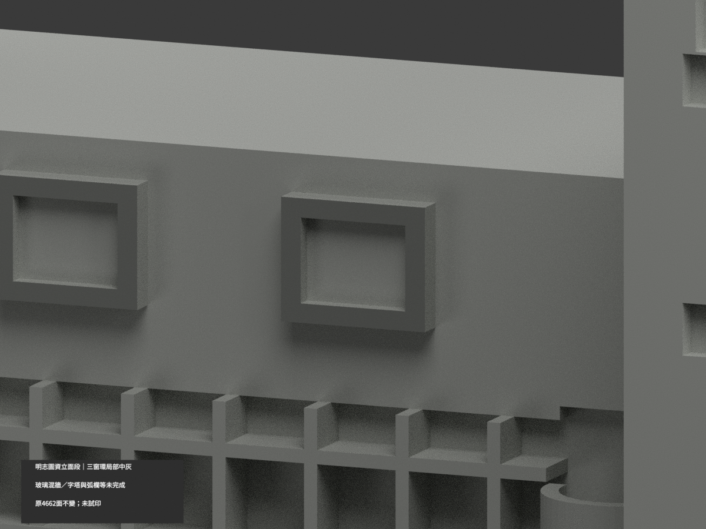

# 明志圖資立面段｜三方窗前環局部中灰

**玻璃、混牆、字塔與弧欄等尚未完成分色。** partial_color_incomplete=true、fully_colored_exterior=false。僅上三方窗完整前環24面名義中灰，非全館完整補色。

| 總覽 | 背側 | 正面 |
|---|---|---|
||||
||||
||||
||||

## 材色範圍
同 mcut-library-facade-segment 原項目，same-item、count_delta=0。明志科技大學泰山校本部圖書資訊大樓前立面片段，原68mm厚度與平背為人工截段，不是全館深度或真實背立面。原4662三角及STL/build_model.py字節不變，19原件無OBJ，原code能輸出重建OBJ不等於有原件。
- whole y−10.5平面40三角分11完整共邊域；只選上三窗前環8×3=24面，原11×9外框/8×6.2窗孔及Boolean三角完整保留。其餘8個陽台端共16面全中性。全3頂點有限界與完整共面域核對，不人工剪三角。
- 其餘4638面中性：玻璃/窗簾/內淺框、環內壁側頂底、混磚與黃橫牆、金字服務塔、弧欄實心代理、雨棚吊桿、入口與地面、屋與背截面。
- 中灰是名義石材族而非照片陰影黑，不填玻璃孔。保原近似幾何與窗列，不新建字樣或真透空欄，補色不追認精度。材界是證據範圍非真實材縫。

## 來源與日期
親看兩日照外觀。source0拍攝日未知；source1 EXIF2011-07-24原始、2011-07-29修改，均無驗證時區/時鐘，不稱2026現況。名義色族非校準色票。原照私人保存、不公開、不作紋理、不建人物，未確認再散布或CC授權，不保證商用。

## 格式與列印
[原STL](model.stl) · [逐面材色3MF](appearance.3mf) · [Blender](scene.blend)
原150mm底座示意尺寸不是測量比例。實際物件名 MCUT Library Facade Segment partial color，獨立核對真slug/館名。STL無色；3MF與Blender逐面分材，兩材標籤不是兩色或四色耗材切片驗證，未實際列印。

## 重建與 QA
原build_model.py → colorize_model.py → export_appearance.py → validate_color.py；Blender render_color.py／verify_color_scene.py。完整隔離Shapely2.1.2精確原build＋color重建、原bytes/全三角multiset、共面均一、閉合正體積、3MF面材、scene重開、十圖1200×900與hash。原README/previews/validation保留歷史，不冒充新QA，不刪檔。

## English scope
Partial only:24 original triangles on three complete upper window front rings medium gray, not shadowblack;4638 neutral. Whole y=-10.5 plane40 triangles, three8triangle rings selected and eight unrelated2triangle balcony-end components neutral. Glass, inner frames/reveals, mixed brick-yellow walls, gold-lettered tower, railing proxies and backs remain neutral. Original4662 triangles and19 immutable files unchanged;no originalOBJ. Artificial68mm deep front section, not full library. Source0 captureunknown;source1 EXIF2011-07-24 unverified timezone/clock, not2026 survey. Sameitem/count0/no geometrychanges/no filament test.
