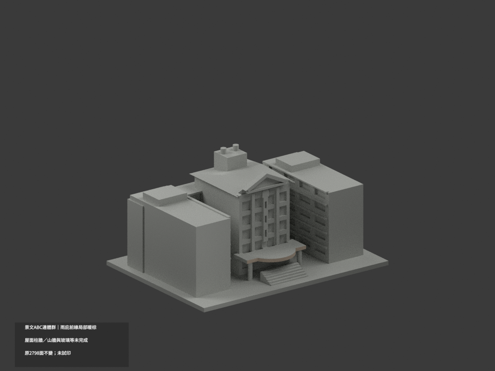
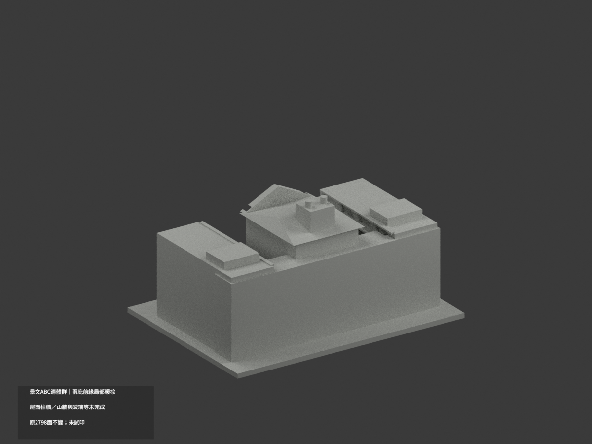
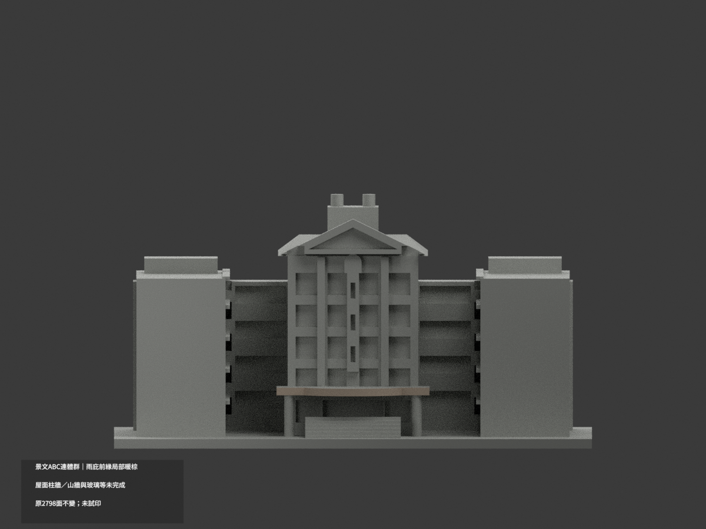
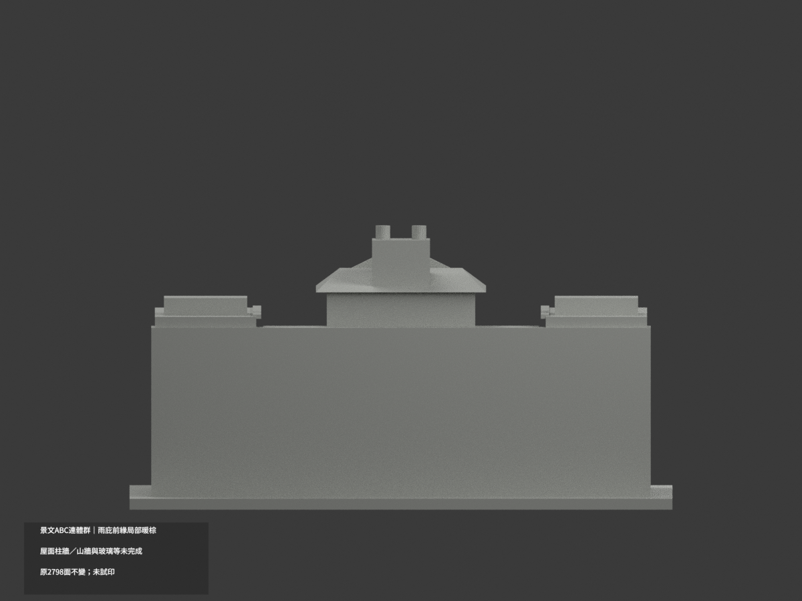
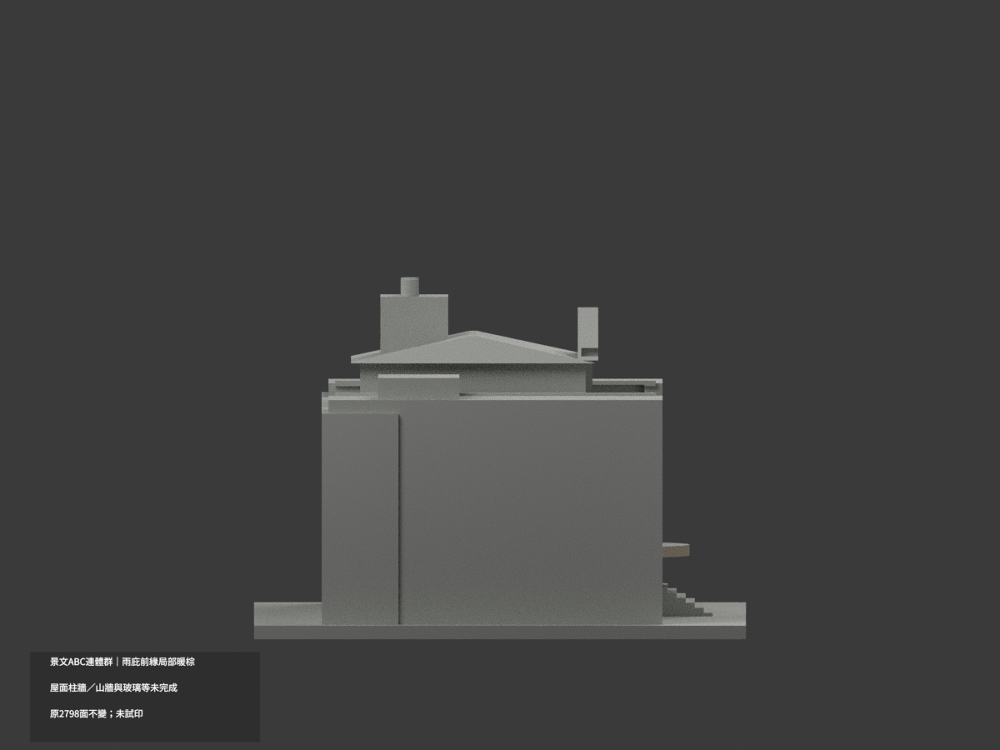
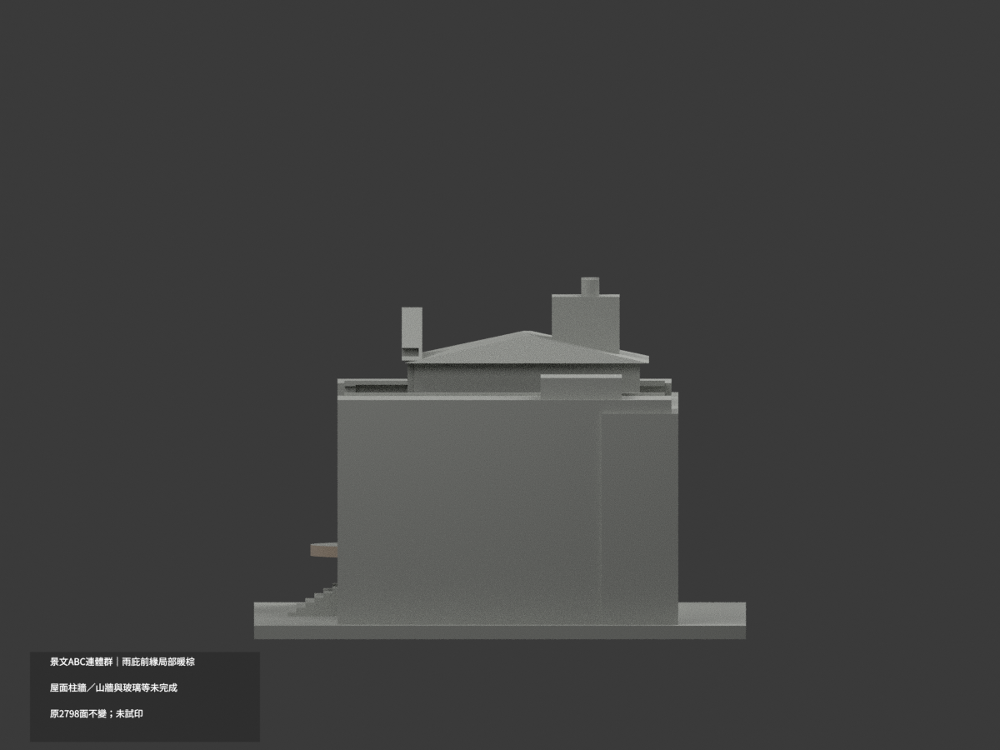
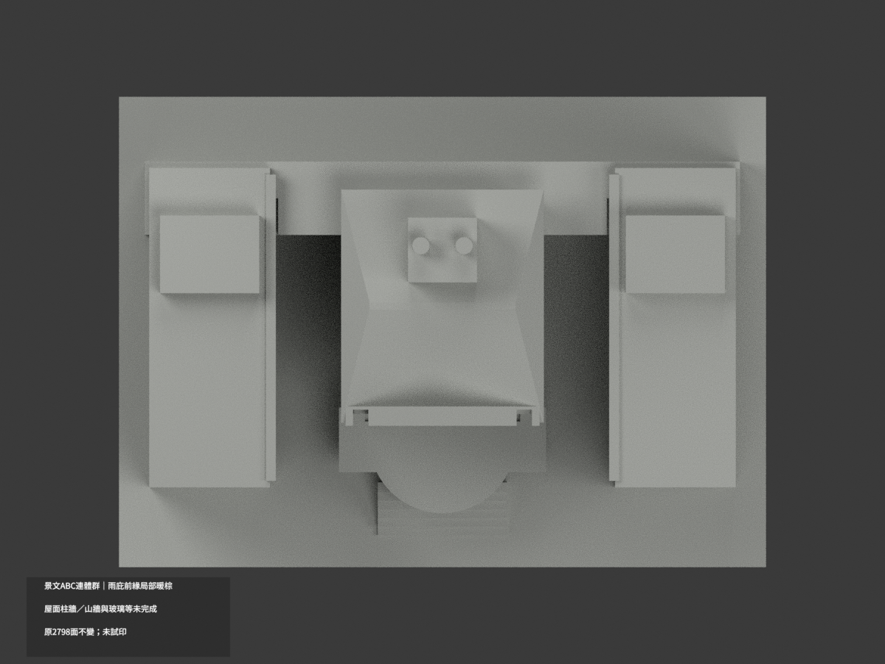
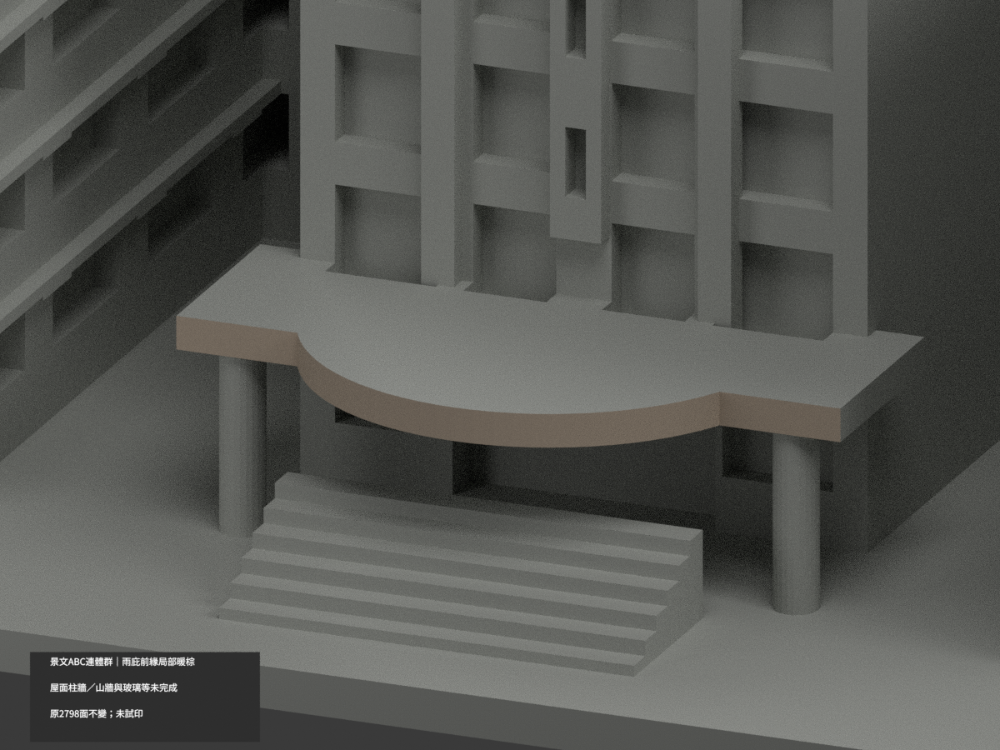
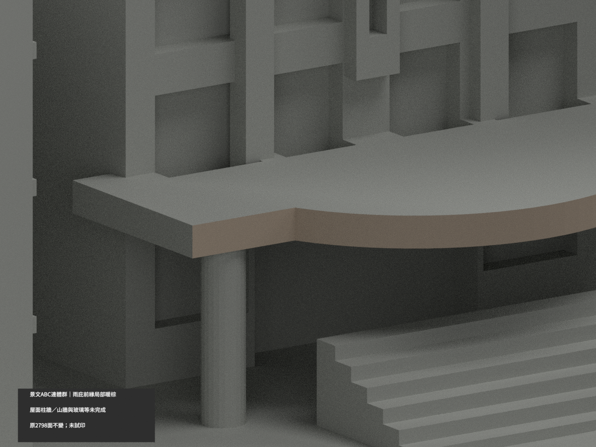
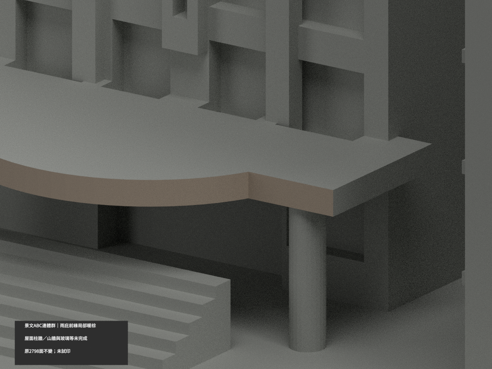

# 景文ABC連體群｜入口雨庇前緣局部暖棕

**屋面、柱牆、山牆與玻璃等尚未完成分色。** partial_color_incomplete=true、fully_colored_exterior=false。僅雨庇弧形及兩直前緣64面名義淺暖棕，非全館完整補色。

| 總覽 | 背側 | 正面 |
|---|---|---|
||||
||||
||||
||||

## 材色範圍
同 just-abc-complex 原項目，same-item、count_delta=0。景文科技大學校本部ABC連體群維持一群，不拆為三棟。2798原三角及STL/build_model.py字節不變，18原件無OBJ；原code可輸出重建OBJ不代表有原件。
- 原80gon中心(0,-25)、半徑17、z16..18.4的45..74號完整有限垂直facet，共60面，加whole y=-32.5兩直前矩形4面。全3頂點plane/tangent/z界核，末端Boolean裁片完整保留，無人工剪面或normal漏片。
- 其餘2734面中性：綠屋面與淺邊無原界、雨庇底側背、掛布圓柱、混粉棕山牆、框實板反光窗、A/C牆、屋頂水箱與階底。不能把陰影當黑漆、不能全綠屋或全白山牆。
- 色界是證據範圍非真材縫，名義暖棕非校準色票；保原照片推估形體，不追認精度或新建磁磚紋理。

## 來源與日期
四張官方外觀實照均親看，拍攝日期未知，不稱2026現況。原照私人保存、不公開、不作紋理、不建人物，未確認CC或再散布授權，不保證商用。

## 格式與列印
[原STL](model.stl) · [逐面材色3MF](appearance.3mf) · [Blender](scene.blend)
150mm底座為原示意尺寸非測量比例。物件明名 JUST ABC Complex partial color，獨立核真slug/館名。STL無色，3MF/Blender逐面分材，不是兩色或四色耗材切片驗證，未實際列印。

## 重建與 QA
原build_model.py → colorize_model.py → export_appearance.py → validate_color.py；Blender render_color.py／verify_color_scene.py。完整隔離Shapely2.1.2精確原build＋color重建、原bytes/全三角multiset、共面均一、閉合正體積、3MF面材、scene重開、十圖1200×900與hash。原README/previews/validation保留歷史，不冒新QA，不刪檔。

## English scope
Partial only:64 original front canopy fascia triangles pale muted warm tan,2734 neutral. Thirty complete finite80gon chord facets60 plus two straight rectangles4; original Boolean end trims retained. Green top with missing pale perimeter boundary, underside, banner columns, mixed pediment, glass/window proxies, A/C walls and rear remain neutral. Original2798 triangles and18 immutable files unchanged;no originalOBJ. ABC connected complex remains one group/sameitem/count0. Capture dates unverified,not2026 survey. No geometrychanges or filament test.
