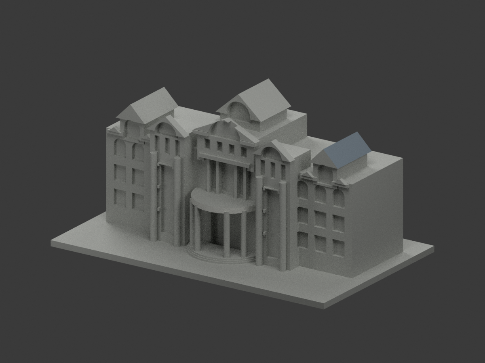
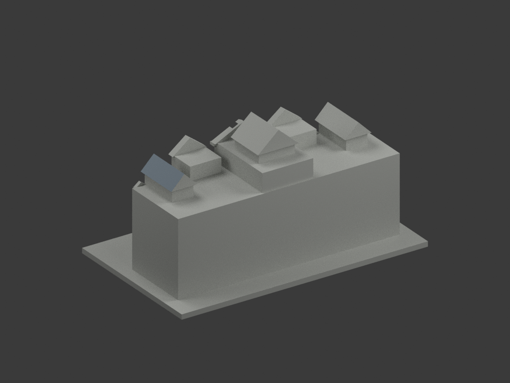
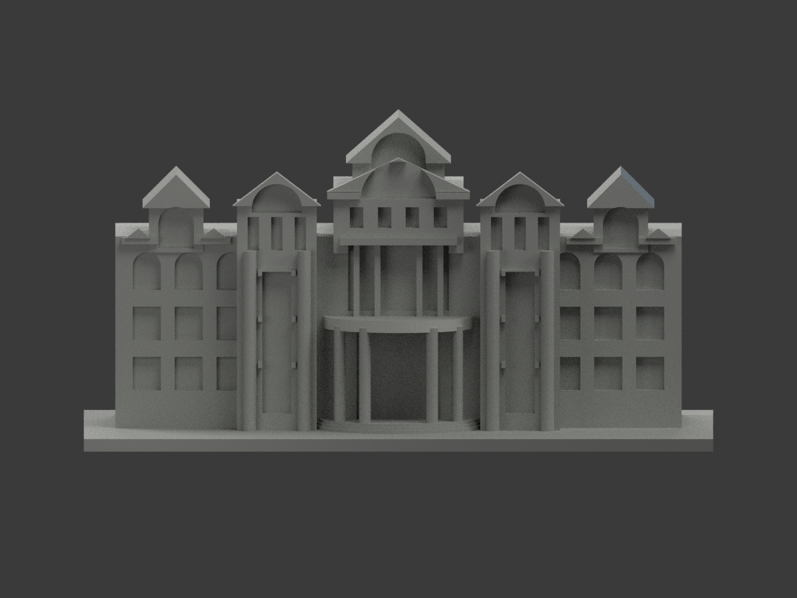
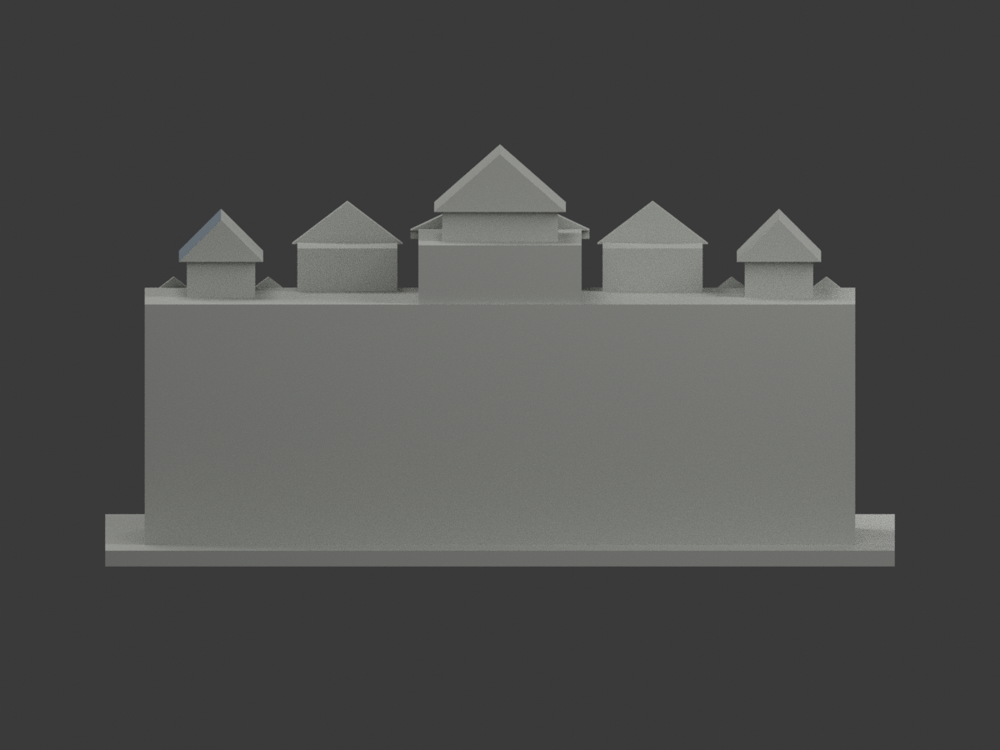
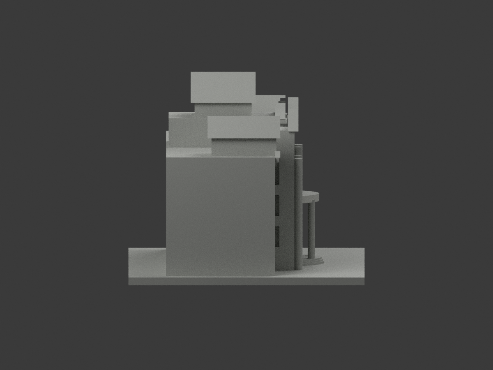
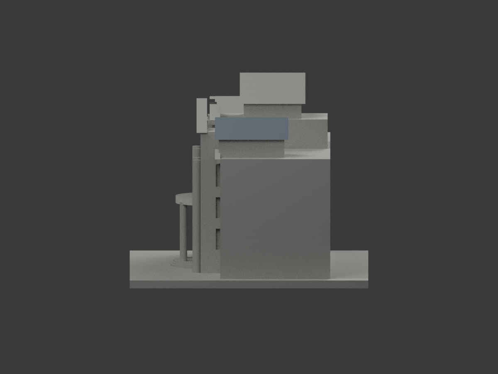
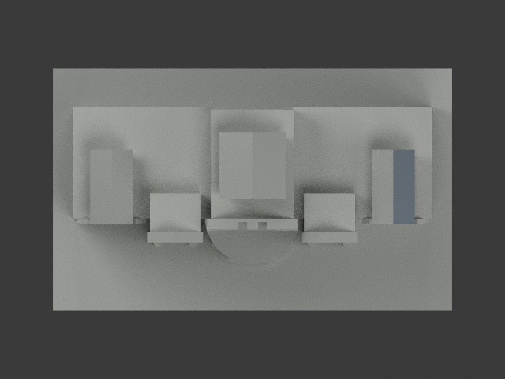
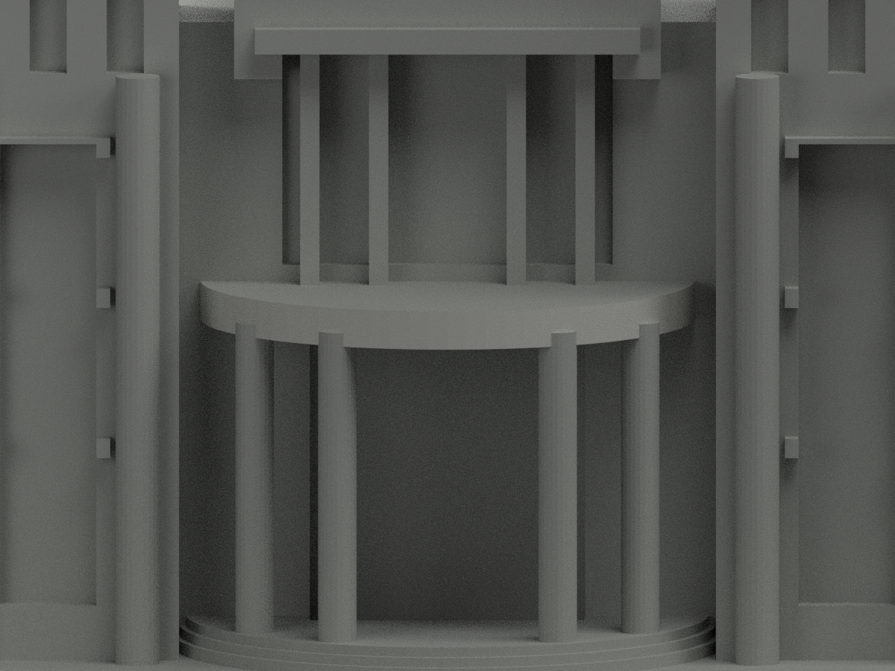
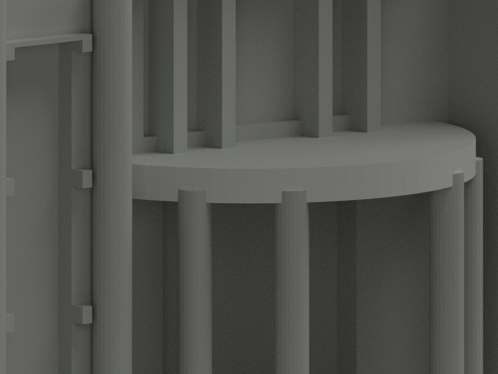
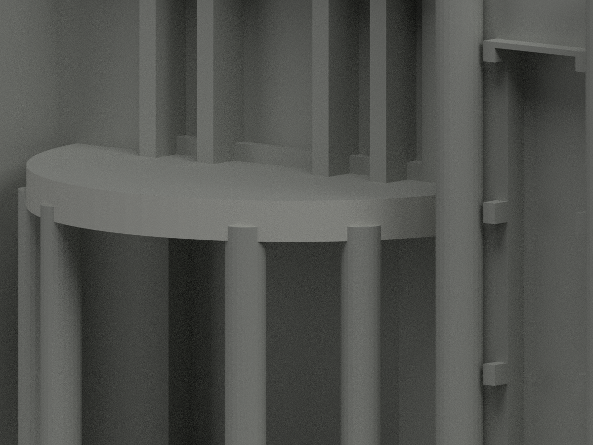

景文設計 L｜右端屋亭右斜坡有限灰藍補色

僅原[3426,3433]兩面完整斜平面，x+z116.7、x53..61、y−13..15。原96白保留，新增2灰藍，98外觀色／3966中性／4064三角；原2palette及所有未選索引精確不動，新增index2名義#84919B非校準色票，0混域。原STL/build與工程限制保留，原無OBJ，不新增。

原官方高斜照片再次實看及精確hash核，不是新拍或2026現況。右端亭右坡灰藍皮與白前山牆、白立檐可分；低解析只支持有限屋皮色族，不逐瓦認證，不延伸其他亭/左坡/山牆/白檐/庇頂底/柱牆。原16×28×8坡代理尺寸非測繪認證。照片日期未知；21幅新讀官方環境照片實看均室內，非新增外觀色證。來源私人；SOURCE pending為固定階段快照審後不回寫。

## 原版歷史說明

# 景文科技大學設計大樓 L｜半圓門廊前立邊局部白色

**局部補色未完成：僅半圓門廊雨庇前外垂直皮96原三角名義白；柱、屋頂、混材牆與其餘面尚未分色。** partial_color_incomplete=true、fully_colored_exterior=false。同項 just-design-l／count_delta=0，景文科技大學校本部。英文身份 JUST Design L partial color。

**保留既有v3原三座真坡屋亭、前山牆薄板與塔量體，沒有因新色源改造屋頂或新增細節。原照片估測尺度/粗化不因補色成為測繪。**

| 前斜視 | 後斜視 | 正面 |
|---|---|---|
|  |  |  |
|  |  |  |
|  |  |  |
|  | | |

## 完整原面與材色

從原80邊柱雨庇中心(0,−10)、半徑18、z27..29.8重算40..79每一弦平面，全部三頂點距離≤0.0001mm；逐無限平面枚舉與有限切向0..弦長/z範圍/y≤−11完全一致，不按中心點或normal漏碎面。8個交柱facet47/48/53/54/65/66/71/72各4原Boolean三角，其餘32facet各2，共96；兩端40/79保留原union截斷，不新增裁切。全共面域材色一致，原4064三角不變、3968面中性。

正面官照顯示連續名義白外立邊，高斜照補身份。頂面/底面/背半與背板全中性，不由陰影染黑或向後鏡色。柱有基座/箍帶/旗幟及附設物未分界，不全白。主牆混淺牆深base/石下翼/窗與設備不整白；玻璃混框、室內及反光不整藍黑。三座坡亭、前山牆板、階與未核後面全部中性。中性不是實景灰，資料覆蓋界線不是真實材料接縫。

## 日期與範圍

近照EXIF DateTimeOriginal為2017:09:16 15:35:24，無獨立時區/時鐘驗證；修改欄2022:10:17 17:11:26不是拍攝日期。高斜照無capturemetadata，不稱2026現況。官方273PNG插畫不作取色實照。保單一設計大樓原範圍/估測厚化，不增加模型數；照片僅私人研究，不公開貼圖或推定商用權利。

## 檔案與 QA

原STL/build與4064三角座標拓撲字節保留；immutable17件無OBJ，原builder隔離生成OBJ僅私存，不冒稱原repo有OBJ。原README.zh-TW.md保存在ORIGINAL-MONOCHROME-README.zh-TW.md，舊單色QA/圖保留，原scene私人保留。兩展示材appearance.3mf與scene.blend實際面材保持原形；export/validate/render/verify及真3MF/scene身份 JUST Design L partial color。

精確依賴隔離原build+color、閉合正體積、3MF座標/面材、Blender重開、十張1200×900與原件保留檢核；重建保留不刪，未試印或驗多料切片，STL本身無色。

## English limitations

JUST Design L partial color. Original4064triangles unchanged:96offwhite front curved portico vertical faces,3968neutral. Recompute original80gon centered(0,-10),radius18,chords40..79;whole infinite planes equal finite tangent/z/y domains. Eight column-intersection facets retain4Boolean triangles each,other32facets2each;no normal/centroid cutoff. Preserve originalunion-trimmed endfacets andv3truepitchedroofpavilions. Cap top/under/rear,columns/bases/fixtures,mixed walls/glass,roofslopes/steps unknownneutral. ClosephotoEXIF2017:09:16 15:35:24 withoutverifiedtimezone;2022modifydate notcapture,otherphoto unknown,no2026claim. Original17files,noOBJ,originalChineseREADME retained,count_delta0,no publicphotos/geometrychanges/testprint.
