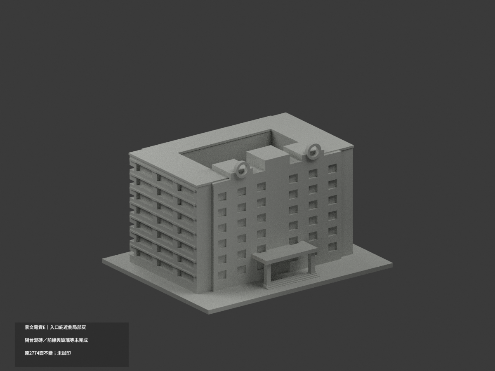
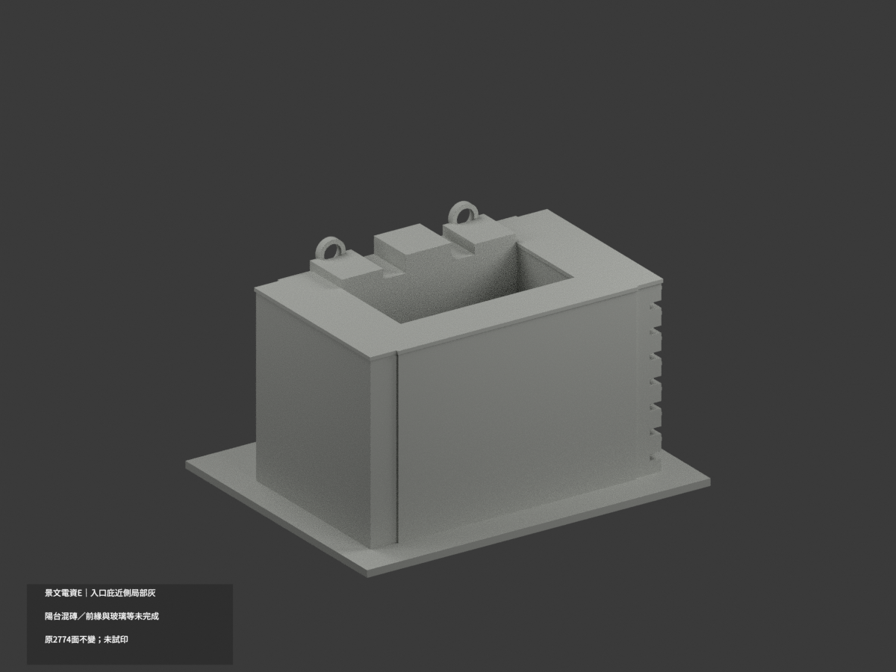
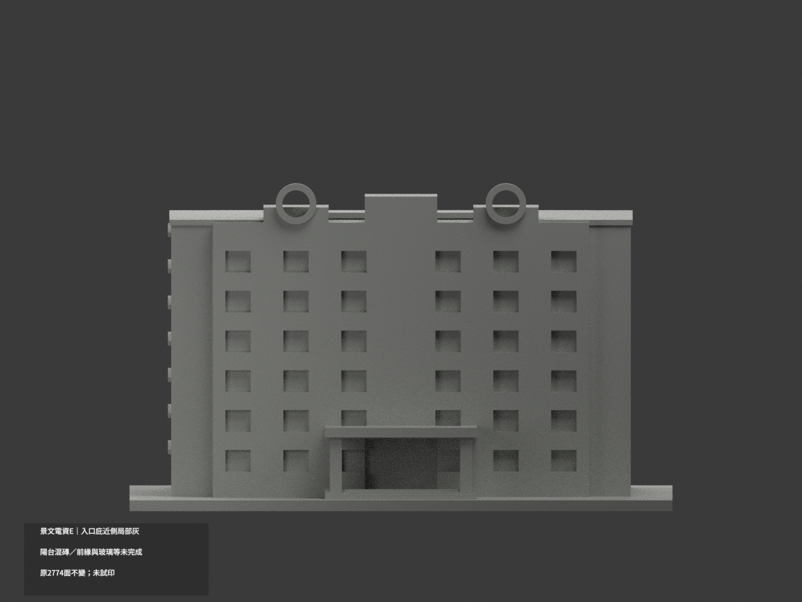
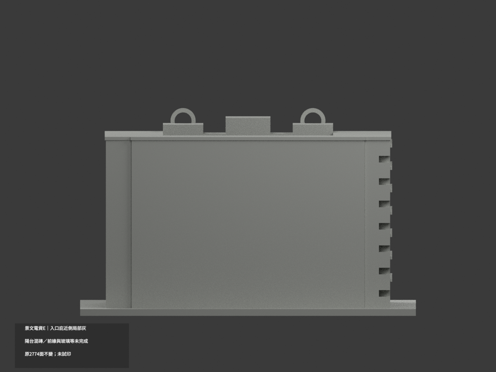
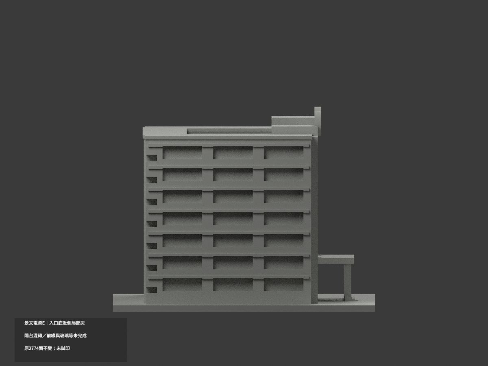
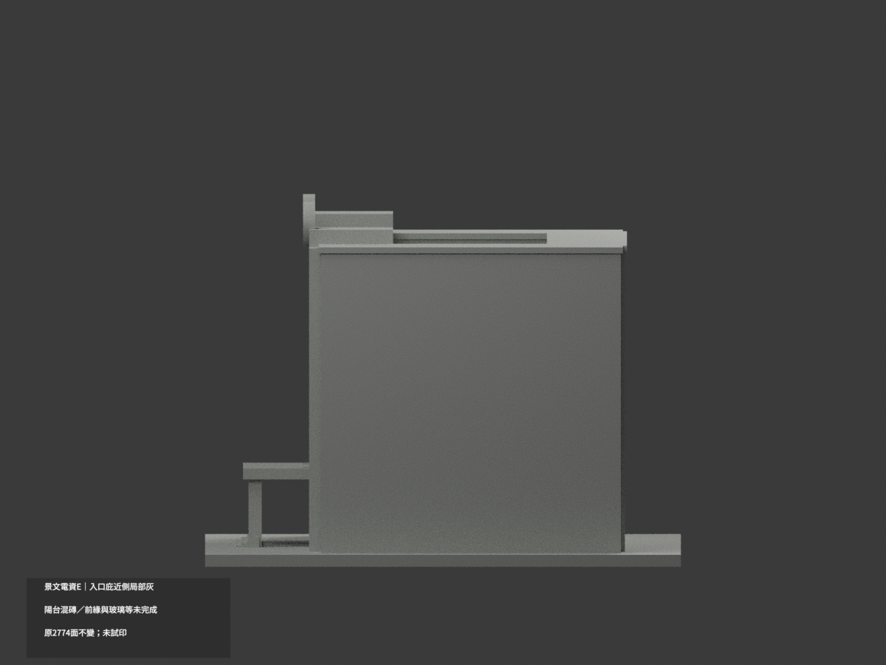
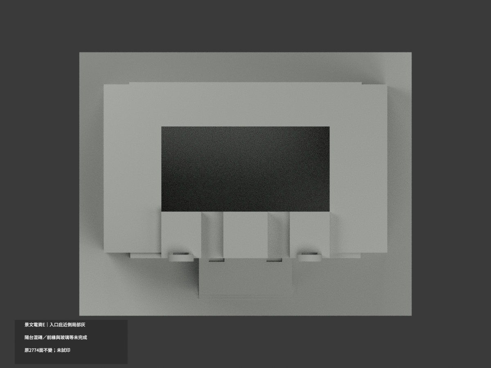
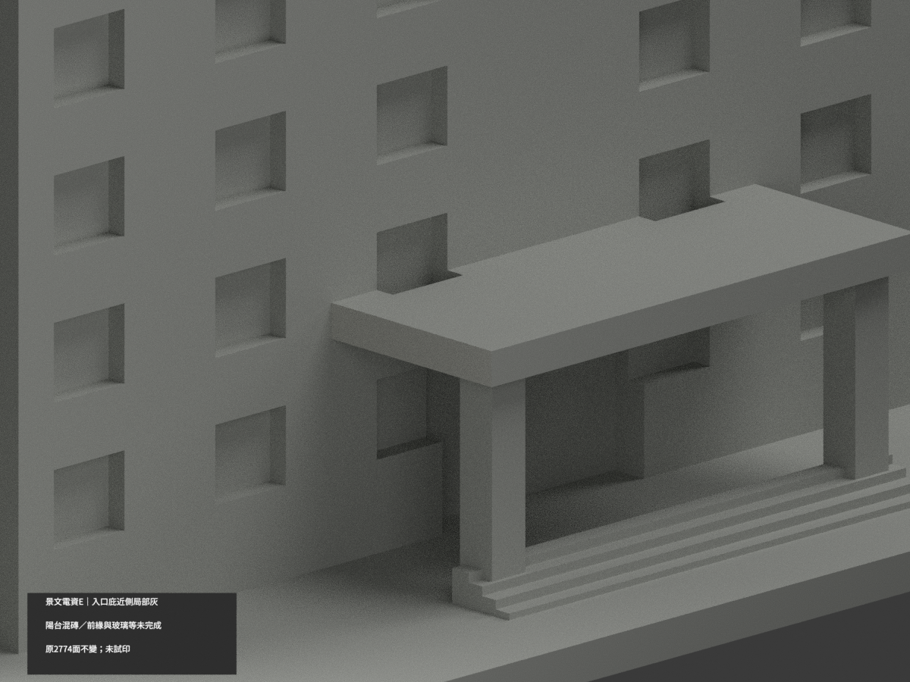
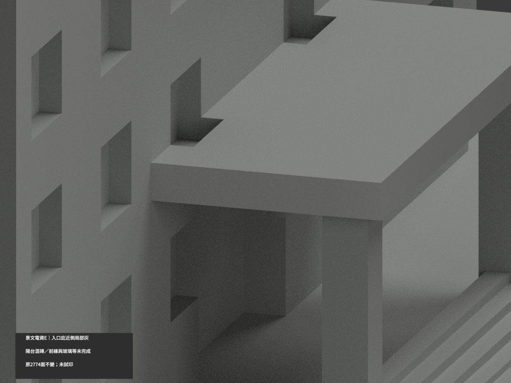
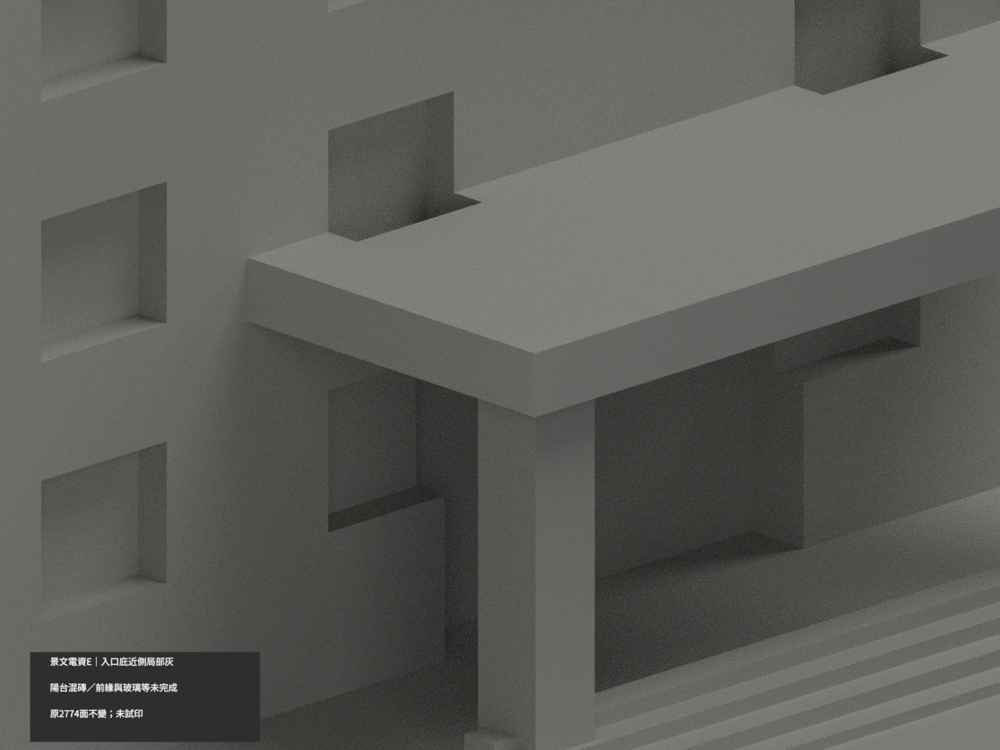

# 景文電資館E｜入口雨庇近側局部淺灰

**陽台混磚、雨庇前緣與玻璃等尚未完成分色。** partial_color_incomplete=true、fully_colored_exterior=false。僅近側雨庇完整立邊2面名義淺灰，非全館完整補色。

| 總覽 | 背側 | 正面 |
|---|---|---|
||||
||||
||||
||||

## 材色範圍
同 just-electronics-e 原項目，same-item、count_delta=0。景文科技大學校本部電資館E，原2774三角及STL/build_model.py字節不變，17原件無OBJ；code可輸出重建OBJ不代表存在原件。
- 整x=-21平面19三角分兩完整共邊域。只選雨庇近側y=-50..-33.5,z20..22.7完整矩形2面；另一17面階側全中性。全3頂點有限界及整連通域核，沒有人工截色。
- 其餘2772面中性：前緣末端被樹遮、對側、頂底、掛物柱、粉磚白帶混面陽台、窗框設備反光與玻璃、屋背階底。暗天花不是黑色材料。
- 官273立圖只是原形體部分參考，不是本次色證；不擴染整前立面對稱。名義淺灰非校準色票，色界為證據範圍，保原中庭/照片推估幾何不追認精度。

## 來源與日期
親看官方斜向實景照片，拍攝日期未知，不稱2026現況。原照私人保存、不公開、不作紋理、不建人物；未確認CC或再散布授權，不保證商用。

## 格式與列印
[原STL](model.stl) · [逐面材色3MF](appearance.3mf) · [Blender](scene.blend)
150mm底座為原示意尺寸非測量比例。物件明名 JUST Electronics E partial color，獨立核真slug/館名。STL無色，3MF/Blender逐面分材，不是兩色或四色耗材切片驗證，未實際列印。

## 重建與 QA
原build_model.py → colorize_model.py → export_appearance.py → validate_color.py；Blender render_color.py／verify_color_scene.py。完整隔離Shapely2.1.2精確原build＋color重建、原bytes/全三角multiset、共面均一、閉合正體積、3MF面材、scene重開、十圖1200×900與hash。原README/previews/validation保留歷史，不冒新QA，不刪檔。

## English scope
Partial only:2 original complete near-side canopy vertical edge triangles pale gray;2772 neutral. Whole x=-21 plane19 triangles in2 components, canopy2 selected and unrelated stair17 neutral. Front extent tree-obscured, opposite edge/top/underside, mixed pink-white balcony bands, windows, columns and illustration-only front composition neutral. Original2774 triangles and17 immutable files unchanged;no originalOBJ. Capture date unknown,not2026 survey; sameitem/count0/no geometrychanges/no filament test.
