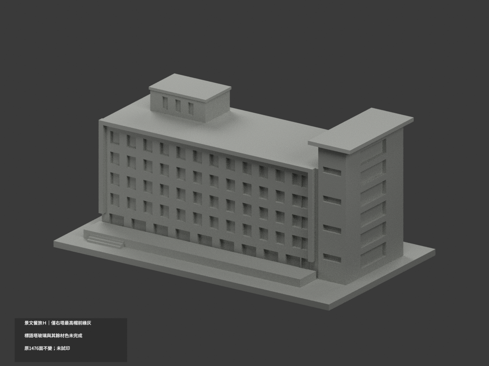
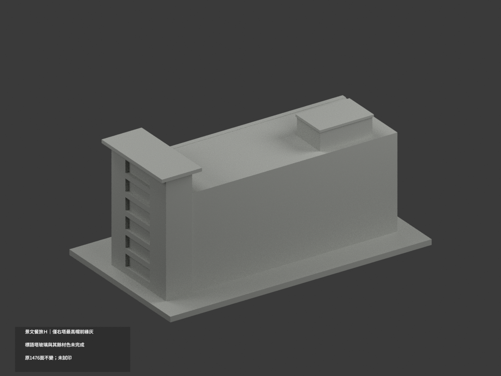
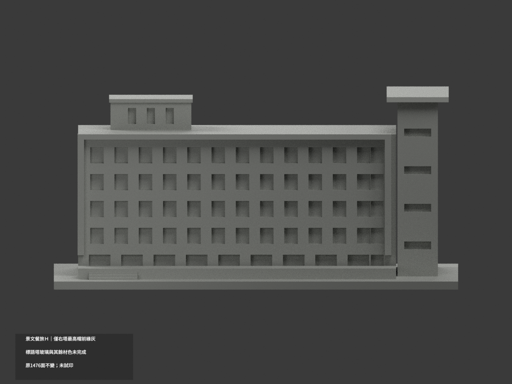
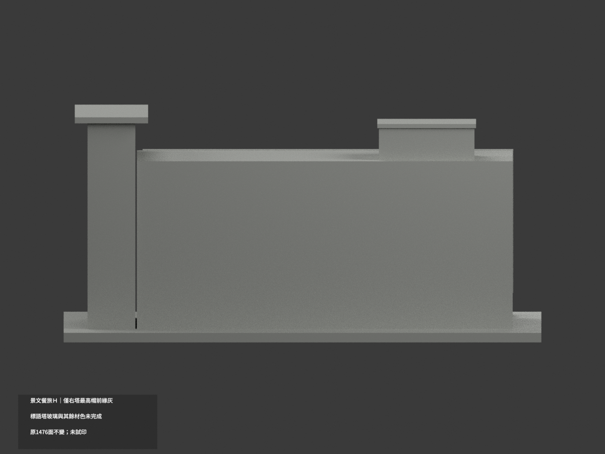
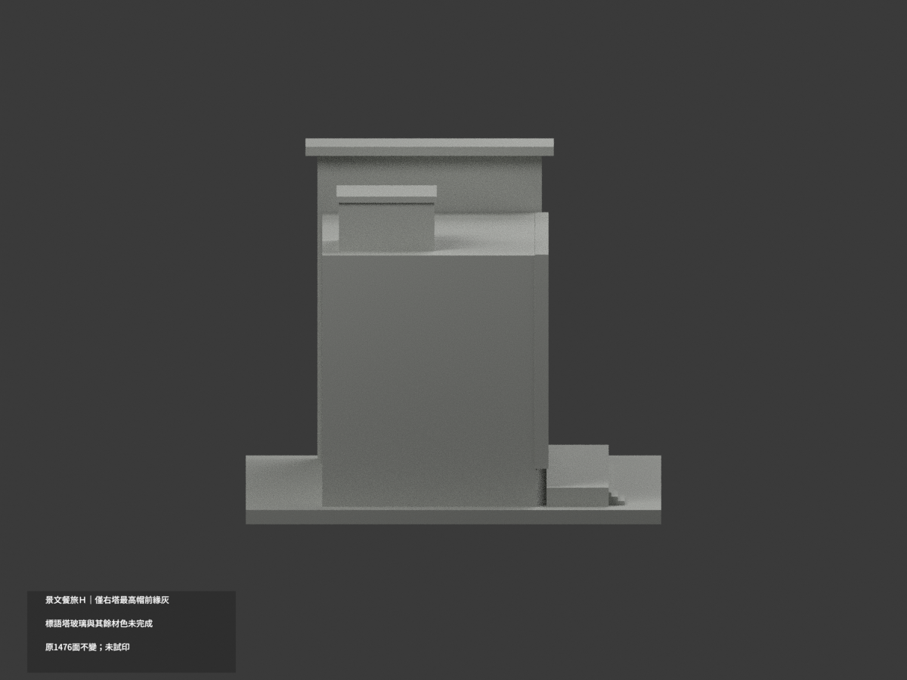
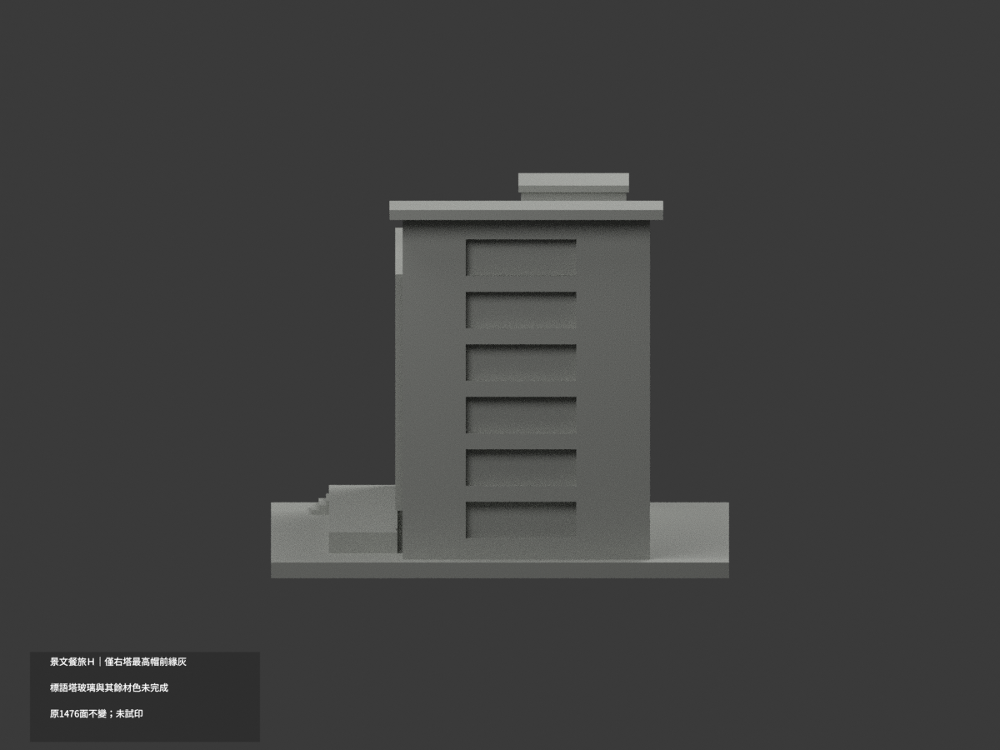
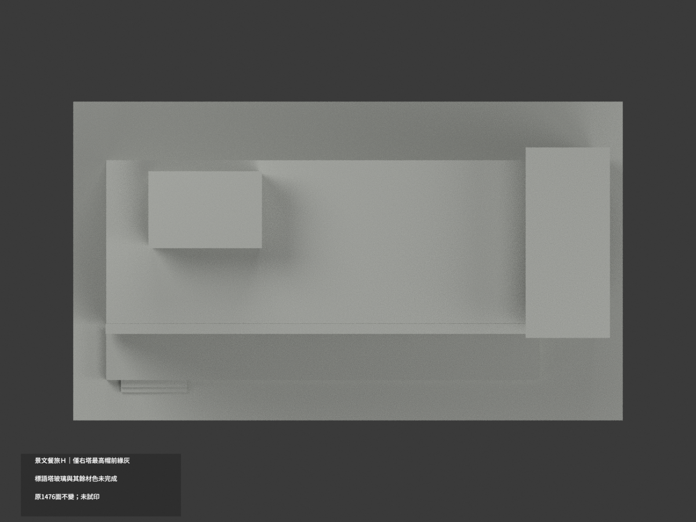
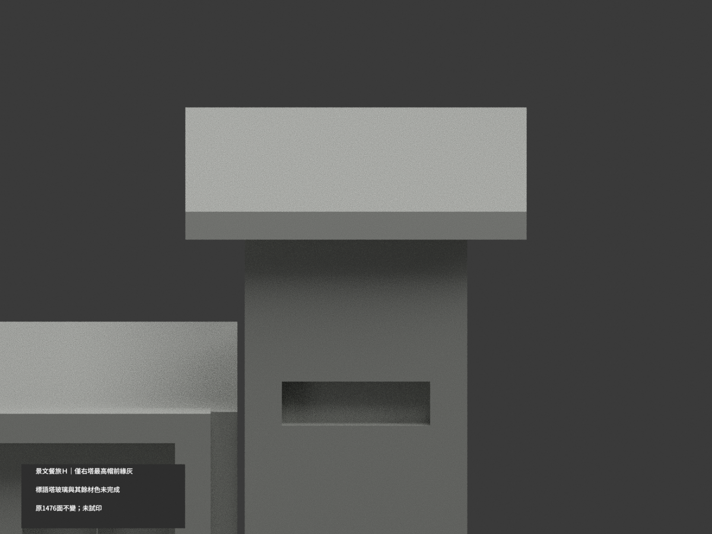
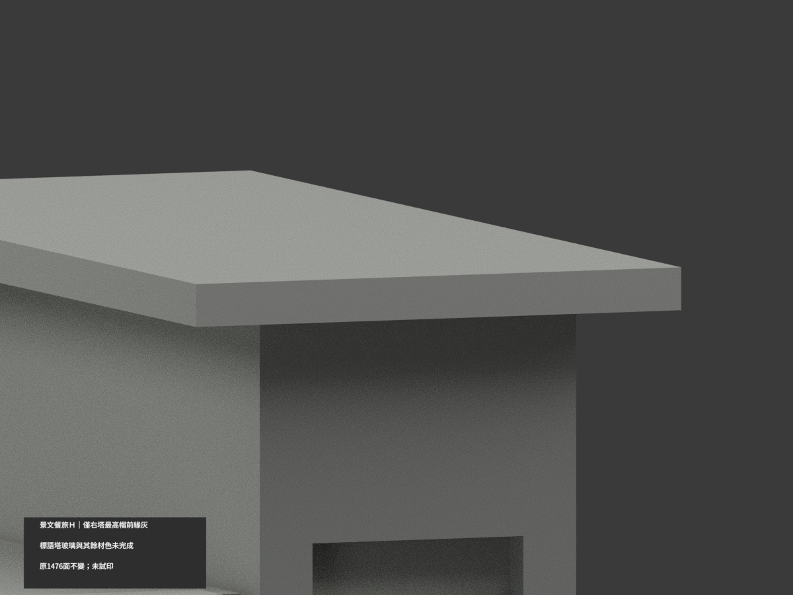
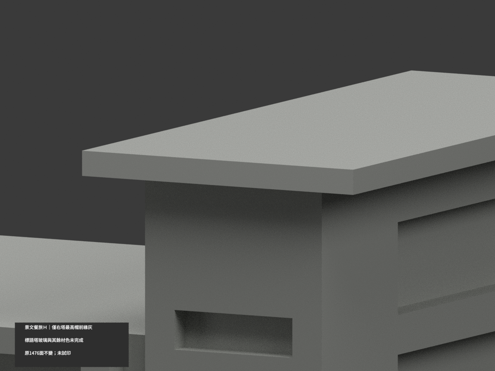

# 景文科技大學餐旅學院 H｜右塔最高帽前緣局部淺灰

**局部補色未完成：僅右側交通塔最高帽完整前緣2原三角淺灰，標語塔身、玻璃、屋面與其餘面尚未分色。** partial_color_incomplete=true、fully_colored_exterior=false。同項 just-hospitality-h／count_delta=0，景文科技大學校本部。英文身份 JUST Hospitality H partial color。

**同一座餐旅學院 H 的既有五排窗外觀近似，保留原估測尺度、加厚與簡化，不含後方相鄰建築，不因補色追認測繪。**

| 前斜視 | 後斜視 | 正面 |
|---|---|---|
|  |  |  |
|  |  |  |
|  |  |  |
|  | | |

## 完整原材域

全原三頂點y−21無限平面0.0001mm枚舉只有2面、共享邊一完整矩形。全域後記錄x48.5..71.5、z68..69.9000015，不以bbox裁片、不按normal/centroid選半面。2名義淺灰、1474中性，原1476三角不變且共面連通域一致。

官方高斜實照可見右塔帽前長緣與兩端；不由此推頂皮、底皮、側返、支撐或後面。右塔有標語字牌與窄窗不整灰，玻璃側返混框不整藍。主五排立面有框、空調、牆色與低層變化，原材界不足不整米色；屋頂機房、露臺景觀代理、階與底板全中性。中性不是實景灰；資料覆蓋界線不是真實材界。官方273PNG示意插畫不作色證。

## 日期與原始限制

唯一官照無可核DateTimeOriginal，保官方版面框，不以發表文案推拍攝日，不稱2026現況。原照片估測/未知後面/簡化原型限制繼續保留，不增加精度或開口。照片僅私人研究，不公開原照或貼圖，不推定商用權利。

## 檔案與 QA

原STL/build與1476三角座標拓撲字節不變，immutable17件無OBJ；原程式隔離生成OBJ僅私存，不冒稱原repo有OBJ。原README.zh-TW.md另存ORIGINAL-MONOCHROME-README.zh-TW.md，舊單色圖/QA保留、原scene私人留存。兩展示材appearance.3mf與scene.blend實際面材保原形，export/validate/render/verify及真3MF/scene身份 JUST Hospitality H partial color。

精確依賴隔離原build+color、閉合正體積、3MF座標/面材、Blender重開及十張1200×900檢核；保留重建不刪，未試印或驗多料切片，STL本身無色。

## English limitations

JUST Hospitality H partial color. Whole original infinite y=-21 plane gives2triangles in one complete uppermost tower-cap front rectangle; exposed x48.5..71.5,z68..69.9000015 recorded after enumeration.2nominal lightgray,1474neutral,1476originaltriangles unchanged. Cap top/under/returns/supports/back,lettered tower,glazed framework,mixed mainwall/AC/window details,roof/terrace/stairs unknownneutral. Only actual official oblique photograph,not schematic illustration;captureunknown/no2026claim. Samebuilding notbackgroundneighbors,count_delta0,no geometry changes. Original17files contain noOBJ and onlyChineseREADME; generatedOBJ private,no publicphotos/testprint.
