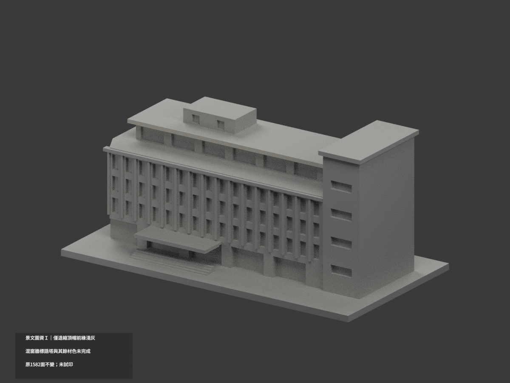
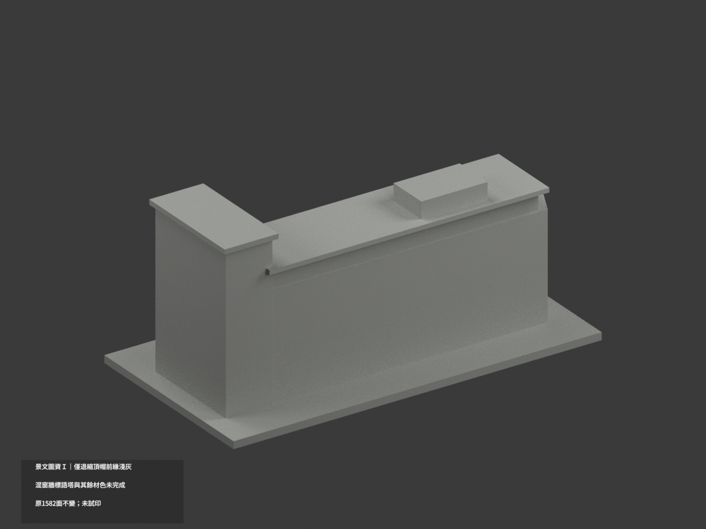
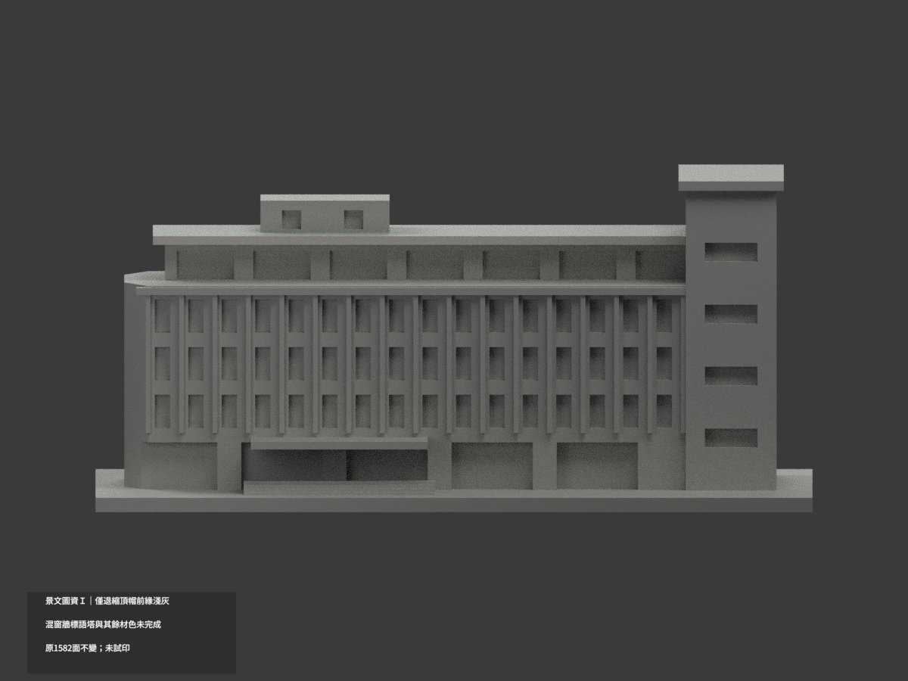
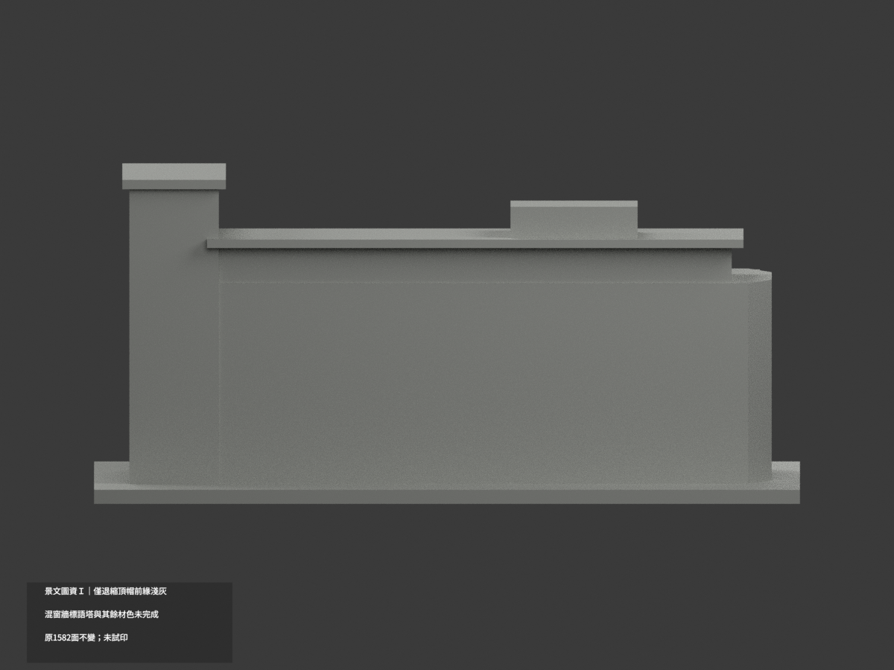
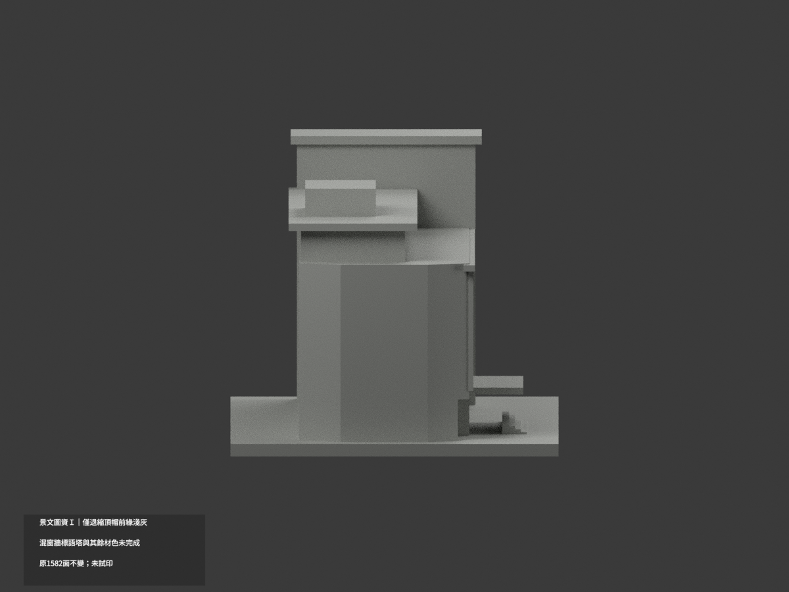
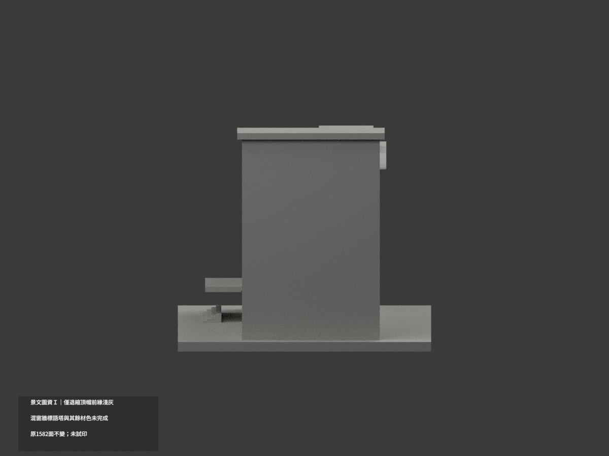
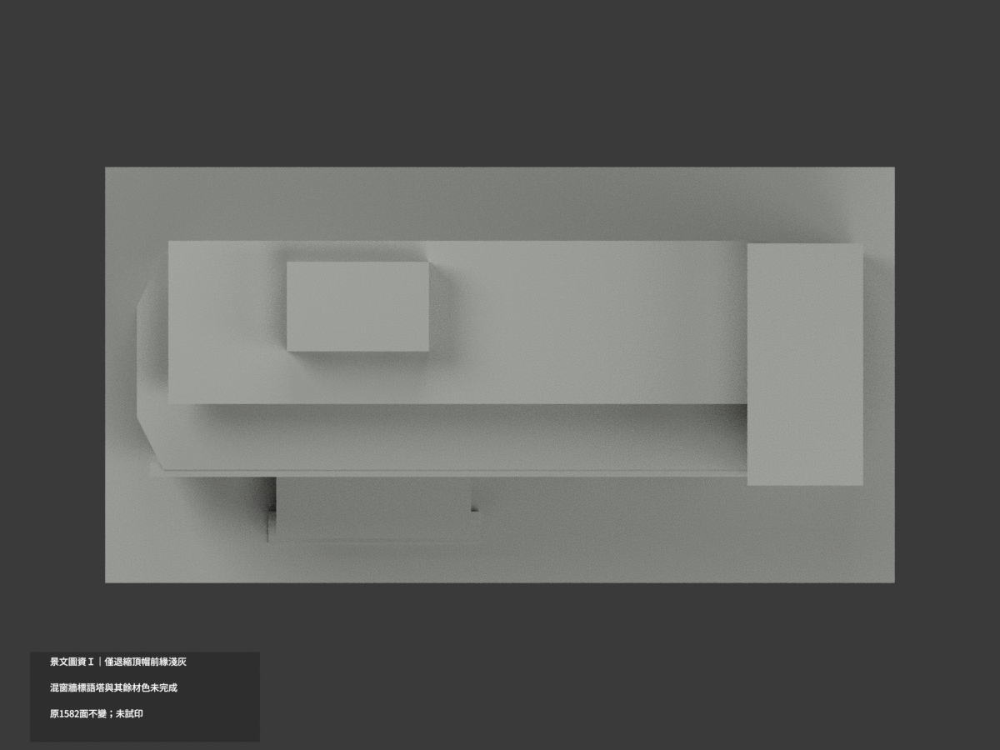
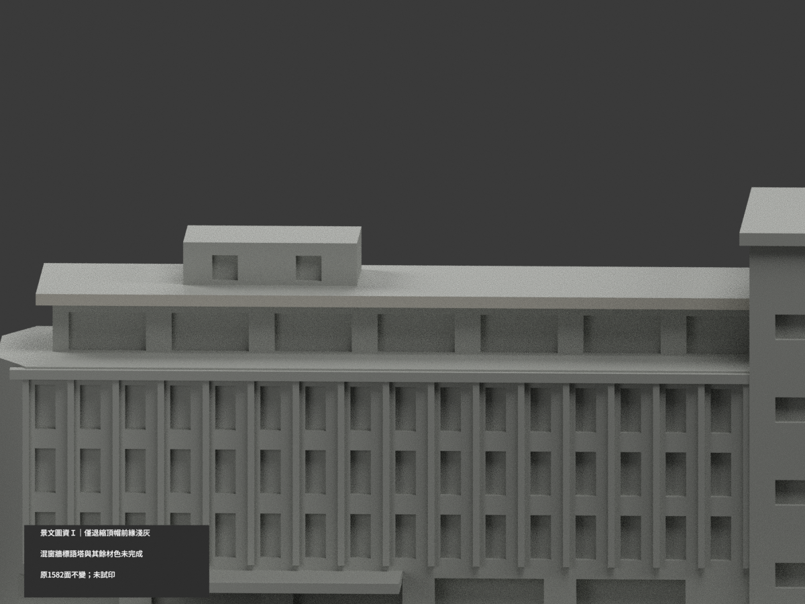
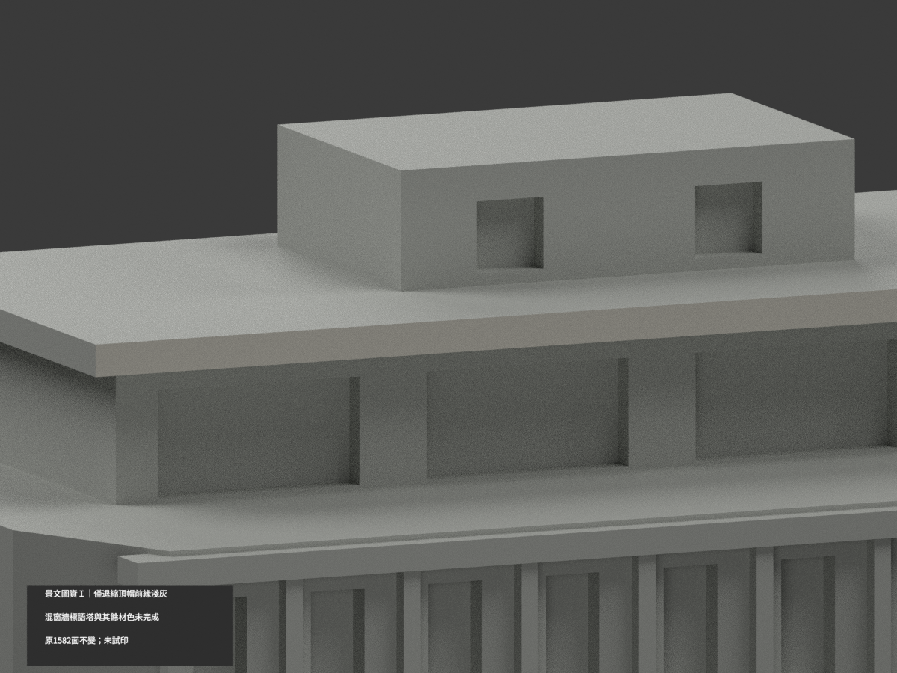
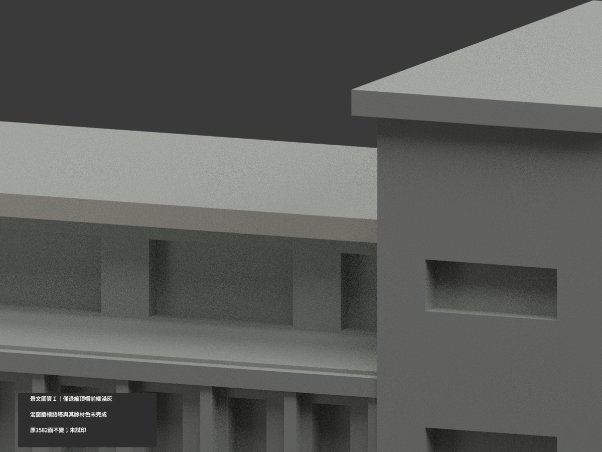

# 景文科技大學圖資大樓 I｜退縮頂帽前緣局部淺灰

**局部補色未完成：僅退縮頂層長帽完整前緣2原三角淺暖灰，混色窗牆、標語塔、屋面與其餘面尚未分色。** partial_color_incomplete=true、fully_colored_exterior=false。同項 just-library-i／count_delta=0，景文科技大學校本部。英文身份 JUST Library I partial color。

**同一座圖資大樓 I 的既有外觀近似，保留原照片估測尺寸、粗化格窗及未知後面留白；補色不追認測繪或2026現況。**

| 前斜視 | 後斜視 | 正面 |
|---|---|---|
|  |  |  |
|  |  |  |
|  |  |  |
|  | | |

## 材色範圍

全原三頂點y−5.5無限平面0.0001mm枚舉，只有2面、共享邊單一完整矩形。枚舉後實露範圍x−63..48.5、z53.5..55.299999；原設計板到x51但最後2.5mm與右塔union，不補不存在外面、不裁真接點。2面名義淺暖灰，1580中性，原1582三角不變。全共面連通域材色一致，不normal/centroid或亮度切三角。

官方高斜實照直接支持長帽前緣淺灰族；另一實照補身份，不擴屋面/側面證據。不使用PNG插畫校色。板頂、底、側返與背全部中性；三列屏牆混淺板、深窗與框，沒有完整原材界不整白或整黑。右塔多色標語/字牌未建模，不整灰。植被遮擋的底柱、入口棚、低牆與階、屋房、露臺未知皆中性。中性不是真實灰；資料界線不是真實材料接縫。

## 日期與原始限制

兩官方實照DateTimeOriginal未知，保官方版面框，不以發布文案當拍攝日期，不稱2026現況。保原地圖/照片估測、加厚框柱、未知後面空白限制；未改形或增添字樣。照片僅私人研究，不公開原圖或貼圖，不推定商用權利。

## 檔案與 QA

原STL/build與1582三角座標、拓撲、字節保留。immutable17件無OBJ，原程式可生成OBJ但隔離產物僅私存；不冒稱原repo有OBJ。原README只有README.zh-TW.md，另存ORIGINAL-MONOCHROME-README.zh-TW.md；舊單色圖與QA保留、原scene私人保存。兩展示材appearance.3mf及scene.blend真面材保原幾何；export/validate/render/verify及實際3MF/scene身份 JUST Library I partial color。

精確依賴隔離原build+color、閉合正體積、3MF座標/材域、Blender重開與十張1200×900檢核；重建留存不刪，未試印或驗多料切片，STL本身無色。

## English limitations

JUST Library I partial color. Only the complete original upper setback cap front edge receives nominal pale warm gray:2faces,1580neutral,1582originaltriangles unchanged. Whole infinite y=-5.5 plane enumeration yields one connected rectangle; exposed x=-63..48.5 andz53.5..55.299999 are reported after enumeration,not crop limits. Original union with the right tower hides the rest of the designed slab; no face addition. Top/underside/returns/rear,mixed screen windows/panels,sign tower,ground columns,canopy,roof room and unknown rear remain neutral. Actual official photographs only,not schematic PNG; capture dates unknown,no2026claim. Original17files have noOBJ and onlyREADME.zh-TW.md; isolated generatedOBJ private. Same libraryI building,count_delta0,no geometry changes/public photos/testprint.
