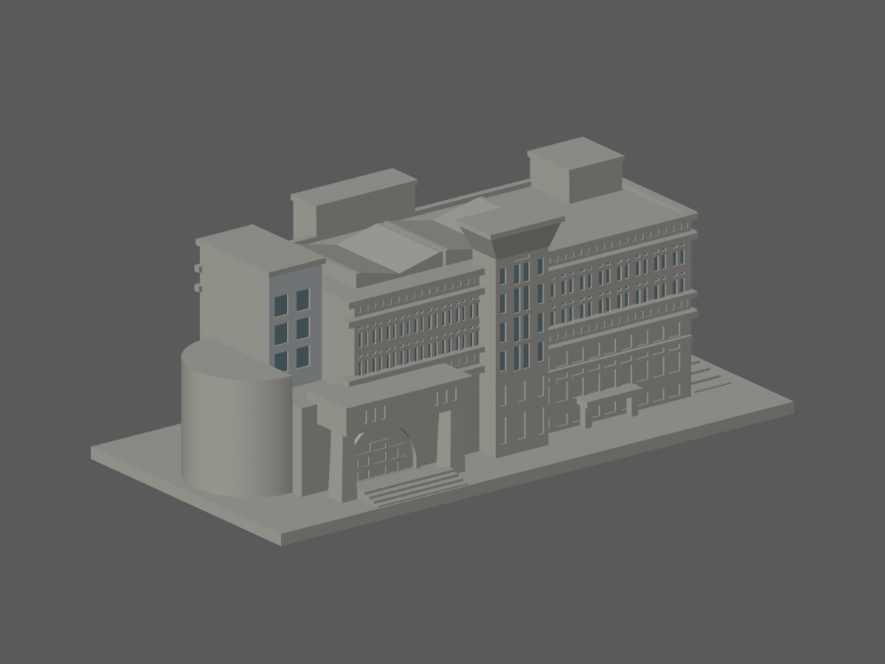
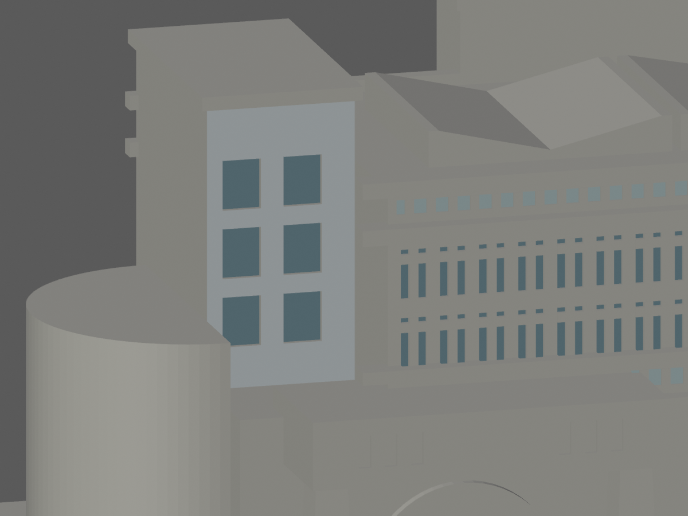

# 朝陽科技大學波錠紀念圖書館｜側端高牆局部補色

[彩色 3MF](appearance.3mf) · [可編輯 Blender](scene.blend) · [原 STL（無色）](../model.stl) · [原窄域窗背版](../appearance/README.md)

僅新增半圓端上方較高退縮量體的一片灰色外牆。這片牆在模型呈朝前的退階側端面，並非把主立面或整面背側塗灰。以未校準的淺冷灰 `#B5BABB` 近似實照中的淺冷灰粒面，不判定實物石材品種或塗料規格。原 438 個已彩窗背與所有 7,254 個三角幾何、STL、原代表圖不變；其餘 6,771 面仍用未知中性展示色。本件不增加建築或套件數。

| 補色總覽 | 側端細部 |
|---|---|
|  |  |
| 完整模型與底座，無文字。 | 裁切僅供面域檢核；原六個窗背及其窗返不改。 |

## 面域與來源

- [面域](domain-core.json) 是 `y=-7.22891569 mm` 上的唯一完整連通外牆，法向 −Y。外矩形扣除六個原窗洞，共 45 個原三角、323.05678 mm²。只換材，不加面、不改材縫或做貼圖。
- 校方高解析斜照 0001 可辨入口左後的側端高牆三列窗。另一個距地面較近的校方 720 環景管理大樓節點露出此壁和窗，呈灰色粒面，不只是陰影。管理大樓廣場節點用來對位半圓端；其灰上帶與紅下壁在原模型沒有獨立材界，均不染。2025 防災表照片僅輔助核同棟，不作完整第二側測量。
- 仍持原縮尺和幾何簡化；窗框、原窗凹背、半圓端、相鄰主立面、凹返、其他側後面、屋頂與底座都不延伸分色。來源年代不一；原高解析照 EXIF 自述 2015 無時區，環景 XML 註記不當攝影日期，都不代表 2026 現況。原照只用於私下觀察，不附檔、不嵌入。

## 驗證與重套色

[交換驗證](exchange-QA.json) · [原生場景驗證](scene-QA.json) · [真實材質修改驗證](native-edit-QA.json) · [逐面材色](face-materials.json) · [校驗和](SHA256SUMS)

從主模型目錄執行 `python side-setback-20261120/build_exchange.py . side-setback-20261120` 重建交換檔。原生重套色：

```sh
blender -b appearance/scene.blend --python side-setback-20261120/apply_side_color.py -- model.stl appearance/face-materials.json side-setback-20261120/scene.blend
```

原三材及節點、相機、燈景保存；新材可編輯。場景 RNA 比對排除 Blender UV Sculpt 與執行期欄位，原空 Render Result 快取不是模型資產。舊製造 QA 及其例外不因改色而改變；未實際切片或試印。
