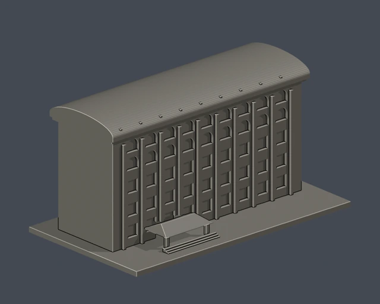
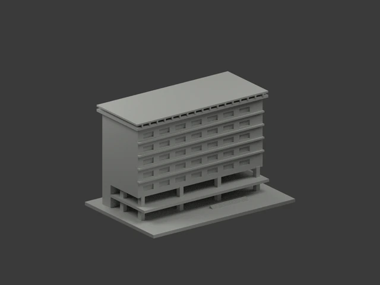
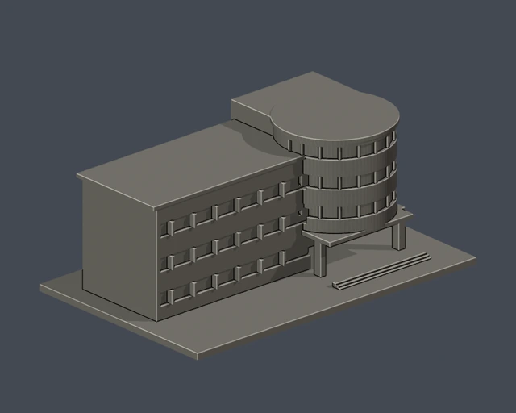
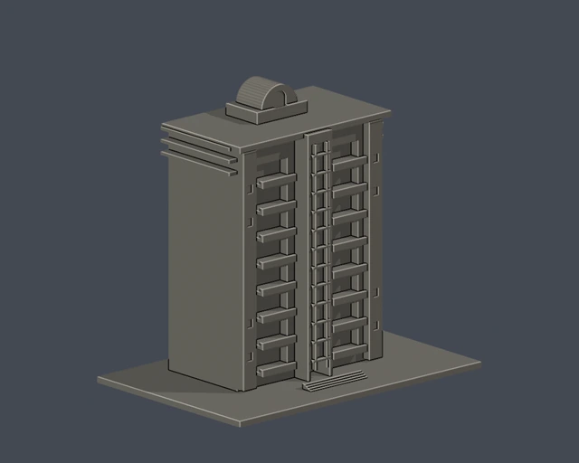
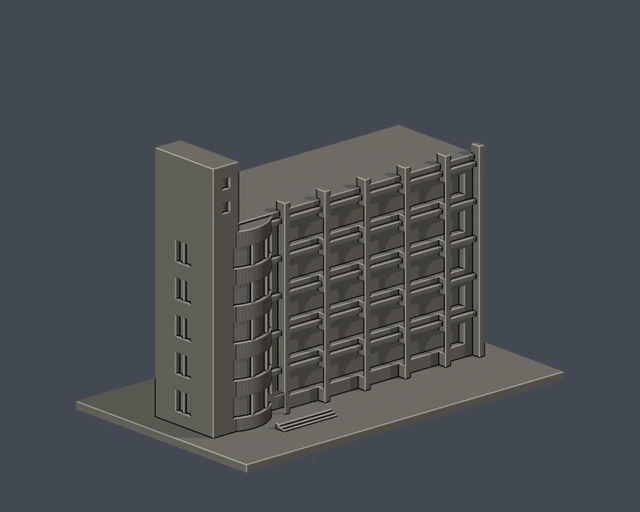
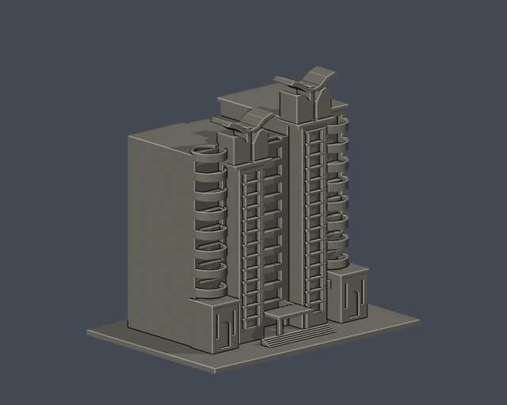
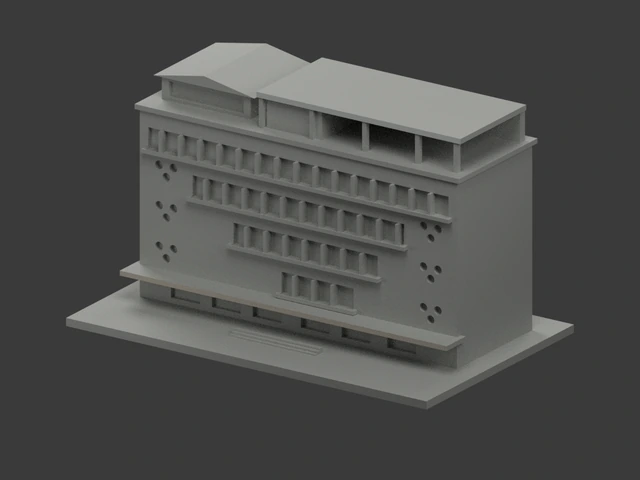
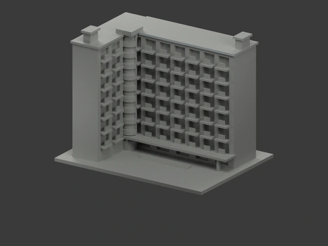

# 美和科技大學 校本部

本輪核准的外觀近似模型套件；全校尚未完成。套件可能包含相連群組、局部或歷史外觀，件數不等於完整建築棟數。未正式切片、未生成經驗證G-code、未實體試印。各件警示、來源年代、背面簡化及支撐需求請讀詳頁。只公開來源URL，不散布原照片或PDF。

| 建築／模型 | 建築／模型 | 建築／模型 |
|---|---|---|
|  [美和科技大學傍興樓（D）](buildings/meiho-bangxing/README.md) [資料夾](buildings/meiho-bangxing) |  [美和科技大學美和大樓（SC）](buildings/meiho-meiho-sc/README.zh-TW.md) [資料夾](buildings/meiho-meiho-sc) [局部材色3MF](buildings/meiho-meiho-sc/appearance.3mf) · [範圍與限制](buildings/meiho-meiho-sc/README.md) |  [美和科技大學仁發樓（C）](buildings/meiho-renfa/README.md) [資料夾](buildings/meiho-renfa) |
|  [美和科技大學商學大樓（E）](buildings/meiho-business-e/README.md) [資料夾](buildings/meiho-business-e) |  [美和科技大學民生大樓（SB）](buildings/meiho-minsheng-sb/README.md) [資料夾](buildings/meiho-minsheng-sb) |  [美和科技大學興春樓／醫護生技大樓（G）](buildings/meiho-xingchun/README.md) [資料夾](buildings/meiho-xingchun) |
|  [美和科技大學基礎醫學大樓（B）](buildings/meiho-basic-medical-b/README.zh-TW.md) [資料夾](buildings/meiho-basic-medical-b) [局部材色3MF](buildings/meiho-basic-medical-b/appearance.3mf) · [範圍與限制](buildings/meiho-basic-medical-b/README.md) |  [美和科技大學致美軒宿舍](buildings/meiho-zhimei-dorm/README.zh-TW.md) [資料夾](buildings/meiho-zhimei-dorm) [局部材色3MF](buildings/meiho-zhimei-dorm/appearance.3mf) · [範圍與限制](buildings/meiho-zhimei-dorm/README.md) |  |
