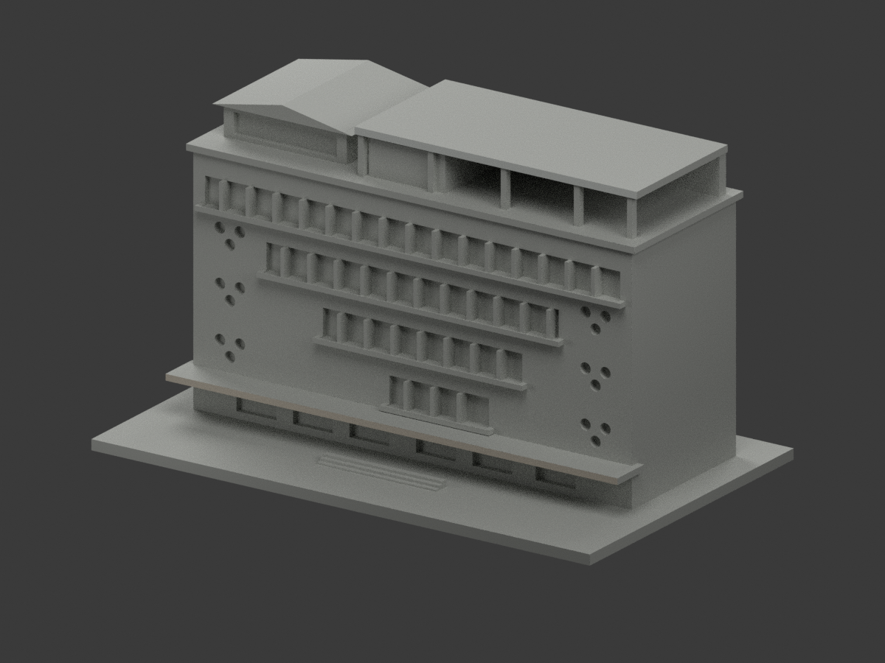
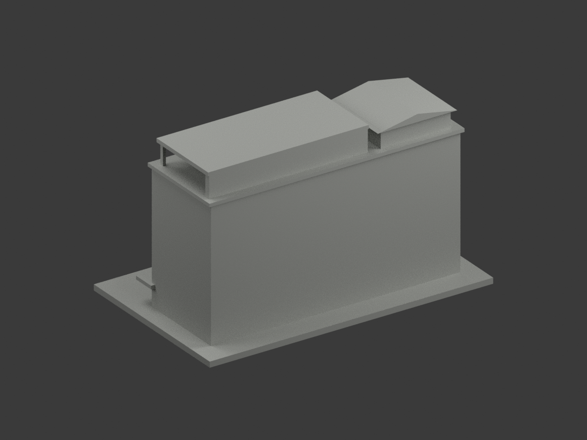
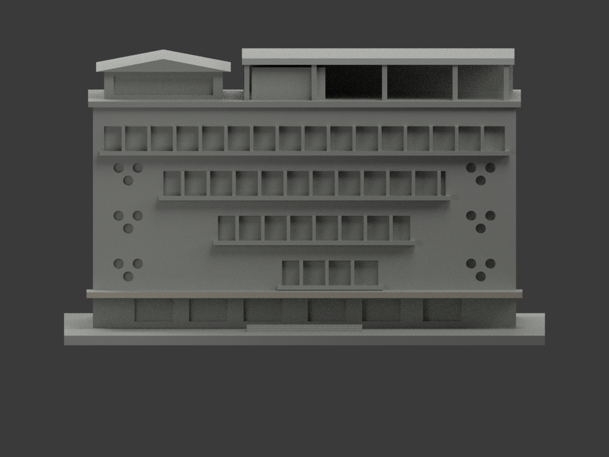
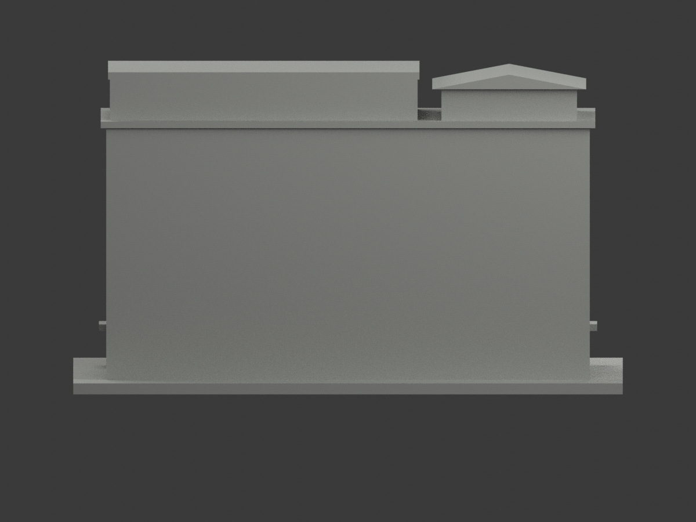
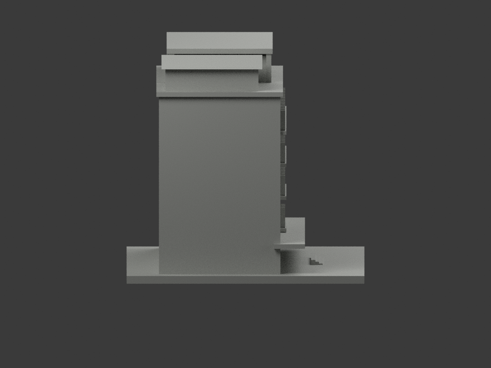
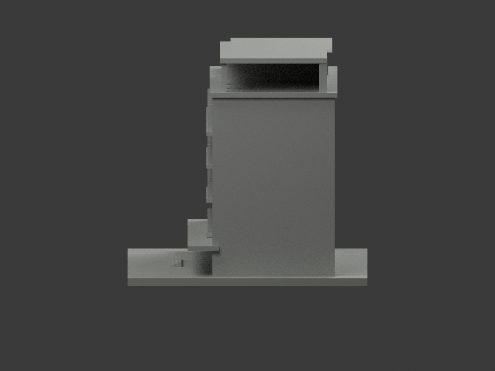
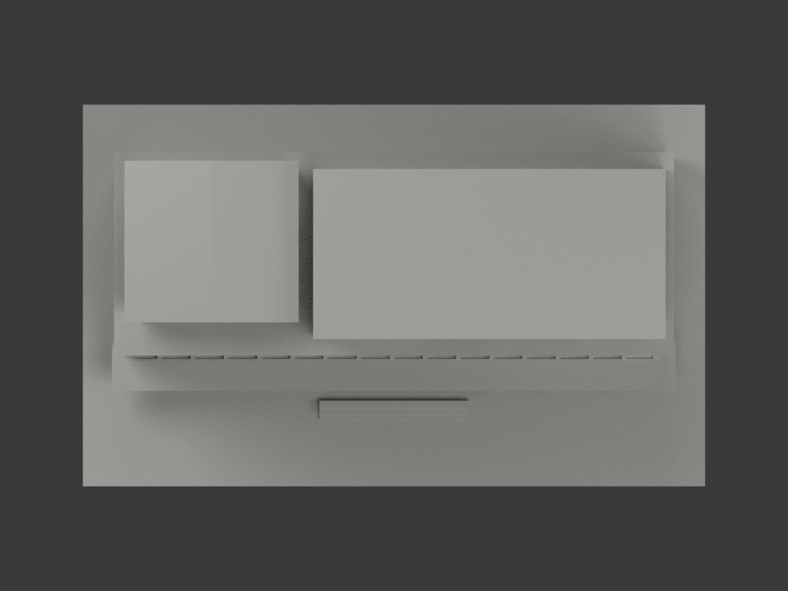
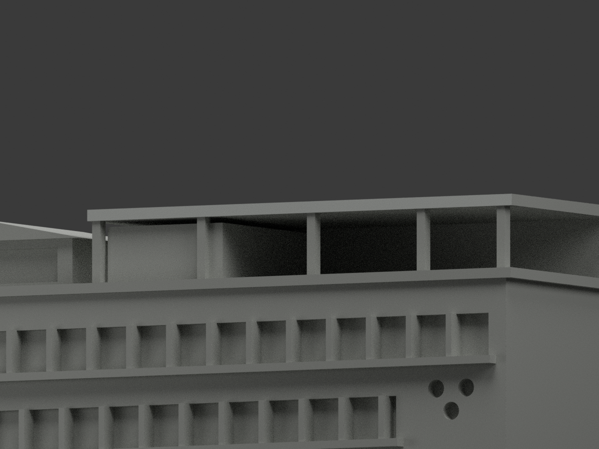
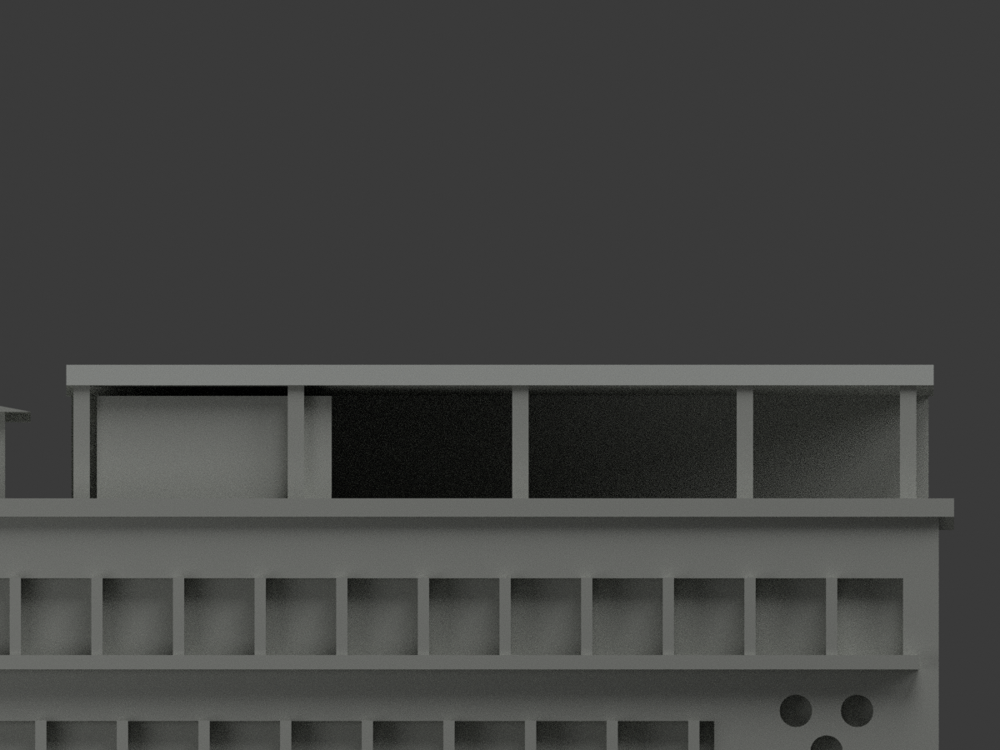
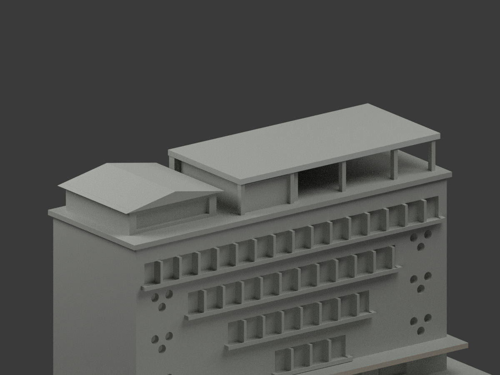

美和 B 基礎醫學大樓｜地面入口庇前薄帶有限補色

只原 [3046,3049] 兩面、一完整共面域，y=-23、x[-68,68]、z13..14.8。原2屋棚前灰保持，新增2暖灰石族，合4色／3332中性／3336原三角。原palette索引0/1與全部未選indices完全保持，新增index2名義#C6BEB1，不是校準色票。0混域，原STL/build不動；原無OBJ，不新增。

新讀官方Piwigo北校區DSC3578公開原幅2240×1488，前薄石帶與下暗底、柱及窗背可分。右段棕櫚局部遮擋，有限同帶連續推定，不誇逐pixel直證；拍攝日未獨立核實，2021上傳路徑非拍攝日期，不稱2026現況。原136×12×1.8代理厚深非測量認證，右鄰白廊與其他棟不可移植。頂底、12深返、其餘屋棚/柱/主牆/窗背不擴。原工程限制與aliases保留，未做多料試印。來源照片私存，SOURCE pending固定階段快照，終審後不得回寫。

## 原版歷史說明

# 美和科技大學基礎醫學大樓（B）｜長頂棚前沿局部淺灰白

**局部補色未完成：只右長頂棚完整前沿2原三角淺灰白；屋面、暗底、主牆與其他材色未完成。** partial_color_incomplete=true、fully_colored_exterior=false。同項 meiho-basic-medical-b／count_delta=0。原repo分類「美和科技大學／校本部」保持不改，原README所述北校區為位置描述，不另搬目錄。英文身份 Meiho Basic Medical B partial color。左右屋頂棚均同一B棟，不拆兩件。

| 前斜視 | 後斜視 | 正面 |
|---|---|---|
|  |  |  |
|  |  |  |
|  |  |  |
|  | | |

## 材色範圍

全原y−10.5無限plane以全部三頂點0.0001mm枚舉，恰2面共享完整對角線，完整x−19.5..65.5,z85..87矩形。沒有用bbox或面心裁半面，whole finite與無限plane相同。2面名義淺灰白、3334中性；901共面連通域uniform，3336原三角不變。

官方panorama中右後方較低B棟有逐層收窄窗帶與三圓窗；前方高G興春樓不是本棟色證。B長棚薄前沿在開放/紅板圍護上方可辨淺色，僅此完整獨立矩形有據。D來源資料夾共用官方map只辨B身份，B圖被布條遮擋，不補遮住牆色。長棚上皮/暗底/端、左斜棚/玻璃背/柱屏、混材料主牆、框反光設備窗背、地面雨庇、側背與階基保持中性。中性非真灰，來源範圍非實材接縫，不宣稱全館色票或紋理。

## 原外觀限制與時期

兩來源拍攝日未知，現行網頁不保證2026照片/現況。沿原公開照片推估單棟主要外觀，尺寸為目測微縮非測繪BIM；深度/背面/遮蔽處簡化，門窗數/細框/曲率非精密，列印加厚。不得拼鄰G/D棟、中學、幼兒園或整校；原各棟獨立150mm縮放不是同尺度校園圖。補材不追認幾何精度。照片私人，不公開貼圖或推定商用權利。

## 檔案與 QA

原STL/build與3336三角座標/拓撲/字節不變；immutable17件沒有OBJ，原builder雖會產生OBJ，隔離生成只私存，不虛稱原repo有OBJ。原README.zh-TW.md存ORIGINAL-MONOCHROME-README.zh-TW.md；單色預覽/QA保歷程。appearance.3mf兩材及scene.blend真面材同原幾何，export/validate/render/verify、3MF/scene明定 Meiho Basic Medical B partial color。精確依賴隔離重建、3MF座標面材、閉合正體積、Blender重開與10張1200×900檢核。重建保留不刪；未實體列印，未驗多料切片，STL本身無色。

## English limitations

Meiho Basic Medical B partial color. Only entire y=-10.5 plane2triangles,complete connected rectangular frontfascia x-19.5..65.5,z85..87.3334neutral,901coplanar domains uniform,original3336triangles/STL/build unchanged,noimmutableOBJ,count_delta0. B is the lower background building right of tall foreground G in officialpanorama,identified by descending windows and circulartrios;never transfer G colors. Shared officialmap B banners provide identity,not occludedwall color. Roofskins/undersides/ends,leftgable/posts/screens,mixedwalls/windowbacks/groundcanopy/rearsidesneutral. Bothcapture datesunknown,no2026condition claim. SingleBbuilding with bothrooftops,not separatepackages;retain repo校本部 classification and original北校區 location wording. Approximate public-photo geometry,not surveyrecertification,no publicphotos/textures,not testprinted.
