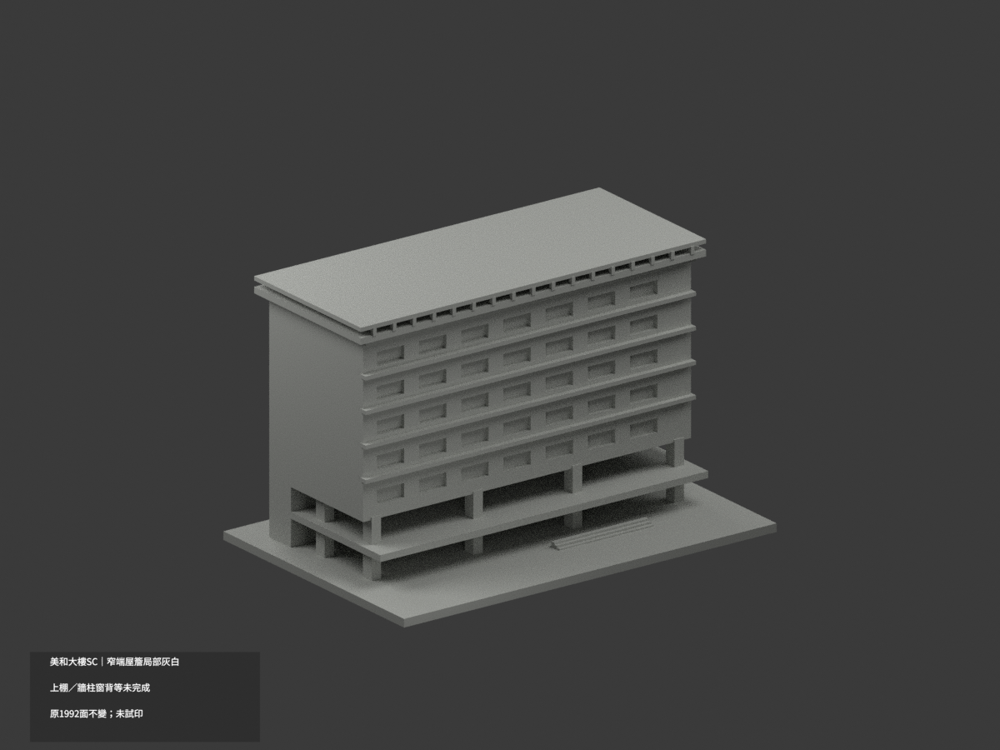
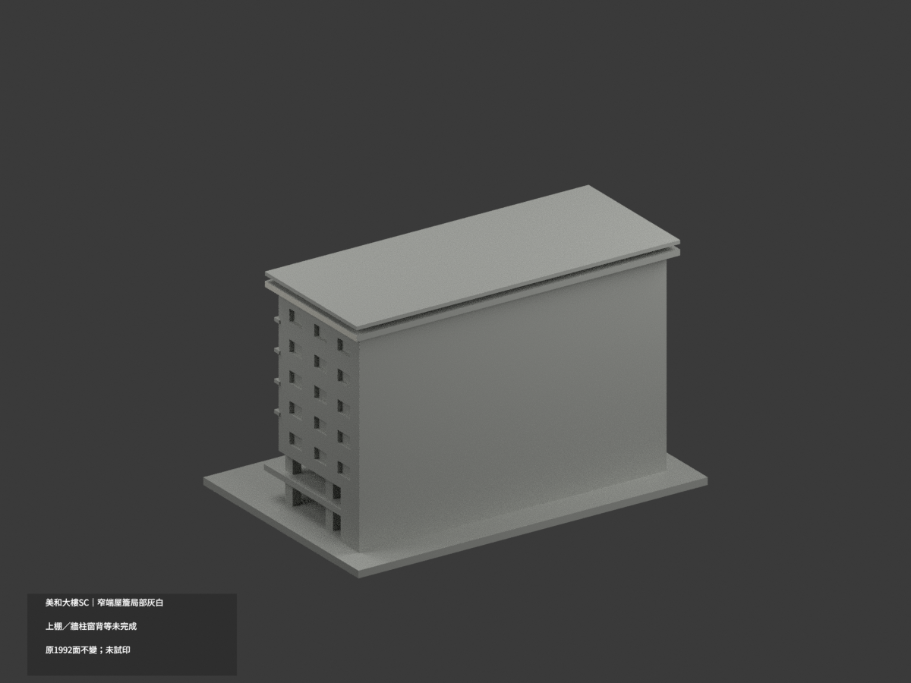
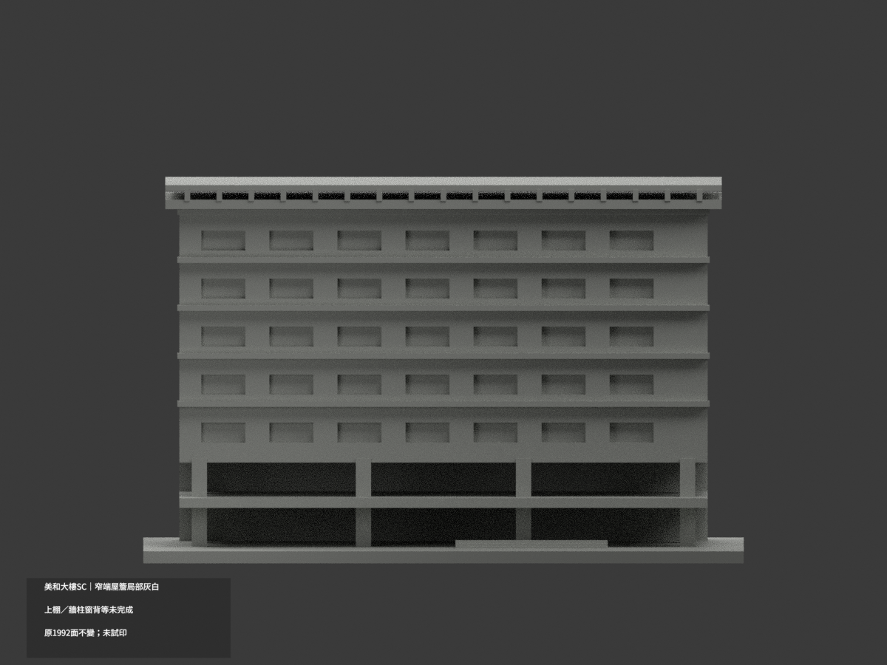
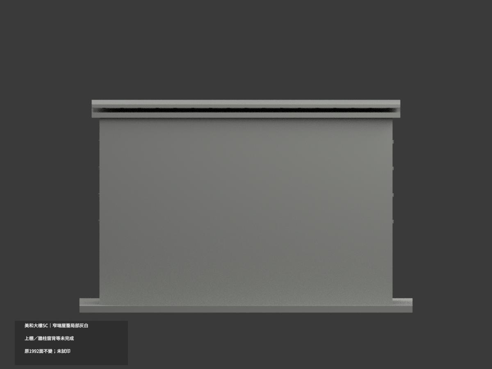
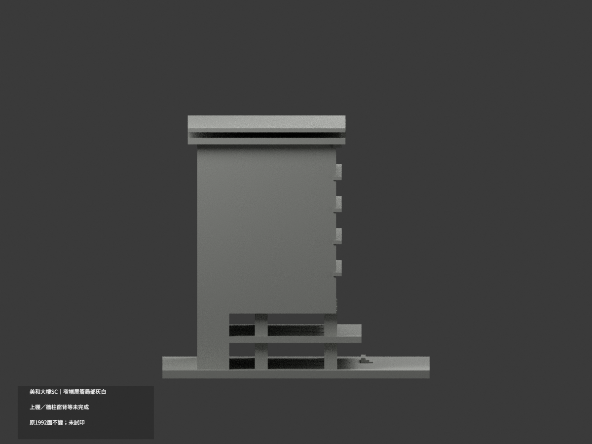
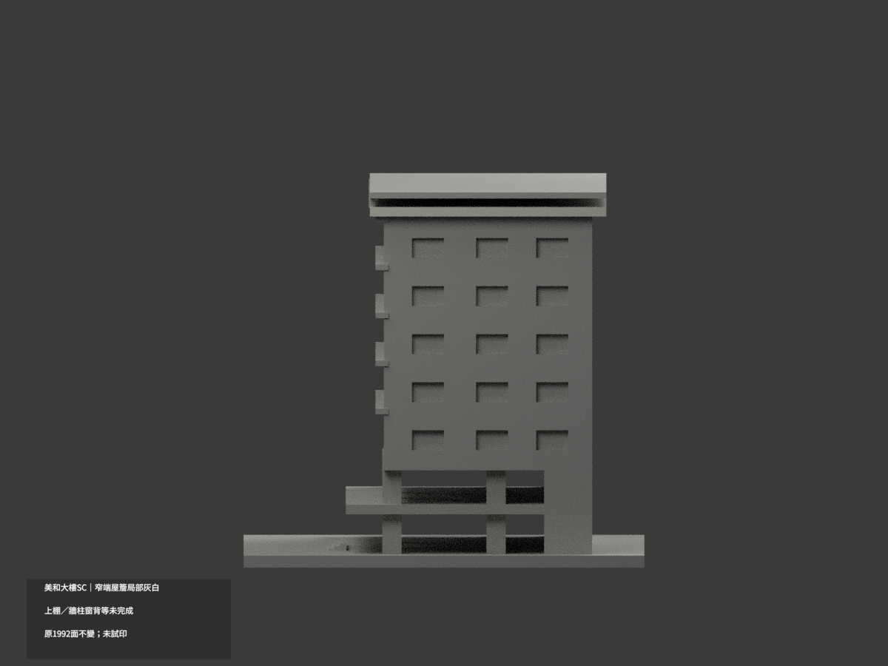
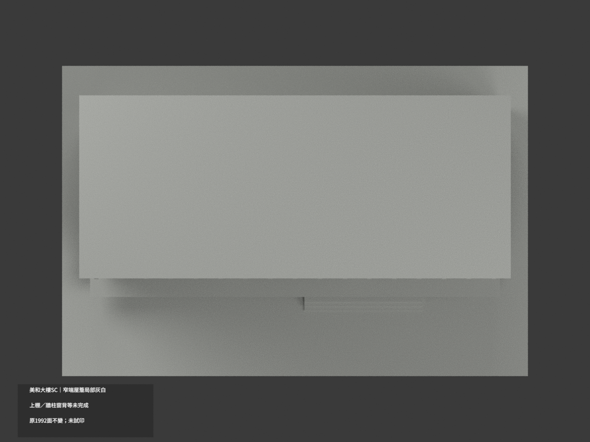
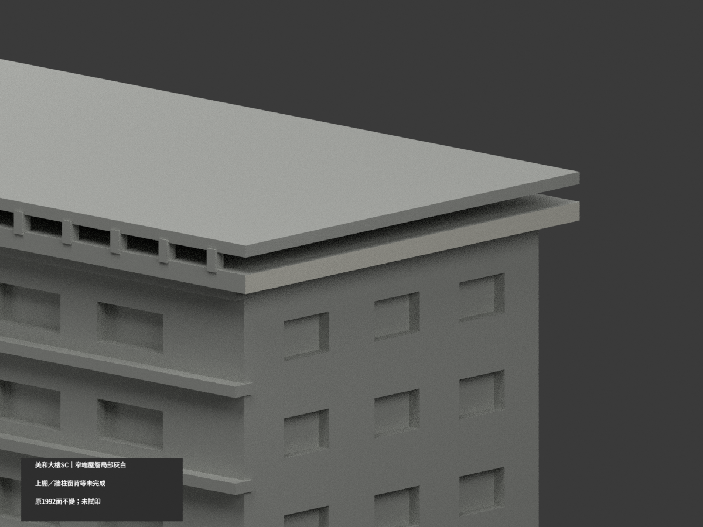
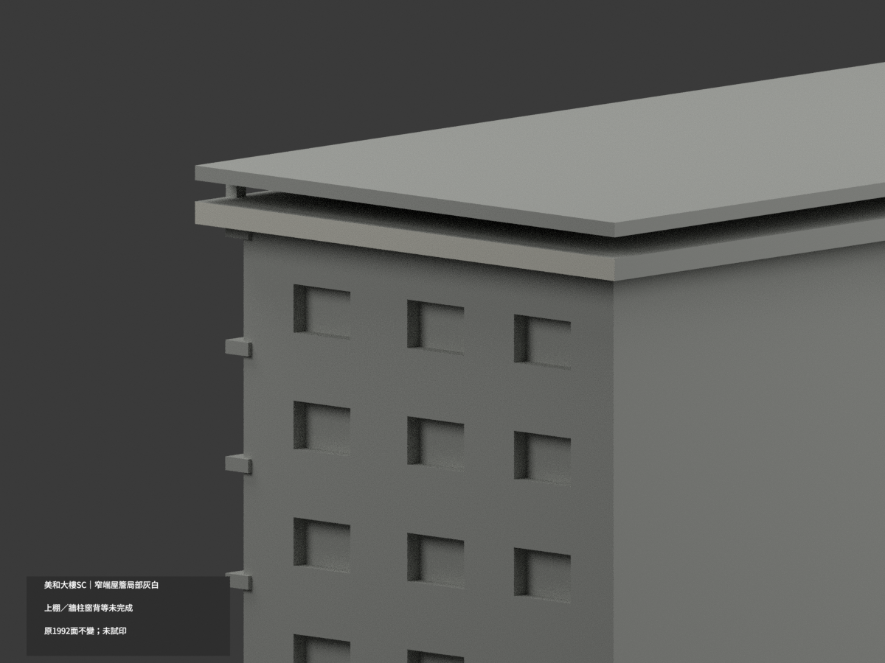
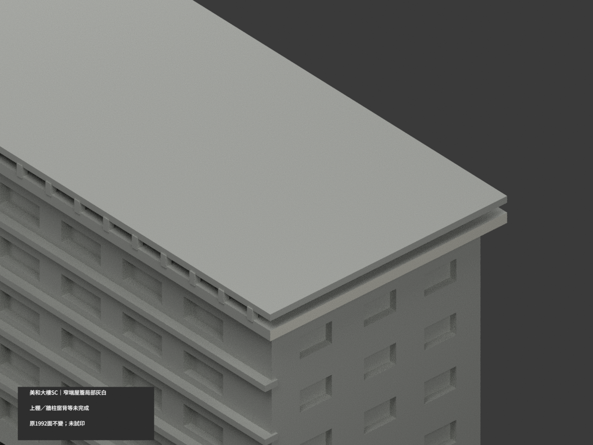

# 美和大樓 SC｜窄端主屋簷局部灰白

**上棚、牆柱與窗背等材域未完成分色。** partial_color_incomplete=true、fully_colored_exterior=false。只原窄端下層屋簷完整2面名義灰白，非全棟完整補色。

| 總覽 | 背側 | 正面 |
|---|---|---|
||||
||||
||||
||||

## 材色範圍
同 meiho-meiho-sc 原項目，same-item、count_delta=0。美和科技大學美和大樓SC含兩層開放基座為單一群；實南校區，原repo校本部分類保留，不搬路徑、不拆套。1992原三角與STL/build_model.py原bytes不變；17原件無OBJ，不造原件。
- x69.5原整平面有兩個分離矩形各2面。只完整下層y−18.5..40.5、z87.5..89.8屋簷外面灰白，原上棚z92..93.5兩面保持中性，不將同plane全部染。
- 以全部3頂點有限矩形及共面連通域核對，沒有人工高度切牆或新增面。其他1990面中性，包括上棚、屋上皮底、長面簷、混黃牆窗框設備、全高柱與遮蔽底層。
- 原照片推估幾何與樓層、屋棚近似保留；色審不追認原精度。中性色邊界是證據範圍，不代表真實材縫。

## 來源與日期
親看官方校園地圖標SC的小外觀照片；檢視放大不增加原151×152像素證據。僅名義淺灰白色族，拍攝日未知，不稱2026現況或校準色票。原照片私人保留，不公開、不作紋理，未確認CC或再散布授權，不保證商用。

## 格式與列印
[原STL](model.stl) · [逐面材色3MF](appearance.3mf) · [Blender](scene.blend)
保留原150mm底座示意比例，非測量比例。實際物件名 Meiho SC Building partial color，依真slug及館名獨立核。STL無色；3MF與Blender逐面分材。兩材標籤非兩色或四色耗材切片驗證，未實際列印。

## 重建與 QA
原build_model.py → colorize_model.py → export_appearance.py → validate_color.py；Blender render_color.py／verify_color_scene.py。完整隔離原依賴Shapely2.1.2精確原build＋color重建，原bytes／全三角multiset、閉合正體積、3MF逐面材、scene重開、十圖1200×900及圖文hash。原README、previews與validation保留歷史，不冒充新QA，沒有刪檔。

## English scope
Partial only:2 original complete lower narrow-end eave faces pale gray;1990 neutral. The x69.5 plane contains two disconnected rectangle components; only the lower original component is approved, not the upper rooftop canopy. All-three-vertex finite bounds and whole coplanar closure preserve original1992 triangles and bytes.17 immutable files contain no OBJ. Official map SC photo is small, capture unknown; not2026 survey or calibrated color. Actual south campus, original repository campus classification retained. No geometry changes, no new count, no tested filament slicing.
