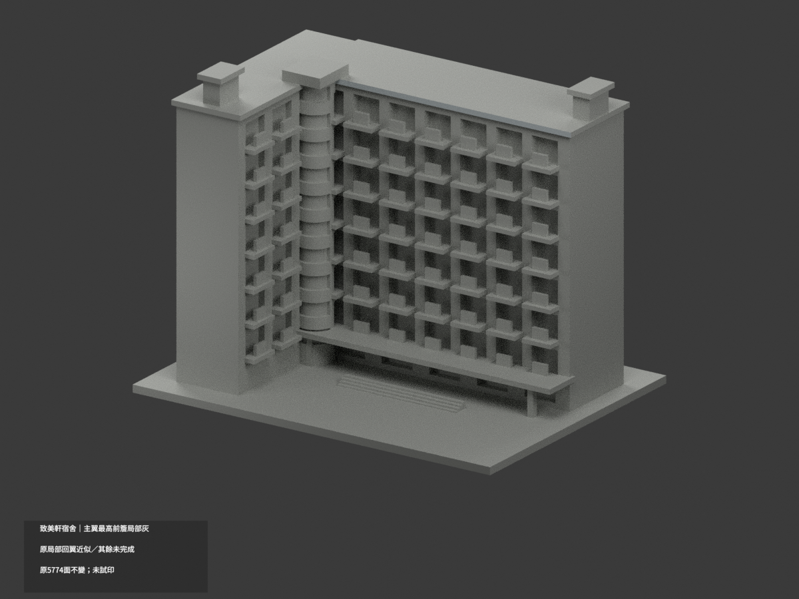
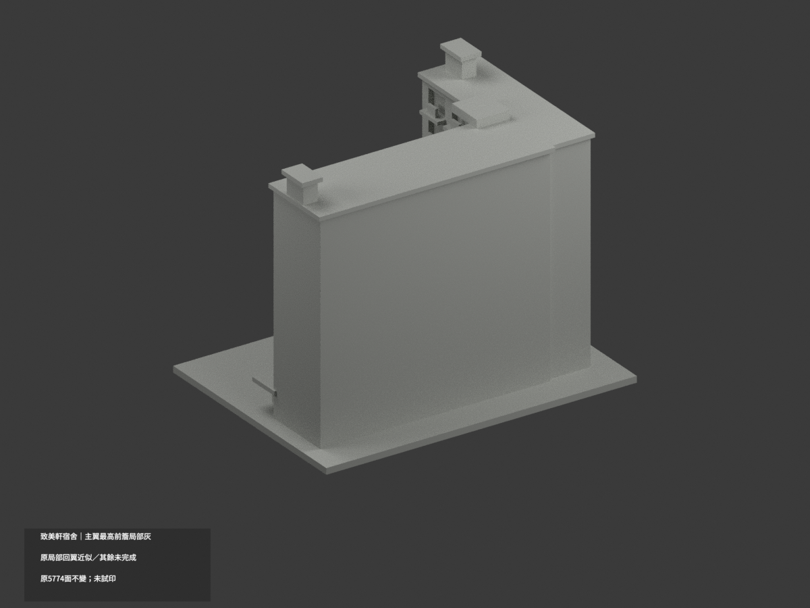
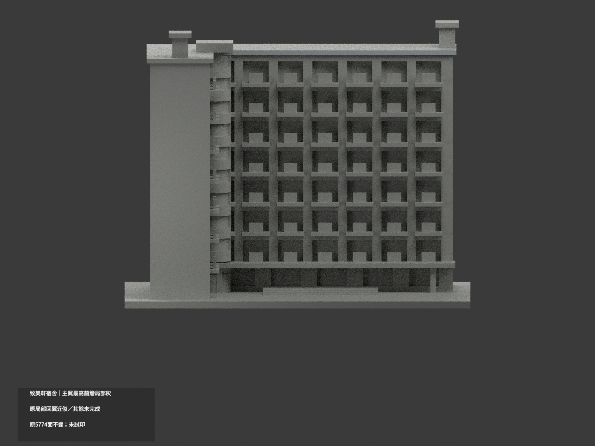
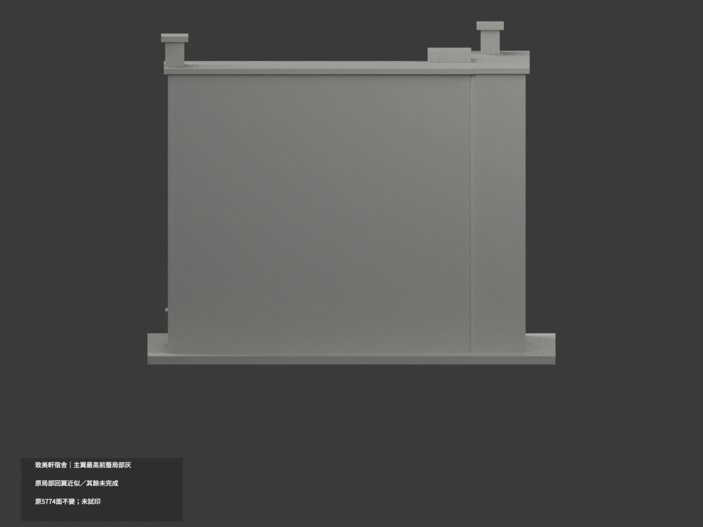
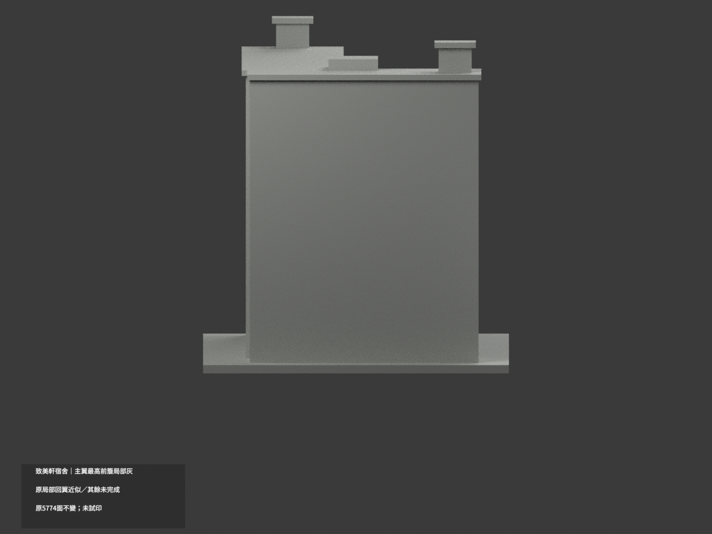
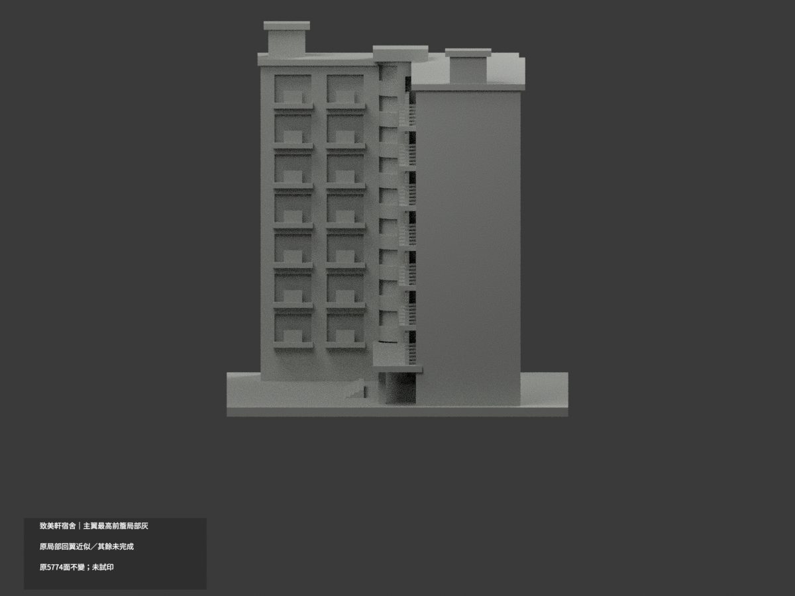
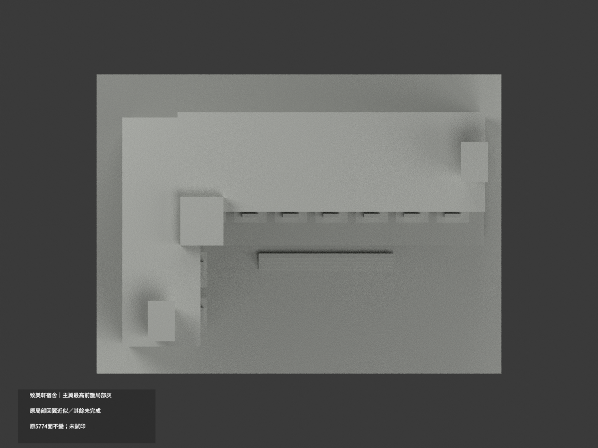
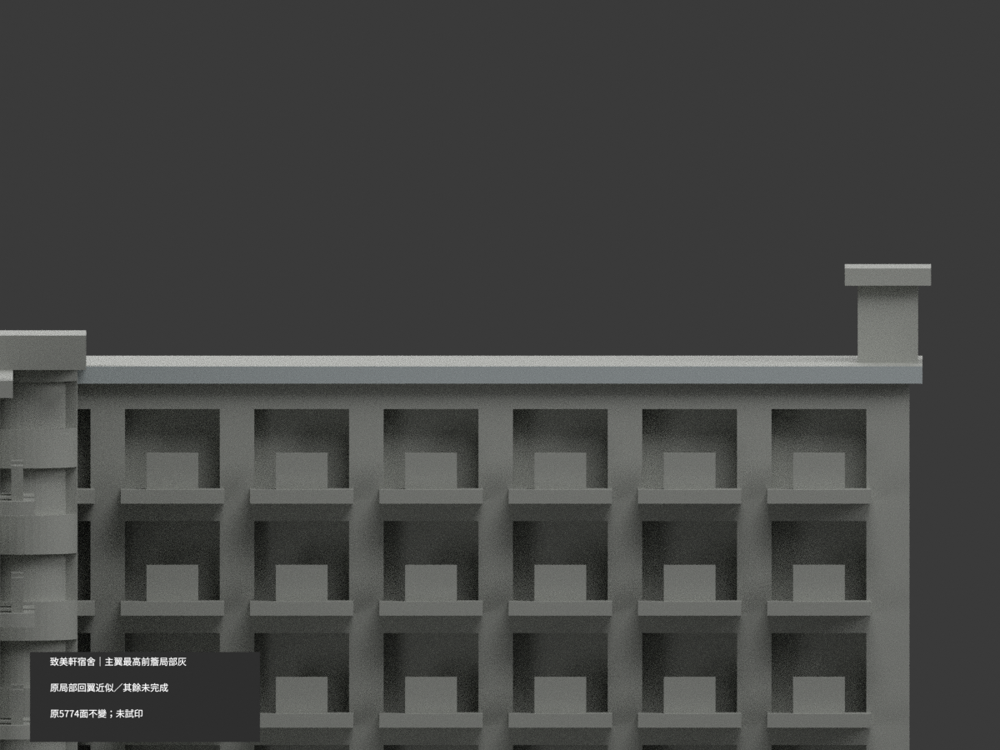
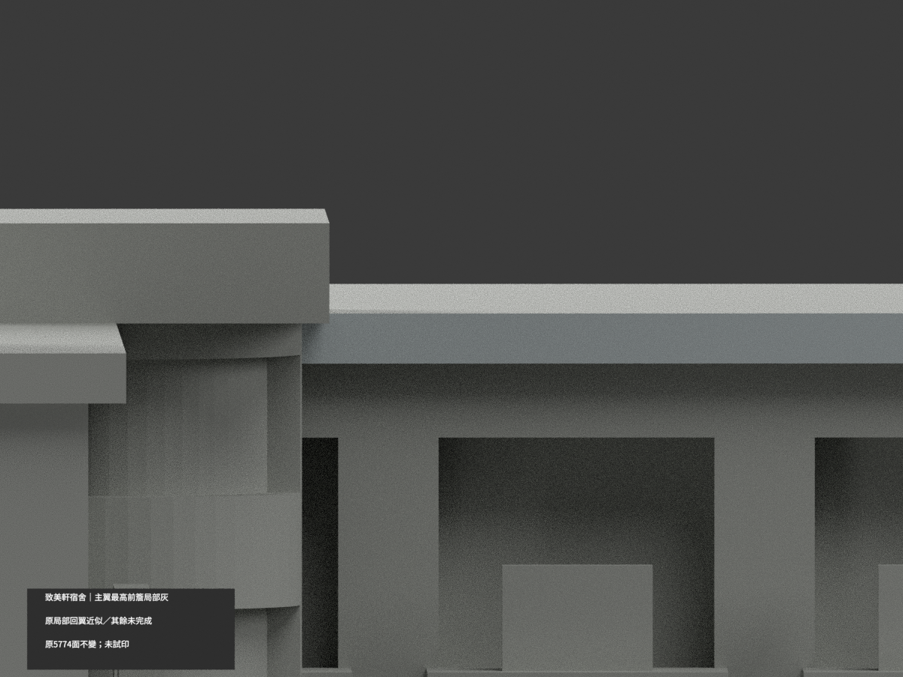
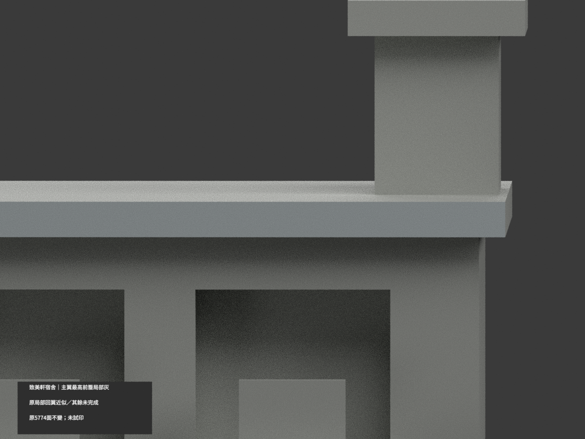

# 致美軒宿舍｜主翼最高前簷局部冷淺灰

**局部補色未完成：只內院主翼最高前簷完整3原三角名義冷淺灰，其餘面尚未分色。** partial_color_incomplete=true、fully_colored_exterior=false。同項 meiho-zhimei-dorm／count_delta=0。美和科技大學致美軒，非「至美」或致和軒；來源南校區身份與原repo校本部分類並存，不自行改路徑。身份 Meiho Zhimei Dormitory partial color。

只原可見主翼及局部近似左回翼，不是全宿舍或全基地測繪。原5774三角不改，未補原Boolean截口。

| 前斜視 | 後斜視 | 正面 |
|---|---|---|
|  |  |  |
|  |  |  |
|  |  |  |
|  | | |

## 材色範圍

先枚舉whole y=4.5無限平面所有3面，共享邊BFS一個完整3三角域，再核原有限帽邊x−45..69/z106..108。原union實露左界−29.937822，不填成理想114寬，不以normal/centroid漏片。3名義冷淺灰#C5CDCF、5771未知中性#B8BAB5；1544共面域一致。資料界線不是真實材色接縫，中性不是已證實現場灰。

內院照可核主簷從圓梯接界到右外角，入口照只補同棟與低層，不能證最高層。左回翼帽出畫、中間圓梯混環玻璃、塔帽、陽台實板代理與真欄分界、混灰奶白主牆/紅字、窗反光框皆中性。下綠透棚原為厚實板，不能整染綠冒充透明格網；柱基/階/隱蔽地面/屋上底側背皆中性。

## 原件與日期

17 immutable原件無OBJ；原code會export OBJ不當原repo已有。原README實名README.zh-TW.md，保於ORIGINAL-PREVIEW-README.zh-TW.md，不捏造原README.md。原STL/build/QA/render/previews字節不變，原scene另名ORIGINAL-PREVIEW-scene.blend且全包私存。新色版不覆原資料/幾何。

兩官照capture未知，目前頁面不代表2026拍攝；來源地圖只校區位置，不取建築材色。原595個0.2mm截面閉合、119個1mm抽層0.8mm XY opening、最大0.0016446695418172509及原canonical-edge-v2紀錄保留，不是全域壁厚證明或實際切片試印。原幾何近似/未知背側依舊。

原build+color精確隔離重建、原全字節/triangle multiset、共面整域、3MF/reopen與十圖1200×900/explicit身份QA。重建保留不刪，未多料切片/試印，STL無色。來源原照私存不公開貼圖。

Meiho Zhimei Dormitory partial color. Only the complete main court-wing highest fascia front receives nominal cool lightgray:3 original triangles,5771unknownneutral. Whole y=4.5plane is one3triangle connected domain. OriginalBoolean left edge -29.937822 retained, not filled to idealcap x-45. No geometry change;1544coplanar components uniform.

Partial maincourtwing plus approximateleftreturn,not full dormitory/site. Correct official name 致美軒. Source southcampus identity retained while originalrepo校本部 path unchanged.17 immutablefiles include README.zh-TW.md and noOBJ. CodeexportsOBJ do not establish an originalrepoOBJ. All originalbytes/history preserved,scene/readme/render aliases retained,count_delta0.

Lower green transparentcanopy remains solidproxy neutral; tower/glass/shortbalcony panels/mixedwall/redlettering,unknownleftcap/roof/back neutral. Twoofficialphotos undated,not2026. Original595closedsections/119sampledlayers/maximum0.0016446695418172509openingfraction not exhaustive thickness or physicalprint certification. Sourcephotos private; no full-color claim.
