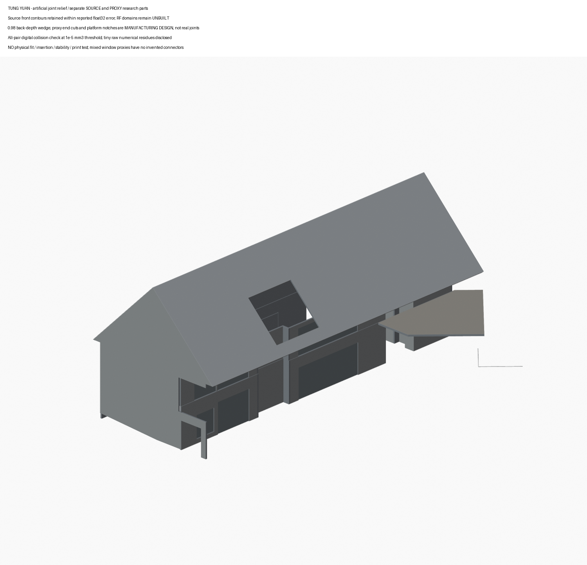

# 臺中市烏日區東園國民小學

[返回全庫](../README.md)

國小附幼建築研究，現有 **1 套模型包**。本件是東園國小附設幼兒園，不是整個國小校園。49分件屬同一研究包，非49棟；不計入大專校院、高中職或私立國際K12分類。

| 建築研究模型 |  |  |
| :---: | :---: | :---: |
|  **[東園附幼｜名義設計有界外殼](校本部/buildings/tung-yuan-kindergarten-bounded-design-study/README.md)** [49分件3MF](校本部/buildings/tung-yuan-kindergarten-bounded-design-study/model.3mf) · [STL清單](校本部/buildings/tung-yuan-kindergarten-bounded-design-study/BUILD-RECORD.json) · [來源／期別](校本部/buildings/tung-yuan-kindergarten-bounded-design-study/sources.json) 作者2018–2020設計及部分完成照支持，非竣工測繪／完整實景配色；未實裝或試印。 |  |  |

## 範圍與限制

名義軸網、人工厚度和斜接退讓另列；窗門是中性整組代理，RF兩域未建，入口只保留已證線域。五個極細非零三角保留，不宣可直接整組切片、穩放或抗倒。F端有限白族與本包全高core中性代理分開，不把局部色證當全色。

[詳細數位檢驗及限制](校本部/buildings/tung-yuan-kindergarten-bounded-design-study/DIGITAL-QA.json) · [元件與接合說明](校本部/buildings/tung-yuan-kindergarten-bounded-design-study/README.md)
