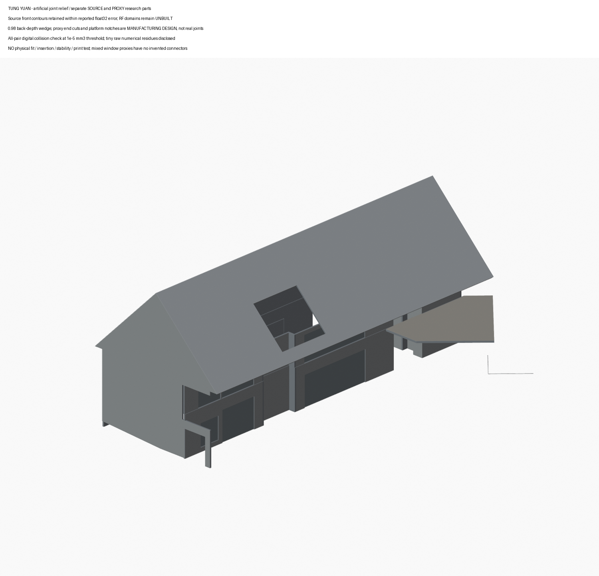

# 東園國小附幼：名義設計有界外殼研究

臺中市烏日區東園國小附設幼兒園，作者 office aaa／究境聯合建築師事務所。此包是作者設計圖與部分完成照支持的名義軸網研究，**不是整個國小校園、竣工測繪、完整實景配色或試印成品**。

[背向](review-rear-oblique.png) · [俯視](review-top.png) · [入口端](review-entry-end.png)

## 檔案

- [3MF 分件集合](model.3mf)：49 個獨立物件，毫米單位，保留共同研究座標。不得以此直接認定可整組列印。
- [Blender 場景](scene.blend)：來源族與中性代理分材，未知域保持未建。
- [STL 清單與元件說明](BUILD-RECORD.json)：各獨立 STL 在 parts/，總計 3602 三角；49 件只屬同一個研究包。
- [來源與期別](sources.json)、[數位檢驗與限制](DIGITAL-QA.json)、[極細三角清單](MICRO-TRIANGLE-RISK.json)。

## 可見範圍與未知

主雙坡、兩層主要外周、F端服務凹折、A/F端及混合窗門組依圖面建立有限外殼。門窗整組以不透明中性薄代理表達，不代表精確窗框、玻璃或真裸洞。RF兩個投影矩形域仍未建；庭院一處屋窗照片能證存在，不能據此補完整深盒或推另一坡相同。入口只保留可證線域，沒有臆造門高。平台內截界是人工有限範圍，非完整樓板。

總圖單位 cm 為同案詳圖 UNIT:cm 的工作推定。名義45°、含檐半跨625與脊1270推得檐645，屬交叉設計推導；R1+695不是滴檐。各層1px對位差保留，沒有用規整掩蓋。作者2018–2020作品、官方2020-12-03啟用、ArchDaily2024刊載與照片拍攝日分開，不宣2026現況。

## 材色及人工製造設計

已核F端前面採近似白族；有限core照片域雖有白族來源證據，本包全高度core仍為中性設計代理，未套用白色。未知A端與背向保持中性。庭院屋皮灰銀族不延至相反坡。新增厚面、切面、屋窗未知和混合門窗代理均中性，不能把反射當玻璃漆色。

名義牆／屋背厚0.8mm、平台1mm均為人工模型厚度，非實際構造尺寸。六代理角與四屋／山牆接口用向內深度規則 d_self ≤ 0.98 d_other 作人工斜接留隙；八處山牆優先，裁短代理牆端；三處平台代理牆作人工缺口。2%深度差不是兩物件最短物理間隙，也不是實測公差。來源共同邊仍可能名義零隙，斜接尖端沒有最低可印厚度保證。

## 品質與不能宣稱的事

每件的反向雙邊、頂點連結、連通及正體積另核；1176配對另做數位交體積檢查，不能拿單件水密代替組裝檢查。1e−5mm³檢出門檻不變，門檻下原始數值仍列在 ASSEMBLY-COLLISION-QA.json，**不稱數學精確零交**。

原7個極細非零三角中，2個以嚴格共面的對角翻轉改善，不移頂點或外輪廓。其餘5個沒有安全的局部共面替代，不強刪，詳見清單。兩次翻轉不改3602三角總數。較早4330的中間數包含29個未變零件的重分三角；恢復其原364面、而非1092面後為3602，並非簡化外殼。

**未實際列印，未證實可插接、穩放、承載或抗倒。** 窗門代理本來就獨立且留有名義間隙，沒有虛構卡扣或支承。不能將此包當完整館體或已可製造設計。

## 自含重建

需要 Blender4.3.2、Python3、numpy、scipy、Pillow。執行 bash rebuild.sh。包內 reference-nominal/build.py 先生成已核名義基準，再作局部人工退讓、兩處安全重分三角、輸出各STL／3MF／預覽，並清理場景與PNG的路徑資訊。重建不下載照片、不依賴外部工作目錄或私人scene。reference-nominal/expected-stl.json綁原49件基準輸出。

原圖／完成照片未包含於包內；來源連結及圖面雜湊供追溯。SHA256SUMS驗其列出的當前公開檔；表本身與外層manifest由發布清單另綁。
