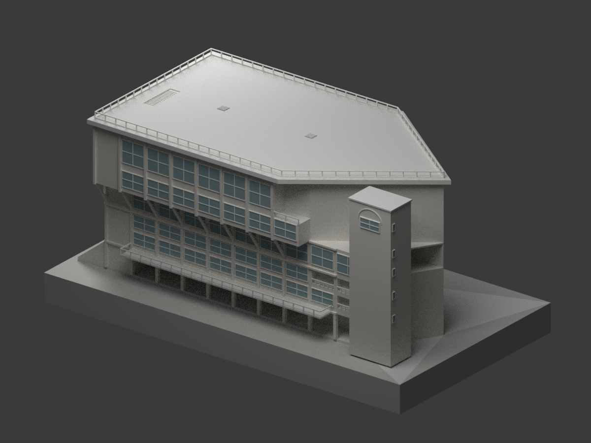

# 臺北市私立泰北高級中學｜校本部建築研究模型

現行收錄 **1 套模型包**，不是完整校園／建物盤點。校本部為本資料庫入口分組，不聲稱另有官方具名校區；舊校名歸入同校，不重複計校。

依圖框標示竣工圖的工號7307重建；校史1988年改建記載不是圖框日期，不從工號推算年分；地下層局部與示意地坪範圍以模型README為準，不是2026現況。

設計者、典藏來源與原圖CC BY-NC標示保留，來源頁未明示版本；原圖像權利與自行編寫程式／重建模型分開說明，不因來源標示而一概將整包模型限制為非商業，也不宣稱已取得原建築設計或原圖的無限制商用權利。原照片、圖紙、PDF與私人參考資料不隨公開包配送；所有模型未實體試印。

| 建築模型 | 建築模型 | 建築模型 |
| :---: | :---: | :---: |
|  **[重光樓｜工號7307竣工圖版](buildings/taibei-chongguang-asbuilt-7307/README.md)** [STL](buildings/taibei-chongguang-asbuilt-7307/model.stl) · [彩色3MF](buildings/taibei-chongguang-asbuilt-7307/model.3mf) · [Blender](buildings/taibei-chongguang-asbuilt-7307/scene.blend) |  |  |

[回學校圖鑑](../README.md)
