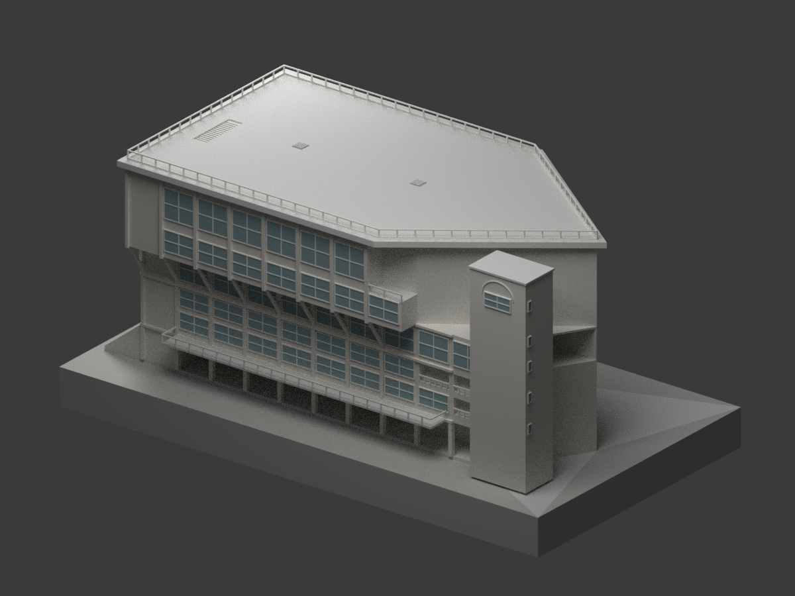
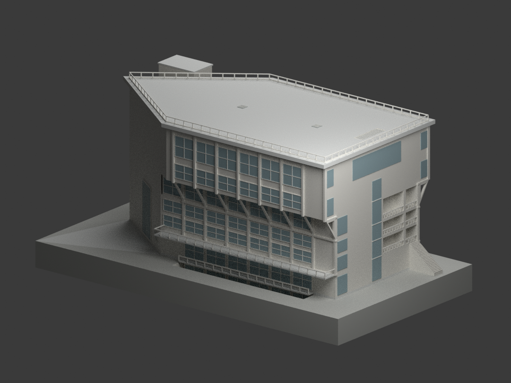
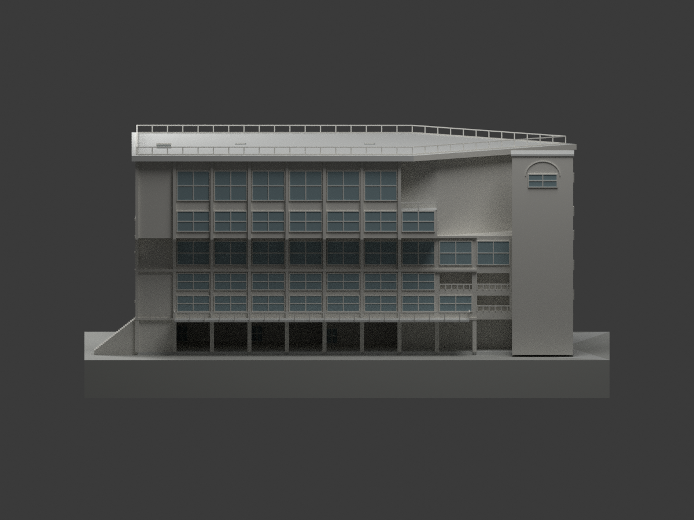
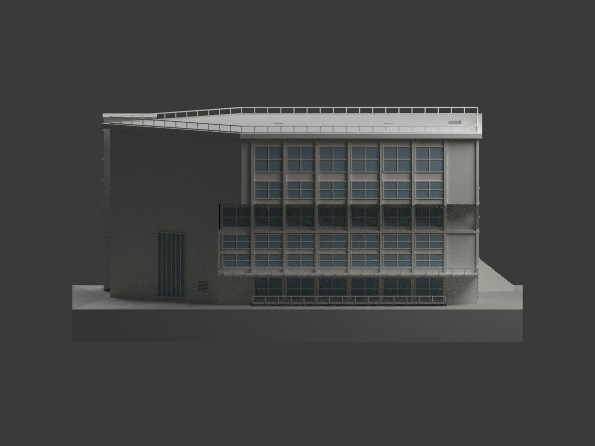
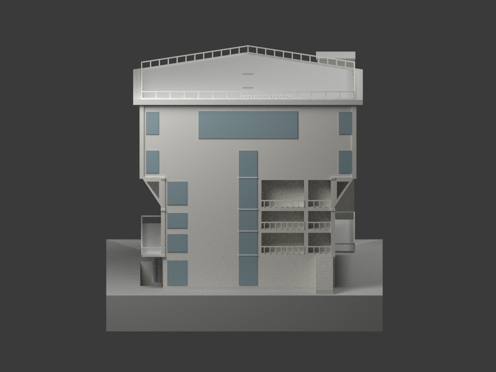
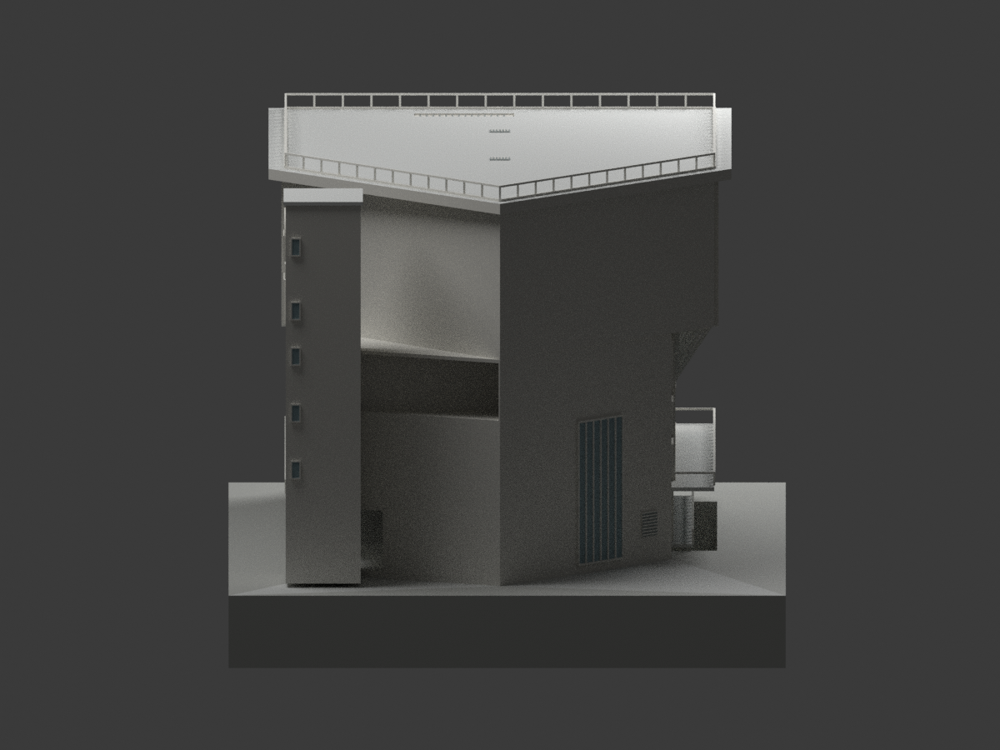
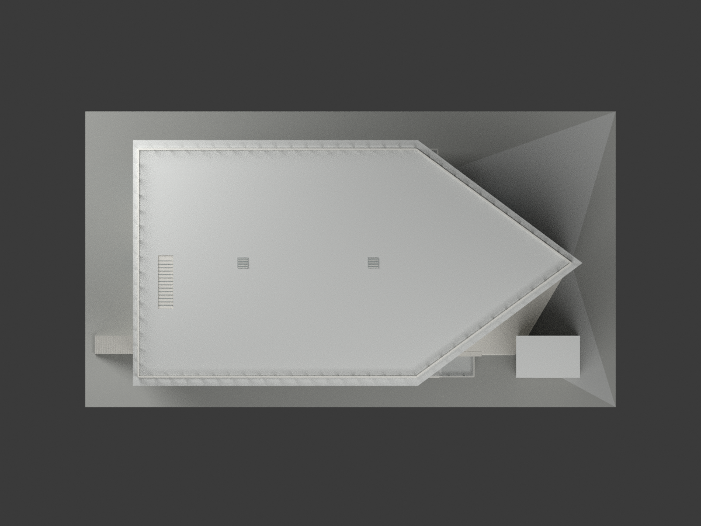

# 泰北高中重光樓 — 工號 7307 竣工圖版

> **本地模型與來源／視覺／格式檢查完成。**
> 依國立臺灣博物館典藏 CGEP116 圖組重建，不是 2026 年現況測繪。

|  |
| :---: |
|  |
| 斜前方 |

## 身分與時間

典藏題名為「泰北高中綜合大樓新建工程」，建築師為**高而潘／高而潘建築師事務所**，工號 **7307**；控制圖右下實際標示「竣工圖」。其基地位置、剪角平面與五樓大跨禮堂，與校方重光樓資料相符。校史記載 **1988 年拆除大禮堂改建重光樓**；此為校史時間，不冒充圖框日期，亦不由工號自行推算設計年。

## 模型範圍

- 原竣工圖外部量體、不同樓層退縮、五樓體育禮堂與夾層平台。
- 一樓開放門廳、北側 1.50 m 陽台、二樓 3 m 陽台、四樓兩側局部凹陽台。
- 東塔側五個小窗與南塔窗上拱形輪廓依 A13 圖面比例估讀；拱線為淺浮雕輪廓，不挖成拱門。
- 托架三角孔、西面分段開放欄杆、來源辨識的窗列；東北斜牆高直豎肋窗帶與低通風孔，其邊界由立面／平面比例估讀，非逐項明標尺寸。
- 屋頂梯口依 RF 圖定位，以 0.12 m 模型設計淺刻與階線表示位置；**不表示實際梯井深度**。兩個屋頂格柵採低浮雕，浮雕厚度是列印表現而非圖載高度。原圖標示 H=3 m 的避雷針因極細構件省略；未補造屋突房。
- 北側地下層可見立面與採光庭園：B1 標高 −4.50 m，庭園約 x5–35 m、北伸 3 m；部分受上層陽台遮蔽。
- 基座與剖開的地坪是**展示用示意**，不是實測地形。

來源未給平面定位的地下層外階不任意安放；既有鄰棟、隱藏室內、結構配筋、設備管線與現代改修不補造。欄杆、窗框、托架內孔圓角等依列印尺度簡化；玻璃為不透明封背，顏色為中性辨識色，不宣稱原建物材質色票。圖上尺寸、軸線優先；個別開口邊距／厚度取圖面比例並於程式明示。

## 規格與檔案

- 比例 **1:250**；STL／3MF 單位 **mm**。
- 含示意底座外包尺寸約 **280 × 156 × 133.28 mm**；須自行核對列印機成形範圍。
- `build_model.py`、`render_model.py`、`export_3mf.py`：可重建腳本。
- `mesh.npz`：同源幾何與逐面材質；`model.stl`：單色幾何；`model.3mf`：材質與 mm 單位。
- `scene.blend`：實際可開啟場景；預覽由該同源網格實際渲染，非生成示意圖。
- 尚未實體試印；封閉性與格式檢查不等於所有列印設定都適用。

## 驗證範圍

已完成 7 視角實際渲染與獨立圖面比對、全頂點相機取景、單一連通水密網格、STL／3MF 回讀、壓縮 BLEND 實際重開，以及另一乾淨目錄重建雜湊一致。這些是數位驗證，並不表示逐項實測或完成實體試印。詳細限制見 `DIMENSIONS-AND-LIMITS.json` 與各 `*-QA.json`。

## 圖像來源與權利分開說明

原建築圖來源：國立臺灣博物館「臺灣現代建築圖說」；建築師署名見上。典藏圖像頁標示 **CC BY-NC（姓名標示—非商業性）**，頁面未明示版本。該標示描述原圖像，不自動等同整包自建模型授權；本包也不宣稱取得不限用途商用權利。**不附原典藏圖、校方照片或含驗證 token 的 HTML**。本包保留設計者與來源，不因原圖公開可讀而刪除來源作者，也不把原圖像標示概括成整包模型僅限非商業。

- [四向立面，CGEP11623013](https://collections.culture.tw/docomomo_collectionsweb/Collection?GID=MQM4MSMCMA)
- [一樓平面](https://collections.culture.tw/docomomo_collectionsweb/Collection?GID=MPMWMSMCMA)
- [地下層平面](https://collections.culture.tw/docomomo_collectionsweb/Collection?GID=M7M4MSMCMA)
- [屋頂平面](https://collections.culture.tw/docomomo_collectionsweb/Collection?GID=MCM4MSMCMA)
- [縱剖面](https://collections.culture.tw/docomomo_collectionsweb/Collection?GID=MPM4MSMCMA)
- [橫剖面](https://collections.culture.tw/docomomo_collectionsweb/Collection?GID=MKM4MSMCMA)
- [校方百年校史](https://www.tpsh.tp.edu.tw/about/history/century)
- [校方校園平面圖](https://www.tpsh.tp.edu.tw/about/campus-map)

其餘原始網址與雜湊見 `sources.json`。來源查讀時間為 2026-11-01；資料年代與查讀時間不同。

## 其他視角

|  |  |  |
| :---: | :---: | :---: |
|  |  |  |
| 背側 | 南面 | 北面 |
|  |  |  |
| 西面 | 東面 | 頂視 |

## 下載與重建

[單色 STL](model.stl) · [彩色 3MF](model.3mf) · [可編輯 Blender 場景](scene.blend) · [建模程式](build_model.py) · [渲染程式](render_model.py) · [3MF 匯出程式](export_3mf.py)
