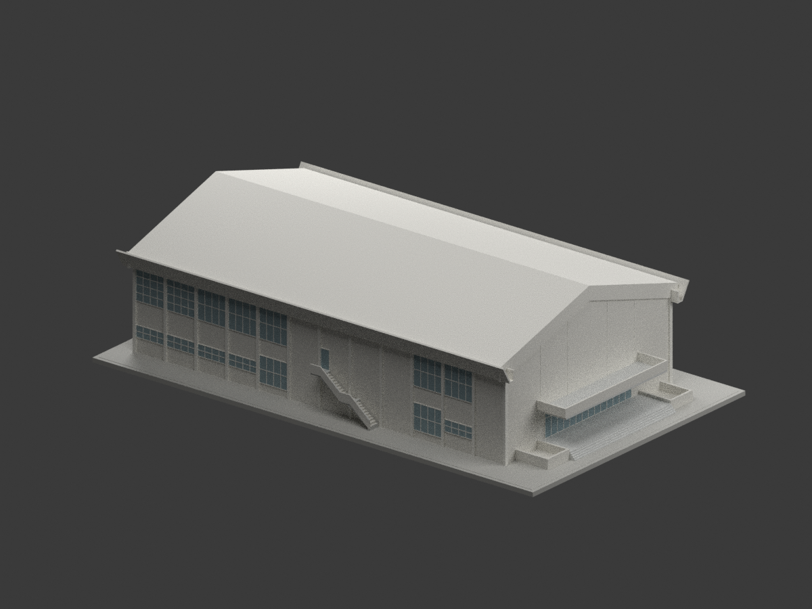
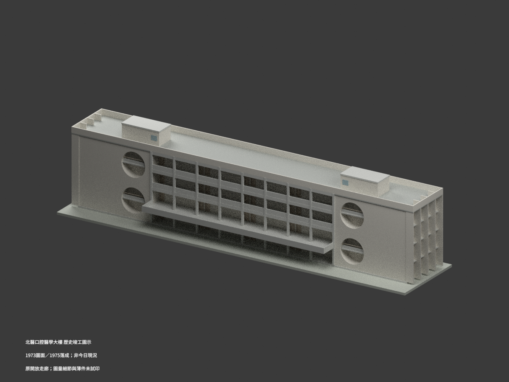

# 臺北醫學大學｜信義校區建築模型圖鑑

## 模型圖鑑

| 建築模型 | 建築模型 | 建築模型 |
| :---: | :---: | :---: |
|  **[教學大樓｜修復後外觀](buildings/tmu-teaching-building-restored/README.md)** 中段格柵、紅磚端區、開通廊與側凸電梯 220 × 70 × 約38.65 mm |  **[臺北醫學大學信義校區｜君蔚樓 Dream-Way Building](buildings/tmu-dream-way-building/README.md)** |  **[原臺北醫學院學生活動中心｜未定年原設計圖版](buildings/tmu-activity-center-undated-design/README.md)** [STL](buildings/tmu-activity-center-undated-design/model.stl) · [彩色3MF](buildings/tmu-activity-center-undated-design/model.3mf) · [Blender](buildings/tmu-activity-center-undated-design/scene.blend) |
|  **[口腔醫學大樓｜1973圖面／1975落成歷史外觀](buildings/tmu-oral-medicine-building-historical-asbuilt/README.md)** [STL](buildings/tmu-oral-medicine-building-historical-asbuilt/model.stl) · [彩色3MF](buildings/tmu-oral-medicine-building-historical-asbuilt/model.3mf) · [Blender](buildings/tmu-oral-medicine-building-historical-asbuilt/scene.blend) |  |  |

目前收錄4套：口腔醫學大樓歷史外觀、未定年原設計活動中心，以及既有2套：信義校區教學大樓2021–2022修復後主體，以及君蔚樓完整有限細節外觀；均為來源引導的近似模型，未含廣場鐘樓。本校為教育部115學年度正式大學，代碼1028；前身臺北醫學院不另計學校。其他建物、雙和校區及全校逐棟清單仍未完成。

[完整模型、正反並排預覽與下載](buildings/tmu-teaching-building-restored/README.md) · [來源摘要](../inventory/sources/tmu-teaching-building-restored-source-summary.md) · [QA摘要](../inventory/qa/tmu-teaching-building-restored-review.md)

原作吳明修（1963年），修復設計曾泊銘建築師事務所。這是教學大樓，非教研大樓、醫檢大樓、附設醫院或雙和教學研究大樓。長條三層的NE長面只有中段密集格柵，兩端為寬紅磚實牆；SW長面為開放水平通廊，靠NW的一側凸電梯以短橋相連。1F中央穿堂由上層教室與屋頂覆蓋，並非露天天井。1F石貼面拱廊只保留來源支持的中段，兩側直線窗柱仍有區別。

名義約1:400。校方82m總長未定義量測端點，歷史4.5m層高不等於修復後實測標高；進深、電梯及屋頂欄杆配置為比例／構造推估。SE短端缺乏完整來源，保留低細節實面，不代表已證實無窗；NW方位依場地關係推定。模型77道格柵、七拱、增厚接根、圓角及樓梯坡段屬製造簡化。未納入歷史巨大裸雨庇或未定年屋頂光電。

原數值檢查各1個flag與strict false完整保留；同一原run唯一事件的精確分類與獨立驗證範圍見QA，不能改稱原strict pass。未實體試印，開通廊、穿堂、遮陽與短橋有懸空／跨距，可能需要大量支撐，不是免支撐或列印成功保證。

公開內容只含自行建立的幾何、程序材質、渲染、來源連結與檢查證據；不含原照片、圖面、PDF、正射或私人比較板，不宣稱原建築師、修復設計者或攝影師授權、認可。

## 新增歷史原設計研究

高而潘／高而潘建築師事務所CGEP234、工作號5716，採橫式含兩側外梯原設計版本；年代與是否建成未知，不以案號推年，不等同今日體育館。原臺北醫學院歸現臺北醫學大學同校；信義校區為歷史校園目錄歸組，不宣稱原案實際基地已精確定位。屋架高度跨圖差、外屋面協調厚度與外梯底高假設均保留；非2026現況。

上述新增模型保留設計者與國立臺灣博物館典藏來源。來源圖像CC BY-NC標示（版本未明）與自行編寫程式／重建模型權利分開，不自動概括整包模型僅限非商業，也不宣稱已獲原圖或建築設計無限制商用權利。不附來源原圖、PDF或私人參考資料；皆未實體試印。

## 口腔醫學大樓歷史外觀研究

高而潘建築師事務所工號6243「私立台北醫學院普通教室新建工程」，圖題竣工圖載1973年，官方沿革記1975年6月落成；圖面日期不是竣工年。歷史口腔醫學大樓原開放前廊與四透空圓洞，不加入1999玻璃幕牆及2006–2007電梯整修，不是今日現況。不同於吳明修1963教學大樓、1983杏春樓、君蔚樓及工號5716活動中心。圓洞RF上錨保留5cm局部基準差，高窗、門窗位置與端折片為有界圖量；RF14.75m／女兒牆15.95m／雙梯屋17.85m，屋面排水不是逐點精測。1:250細框管欄名義0.40mm，色彩示意、隱蔽室內不補造，未實際列印。原圖CC BY-NC私存與詮釋CC BY分開，無概括商用保證。
