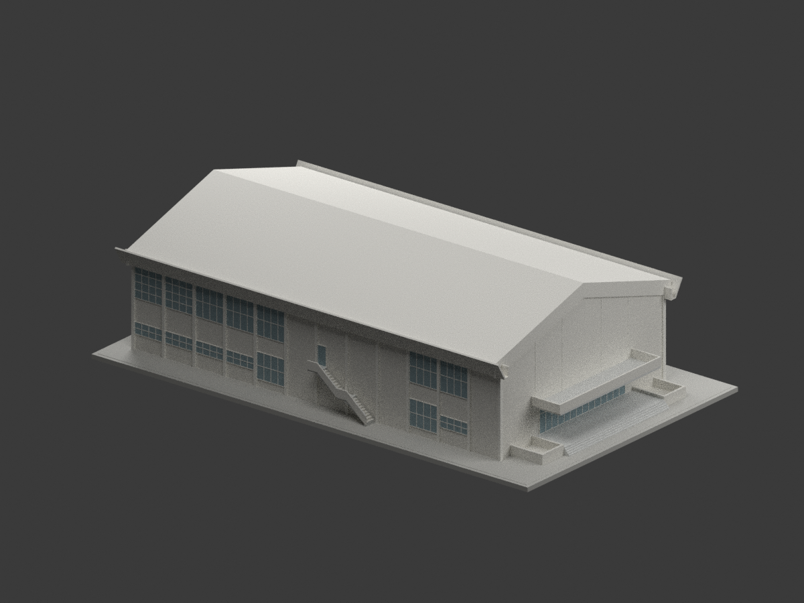
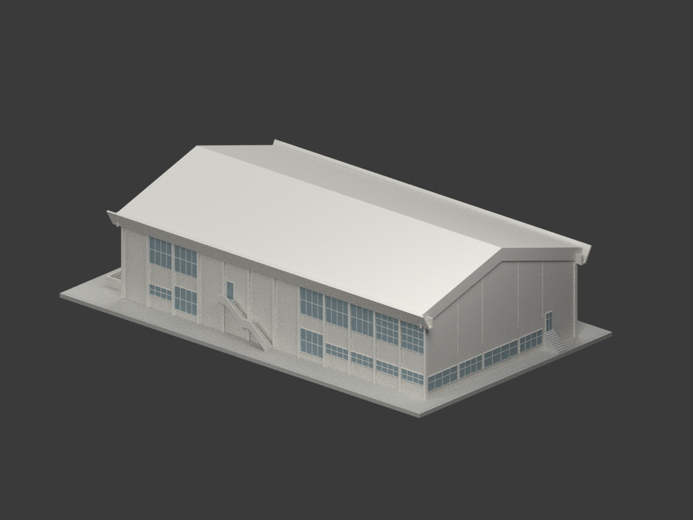
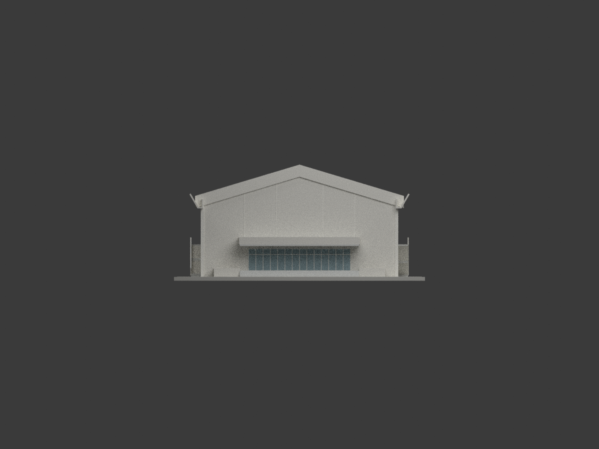
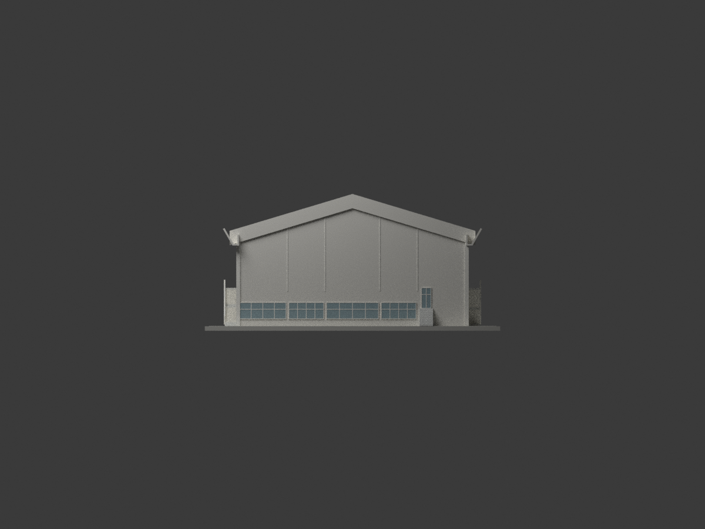
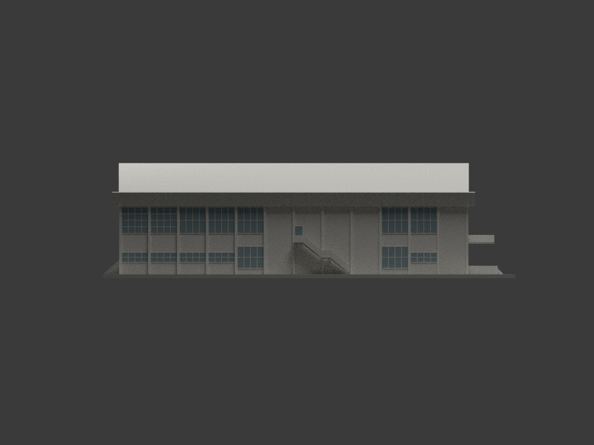
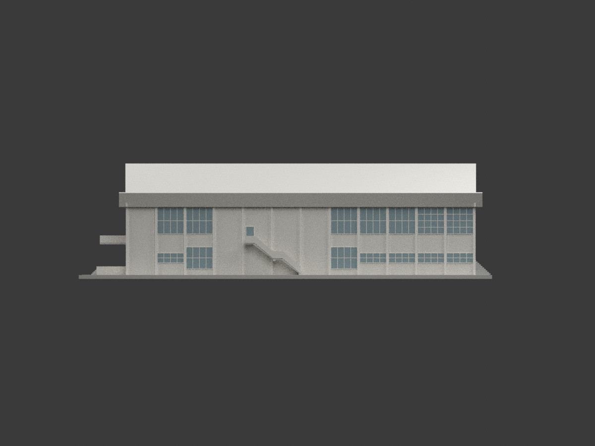
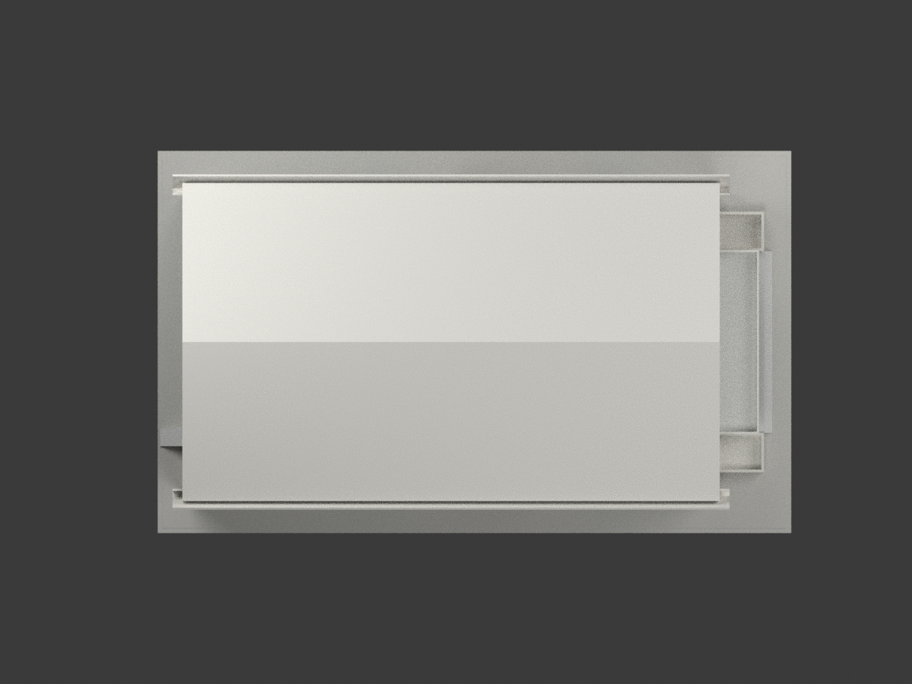
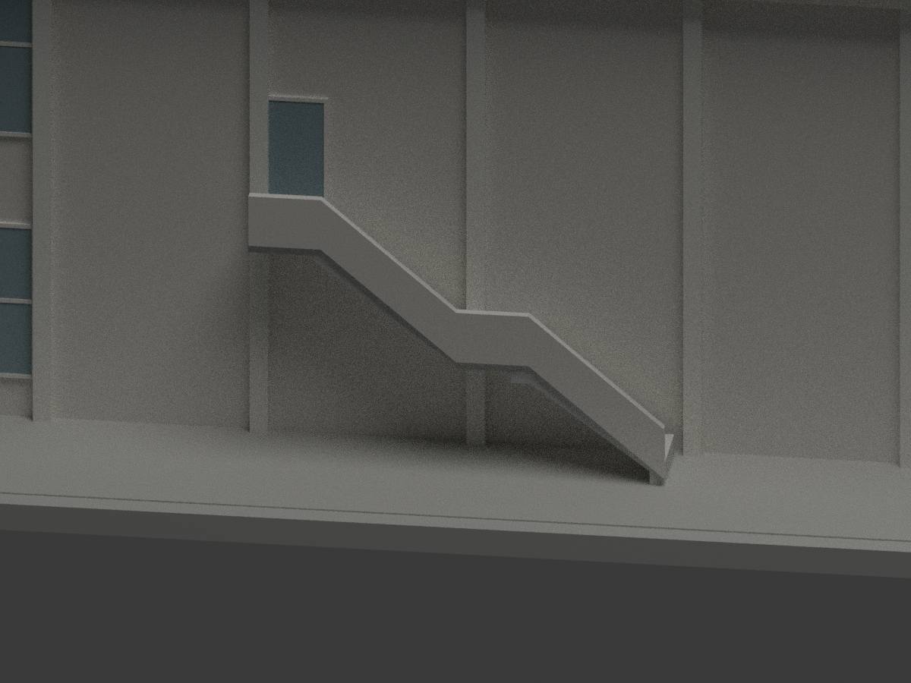
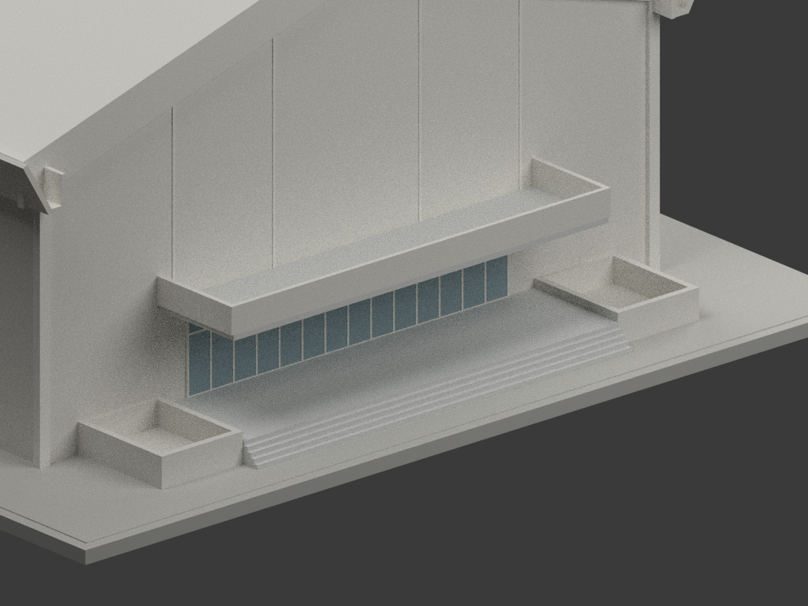

# 臺北醫學院學生活動中心｜未定年原設計圖版

依高而潘／高而潘建築師事務所「私立台北醫學院學生活動中心新建工程設計圖」CGEP234、工作號5716重建。**圖面年代未確認、是否實現未知；不是竣工測繪，不等同現今北醫體育館，也不是2026年校園現況。** 工作號不當作年代；圖號旁2/21、4/21為張次，不是日期。

## 採用版本與控制尺寸

採橫式A1（CGEP23423002）、A2（23004）、A3（23008）含兩側外梯版本，以及相應A4/A7/A8/A11/A12詳圖。另有直式無外梯版本與較細窗格版本，沒有混用其中央窗帶補滿所選版本的素牆。

- 主體柱軸43.20×24.00m，長向12跨、3.60m節距；寬向5.175+3.95+5.75+3.95+5.175m。
- 主地坪GL+0.75m。A4名義高度鏈0.75+8.80+3.30=12.85m；A12詳細屋架另由0.75+8.80+0.30+3.825推得上弦脊13.675m。**兩圖控制不同，保留差異；模型採A12詳圖，不把12.85m當外屋頂最高點。** 外屋面暫取脊13.85m，即上弦上方0.175m的檁條／屋面協調厚度，屬建模估值而非明標測繪高度。
- 雙坡屋頂斜率3:10，山牆簷帶高1.50m。A7長邊折簷槽底在屋架基準下1.10m；外折板長2.00m、60°，非垂直2m牆。
- A1兩長邊均指向3/A3。上層窗帶約GL+5.10至8.35m依立面比例估讀；W2表內有150cm與325cm兩種標法，不宣稱每窗一致。下W1寬330×高120cm；位置與有限窗格為比例簡化，立面X線不做實體斜撐。
- D1寬540×高270cm，兩旁D2各360×270cm；側D3為330×270cm。窗玻璃不透明、封背，不復原內部觀眾席／完整構造。
- A2前上平台寬14.75m、出挑3.38m；A1下層入口及花台按該平面比例讀取，花台橫向3.20m。A7另有4.05×5.30m花台詳圖，**不混合當作A1同一外框**。欄板高度、下入口出挑等非明標部分均為估讀。
- 兩長邊外梯方向相反。A7明標20級×19cm=3.80m總升高；每跑9踏面×25cm、平台1.20m。依A8廊台推估頂端GL+4.00m，因此底端+0.20m僅為跨圖協調假設，**不是原圖證實的門檻或現地高程**。薄梯板約20cm、中台短梁約40cm為圖面估讀；保留下方空間，不用實心楔台掩蓋未知構造；腳點小支承為展示連接，不宣稱地下基礎。
- 後側四段低窗帶、服務門與短梯保留；後梯高程／級深採比例簡化。地形、室內、設備、鋼筋、細五金未建，底座與中性色彩為展示設計。

## 來源與權利

原設計者：**高而潘／高而潘建築師事務所（E. P. Kao Associates）**。典藏：**國立臺灣博物館／臺灣現代建築圖說**。來源圖像頁標示 **CC BY-NC，版本未確認**；這是來源圖像標示，**不自動概括套用整包生成模型**，也不宣稱模型已獲無限制商用授權。保留設計者、來源、原設計及不確定性。原圖、照片、PDF、工作階段HTML不附送。

- [activity-plan](https://collections.culture.tw/docomomo_collectionsweb/Collection?GID=MKMSMRM8M2)
- [gallery-plan](https://collections.culture.tw/docomomo_collectionsweb/Collection?GID=MLMAMSM8M2)
- [elevation-finish-2](https://collections.culture.tw/docomomo_collectionsweb/Collection?GID=M7MAMSM8M2)
- [section-detail-c](https://collections.culture.tw/docomomo_collectionsweb/Collection?GID=MXM6MSM8M2)
- [roof-truss](https://collections.culture.tw/docomomo_collectionsweb/Collection?GID=MLMWMSM8M2)

完整來源頁URL、原圖查讀雜湊與採用版本見 `sources.json`，原控制值見 `SOURCE-CONTROLS.json`。查讀日期2026-11-01不是建築年代。

## 其他實際渲染

比例1:200，STL／3MF單位mm，含底座257×155×71.75mm。縮尺窗框、欄板及懸空梯板需依設備設定支撐；數位水密不等於實體試印保證。可重現程式、網格與檢核檔隨包保存，無原始典藏圖像。

七張全模型視角之外，外梯與入口兩張 detail 是刻意裁切的局部圖，不表示全模型取景。尚未實體試印。

## 下載與重建檔案

[單色 STL](model.stl) · [彩色 3MF](model.3mf) · [可編輯 Blender 場景](scene.blend) · [建模程式](build_model.py) · [渲染程式](render_model.py) · [3MF 匯出程式](export_3mf.py) · [重建依賴](requirements.txt)
